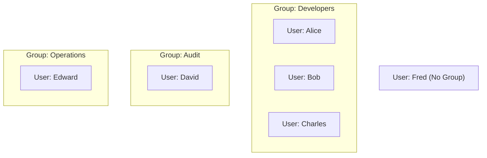

# Bài 11: IAM Introduction: Users, Groups, Policies

- **Phần:** Phần 4: IAM & AWS CLI
- **Lecture ID:** `26097996` (`CCP_-_IAM_-_Users_Groups_Policies.mp4`)
- **Thời lượng:** `03:22`
- **Cheat sheet:** [topics/aws_iam.html](../../topics/aws_iam.html)

---

## 1. Kiến thức trọng tâm (Exam Notes)

> [!TIP]
> **Tóm tắt nhanh dịch vụ AWS IAM (SAA-C03 Cheat Sheet)**
> - **Là gì:** Dịch vụ toàn cầu (Global service) quản lý danh tính người dùng và phân quyền truy cập an toàn vào các tài nguyên AWS.
> - **Dùng khi nào (Use case điển hình trong đề):** Cấp quyền theo nguyên tắc đặc quyền tối thiểu (**Least Privilege**) cho Users/Groups; cấp quyền cho dịch vụ AWS (`EC2`, `Lambda`, `ECS`) truy cập dịch vụ khác (`S3`, `DynamoDB`) mà **không cần lưu Access Keys trong code** bằng **`IAM Roles`**; kiểm toán quyền hạn bằng **IAM Credentials Report** và **IAM Access Advisor**.
> - **Khác gì dịch vụ gần giống:**
>   - **IAM Policies vs. S3 Bucket Policies:** `IAM Policy` gắn vào **Identity** (User/Group/Role); `S3 Bucket Policy` gắn trực tiếp vào tài nguyên S3 (hỗ trợ cấp quyền Cross-Account trực tiếp mà không cần Assume Role hoặc mở Public S3).
>   - **IAM Roles vs. Access Keys:** `IAM Role` cấp **Temporary Credentials** tự động xoay vòng qua STS; `Access Keys` là khóa dài hạn gắn với IAM User.
> - **Điểm hay bị hỏi (Giới hạn, Mặc định, Từ khóa gợi ý):**
>   - **Mặc định:** Mọi hành động (ngoài Root) đều bị **Implicit Deny** cho đến khi có `Allow`; **`Explicit Deny`** luôn ghi đè mọi lệnh `Allow`.
>   - **Giới hạn:** `IAM Groups` **chỉ chứa Users**, không thể chứa Group khác (không hỗ trợ lồng nhau).
>   - **Từ khóa gợi ý:** `"without hardcoding credentials"`, `"grant EC2 access to S3"` $\rightarrow$ **IAM Role**; `"remove unused permissions / last accessed"` $\rightarrow$ **IAM Access Advisor**.

### 1.1. IAM là gì?
- **IAM (Identity and Access Management):** Dịch vụ quản lý danh tính và quyền truy cập trên AWS.
- **Global Service (Dịch vụ toàn cầu):** IAM không phụ thuộc vào từng Region riêng lẻ. Khi tạo Users hoặc Groups trong IAM, chúng có hiệu lực trên toàn bộ các Region.
- **Root Account (Tài khoản gốc):**
  - Được tạo mặc định khi khởi tạo tài khoản AWS lần đầu.
  - **Quy tắc quan trọng:** Chỉ dùng Root Account để thiết lập tài khoản ban đầu (tạo IAM Admin User), sau đó **không sử dụng cho công việc hàng ngày và tuyệt đối không chia sẻ**.

### 1.2. IAM Users & IAM Groups
- **IAM User:** Đại diện cho **1 cá nhân (1 người thật)** trong tổ chức của bạn.
- **IAM Group:** Dùng để nhóm các Users có cùng vai trò lại với nhau (ví dụ: nhóm `Developers` gồm Alice, Bob, Charles; nhóm `Operations` gồm David, Edward; nhóm `Audit` gồm Charles, David).
- **3 quy tắc cốt lõi về Groups (cực kỳ hay hỏi trong đề thi):**
  1. **Groups CHỈ chứa Users**, **KHÔNG THỂ** chứa các Groups khác (không hỗ trợ lồng group).
  2. Một User **không bắt buộc** phải thuộc về một Group (ví dụ: Fred đứng độc lập, dù đây không phải là best practice).
  3. Một User **có thể thuộc về nhiều Groups** cùng lúc (ví dụ: Charles và David vừa thuộc nhóm chuyên môn, vừa thuộc nhóm `Audit`).

### 1.3. IAM Policies & Nguyên tắc Least Privilege
- **IAM Policy:** Một tài liệu định dạng **JSON** mô tả những hành động (API calls) mà một User hoặc toàn bộ thành viên trong một Group được phép (Allow) hoặc bị từ chối (Deny) thực hiện.
  - Ví dụ: Cho phép `ec2:Describe*`, `elasticloadbalancing:Describe*`, `cloudwatch:*`.
- **Least Privilege Principle (Nguyên tắc đặc quyền tối thiểu):**
  - Không cấp cho người dùng nhiều quyền hơn mức họ thực sự cần để làm việc.
  - Giúp ngăn ngừa rủi ro bảo mật và tránh phát sinh chi phí lớn ngoài ý muốn.

---

## 2. Phụ đề chi tiết theo mốc thời gian (Full Transcript & Timestamps)

| Thời gian | Nội dung lời giảng gốc (English) | Bản dịch tiếng Việt sát nghĩa |
| :---: | :--- | :--- |
| `00:00` - `00:31` | Welcome to the first deep dive on an AWS service. The first one is called IAM. So IAM stands for Identity and Access Management. It is a global service because in IAM, we are going to create our users and assign them to group. So we've already used IAM without knowing, when we created an account, we created a root account, and has been created by default. This is the root user of our account. And the only things you should use it for is to set up your account as we'll do it right now. But then you shouldn't use that account anymore, or even share it. | Chào mừng bạn đến với bài tìm hiểu chuyên sâu đầu tiên về dịch vụ AWS: IAM (Identity and Access Management). Đây là một dịch vụ toàn cầu (Global Service), nơi chúng ta tạo người dùng (users) và gán họ vào nhóm (groups). Khi mới tạo tài khoản AWS, tài khoản Root đã được tạo mặc định. Bạn chỉ nên dùng Root user để thiết lập tài khoản ban đầu, sau đó không nên tiếp tục sử dụng hoặc chia sẻ nó. |
| `00:31` - `01:10` | What you should be doing instead, is create users. So you will create users in IAM, and one user represents one person within your organization. And the users can be grouped together if it makes sense. So let's take an example we have an organization with six people. You have Alice, Bob, Charles, David, Edward and Fred. Now Alice, Bob, and Charles they work together. They're all developers. So we're going to create a group called the group developers regrouping Alice, Bob and Charles. And it turns out that David and Edward also work together. So we're going to create an operations group. Now we have two groups within IAM. | Thay vào đó, bạn nên tạo các IAM Users. Mỗi user đại diện cho một người trong tổ chức. Các user có thể được gom vào các nhóm. Ví dụ tổ chức có 6 người: Alice, Bob, Charles, David, Edward và Fred. Alice, Bob và Charles cùng là lập trình viên nên ta tạo nhóm `Developers`. David và Edward làm việc cùng nhau nên ta tạo nhóm `Operations`. |
| `01:10` - `01:51` | Now groups can only contain users, not other groups. So this is something very important to understand. Groups only contain users. Now, some users don't have to belong to a group. For example, Fred right here is alone, he does not correspond to any group. That is not best practice. But it is something you can do in AWS. And also, a user can belong to multiple groups. That means that for example, if you know that Charles and David worked together, and they're part of your audit team, you can create a third group with Charles and David. And as you can see, now, in this example, Charles and David are part of two different groups. | Lưu ý cực kỳ quan trọng: **Groups chỉ có thể chứa Users, không thể chứa các Groups khác**. Ngoài ra, một số user không bắt buộc phải thuộc về nhóm nào (ví dụ Fred đứng một mình — dù không phải là best practice nhưng AWS cho phép). Đồng thời, một user có thể thuộc nhiều nhóm khác nhau (ví dụ tạo thêm nhóm `Audit` gồm Charles và David; lúc này Charles và David thuộc 2 nhóm khác nhau). |
| `01:51` - `02:49` | So why do we create users and why do we create groups? Well, because we want to allow them to use our AWS accounts and to allow them to do so, we have to give them permissions. So users or groups can be assigned what's called a JSON document, called a policy, an IAM policy. So it looks just like this. This is just describing in plain English what a user is allowed to do or what a group and all the users within that group are allowed to do. So in this example, we can see that we allow people to use the EC2 service and do describe on it, to use the Elastic Load Balancing service and to describe on it and to use CloudWatch. Through this JSON document we are allowing our users to use some services in AWS. | Tại sao ta tạo users và groups? Vì ta muốn cấp quyền cho họ sử dụng tài khoản AWS thông qua một tài liệu JSON gọi là **IAM Policy**. Tài liệu này mô tả những gì một user hoặc các thành viên trong group được phép làm (ví dụ: cho phép gọi Describe trên EC2, Describe trên Elastic Load Balancing, và sử dụng CloudWatch). |
| `02:49` - `03:22` | And so in AWS, you don't allow everyone to do everything that would be catastrophic, because a new user could basically launch so many services and they will cost you a lot of money or would be bad for security. So in AWS, you apply a principle called the least privilege principle. So you don't give more permissions than a user needs. Okay, so if a user just needs access to three services, just create a permission for that user. So now we have seen an overview of IAM. Let's go in the next lecture to practice creating users and groups. | Trong AWS, bạn không cho phép mọi người làm mọi thứ vì sẽ gây thảm họa về bảo mật và chi phí. Thay vào đó, bạn áp dụng **nguyên tắc đặc quyền tối thiểu (Least Privilege Principle)**: không cấp nhiều quyền hơn mức người dùng cần. Ở bài tiếp theo, chúng ta sẽ thực hành tạo users và groups. |
