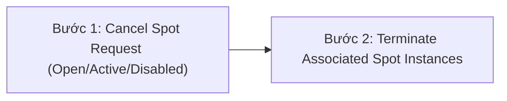

# Bài 45: Spot Instances & Spot Fleet

- **Phần:** Phần 5: EC2 Fundamentals
- **Lecture ID:** `18756818` (`SAA - EC2 - Spot Deep Dive v4.mp4`)
- **Thời lượng:** `08:52`
- **Cheat sheet:** [topics/aws_ec2.html](../../topics/aws_ec2.html)

---

## 1. Kiến thức trọng tâm (Exam Notes)

### 1.1. Cơ chế hoạt động của EC2 Spot Instances
- Giảm giá lên tới **90%** so với On-Demand.
- Bạn định nghĩa một **mức giá Spot tối đa (max spot price)** mà bạn sẵn sàng trả mỗi giờ.
- Chừng nào **giá Spot hiện tại (current spot price)** trong Availability Zone đó còn thấp hơn mức `max price` của bạn, máy ảo sẽ tiếp tục chạy.
- Nếu giá Spot hiện tại vượt quá `max price` của bạn (hoặc AWS hết dung lượng rảnh), AWS sẽ gửi thông báo thu hồi kèm **thời gian ân hạn 2 phút (2 minutes grace period)**:
  - Trong 2 phút này, ứng dụng của bạn cần lưu lại dữ liệu dở dang, ngưng nhận traffic mới và tắt máy an toàn.
  - Bạn có thể chọn hành vi khi bị gián đoạn (**Interruption behavior**): **Stop** (dừng máy) hoặc **Terminate** (xóa máy) *(hoặc Hibernate)*.

---

### 1.2. Hai loại Spot Request & Quy trình hủy Spot Instance (Cực kỳ hay ra thi!)
Một **Spot Request** bao gồm: số lượng instances mong muốn, mức giá tối đa (`max price`), cấu hình khởi chạy (`launch specification` - AMI...), thời hạn hiệu lực (`valid from` -> `valid until`), và **loại yêu cầu (`Request type`)**:

1. **One-time Request (Yêu cầu một lần):**
   - Ngay khi Spot Request được đáp ứng và các Spot Instances được khởi chạy, bản thân **Spot Request sẽ tự động đóng/biến mất**.
2. **Persistent Request (Yêu cầu duy trì liên tục):**
   - Đảm bảo số lượng Spot Instances mong muốn luôn được duy trì trong suốt khoảng thời gian hiệu lực (`valid from` -> `valid until`).
   - Nếu Spot Instance bị dừng (stopped) hoặc bị thu hồi (terminated) do biến động giá, **Spot Request vẫn hoạt động và sẽ tự động khởi chạy lại (relaunch) các Spot Instances mới** ngay khi giá Spot giảm xuống trở lại!

> [!IMPORTANT]
> **Thứ tự đúng để xóa vĩnh viễn một Spot Instance thuộc loại Persistent Request (Rất hay hỏi trong đề thi SAA-C03):**
> - Bạn chỉ có thể hủy (Cancel) một Spot Request khi nó đang ở trạng thái `open`, `active`, hoặc `disabled`.
> - Việc hủy một Spot Request **KHÔNG** tự động xóa các Spot Instances đang chạy.
> - Ngược lại, nếu bạn **Terminate Spot Instance trước** khi hủy Persistent Spot Request, Spot Request sẽ thấy thiếu máy và **tự động tạo lại máy mới**!
> - **Quy trình 2 bước bắt buộc theo đúng thứ tự:**
>   1. **Bước 1:** **Cancel the Spot Request** (Hủy yêu cầu Spot trước để AWS không tự đẻ thêm máy mới).
>   2. **Bước 2:** **Terminate the associated Spot Instances** (Xóa các máy ảo Spot đang chạy).

---

### 1.3. EC2 Spot Fleets & Các chiến lược phân bổ (Allocation Strategies)
- **Định nghĩa:** **Spot Fleet = Tập hợp các Spot Instances + (tùy chọn) On-Demand Instances** nhằm đạt được dung lượng mục tiêu (`target capacity`) dưới ràng buộc ngân sách của bạn.
- Bạn định nghĩa nhiều **Launch Pools** khác nhau (nhiều loại Instance types, OS, Availability Zones khác nhau), và Spot Fleet sẽ tự động chọn các pool tối ưu nhất. Khi đạt tới ngân sách (budget) hoặc đạt đủ dung lượng (capacity), Spot Fleet sẽ ngừng khởi chạy thêm máy.
- **4 chiến lược phân bổ (Allocation Strategies) trong Spot Fleet cần nhớ cho kỳ thi:**
  1. **`lowestPrice`:** Khởi chạy instances từ pool có **giá thấp nhất** -> Tối ưu chi phí tối đa, phù hợp cho **short workloads** (rất hay hỏi trong đề thi!).
  2. **`diversified`:** Phân bổ các Spot Instances trải đều trên **tất cả các pools** đã định nghĩa -> Tuyệt vời cho tính sẵn sàng cao (**Availability**) và **long workloads** (nếu 1 pool bị thu hồi thì các pool khác vẫn chạy).
  3. **`capacityOptimized`:** Chọn pool có **dung lượng trống dồi dào nhất** cho số lượng máy bạn cần -> Giảm thiểu nguy cơ bị thu hồi/gián đoạn.
  4. **`priceCapacityOptimized` *(Khuyến nghị tốt nhất cho đa số workloads)*:** Trước tiên lọc ra các pools có **dung lượng trống cao nhất**, sau đó trong nhóm đó chọn pool có **mức giá thấp nhất**.

---

## 2. Phụ đề chi tiết theo mốc thời gian (Full Transcript & Timestamps)

| Thời gian | Nội dung lời giảng gốc (English) | Bản dịch tiếng Việt sát nghĩa |
| :---: | :--- | :--- |
| `00:00` - `01:13` | With EC2 Spot Instances, you get up to 90% discount compared to On-Demand. You define a **max spot price** you're willing to pay, and you keep the instance as long as the current spot price is below your max price. If the current spot price exceeds your max price, you can choose to **stop or terminate** your instance with a **2-minute grace period** to save state and shut down gracefully. Spot instances are great for batch jobs and data analysis, not critical jobs or databases. | Với EC2 Spot Instances, bạn được giảm giá tới 90% so với On-Demand. Bạn đặt một mức giá tối đa (**max spot price**) và giữ được máy chừng nào giá Spot hiện tại còn thấp hơn mức tối đa đó. Nếu giá Spot vượt quá mức tối đa, máy sẽ bị **stop hoặc terminate** sau **2 phút báo trước (2-minute grace period)** để kịp lưu dữ liệu và đóng kết nối. |
| `01:13` - `03:17` | Looking at the Spot Instance Pricing graph across 6 Availability Zones in `us-east-1` over 3 months, the spot price varies by AZ and fluctuates based on supply and demand, while still offering ~60% savings compared to the `$0.10/hr` On-Demand price. | Nhìn vào biểu đồ lịch sử giá Spot qua 6 Availability Zones tại `us-east-1` trong 3 tháng, giá Spot khác nhau tùy theo từng AZ và biến động theo cung cầu, nhưng nhìn chung khá ổn định và tiết kiệm lớn so với giá On-Demand. |
| `03:17` - `06:01` | A **Spot Request** defines how many instances you want, max price, launch specification (AMI), validity period, and request type: **One-time** or **Persistent**. A **One-time** request launches your instances and then the request disappears. A **Persistent** request stays active during its validity window: if your Spot instances are interrupted or stopped, the Spot request automatically relaunches them when capacity/price allows. Crucially, cancelling a Spot request (must be in `open`, `active`, or `disabled` state) does **not** terminate running instances. Therefore, to permanently terminate persistent Spot instances, you must: **1) First cancel the Spot request, and 2) Then terminate the associated Spot instances.** | Một **Spot Request** có 2 loại: **One-time** (chạy máy xong thì yêu cầu tự đóng) và **Persistent** (duy trì liên tục: nếu máy Spot bị dừng hoặc thu hồi, Spot Request sẽ tự động khởi chạy lại máy mới khi đủ điều kiện giá). Lưu ý quan trọng: việc hủy một Spot Request (khi đang ở trạng thái `open`, `active` hoặc `disabled`) **không** tự động xóa các máy đang chạy. Do đó, để xóa hẳn các Spot Instances dạng Persistent, bạn bắt buộc phải làm theo đúng thứ tự: **1) Hủy Spot Request trước, sau đó 2) Xóa (Terminate) các Spot Instances liên quan.** |
| `06:01` - `08:52` | **Spot Fleets** are a set of Spot Instances and optionally On-Demand Instances that try to meet your target capacity within your price constraints across multiple launch pools (different instance types, OS, AZs). The 4 allocation strategies are: 1) **`lowestPrice`** (launches from the pool with the lowest price — great for cost optimization and short workloads); 2) **`diversified`** (distributes across all defined pools — great for availability and long workloads); 3) **`capacityOptimized`** (chooses pools with optimal capacity to reduce interruptions); and 4) **`priceCapacityOptimized`** (selects pools with highest capacity available first, then picks the lowest price among them — best choice for most workloads). | **Spot Fleet** là tập hợp các Spot Instances và (tùy chọn) On-Demand Instances giúp đạt dung lượng mục tiêu từ nhiều Launch Pools (nhiều loại máy, OS, AZ khác nhau). Có 4 chiến lược phân bổ: 1) **`lowestPrice`** (lấy từ pool có giá rẻ nhất — tối ưu chi phí cho tác vụ ngắn); 2) **`diversified`** (rải đều qua tất cả các pools — tăng tính sẵn sàng cho tác vụ dài); 3) **`capacityOptimized`** (chọn pool có dung lượng trống tốt nhất); và 4) **`priceCapacityOptimized`** (chọn các pools nhiều dung lượng trống nhất rồi chọn pool rẻ nhất trong số đó — lựa chọn tốt nhất cho đa số trường hợp). |
