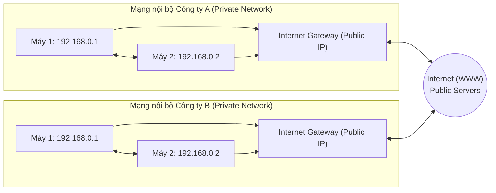

# Bài 47: Private vs Public vs Elastic IP

- **Phần (Section):** Section 6: EC2 - Solutions Architect Associate Level
- **Lecture ID:** `13528052`
- **Video gốc:** `EC2_-_Private_vs_Public_vs_Elastic_IP_v2.mp4`
- **Thời lượng:** `04:42`

---

## 1. Kiến thức trọng tâm (Exam Notes)

> [!TIP]
> **Tóm tắt nhanh dịch vụ — Elastic IP (EIP) (SAA-C03 Cheat Sheet)**
> - **Là gì (1 câu):** Địa chỉ IPv4 công khai tĩnh (Static Public IPv4) thuộc sở hữu của AWS Account, có thể gắn linh hoạt (remapping) giữa các EC2 instances để che giấu lỗi phần cứng.
> - **Dùng khi nào:** Cần một địa chỉ Public IPv4 cố định không đổi khi Stop/Start EC2 instance hoặc khi đối tác yêu cầu whitelist IP cố định trên Firewall, hoặc fail-over nhanh IP sang Standby EC2 instance.
> - **Khác gì dịch vụ gần giống:**
>   - **Elastic IP vs Public IPv4 mặc định:** Public IPv4 mặc định bị mất và đổi sang IP mới mỗi khi EC2 **Stop/Start**; Elastic IP giữ nguyên cố định cho đến khi bạn chủ động Release.
>   - **Elastic IP Failover vs Route 53 / ALB:** AWS khuyến khích dùng DNS (Route 53) hoặc Load Balancer (ALB/NLB) cho kiến trúc lớn thay vì переmap Elastic IP thủ công.
> - **Điểm hay bị hỏi:**
>   - **Giới hạn & Mặc định:** Mặc định tối đa **5 Elastic IPs / Region** (Soft limit, xin tăng được). **Miễn phí** chỉ khi đang gắn vào một EC2 instance đang **Running** và chỉ có **1 EIP** gắn trên instance đó (bị tính phí nếu EIP không gắn vào đâu, gắn vào EC2 đang Stopped, hoặc là EIP thứ 2 trở lên trên cùng instance).
>   - **Từ khóa gợi ý:** `"static public IPv4"`, `"fixed IP address for firewall whitelisting"`, `"rapidly remap IP to standby instance"`.

### 1.1. IPv4 vs IPv6 trên AWS
- **IPv4:** Định dạng phổ biến nhất hiện nay (`[0-255].[0-255].[0-255].[0-255]`), cung cấp khoảng **3.7 tỷ** địa chỉ công cộng trên toàn cầu (ví dụ: `1.160.10.240`).
- **IPv6:** Định dạng mới hơn dùng hệ thập lục phân (`xxxx:xxxx:xxxx:xxxx:xxxx:xxxx:xxxx:xxxx`, ví dụ: `3ffe:1900:4545:3:200:f8ff:fe21:67cf`), giải quyết bài toán cạn kiệt IPv4 và rất phổ biến cho IoT. AWS hỗ trợ cả IPv4 và IPv6, nhưng trong khóa học SAA-C03 trọng tâm chủ yếu xoay quanh **IPv4**.

---

### 1.2. So sánh Public IP, Private IP và Elastic IP

| Tiêu chí | Public IP | Private IP | Elastic IP (EIP) |
| :--- | :--- | :--- | :--- |
| **Phạm vi định danh** | Định danh máy chủ trên toàn mạng **Internet (WWW)**. | Chỉ định danh máy chủ bên trong **mạng nội bộ (Private Network / VPC)**. | Là một **Public IPv4 cố định** thuộc quyền sở hữu của tài khoản AWS của bạn (cho đến khi bạn xóa/release). |
| **Tính duy nhất** | Phải là **duy nhất trên toàn bộ Internet** (không có 2 máy dùng chung 1 Public IP). | Phải là duy nhất trong mạng nội bộ đó, nhưng **2 mạng riêng khác nhau (2 công ty)** có thể dùng trùng dải Private IP. | Duy nhất trên toàn bộ Internet. |
| **Khi Stop & Start EC2** | **Thay đổi** sang một Public IP mới (nếu Reboot thì giữ nguyên). | **Giữ nguyên** (không thay đổi). | **Giữ nguyên** địa chỉ Public IPv4 cố định. |
| **Đặc điểm bổ sung** | Có thể tra cứu vị trí địa lý (Geolocation) dễ dàng. | Kết nối ra Internet thông qua **NAT Device + Internet Gateway** đóng vai trò proxy. Chỉ các dải IP quy định mới được dùng làm Private IP (`10.0.0.0/8`, `172.16.0.0/12`, `192.168.0.0/16`). | Chỉ gắn cho **1 EC2 instance tại một thời điểm**. Giới hạn mặc định **5 Elastic IP / Region** (có thể xin tăng). |

---

### 1.3. Kiến thức quan trọng về Elastic IP cho kỳ thi SAA-C03
- **Mục đích sử dụng:**
  1. Giữ **Public IPv4 cố định** cho EC2 instance qua các lần Stop/Start.
  2. **Che giấu lỗi (Mask the failure)** của một EC2 instance hoặc phần mềm bằng cách nhanh chóng tháo và chuyển (remap) Elastic IP từ instance bị lỗi sang một instance dự phòng khác.
- **Lưu ý thiết kế kiến trúc (Best Practice):**
  - Stéphane khuyến nghị **hạn chế dùng Elastic IP** vì nó thường phản ánh thiết kế kiến trúc kém linh hoạt.
  - **Giải pháp thay thế tốt hơn:**
    1. Sử dụng Public IP ngẫu nhiên và đăng ký một tên miền **DNS (Amazon Route 53)** trỏ vào đó.
    2. Đặt các EC2 instances đằng sau một **Load Balancer (ELB)** và không sử dụng Public IP trực tiếp trên EC2.
- **Mặc định trên EC2:**
  - EC2 đi kèm 1 **Private IP** cho mạng nội bộ AWS và (nếu bật) 1 **Public IP** cho Internet.
  - Khi **SSH** từ máy cá nhân vào EC2 qua Internet (không có VPN), bạn **bắt buộc phải dùng Public IP** (không dùng được Private IP).

---

## 2. Phụ đề chi tiết theo mốc thời gian (Full Transcript & Timestamps)

| Thời gian | Nội dung lời giảng gốc (English) | Bản dịch tiếng Việt sát nghĩa |
| :--- | :--- | :--- |
| `00:00:00` | Okay, so we're getting into the very interesting concept of Private and Public IP. | Được rồi, bây giờ chúng ta sẽ bước vào khái niệm rất thú vị về Địa chỉ IP Riêng tư (Private IP) và Địa chỉ IP Công cộng (Public IP). |
| `00:00:04` | That may be too basic for you, I'm sorry that is, but some people need help with this so I rather help everyone. | Điều này có thể quá cơ bản đối với bạn, tôi xin lỗi nếu đúng như vậy, nhưng một số người cần trợ giúp về phần này nên tôi muốn giúp đỡ tất cả mọi người. |
| `00:00:09` | So networking is to sort of have IP, there is IPv4 and IPv6. | Trong mạng máy tính chúng ta có các địa chỉ IP, bao gồm IPv4 và IPv6. |
| `00:00:13` | IPv4 is what is most common probably, you know already it's basically four numbers separated by three dots. | IPv4 có lẽ là thứ phổ biến nhất mà bạn đã biết, về cơ bản nó gồm 4 con số cách nhau bởi 3 dấu chấm. |
| `00:00:19` | IPv6 is a bit less common, it has this very long, strange string of exotic symbol numbers, and letters | IPv6 ít phổ biến hơn một chút, nó có một chuỗi rất dài và lạ gồm các ký hiệu, chữ số và chữ cái, |
| `00:00:26` | and basically, in this course, we'll be using just IPv4, but know that AWS has support for IPv6 as well. | và về cơ bản, trong khóa học này chúng ta sẽ chỉ sử dụng IPv4, nhưng hãy biết rằng AWS cũng hỗ trợ đầy đủ IPv6. |
| `00:00:33` | IPv4 right now is still the most common format used online. IPv6 is more for IoT or the Internet of Things | IPv4 hiện tại vẫn là định dạng phổ biến nhất được dùng trực tuyến. IPv6 thiên về IoT (Internet vạn vật) hơn |
| `00:00:40` | and basically, it solves a lot of problems but not for us we don't have any problems with IPv4 so far. | và về cơ bản nó giải quyết được rất nhiều vấn đề, nhưng với chúng ta hiện tại thì chưa gặp vấn đề gì với IPv4 cả. |
| `00:00:45` | IPv4 allows for 3.7 billion different addresses in a public space and that's almost running out of IP addresses, and basically, each number can vary | IPv4 cho phép 3,7 tỷ địa chỉ khác nhau trong không gian công cộng và kho địa chỉ này gần như đang cạn kiệt; về cơ bản mỗi con số có thể thay đổi |
| `00:00:54` | between zero and 255 each, where the dots so if you do the math, you get 3.7 billion different addresses. | trong khoảng từ 0 đến 255 giữa các dấu chấm, nên nếu bạn làm phép tính nhân, bạn sẽ có khoảng 3,7 tỷ địa chỉ khác nhau. |
| `00:01:02` | Now, let's have an example of what that means if you have a web server and it's public, | Bây giờ hãy lấy một ví dụ về ý nghĩa của nó: nếu bạn có một máy chủ web và nó ở chế độ công khai (public), |
| `00:01:06` | that could be our EC2 instance or have a public IP and we can have another server with another public IP | đó có thể là EC2 instance của chúng ta mang một Public IP, và chúng ta có thể có một máy chủ khác với một Public IP khác, |
| `00:01:12` | and using the public IP, these servers can talk to one another, which is great. | và bằng cách sử dụng Public IP, các máy chủ này có thể giao tiếp với nhau, rất tuyệt vời. |
| `00:01:17` | Now, when we have a company, for example, my company and it has a private network, the private network, basically | Bây giờ, khi chúng ta có một công ty, ví dụ công ty của tôi và nó có một mạng nội bộ (private network), mạng nội bộ đó về cơ bản |
| `00:01:24` | has a private IP range, and private IPs have this very specific way of being defined | có một dải địa chỉ IP riêng (Private IP range), và các Private IP có cách định nghĩa rất cụ thể, |
| `00:01:30` | but basically, that means that all the computers within that private network can talk to one another using the private IP. | nhưng về cơ bản điều đó có nghĩa là tất cả các máy tính bên trong mạng nội bộ đó có thể giao tiếp với nhau bằng Private IP. |
| `00:01:37` | Whereas, when you touch an internet gateway, which is a public gateway, well, these instances also will get access to other servers, and so on | Trong khi đó, khi bạn kết nối qua một Internet Gateway (một cổng công cộng), các máy chủ này cũng sẽ truy cập được tới các máy chủ khác bên ngoài, v.v. |
| `00:01:45` | and so that's a common pattern in AWS. | và đó là một mô hình rất phổ biến trong AWS. |
| `00:01:47` | Now, basically, if you have another company it will also have a private network and within the private network, | Tương tự, nếu bạn có một công ty khác, họ cũng sẽ có một mạng nội bộ riêng và bên trong mạng nội bộ đó, |
| `00:01:53` | every computer can talk to one another and maybe also have an internet gateway with an IP | mọi máy tính có thể nói chuyện với nhau và có thể cũng có một Internet Gateway mang địa chỉ IP công cộng |
| `00:01:59` | and basically can connect all over the internet and talk to other servers, okay. | để kết nối ra toàn mạng Internet và giao tiếp với các máy chủ khác. |
| `00:02:03` | So basically, the difference I wanna show you is that when you have a public IP, you're accessible over the internet and when you have a private IP | Tóm lại, sự khác biệt mà tôi muốn chỉ cho bạn thấy là: khi bạn có Public IP, bạn có thể được truy cập qua Internet; còn khi bạn chỉ có Private IP, |
| `00:02:10` | you only accessible within your private network. | bạn chỉ có thể được truy cập bên trong mạng nội bộ của mình mà thôi. |
| `00:02:14` | So some differences, public IP, as I said, means that the machine can be identified on the internets, and the public IP must be unique | Một số điểm khác biệt: Public IP như tôi đã nói nghĩa là máy chủ có thể được nhận diện trên Internet, và Public IP bắt buộc phải là duy nhất |
| `00:02:21` | across the whole web, so not two machines can have the same public IP, and I think that makes sense. | trên toàn bộ mạng web, tức là không thể có hai máy tính nào có cùng một Public IP, điều này hoàn toàn hợp lý. |
| `00:02:26` | And an IP usually gives you an IP, you can just Google it and you can find a geolocation. | Và với một địa chỉ Public IP, bạn chỉ cần tra Google là có thể tìm ra vị trí địa lý (geolocation) của nó. |
| `00:02:31` | Whereas a private IP, it means that the machine can only be identified on the private network only and the IP | Ngược lại, Private IP có nghĩa là máy chủ chỉ có thể được nhận diện trên mạng nội bộ mà thôi, và địa chỉ IP đó |
| `00:02:37` | must be unique only across the private network but two different private networks | chỉ cần duy nhất trong phạm vi mạng nội bộ đó; còn hai mạng nội bộ khác nhau |
| `00:02:42` | so two different companies can have the same private IP that is absolutely not problem. | (tức hai công ty khác nhau) hoàn toàn có thể sử dụng cùng một địa chỉ Private IP mà không gặp bất kỳ vấn đề gì. |
| `00:02:46` | And machines, when they're on the private network they will connect to the Internet through a NAT device | Và các máy chủ khi nằm trong mạng nội bộ sẽ kết nối ra Internet thông qua một thiết bị NAT (NAT device) |
| `00:02:52` | and an internet gateway that will act as a proxy. | cùng với một Internet Gateway đóng vai trò như một proxy. |
| `00:02:54` | And finally, only a specified range of IPs can be used as private IPs. | Và cuối cùng, chỉ một số dải IP được quy định cụ thể mới được phép sử dụng làm Private IP. |
| `00:03:00` | Finally, for Elastic IPs, basically when you start and you stop an EC2 instance, it will change its public IP and we'll see this in the hands on. | Cuối cùng là về Elastic IP: về cơ bản khi bạn dừng (Stop) rồi khởi động lại (Start) một EC2 instance, nó sẽ bị đổi địa chỉ Public IP, và chúng ta sẽ thấy điều này trong bài thực hành. |
| `00:03:08` | And if you have a fixed public IP for whatever reason for your instance, what you are going to need is something called an Elastic IP. | Và nếu vì lý do nào đó bạn cần một địa chỉ Public IP cố định cho instance của mình, thứ bạn cần chính là một Elastic IP. |
| `00:03:15` | So the Elastic IP is what, it's a public IPv4 and you own it, as long as you don't delete it. | Vậy Elastic IP là gì? Nó là một địa chỉ Public IPv4 cố định và bạn sở hữu nó chừng nào bạn chưa xóa (release) nó đi. |
| `00:03:21` | Basically, you can attach it to one instance at a time only obviously, and basically, | Về cơ bản, hiển nhiên bạn chỉ có thể gắn nó vào một instance tại một thời điểm, |
| `00:03:25` | when you have an IP address and it's elastic, you can basically use it to mask the failure of an instance or software, by basically quickly moving it | và khi bạn có một địa chỉ Elastic IP, bạn có thể dùng nó để che giấu sự cố (mask the failure) của một instance hoặc phần mềm bằng cách nhanh chóng chuyển địa chỉ IP đó |
| `00:03:33` | from one instance to another, but it's quite an uncommon pattern, because you can only have five Elastic IP in your accounts. | từ instance này sang instance khác; tuy nhiên đây là một mô hình khá ít gặp vì mặc định bạn chỉ có tối đa 5 Elastic IP trong tài khoản (mỗi Region). |
| `00:03:40` | Now, you can ask to AWS to increase that but it's quite rare to use them. | Bạn có thể yêu cầu AWS tăng giới hạn này lên, nhưng thực tế khá hiếm khi dùng cách đó. |
| `00:03:45` | Overall, I would recommend to try avoiding using Elastic IP, they're often referred very poor architectural decisions | Nhìn chung, tôi khuyên bạn nên tránh sử dụng Elastic IP vì chúng thường phản ánh các quyết định kiến trúc kém tối ưu, |
| `00:03:52` | and instead, you should use a random public IP and assign a DNS name to it. | và thay vào đó, bạn nên dùng một Public IP ngẫu nhiên rồi gán một tên miền DNS cho nó. |
| `00:03:56` | Now DNS, we'll see them route 53 and is something that's gonna be much more in control for us | Về DNS, chúng ta sẽ tìm hiểu trong phần Route 53, đó là công cụ giúp chúng ta kiểm soát tốt hơn nhiều |
| `00:04:01` | and much more scalable, or later, as we'll see, we can also use a Load Balancer and not using public IP at all, which is the best pattern you can have for AWS. | và có khả năng mở rộng cao hơn nhiều; hoặc sau này như chúng ta sẽ thấy, chúng ta có thể dùng Load Balancer và hoàn toàn không cần dùng Public IP trên EC2 nữa — đó là mô hình tốt nhất trên AWS. |
| `00:04:12` | Now, let's go ahead and do a quick Hands On, so we can get a good feeling for all these things. | Bây giờ hãy cùng làm một bài thực hành nhanh để nắm rõ cảm giác thực tế về tất cả những khái niệm này. |
| `00:04:16` | By default, our EC2 machine will come with a private IP for the internal AWS Network, | Mặc định, máy ảo EC2 của chúng ta sẽ đi kèm một Private IP dành cho mạng nội bộ AWS, |
| `00:04:21` | a public IP, for the WWW, so the World Wide Web and then when we're doing SSH into our EC2 machines | một Public IP dành cho mạng WWW (World Wide Web), và khi chúng ta thực hiện kết nối SSH vào các máy EC2, |
| `00:04:27` | we cannot use a private IP because we're not on the same network, unless you have a VPN. | chúng ta không thể sử dụng Private IP vì chúng ta không nằm chung một mạng nội bộ, trừ khi bạn có kết nối VPN. |
| `00:04:31` | We can only use the public IP if you don't have a VPN and if your machine is stopped and started, the public IP can change. | Chúng ta chỉ có thể dùng Public IP nếu không có VPN, và nếu máy chủ của bạn bị dừng (Stopped) rồi bật lại (Started), địa chỉ Public IP sẽ thay đổi. |
| `00:04:39` | So now let's go and observe all these behaviors. | Bây giờ hãy cùng đi quan sát tất cả các hành vi này trong thực tế. |
