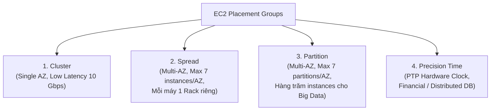

# Bài 49: EC2 Placement Groups

- **Phần (Section):** Section 6: EC2 - Solutions Architect Associate Level
- **Lecture ID:** `13528080`
- **Video gốc:** `SAA - EC2 - Placement Groups v5.mp4`
- **Thời lượng:** `06:55`
- **Cheat sheet:** [topics/aws_ec2.html](../../topics/aws_ec2.html)

---

## 1. Kiến thức trọng tâm (Exam Notes)

> [!TIP]
> **Tóm tắt nhanh dịch vụ — EC2 Placement Groups (SAA-C03 Cheat Sheet)**
> - **Là gì (1 câu):** Cơ chế kiểm soát cách AWS sắp xếp vị trí vật lý của các EC2 instances trên phần cứng hạ tầng nhằm tối ưu hiệu năng mạng hoặc giảm thiểu rủi ro lỗi phần cứng đồng thời.
> - **Dùng khi nào:** Cần độ trễ mạng cực thấp và băng thông 10 Gbps+ cho bài toán HPC (**Cluster**), cần cách ly tuyệt đối tối đa 7 instances trọng yếu mỗi AZ trên các rack khác nhau (**Spread**), hoặc chạy hệ thống phân tán hàng trăm nodes như Hadoop/Kafka/Cassandra tách biệt theo nhóm rack (**Partition**).
> - **Khác gì dịch vụ gần giống:**
>   - **Cluster vs Spread vs Partition:** **Cluster** gom chung 1 rack/1 AZ (mạng nhanh nhất, rủi ro sập cả cụm); **Spread** mỗi máy nằm trên 1 rack riêng biệt (tối đa 7 máy/AZ); **Partition** chia AZ thành tối đa 7 partitions độc lập, mỗi partition chứa hàng trăm EC2 (Hadoop/Kafka rack-aware).
> - **Điểm hay bị hỏi:**
>   - **Giới hạn & Mặc định:** **Spread** giới hạn cứng **7 running instances / AZ / group**. **Partition** tối đa **7 partitions / AZ**, hỗ trợ hàng trăm EC2. **Cluster** chỉ nằm trong **1 AZ duy nhất**.
>   - **Từ khóa gợi ý:** `"HPC / low latency / 10 Gbps network"` (Cluster), `"critical instances isolated on separate hardware / max 7 per AZ"` (Spread), `"HDFS / HBase / Cassandra / Kafka / hundreds of instances / rack-aware"` (Partition).

### 1.1. Tổng quan về EC2 Placement Groups
- **Mục đích:** Cho phép bạn kiểm soát cách thức các **EC2 instances được bố trí (placed)** trên hạ tầng phần cứng vật lý của AWS. Bạn không tương tác trực tiếp với phần cứng AWS, nhưng bạn chỉ định **chiến lược bố trí (placement strategy)** để tối ưu hóa hiệu năng mạng hoặc giảm thiểu rủi ro lỗi phần cứng.
- Có **4 chiến lược Placement Group**:
  1. **Cluster** — Gom các instances lại gần nhau trong một thiết lập phần cứng độ trễ thấp (low-latency) thuộc **cùng 1 Availability Zone (Single AZ)**.
  2. **Spread** — Trải các instances ra các phần cứng vật lý hoàn toàn khác nhau (giới hạn **7 instances / AZ / group**).
  3. **Partition** — Trải các instances qua nhiều **partitions** (mỗi partition là một tập hợp các tủ rack phần cứng riêng biệt) trong một hoặc nhiều AZ; mở rộng tới **hàng trăm EC2 instances**.
  4. **Precision Time** — Đặt các EC2 instances trên phần cứng có quyền truy cập trực tiếp vào nguồn thời gian độ chính xác cao (**PTP Hardware Clock / Amazon Time Sync Service**).

---

### 1.2. Bảng so sánh chi tiết các loại Placement Groups (Trọng tâm thi SAA-C03)

| Tiêu chí | 1. Cluster Placement Group | 2. Spread Placement Group | 3. Partition Placement Group | 4. Precision Time Placement Group |
| :--- | :--- | :--- | :--- | :--- |
| **Cách thức bố trí** | Các EC2 nằm sát nhau trên cùng rack / cùng **1 AZ duy nhất (Single AZ)**. | Mỗi EC2 nằm trên **một phần cứng vật lý (rack) riêng biệt**, có thể trải qua nhiều AZ. | Mỗi Partition đại diện cho **1 tủ rack vật lý riêng biệt** (không dùng chung rack với partition khác). Trải qua nhiều AZ. | Đặt EC2 trên phần cứng có kết nối trực tiếp tới nguồn đồng hồ độ chính xác cao. |
| **Ưu điểm (Pros)** | Mạng cực nhanh (**10 Gbps** bandwidth với Enhanced Networking), **độ trễ cực thấp (low latency)**, thông lượng cao. | Giảm thiểu tối đa rủi ro lỗi đồng thời (simultaneous failure). Cách ly lỗi ở mức từng instance. | Cách ly lỗi theo từng tủ rack (Partition failure isolation). Mở rộng tới **hàng trăm EC2 instances** mỗi group. | Đồng bộ thời gian chính xác hơn nhiều so với NTP tiêu chuẩn (Amazon Time Sync Service, PTP hardware clock, hardware packet timestamping). |
| **Nhược điểm / Giới hạn (Cons)** | **Rủi ro cao (Single Point of Failure):** Nếu AZ đó gặp sự cố, toàn bộ EC2 trong Cluster sẽ sập cùng lúc. | Giới hạn cứng: **Tối đa 7 instances / AZ / placement group**. | Các EC2 trong cùng 1 partition có thể bị lỗi cùng nhau nếu rack đó hỏng. **Tối đa 7 partitions / AZ**. EC2 truy vấn số thứ tự partition qua **Instance Metadata**. | Chỉ dành cho các bài toán đặc thù cần độ chính xác thời gian cực cao. |
| **Use Cases điển hình trong đề thi** | - **HPC (High Performance Computing)** - Big Data job cần hoàn thành cực nhanh - Ứng dụng cần độ trễ mạng cực thấp giữa các node. | - **Critical Applications** (ứng dụng sống còn) - Cần **Maximize High Availability** mà số lượng máy nhỏ (≤ 7 máy/AZ). | - Ứng dụng phân tán lớn biết nhận diện partition (**Partition-aware**): **HDFS, HBase, Apache Cassandra, Apache Kafka**. | - **Distributed Databases** - **Financial timestamping** (giao dịch tài chính) - **Event ordering**. |

---

## 2. Phụ đề chi tiết theo mốc thời gian (Full Transcript & Timestamps)

| Thời gian | Nội dung lời giảng gốc (English) | Bản dịch tiếng Việt sát nghĩa |
| :--- | :--- | :--- |
| `00:00:00` | So, now let's talk about placement groups. Placement groups are a little bit more advanced, | Bây giờ chúng ta hãy nói về Placement Groups. Placement Groups là một khái niệm nâng cao hơn một chút, |
| `00:00:03` | and we want to use them once we want to have control over how our EC2 instances are going to be placed within the AWS infrastructure. | và chúng ta sử dụng chúng khi muốn kiểm soát cách các EC2 instances được sắp xếp vị trí bên trong hạ tầng của AWS. |
| `00:00:12` | So, that strategy can be defined using these placement groups. | Chiến lược sắp xếp đó có thể được định nghĩa thông qua các Placement Groups này. |
| `00:00:15` | So, we don't get direct interaction with the hardware of AWS, | Chúng ta không tương tác trực tiếp với phần cứng của AWS, |
| `00:00:19` | but we let AWS know how we would like our EC2 instance to be placed compared to one another. | nhưng chúng ta cho AWS biết cách chúng ta muốn các EC2 instances được đặt tương quan với nhau như thế nào. |
| `00:00:25` | So, when you create a placement group, you have three strategies available for you. | Khi bạn tạo một Placement Group, bạn có các chiến lược chính sau đây. |
| `00:00:30` | You have the cluster placement group, in which your instances will be grouped together in a low latency hardware setup within a single availability zone. | Đầu tiên là **Cluster Placement Group**, nơi các instances của bạn được gom cụm lại với nhau trong một thiết lập phần cứng độ trễ thấp bên trong một Availability Zone duy nhất. |
| `00:00:41` | This is going to give you high performance, but high risk. We'll see this in details in a second. | Chiến lược này mang lại cho bạn hiệu năng cao nhưng đi kèm rủi ro cao. Chúng ta sẽ xem chi tiết ngay sau đây. |
| `00:00:44` | Spread means that your instances are going to be spread across different hardware. | Chiến lược **Spread** có nghĩa là các instances của bạn sẽ được phân tán ra các phần cứng vật lý khác nhau. |
| `00:00:49` | And that is a restriction on this that means you can only have seven EC2 instance per placement group that's spread per AZ. | Có một giới hạn ở đây là bạn chỉ có thể có tối đa 7 EC2 instances cho mỗi Spread Placement Group trên mỗi AZ. |
| `00:00:56` | So, you would use a spread placement group when you have critical applications. | Bạn sẽ sử dụng Spread Placement Group khi bạn có các ứng dụng quan trọng sống còn (critical applications). |
| `00:01:01` | Finally, the last one is a new kind of placement group that is really helpful. It's called partition. | Tiếp theo là một loại Placement Group rất hữu ích được gọi là **Partition**. |
| `00:01:06` | It's similar to the spread, meaning that you want to spread your instances, but here they're spread across many different partitions. | Nó tương tự như Spread ở chỗ bạn muốn phân tán các instances của mình ra, nhưng ở đây chúng được phân tán qua nhiều phân vùng (partitions) khác nhau. |
| `00:01:13` | And these partitions rely on different sets of racks of hardware within an AZ. | Và các partitions này nằm trên các tập hợp tủ rack phần cứng khác nhau bên trong một AZ. |
| `00:01:19` | What does that mean is that they're still spread, but they're not isolated one from another failure, but a partition should be isolated from another partition of failure. | Điều đó có nghĩa là chúng vẫn được phân tán: các máy trong cùng một partition không cách ly lỗi với nhau, nhưng mỗi partition sẽ được cách ly hoàn toàn khỏi sự cố của một partition khác. |
| `00:01:27` | The idea with this is that you can scale to hundreds of EC2 instances per group and that allows you to run applications such as Hadoop, Cassandra, or Kafka. | Ý tưởng của mô hình này là bạn có thể mở rộng quy mô lên tới hàng trăm EC2 instances mỗi nhóm, cho phép chạy các ứng dụng lớn như Hadoop, Cassandra hoặc Kafka. |
| `00:01:36` | Finally, you have precision time, which gives you direct access to high precision time sources. | Cuối cùng, bạn có **Precision Time**, cung cấp quyền truy cập trực tiếp vào các nguồn thời gian có độ chính xác cao. |
| `00:01:42` | Now let's have a look into each of these placement groups in details. | Bây giờ hãy cùng đi sâu vào chi tiết từng loại Placement Group này. |
| `00:01:46` | So next we have the cluster placement group and all your EC2 instances are going to be in the same availability zone. | Đầu tiên là **Cluster Placement Group**: tất cả các EC2 instances của bạn sẽ nằm trong cùng một Availability Zone (cùng một tủ rack/nhóm phần cứng). |
| `00:01:55` | So why do we do this? Well, this particular placement group gives you great networking. | Tại sao chúng ta lại làm vậy? Bởi vì loại Placement Group này mang lại hiệu năng mạng tuyệt vời. |
| `00:02:02` | So you have around 10 gigabits per second of bandwidth between all these instances that will have enhanced networking enabled. | Bạn nhận được băng thông khoảng 10 Gbps giữa tất cả các instances này khi bật tính năng Enhanced Networking. |
| `00:02:11` | And so you get low latency, high throughput network, and the idea is that out of this you can get great performance for any kind of computational job. | Nhờ đó bạn có được mạng độ trễ thấp (low latency), thông lượng cao (high throughput), mang lại hiệu năng tuyệt vời cho bất kỳ tác vụ tính toán nặng nào. |
| `00:02:20` | So a drawback of using this architecture is that if your availability zone fails, then all the instances will fail at the same time. | Nhược điểm của kiến trúc này là nếu Availability Zone hoặc tủ rack đó gặp sự cố, tất cả các instances sẽ bị sập cùng một lúc. |
| `00:02:29` | But usually for use case, this is fine. So the use cases for this kind of placement group are big data jobs that need to complete very fast with very high networking | Nhưng thông thường đối với mục đích sử dụng của nó thì điều này chấp nhận được. Các trường hợp sử dụng (use cases) của Cluster Placement Group là các tác vụ Big Data cần hoàn thành cực nhanh với băng thông mạng rất cao, |
| `00:02:40` | or applications that need extremely low latency and high throughput network between each instance of your application. | hoặc các ứng dụng đòi hỏi độ trễ cực thấp và thông lượng mạng cao giữa các máy chủ trong ứng dụng. |
| `00:02:49` | Now spread is the complete opposite and spread want to minimize the failure risk. | Ngược lại hoàn toàn là **Spread Placement Group** — chiến lược muốn giảm thiểu tối đa rủi ro sập hệ thống. |
| `00:02:53` | And so in this case, when we ask for spread placement group, all the EC2 instances are going to be located on different hardware. | Trong trường hợp này, khi chúng ta yêu cầu một Spread Placement Group, tất cả các EC2 instances sẽ được đặt trên các phần cứng vật lý hoàn toàn khác nhau. |
| `00:03:01` | So you can see here we have three AZ and we have six EC2 and each EC2 instance is on a different hardware. | Như trên sơ đồ bạn thấy chúng ta có 3 AZ và 6 máy EC2, và mỗi máy EC2 đều nằm trên một phần cứng vật lý riêng biệt. |
| `00:03:08` | So what does that mean? Well, what we get is that we can span across multiple AZ and there is a reduced risk of simultaneous failure. | Điều đó có ý nghĩa gì? Chúng ta có thể trải rộng qua nhiều AZ (Multi-AZ) và giảm thiểu rủi ro các máy bị lỗi đồng thời. |
| `00:03:16` | Why? Well, because if my hardware one fails, I'm pretty sure my hardware two will not fail. | Tại sao? Bởi vì nếu phần cứng số 1 bị hỏng, tôi khá chắc chắn rằng phần cứng số 2 sẽ không bị hỏng cùng lúc. |
| `00:03:21` | And so we've separated the risk of my two instances in the us-east-1a to fail at the same time. And so that's the benefit from it. | Như vậy chúng ta đã tách biệt được rủi ro để hai instances nằm trong cùng `us-east-1a` không bị chết cùng một thời điểm. Đó chính là lợi ích của nó. |
| `00:03:30` | The con is that from this configuration, we're limited to seven instances per AZ per placement group. | Nhược điểm của cấu hình này là chúng ta bị giới hạn tối đa 7 instances trên mỗi AZ cho mỗi Placement Group. |
| `00:03:36` | So there is a limit to how big your placement group can be and so you need to have an application that's going to be of good size but not too big. | Tức là có giới hạn về quy mô của nhóm, nên nó phù hợp với các ứng dụng có quy mô vừa phải chứ không quá lớn. |
| `00:03:44` | The use case would be an application that needs to maximize high availability and reduce the risk and in general for critical applications | Trường hợp sử dụng điển hình là các ứng dụng cần tối đa hóa tính sẵn sàng cao (High Availability) và giảm thiểu rủi ro, nhìn chung là các ứng dụng trọng yếu (critical applications) |
| `00:03:52` | where your instance failures must be isolated from one another. Remember here we have a limitation of seven instances per AZ per placement group. | nơi sự cố của từng instance bắt buộc phải được cô lập hoàn toàn với nhau. Hãy nhớ kỹ giới hạn 7 instances / AZ / placement group. |
| `00:04:02` | Now for the partition placement group, we can have instances spread across partitions in multiple availability zones. | Tiếp theo, đối với **Partition Placement Group**, chúng ta có thể phân tán các instances qua nhiều phân vùng (partitions) nằm trên nhiều Availability Zones. |
| `00:04:09` | So we can have up to seven partitions per AZ. So in this example, we have partition one and partition two in US East 1A and partition three in US East 1B. | Chúng ta có thể có tối đa **7 partitions trên mỗi AZ**. Trong ví dụ này, chúng ta có Partition 1 và Partition 2 ở `us-east-1a`, và Partition 3 ở `us-east-1b`. |
| `00:04:20` | And on each partition you can have many EC2 instances. So in the first one I have four and the second one I have four and the third one have four as well. | Và bên trong mỗi partition, bạn có thể chạy rất nhiều EC2 instances. Ví dụ ở partition thứ nhất tôi có 4 máy, partition thứ hai có 4 máy và partition thứ ba cũng có 4 máy. |
| `00:04:27` | So why do we use a partition placement group? Well, each partition represents a rack in AWS. | Tại sao chúng ta lại dùng Partition Placement Group? Bởi vì mỗi một partition đại diện cho một tủ rack vật lý trong AWS. |
| `00:04:33` | And so by having many partitions, you're making sure that your instances are distributed across many hardware racks and so therefore they're safe from a rack failure from one another. | Nhờ việc chia thành nhiều partitions, bạn đảm bảo rằng các instances của mình được phân bổ qua nhiều tủ rack phần cứng khác nhau và do đó an toàn trước sự cố hỏng tủ rack của nhau. |
| `00:04:43` | So you can have up to seven partitions per AZ and these partitions can span across multiple availability zones in the same region. | Bạn có thể có tối đa 7 partitions mỗi AZ và các partitions này có thể trải rộng qua nhiều AZ trong cùng một Region. |
| `00:04:52` | You can get up to hundreds of EC2 instances with a setup. So this is a difference versus the spread type of placement group. | Bạn có thể mở rộng lên tới hàng trăm EC2 instances với thiết lập này — đây chính là điểm khác biệt lớn so với Spread Placement Group. |
| `00:05:00` | And as I said, the instances in the partition do not share the same hardware physical rack with the instances in the other partitions and therefore each partition is isolated from failure. | Và như tôi đã nói, các instances trong một partition không dùng chung tủ rack vật lý với các instances ở các partitions khác, do đó mỗi partition được cô lập khỏi lỗi phần cứng của nhau. |
| `00:05:12` | So that means that yes, if one goes down, if partition goes down the partition number two, then partition number one should be fine. | Nghĩa là nếu Partition số 2 bị sập do lỗi nguồn/rack, thì Partition số 1 vẫn hoạt động bình thường. |
| `00:05:20` | And to know which partition these EC2 instances are on, there is an option to access this information as with using the metadata service. | Và để biết một EC2 instance đang nằm ở partition nào, ứng dụng có thể truy vấn thông tin này thông qua dịch vụ **EC2 Instance Metadata**. |
| `00:05:32` | So when would you use a partition placement group? Well, when you have an application that it can be partition aware to distribute the data and your servers across partitions | Vậy khi nào bạn dùng Partition Placement Group? Khi bạn có một ứng dụng có khả năng nhận biết phân vùng (partition-aware) để phân bổ dữ liệu và các bản sao (replicas) qua các partitions khác nhau, |
| `00:05:40` | and usually the use cases are going to be big data applications which are partition aware such as using HDFS, HBase, Cassandra and Apache Kafka. | và thông thường các trường hợp sử dụng sẽ là các ứng dụng Big Data hỗ trợ partition-aware như **HDFS, HBase, Cassandra và Apache Kafka**. |
| `00:05:51` | So for the precision time placement group, the idea is that you want to place your EC2 instances on underlying hardware with direct access to high precision time sources. | Cuối cùng, đối với **Precision Time Placement Group**, ý tưởng là bạn muốn đặt các EC2 instances của mình trên phần cứng vật lý có kết nối trực tiếp tới các nguồn thời gian độ chính xác cao. |
| `00:06:02` | What does that mean? That means that the clock of your underlying Linux, for example, will be connected to the Amazon time sync service, | Điều đó có nghĩa là gì? Nghĩa là đồng hồ hệ thống Linux của bạn sẽ được kết nối với **Amazon Time Sync Service**, |
| `00:06:09` | which is going to give you a time that is much more accurate than the standard NTP. | cung cấp cho bạn thời gian chính xác hơn rất nhiều so với giao thức NTP tiêu chuẩn. |
| `00:06:15` | Also, you have access to a PTP hardware clock and hardware packet timestamping. | Ngoài ra, bạn còn có quyền truy cập vào đồng hồ phần cứng PTP (PTP hardware clock) và tính năng đóng dấu thời gian gói tin bằng phần cứng (hardware packet timestamping). |
| `00:06:19` | So the idea is that you have very, very, very precise time on these instances, which is good only for some very specific applications | Nhờ vậy bạn có được thời gian cực kỳ chính xác trên các instances này, điều rất hữu ích cho một số ứng dụng đặc thù |
| `00:06:31` | such as distributed databases, financial timestamping or event ordering. | chẳng hạn như cơ sở dữ liệu phân tán (distributed databases), đóng dấu thời gian giao dịch tài chính (financial timestamping) hoặc sắp xếp thứ tự sự kiện (event ordering). |
| `00:06:36` | For web and that kind of stuff, the time you get on all these machines is good enough. | Đối với các ứng dụng web thông thường, đồng hồ mặc định trên các máy chủ đã là quá đủ tốt rồi. |
| `00:06:40` | But if you have a time constraint, then you can use the precision type placement group to get placed on the hardware that supports this more accurate time. | Nhưng nếu bạn có yêu cầu khắt khe về độ chính xác thời gian, bạn có thể dùng Precision Time Placement Group để được đặt trên phần cứng hỗ trợ thời gian siêu chính xác này. |
| `00:06:50` | So that's it for this lecture. I hope you liked it and I will see you in the next lecture. | Đó là tất cả nội dung của bài giảng này. Hy vọng bạn thích nó và hẹn gặp lại bạn ở bài học tiếp theo. |
