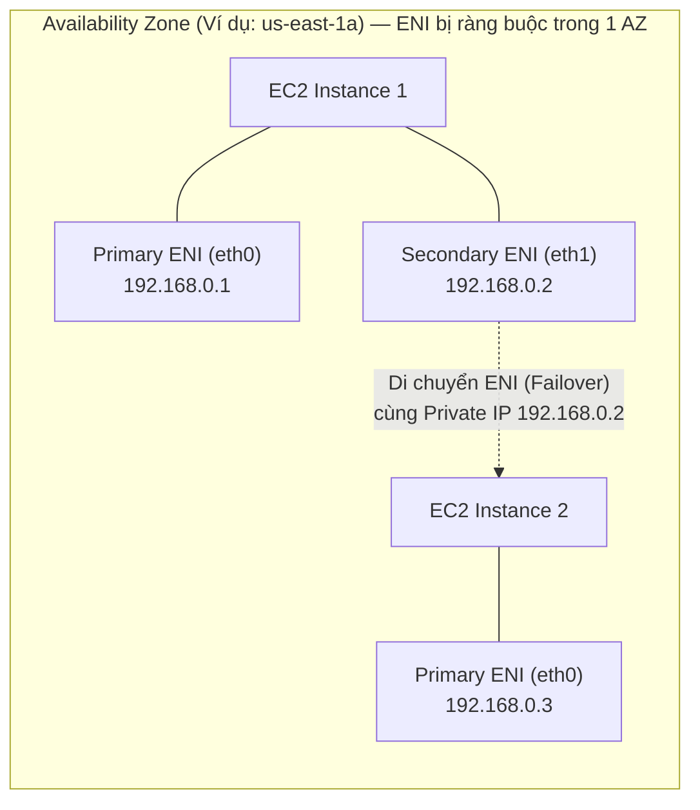

# Bài 51: Elastic Network Interfaces (ENI) - Overview

- **Phần (Section):** Section 6: EC2 - Solutions Architect Associate Level
- **Lecture ID:** `18077955`
- **Video gốc:** `SAA_-_EC2_-_ENI_Overview_v2.mp4`
- **Thời lượng:** `02:16`
- **Cheat sheet:** [topics/aws_ec2.html](../../topics/aws_ec2.html)

---

## 1. Kiến thức trọng tâm (Exam Notes)

> [!TIP]
> **Tóm tắt nhanh dịch vụ — Elastic Network Interface (ENI) (SAA-C03 Cheat Sheet)**
> - **Là gì (1 câu):** Card mạng ảo (Virtual Network Card) trong VPC cung cấp cho EC2 instance kết nối mạng (Private IP, Public/Elastic IP, MAC address, và Security Groups).
> - **Dùng khi nào:** Cần di chuyển nhanh một địa chỉ Private IP cố định hoặc bản quyền phần mềm khóa theo địa chỉ MAC (MAC-bound license) từ EC2 chính sang EC2 dự phòng trong cùng một AZ, hoặc tách mạng quản trị (Management Network) riêng cho EC2.
> - **Khác gì dịch vụ gần giống:**
>   - **ENI vs ENA vs EFA:** **ENI** là card mạng ảo cơ bản; **ENA (Elastic Network Adapter)** cung cấp Enhanced Networking lên tới 100 Gbps; **EFA (Elastic Fabric Adapter)** là thiết bị mạng cải tiến cho HPC/Machine Learning trên Linux (bypass OS kernel).
> - **Điểm hay bị hỏi:**
>   - **Giới hạn & Mặc định:** ENI bị **ràng buộc vào một Availability Zone (AZ-bound)** — không thể gắn ENI của `AZ-a` cho EC2 ở `AZ-b`. Card chính (`eth0`) không thể tháo rời; các card phụ (`eth1..ethN`) có thể tháo lắp nóng giữa các EC2 trong cùng AZ. Security Group gắn ở cấp **ENI**, không phải trực tiếp ở cấp EC2.
>   - **Từ khóa gợi ý:** `"failover specific Private IP"`, `"license bound to MAC address"`, `"dual-homed instances / separate management network"`.

### 1.1. Elastic Network Interface (ENI) là gì?
- **Định nghĩa:** **ENI (Elastic Network Interface)** là một thành phần logic trong một **VPC**, đại diện cho một **card mạng ảo (virtual network card)**.
- ENI cung cấp khả năng kết nối mạng cho các **EC2 instances** (ví dụ: `eth0` là Primary ENI mặc định gắn vào EC2, và có thể gắn thêm Secondary ENI như `eth1`,...). Ngoài EC2, nhiều dịch vụ AWS khác bên trong VPC cũng sử dụng ENI ở tầng dưới.

---

### 1.2. Các thuộc tính của một ENI (ENI Attributes)
Một ENI có thể sở hữu các thuộc tính sau:
1. **Một Primary Private IPv4** và một hoặc nhiều **Secondary Private IPv4**.
2. Một **Elastic IP (IPv4)** cho mỗi địa chỉ Private IPv4, hoặc một **Public IPv4** (nếu bật auto-assign).
3. Một hoặc nhiều **Security Groups** (lưu ý quan trọng: Security Group thực chất được gắn vào **ENI**, không phải gắn trực tiếp vào EC2!).
4. Một địa chỉ **MAC Address** riêng biệt.

---

### 1.3. Đặc điểm vận hành & Câu hỏi bẫy trong đề thi SAA-C03
- **Tạo độc lập & Di chuyển linh hoạt (Failover):**
  - Bạn có thể tạo các ENI độc lập với EC2 instance và gắn (attach) chúng ngay khi máy đang chạy (**on the fly**), hoặc tháo (detach) và di chuyển chúng từ EC2 instance này sang EC2 instance khác để thực hiện **chuyển đổi dự phòng mạng (Network Failover)** (giữ nguyên địa chỉ Private IP tĩnh và MAC address).
- **Ràng buộc theo Availability Zone (Bound to a specific AZ):**
  - **Cực kỳ quan trọng cho kỳ thi:** Mỗi ENI được tạo trong một Subnet thuộc một **Availability Zone (AZ) cụ thể**. Bạn **CHỈ có thể gắn ENI vào các EC2 instances nằm trong CÙNG Availability Zone đó** (KHÔNG thể gắn một ENI ở `us-east-1a` vào một EC2 ở `us-east-1b`).

---

## 2. Phụ đề chi tiết theo mốc thời gian (Full Transcript & Timestamps)

| Thời gian | Nội dung lời giảng gốc (English) | Bản dịch tiếng Việt sát nghĩa |
| :--- | :--- | :--- |
| `00:00:00` | Okay now lets talk about Elastic Network Interfaces or ENI. | Được rồi, bây giờ chúng ta hãy nói về Elastic Network Interfaces hay viết tắt là ENI. |
| `00:00:03` | So if you hear me say ENI I mean Elastic Network Interfaces. | Vì vậy nếu bạn nghe tôi nói ENI thì ý tôi là Elastic Network Interfaces. |
| `00:00:07` | They're a logical component in a VPC and they represent a virtual network card. | Chúng là một thành phần logic trong một VPC và đại diện cho một card mạng ảo (virtual network card). |
| `00:00:13` | So they're what gives EC2 Instances access to the network, but they're used outside EC2 Instances as well as we'll see later in this course. | Chúng chính là thứ cung cấp quyền truy cập mạng cho các EC2 instances, và cũng được sử dụng bên ngoài EC2 như chúng ta sẽ thấy ở các phần sau của khóa học. |
| `00:00:21` | So for example we have an availability zone and we have one EC2 Instance and to it is attached on `eth0`, your primary ENI | Ví dụ chúng ta có một Availability Zone và một EC2 instance, gắn vào nó ở cổng `eth0` là Primary ENI (card mạng chính) của bạn, |
| `00:00:30` | and this will provide your EC2 Instance network connectivity and for example, a private IP. | và card mạng này cung cấp kết nối mạng cho EC2 instance của bạn cùng một địa chỉ Private IP. |
| `00:00:36` | So each ENI can have the following attributes. | Mỗi một ENI có thể bao gồm các thuộc tính sau đây. |
| `00:00:39` | Number one it can have a Primary private IPv4 and one or more secondary IPv4. Okay. | Thứ nhất, nó có thể có một địa chỉ Primary Private IPv4 và một hoặc nhiều địa chỉ Secondary Private IPv4. |
| `00:00:46` | So in this example, I have one of zero but you are more than welcomed to add a secondary ENI to EC2 and that will be `eth1` | Trong ví dụ này tôi đang có `eth0`, nhưng bạn hoàn toàn có thể thêm một Secondary ENI (card mạng phụ) vào EC2, gọi là `eth1`, |
| `00:00:55` | and this will give you another private IPv4 as well, okay. | và nó cũng sẽ mang lại cho bạn thêm một địa chỉ Private IPv4 nữa. |
| `00:01:00` | Each ENI can also have an elastic IPv4 per private IPv4 or one or more public IPv4, | Mỗi ENI cũng có thể có một địa chỉ Elastic IP (IPv4) cho mỗi địa chỉ Private IPv4, hoặc một địa chỉ Public IPv4, |
| `00:01:07` | so it gives you a private and a public IP as will see in the hands-on. | nhờ đó cung cấp cho bạn cả địa chỉ Private IP lẫn Public IP như chúng ta sẽ thấy trong bài thực hành. |
| `00:01:11` | You can have one or more security groups attached to your ENI. | Bạn có thể gắn một hoặc nhiều Security Groups vào ENI của mình. |
| `00:01:15` | You can have a Mac address attached to it and other things but I've just give you the most important bits right now in this lecture. | Bạn cũng có một địa chỉ MAC gắn với nó cùng một số thuộc tính khác, nhưng ở đây tôi chỉ nêu những điểm quan trọng nhất cho bài học này. |
| `00:01:22` | And you can create ENI's independently from your EC2 instances and attach them on the fly or move them from EC2 instances for failover. | Bạn có thể tạo các ENI hoàn toàn độc lập với EC2 instances, gắn chúng ngay tức thì (on the fly) hoặc di chuyển chúng giữa các EC2 instances để thực hiện chuyển đổi dự phòng (failover). |
| `00:01:31` | So, let's have a look at what it looks like. And by the way, they're bounded to a specific availability zone or AZ. | Hãy xem nó hoạt động như thế nào nhé. Nhân tiện, các ENI bị ràng buộc chặt vào một Availability Zone (AZ) cụ thể. |
| `00:01:37` | So that means that if you create a ENI in the specific AZ, you can only have it bound to that specific AZ. | Điều đó có nghĩa là nếu bạn tạo một ENI ở một AZ cụ thể, bạn chỉ có thể gắn nó cho các tài nguyên nằm trong đúng AZ đó mà thôi. |
| `00:01:42` | So here's another EC2 instance and it has another ENI attached to it. | Giả sử ở đây có một EC2 instance thứ hai trong cùng AZ và nó cũng có một Primary ENI gắn sẵn. |
| `00:01:47` | And for example, we can do is we can move `eth1` from the first EC2 instance into the second EC2 Instance to move that private IP. | Những gì chúng ta có thể làm là di chuyển card mạng phụ `eth1` từ EC2 instance thứ nhất sang EC2 instance thứ hai để chuyển địa chỉ Private IP đó sang. |
| `00:01:55` | And what it means is that that private IP will change from the first EC2 instance and will be attached to the second EC2 Instance. | Điều đó có nghĩa là địa chỉ Private IP đó sẽ rời khỏi EC2 instance thứ nhất và được gắn sang EC2 instance thứ hai. |
| `00:02:01` | And it's very very helpful for failovers. For example, if your EC2 instance is accessed by a private static IP, | Tính năng này cực kỳ hữu ích cho việc chuyển đổi dự phòng (failover). Ví dụ nếu EC2 instance của bạn được truy cập thông qua một địa chỉ Private IP tĩnh, |
| `00:02:09` | then you can move the IP around between these two instances for failover purposes, okay. | bạn có thể di chuyển địa chỉ IP đó qua lại giữa hai instances này cho mục đích dự phòng khi có sự cố. |
| `00:02:13` | So let's have a look in the hands-on to see what it looks like. | Bây giờ hãy cùng sang bài thực hành để xem trực tiếp cách nó hoạt động. |
