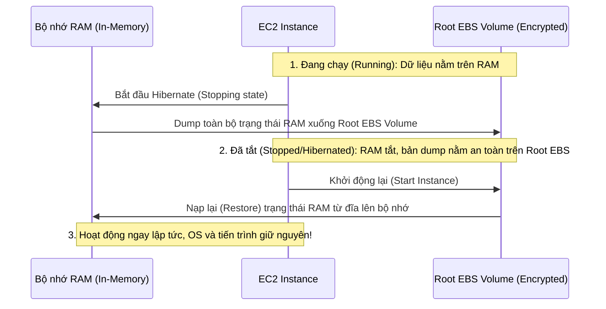

# Bài 54: EC2 Hibernate

- **Phần (Section):** Section 6: EC2 - Solutions Architect Associate Level
- **Lecture ID:** `18104377`
- **Video gốc:** `SAA_-_EC2_-_Hibernate_Overview_v3.mp4`
- **Thời lượng:** `03:13`

---

## 1. Kiến thức trọng tâm (Exam Notes)

> [!TIP]
> **Tóm tắt nhanh dịch vụ — EC2 Hibernate (SAA-C03 Cheat Sheet)**
> - **Là gì (1 câu):** Cơ chế ngủ đông EC2 instance bằng cách lưu toàn bộ trạng thái bộ nhớ in-memory (RAM) xuống ổ đĩa Root EBS trước khi tắt máy để khi bật lại ứng dụng khôi phục ngay lập tức mà không cần khởi tạo lại OS/Cache.
> - **Dùng khi nào:** Ứng dụng mất rất nhiều thời gian để khởi động (long-running initialization) hoặc cần giữ nguyên dữ liệu cache lớn đang nạp sẵn trong RAM qua các lần tắt/bật máy.
> - **Khác gì dịch vụ gần giống:**
>   - **EC2 Hibernate vs EC2 Stop:** **Stop** xóa sạch dữ liệu trong RAM và phải boot lại hệ điều hành từ đầu khi Start; **Hibernate** ghi toàn bộ RAM vào Root EBS volume và nạp ngược vào RAM khi Start nên nhanh hơn rất nhiều.
> - **Điểm hay bị hỏi:**
>   - **Giới hạn & Mặc định:** Dung lượng RAM của instance phải **< 150 GB**; ổ **Root EBS Volume bắt buộc phải được mã hóa (Encrypted)** và đủ dung lượng trống để chứa RAM; thời gian Hibernate liên tục tối đa không quá **60 ngày**; hỗ trợ On-Demand, Reserved và Spot Instances.
>   - **Từ khóa gợi ý:** `"preserve in-memory state (RAM)"`, `"long-running boot / initialization time"`, `"fast startup with pre-warmed memory cache"`.

### 1.1. So sánh Stop, Terminate và Hibernate EC2 Instance
- **Stop Instance:** Dữ liệu trên ổ đĩa **EBS (EBS disk)** được giữ nguyên cho lần Start kế tiếp, nhưng dữ liệu trong **RAM bị xóa sạch**. Khi Start lại, hệ điều hành (OS) phải khởi động lại từ đầu, chạy script khởi tạo và làm nóng bộ nhớ đệm (cache warming) tốn nhiều thời gian.
- **Terminate Instance:** Xóa EC2 instance; ổ đĩa **Root EBS volume** mặc định được thiết lập tự động xóa theo (trừ khi bỏ chọn), các EBS volumes phụ mặc định được giữ lại.
- **Hibernate Instance (Ngủ đông):**
  - Toàn bộ trạng thái dữ liệu đang nằm trong **bộ nhớ RAM (in-memory state)** được **bảo toàn (preserved)**.
  - Hệ điều hành (OS) không bị tắt hay khởi động lại mà chỉ bị **đóng băng (frozen)**.
  - Cơ chế bên dưới (Under the hood): Khi chuyển sang trạng thái `Stopping` để ngủ đông, toàn bộ dữ liệu trong **RAM được ghi (dump) ra một file trên ổ đĩa Root EBS volume** trước khi tắt máy. Khi Start lại, dữ liệu RAM được nạp ngược từ Root EBS volume vào bộ nhớ RAM — giúp **khởi động lại cực nhanh (much faster boot)**.

---

### 1.2. Trường hợp sử dụng (Use Cases) & Điều kiện bắt buộc của EC2 Hibernate (Trọng tâm thi SAA-C03)

#### Use Cases:
- Các tiến trình chạy dài hạn (**Long-running processes**) không muốn bị ngắt quãng.
- Lưu lại trạng thái bộ nhớ **RAM (Save the RAM state)**.
- Các dịch vụ mất rất nhiều thời gian để khởi tạo (**Services that take time to initialize / warm up cache**) và cần khởi động nhanh.

#### Điều kiện & Giới hạn bắt buộc (Must-Know cho kỳ thi):
1. **Root Volume:**
   - **Bắt buộc phải là EBS volume** (KHÔNG hỗ trợ Instance Store root volume).
   - **Bắt buộc phải được mã hóa (Encrypted)** (vì dữ liệu RAM thường chứa thông tin nhạy cảm khi ghi xuống đĩa).
   - **Bắt buộc có đủ dung lượng trống (Large enough)** để chứa toàn bộ bản dump của RAM.
2. **Dung lượng RAM:** Nhỏ hơn **150 GB** (`< 150 GB`).
3. **Loại Instance:** Hỗ trợ nhiều dòng (`C3, C4, C5, I3, M3, M4, M5, R3, R4, R5, T2, T3, T3a,...`), **KHÔNG hỗ trợ Bare Metal instances**.
4. **Hệ điều hành:** Hỗ trợ Windows, Amazon Linux 2, Ubuntu, RHEL, CentOS,...
5. **Hình thức mua:** Hỗ trợ cả **On-Demand, Reserved và Spot Instances**.
6. **Thời gian ngủ đông tối đa:** Một instance **không được hibernate quá 60 ngày** liên tục.

---

## 2. Phụ đề chi tiết theo mốc thời gian (Full Transcript & Timestamps)

| Thời gian | Nội dung lời giảng gốc (English) | Bản dịch tiếng Việt sát nghĩa |
| :--- | :--- | :--- |
| `00:00:00` | So let's talk about a lesser-known feature called EC2 Hibernate. | Bây giờ hãy cùng tìm hiểu một tính năng ít được biết đến hơn có tên là **EC2 Hibernate** (Ngủ đông EC2). |
| `00:00:04` | So we know that we can stop and terminate instances, and when we do so, when we stop it, the data on disk, on your EBS disk, is going to be kept intact until the next start. That makes sense. | Chúng ta đều biết rằng chúng ta có thể Stop và Terminate các instances: khi chúng ta Stop máy, dữ liệu trên ổ đĩa EBS sẽ được giữ nguyên vẹn cho đến lần Start tiếp theo. Điều đó rất dễ hiểu. |
| `00:00:14` | And if we terminate it, well, if you set up the root volume to be destroyed with your instance, it's going to be destroyed, | Còn nếu chúng ta Terminate máy, nếu ổ đĩa gốc (Root volume) được thiết lập hủy theo instance thì nó sẽ bị xóa, |
| `00:00:19` | but any volume that is not set up to be destroyed when your instance is terminated will be kept. | nhưng bất kỳ ổ đĩa EBS nào không được đánh dấu xóa khi Terminate sẽ vẫn được giữ lại. |
| `00:00:25` | And then when you start an instance, well, the OS, the operating system will boot and then the EC2 User Data that was going to be run, the script, and then the OS will boot up. | Khi bạn khởi chạy (Start) một instance từ đầu, hệ điều hành (OS) sẽ khởi động, chạy script EC2 User Data (trong lần đầu tiên), |
| `00:00:35` | And then your application starts, your caches get warmed, and that can take time, because you are booting your machine, right? | sau đó ứng dụng của bạn mới khởi chạy, bộ nhớ đệm (cache) mới được làm nóng dần — quá trình đó có thể tốn khá nhiều thời gian vì máy phải khởi động lại từ đầu. |
| `00:00:43` | But the idea is that with Hibernate, we want to achieve a new state. | Nhưng với tính năng **Hibernate**, chúng ta muốn đạt được một trạng thái mới. |
| `00:00:46` | So when we hibernate an instance, whatever was in RAM, the in-memory state is going to be preserved. | Khi chúng ta cho một instance ngủ đông (hibernate), bất cứ dữ liệu nào đang nằm trong RAM — tức trạng thái bộ nhớ trong (in-memory state) — sẽ được bảo toàn nguyên vẹn. |
| `00:00:53` | What does that mean? That means that your instance boot is going to be much faster, because the operating system is not stopped or restarted, the operating system is actually just frozen, it's hibernated. | Điều đó có nghĩa là gì? Nghĩa là quá trình bật lại instance sẽ nhanh hơn rất nhiều, bởi vì hệ điều hành không hề bị tắt hay khởi động lại, mà thực chất chỉ bị đóng băng (frozen) — tức là ngủ đông. |
| `00:01:04` | And under the hood, well, whatever was in the RAM state is going to be written into a file in the root EBS volume. | Ở tầng bên dưới (under the hood), toàn bộ trạng thái trong bộ nhớ RAM sẽ được ghi xuống một tệp tin nằm trên ổ đĩa **Root EBS volume**. |
| `00:01:11` | So that means that the root EBS volume must be encrypted and that it must have enough space to contain the RAM. | Điều đó kéo theo hai yêu cầu bắt buộc: ổ đĩa **Root EBS volume bắt buộc phải được mã hóa (encrypted)** và **phải có đủ dung lượng trống** để chứa toàn bộ dữ liệu từ RAM. |
| `00:01:17` | So let me show you what happens. So we take an EC2 instance, and it's running and there is data in RAM, and then we start a hibernation process. | Hãy xem sơ đồ minh họa điều gì xảy ra: chúng ta có một EC2 instance đang chạy với dữ liệu trong RAM, và chúng ta kích hoạt quá trình ngủ đông (hibernation). |
| `00:01:26` | So what happens that the instance will go in the stopping state, and the RAM is going to be dumped into your EBS volume. | Lúc này instance sẽ chuyển sang trạng thái `stopping`, và dữ liệu trong RAM sẽ được đổ (dumped) xuống ổ đĩa Root EBS volume. |
| `00:01:34` | Then the instance is shut down and the RAM disappears, because as soon as you stop an instance the RAM goes away, but the EBS volume still contains the dump of the RAM. | Sau đó instance được tắt đi và bộ nhớ RAM giải phóng, nhưng ổ đĩa EBS vẫn lưu giữ bản dump của RAM đó. |
| `00:01:45` | And then when your instance is started, then the RAM is going to be loaded from disk onto the EC2 instance memory. | Và khi instance của bạn được Start trở lại, dữ liệu RAM sẽ được nạp ngược từ ổ đĩa lên bộ nhớ của EC2 instance. |
| `00:01:53` | And that means that it is just as is your EC2 instance never got stopped. And we'll have a look at this in the hands-on. | Điều đó có nghĩa là mọi thứ tiếp diễn y hệt như thể EC2 instance của bạn chưa từng bị tắt đi vậy. Chúng ta sẽ kiểm chứng điều này trong bài thực hành. |
| `00:02:01` | So the use cases for hibernation is if you want to have long-running processes and never actually stop them, or if you want to save the RAM state, | Vậy các trường hợp sử dụng (use cases) của Hibernation là khi bạn có các tiến trình chạy dài hạn (long-running processes) và không muốn dừng chúng, hoặc khi bạn muốn lưu lại trạng thái RAM, |
| `00:02:09` | or if you just want to reboot, like boot up fast, and you have services that take time to initialize. | hoặc khi bạn muốn bật máy lên thật nhanh đối với các dịch vụ mất nhiều thời gian để khởi tạo (initialize). |
| `00:02:16` | So you actually don't want them to initialize, you want them to stay up and running even if you hibernate your instance. | Bạn không muốn chúng phải khởi tạo lại từ đầu mà muốn chúng giữ nguyên trạng thái đang chạy ngay cả khi cho máy ngủ đông. |
| `00:02:23` | So, some good things to know about EC2 Hibernate is that it supports a lot of different families. The instance RAM size must be less than 150 gigabytes. | Một số thông tin quan trọng cần nhớ về EC2 Hibernate: nó hỗ trợ rất nhiều dòng instance khác nhau, và dung lượng RAM của instance phải nhỏ hơn 150 GB. |
| `00:02:31` | Now, that can change, and again, you're not tested on limits at the exam, but I'm just putting this as an indication for you to get an idea of how that works. | Con số giới hạn này có thể thay đổi theo thời gian, nhưng tôi đưa ra để bạn nắm được quy mô hoạt động của nó. |
| `00:02:39` | It doesn't work for bare metal instances. It works for many different operating systems, including Linux and Windows. | Nó không hỗ trợ các Bare Metal instances. Nó hoạt động trên nhiều hệ điều hành khác nhau bao gồm cả Linux và Windows. |
| `00:02:46` | It works for the root volume, so the root volume must be an EBS volume, it must be encrypted, okay? And it must be large to contain the RAM that you dump onto it. | Đối với ổ đĩa gốc (Root volume): bắt buộc phải là **EBS volume**, bắt buộc phải được **mã hóa (encrypted)**, và phải đủ lớn để chứa bản dump của RAM. |
| `00:02:54` | It's available for all kind of instances, such as on-demand, reserved, and spot instances. | Tính năng này khả dụng cho cả On-Demand, Reserved và Spot Instances. |
| `00:02:59` | And hibernation is meant to be no more than 60 days. Again, this can change, but right now this is the actual limits. | Và thời gian ngủ đông của một instance không được vượt quá **60 ngày**. |
| `00:03:08` | Okay, so that's it for this lecture, I hope you liked it, and I will see you in the next lecture for a hands-on. | Đó là tất cả cho bài học này, hy vọng bạn thích nó, và hẹn gặp lại ở bài thực hành tiếp theo. |
