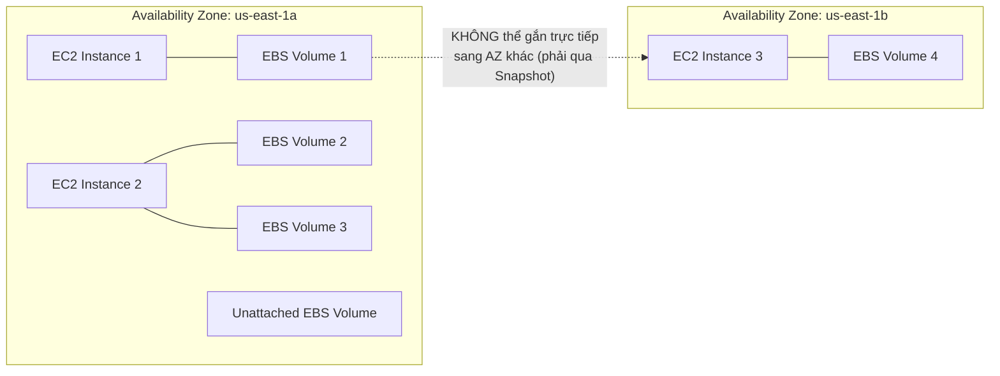

# Bài 56: EBS Overview

- **Phần (Section):** Section 7: EC2 Instance Storage
- **Lecture ID:** `26098272`
- **Video gốc:** `CCP - EBS - Overview v3.mp4`
- **Thời lượng:** `04:47`

---

## 1. Kiến thức trọng tâm (Exam Notes)

> [!TIP]
> **Tóm tắt nhanh dịch vụ Amazon EBS (SAA-C03 Cheat Sheet)**
> - **Là gì:** Dịch vụ ổ cứng mạng dạng khối (**Network Block Storage**) gắn vào EC2 instance tại **1 Availability Zone (AZ)** cụ thể và lưu giữ dữ liệu bền vững độc lập với vòng đời của EC2.
> - **Dùng khi nào (Use case điển hình trong đề):** Làm ổ đĩa hệ điều hành (Boot volume) hoặc ổ đĩa cơ sở dữ liệu cần độ bền cao (`gp2/gp3`), cần **trên 16.000 IOPS** hoặc **Multi-Attach** (`io1/io2`), hoặc xử lý dữ liệu lớn tuần tự giá rẻ (`st1/sc1`).
> - **Khác gì dịch vụ gần giống:**
>   - **EBS vs. EC2 Instance Store:** `EBS` là ổ đĩa mạng bền vững qua các lần Stop/Start; `Instance Store` là ổ cứng vật lý gắn trực tiếp trên host mang lại **IOPS cực đại** nhưng là bộ nhớ tạm (**Ephemeral** — mất dữ liệu khi `Stop` máy).
>   - **EBS vs. Amazon EFS:** `EBS` bị giới hạn trong **1 AZ** và mặc định chỉ gắn cho **1 EC2** (trừ `io1/io2` Multi-Attach tối đa **16 EC2 trong cùng 1 AZ**); `EFS` là File Storage (NFS) chia sẻ đồng thời cho **hàng trăm Linux EC2 trên nhiều AZs**.
> - **Điểm hay bị hỏi (Giới hạn, Mặc định, Từ khóa gợi ý):**
>   - **Mặc định:** Khi Terminate EC2, **Root EBS Volume mặc định bị xóa** (`Delete on Termination = Yes`), còn các **Additional EBS Volumes mặc định được giữ lại**.
>   - **Giới hạn:** Không thể gắn trực tiếp EBS Volume ở `AZ-a` cho EC2 ở `AZ-b` (phải qua **EBS Snapshot**); ổ HDD (`st1`, `sc1`) **không thể làm Boot Volume**.
>   - **Từ khóa gợi ý:** `"persistent block storage in a single AZ"` $\rightarrow$ **EBS (`gp3`)**; `"> 16,000 IOPS or clustered DB needing Multi-Attach in 1 AZ"` $\rightarrow$ **EBS Provisioned IOPS (`io1/io2`)**.

### 1.1. Amazon EBS (Elastic Block Store) là gì?
- **Định nghĩa:** **EBS (Elastic Block Store)** là một **ổ đĩa mạng (Network Drive)** bạn có thể gắn (attach) vào các EC2 instances ngay khi chúng đang chạy.
- **Lưu trữ bền vững (Persistent Storage):** Cho phép lưu giữ dữ liệu tồn tại độc lập ngay cả sau khi EC2 instance đã bị **Terminate**. Bạn có thể tạo một EC2 instance mới và gắn lại cùng ổ EBS cũ để lấy lại toàn bộ dữ liệu.
- **Hình ảnh ẩn dụ:** Hãy hình dung EBS giống như một **"chiếc USB mạng" (Network USB stick)** — bạn có thể rút (detach) khỏi máy tính này và cắm (attach) sang máy tính khác một cách nhanh chóng thông qua kết nối mạng (không phải cắm vật lý).

---

### 1.2. Các đặc điểm cốt lõi của EBS (Must-Know cho kỳ thi SAA-C03)
1. **Gắn kết với EC2:**
   - Ở mức cơ bản (CCP / các dòng `gp2`, `gp3`, `st1`, `sc1`), một EBS volume **chỉ gắn được vào 1 EC2 instance tại một thời điểm** (ngoại trừ tính năng **EBS Multi-Attach** trên `io1`/`io2` sẽ học ở bài 64).
   - Tuy nhiên, **1 EC2 instance có thể gắn nhiều EBS volumes cùng lúc** (giống như cắm nhiều USB vào 1 máy).
   - Có thể tạo các EBS volumes để ở trạng thái chưa gắn (`unattached / available`) rồi gắn theo nhu cầu.
2. **Ràng buộc theo Availability Zone (Locked to a specific AZ):**
   - Một EBS volume được tạo ở `us-east-1a` **KHÔNG THỂ** gắn trực tiếp vào EC2 instance ở `us-east-1b`.
   - Muốn di chuyển ổ EBS sang AZ khác, bạn phải tạo **EBS Snapshot** rồi khôi phục (restore) thành volume mới ở AZ đích.
3. **Giao tiếp qua mạng & Cấp phát dung lượng trước (Provisioned Capacity):**
   - Vì là ổ đĩa mạng nên có một chút độ trễ mạng (latency) giữa EC2 và EBS.
   - Bạn phải **cấp phát trước dung lượng (GB) và hiệu năng (IOPS)**, và bị **tính phí cho toàn bộ dung lượng đã cấp phát đó** (dù dùng hết hay chưa). Bạn có thể tăng dung lượng và hiệu năng về sau.
4. **Thuộc tính `Delete on Termination` (Cực kỳ hay hỏi trong đề thi):**
   - Kiểm soát hành vi của ổ đĩa EBS khi EC2 instance bị **Terminate**:
     - **Root EBS Volume (ổ cài hệ điều hành):** Mặc định `Delete on Termination = Enabled (Checked)` -> **Tự động bị xóa** khi EC2 bị Terminate.
     - **Additional EBS Volumes (các ổ EBS gắn thêm):** Mặc định `Delete on Termination = Disabled (Unchecked)` -> **Được giữ lại** khi EC2 bị Terminate.
   - Bạn hoàn toàn có thể bật/tắt thuộc tính này trên Console/CLI (ví dụ: bỏ chọn `Delete on Termination` trên Root volume nếu muốn giữ lại ổ đĩa gốc sau khi hủy EC2).

---

## 2. Phụ đề chi tiết theo mốc thời gian (Full Transcript & Timestamps)

| Thời gian | Nội dung lời giảng gốc (English) | Bản dịch tiếng Việt sát nghĩa |
| :--- | :--- | :--- |
| `00:00:00` | Welcome to this section where we will look at the different storage options for EC2 instances. | Chào mừng bạn đến với chương học tìm hiểu các tùy chọn lưu trữ khác nhau dành cho EC2 instances. |
| `00:00:06` | So first the most important ones are going to be EBS volumes. So let's define what they are. | Đầu tiên và quan trọng nhất chính là các ổ đĩa **EBS volumes**. Hãy cùng định nghĩa xem chúng là gì. |
| `00:00:11` | And EBS volume stands for Elastic Block Store. It's a network drive that you can attach to your instances while they run. | EBS là viết tắt của **Elastic Block Store**. Nó là một ổ đĩa mạng (network drive) mà bạn có thể gắn vào các instances ngay khi chúng đang chạy. |
| `00:00:19` | And we've been using them without even knowing. | Thực tế chúng ta đã và đang sử dụng chúng từ đầu khóa học mà không hề để ý. |
| `00:00:22` | So this EBS volumes allow us to persist data even after the instance is terminated. And so that's the whole purpose. | Các ổ đĩa EBS này cho phép chúng ta lưu giữ dữ liệu bền vững (persist data) ngay cả sau khi instance đã bị xóa (terminated). Đó chính là mục đích cốt lõi của nó. |
| `00:00:30` | We can recreate an instance and mount the same EBS volume from before, and we will get back our data. That is very helpful. | Chúng ta có thể tạo lại một instance mới và gắn (mount) lại đúng ổ đĩa EBS trước đó, và chúng ta sẽ lấy lại được toàn bộ dữ liệu của mình. Rất hữu ích! |
| `00:00:37` | So these EBS volumes at the CCP level can only be mounted to one instance at a time. Okay. | Ở cấp độ cơ bản (CCP level), mỗi ổ đĩa EBS chỉ có thể được gắn vào một EC2 instance tại một thời điểm. |
| `00:00:45` | And when you create an EBS volume it is bound to a specific availability zone. | Và khi bạn tạo một ổ đĩa EBS, nó bị ràng buộc vào một Availability Zone (AZ) cụ thể. |
| `00:00:49` | That means that you cannot have an EBS volume created in, for example, `us-east-1a` attached to an instance in `us-east-1b`. We'll see this in the diagram in a second. | Điều đó có nghĩa là bạn không thể lấy một ổ đĩa EBS được tạo trong `us-east-1a` để gắn vào một instance nằm ở `us-east-1b`. Chúng ta sẽ xem sơ đồ minh họa ngay sau đây. |
| `00:00:59` | So how do you think of EBS volumes. Well you can think of them as network USB sticks. | Vậy bạn nên hình dung về EBS volumes như thế nào? Bạn có thể coi chúng như những chiếc **"USB mạng" (network USB sticks)**. |
| `00:01:05` | So it's a USB stick that you can take from a computer and put it in another computer, but you actually don't physically put it in a computer. It's attached through the network. | Tức là một chiếc USB mà bạn có thể rút từ máy tính này và cắm sang máy tính khác, chỉ khác là bạn không cắm vật lý mà gắn kết thông qua hệ thống mạng. |
| `00:01:15` | Now let's look at it. So EBS volumes are network drive. As I said it's not a physical drive okay. | Hãy điểm qua các đặc tính kỹ thuật: EBS volume là ổ đĩa mạng (network drive), không phải ổ đĩa vật lý gắn trực tiếp. |
| `00:01:20` | So to communicate between the instance and the EBS volume it will be using the network. | Vì vậy để giao tiếp giữa EC2 instance và ổ đĩa EBS, hệ thống sẽ truyền tải qua mạng. |
| `00:01:25` | And because the network is used there may be a bit of latency from one computer to reach to another server. | Và bởi vì sử dụng mạng nên có thể có một chút độ trễ (latency) khi truyền dữ liệu giữa máy chủ tính toán và máy chủ lưu trữ. |
| `00:01:31` | Now EBS volumes, because they are a network drive, they can be detached from an EC2 instance and attached to another one very quickly. And that makes it super handy when you want to do failovers. | Nhờ bản chất là ổ đĩa mạng, EBS volumes có thể được tháo (detached) khỏi một EC2 instance và gắn (attached) sang một instance khác cực kỳ nhanh chóng — vô cùng tiện lợi khi bạn muốn xử lý chuyển đổi dự phòng (failovers). |
| `00:01:43` | EBS volumes are locked to a specific availability zones. That means that, as I said, if it's created in `us-east-1a`, it cannot be attached to `us-east-1b`. | EBS volumes bị khóa chặt vào một Availability Zone cụ thể. Nghĩa là nếu tạo ở `us-east-1a` thì không thể gắn trực tiếp sang `us-east-1b`. |
| `00:01:52` | But we will see in this section that if we do a snapshot, then we are able to move a volume across from different availability zones. | Nhưng như chúng ta sẽ học trong chương này, nếu chúng ta chụp một bản **Snapshot**, chúng ta hoàn toàn có thể di chuyển ổ đĩa đó sang các Availability Zones khác nhau. |
| `00:02:00` | And finally it's a volume. So you have to provision capacity in advance. | Tiếp theo, vì nó là một ổ đĩa (block volume) nên bạn phải cấp phát dung lượng trước (provision capacity in advance). |
| `00:02:04` | So you need to say how many gigabytes you want in advance. And the IOPS which is I/O operations per second. | Bạn cần chỉ định trước bạn muốn bao nhiêu GB dung lượng và bao nhiêu **IOPS** (số thao tác đọc/ghi I/O mỗi giây). |
| `00:02:11` | And you're basically defining how you want your EBS volume to perform. You're going to get billed for that provisioned capacity. | Về cơ bản bạn định nghĩa mức hiệu năng mong muốn cho ổ EBS, và bạn sẽ bị tính phí theo toàn bộ dung lượng đã cấp phát đó. |
| `00:02:19` | And you can increase the capacity over time if you want to have better performance or more size. | Bạn cũng có thể tăng thêm dung lượng hoặc hiệu năng theo thời gian nếu cần. |
| `00:02:24` | So as a diagram, what does it look like? Well we have `us-east-1a` we have one EC2 instance. And we can attach for example one EBS volume to that EC2 instance. | Nhìn vào sơ đồ minh họa: trong `us-east-1a`, chúng ta có một EC2 instance và gắn một EBS volume vào nó. |
| `00:02:33` | If we create another EC2 instance, as I said, an EBS volume cannot be attached to two instances at a time at the certified cloud practitioner level. | Nếu chúng ta tạo thêm một EC2 instance thứ hai, một ổ EBS thông thường không thể gắn cho hai instances cùng lúc. |
| `00:02:43` | And therefore, what I want to say is that this EC2 instance needs to have its own EBS volume attached to it, but it is very possible for us to have two EBS volumes attached to one instance. | Do đó EC2 instance thứ hai cần có ổ EBS riêng của nó; tuy nhiên chúng ta hoàn toàn có thể gắn 2 (hoặc nhiều) ổ EBS vào cùng một EC2 instance. |
| `00:02:55` | Think of it as two network USB sticks into one machine. That makes a lot of sense. | Hãy cứ hình dung như việc cắm 2 chiếc USB mạng vào cùng 1 máy tính vậy, rất dễ hiểu. |
| `00:03:00` | Now EBS volumes are linked to an availability zone. So as you can see, all this diagram has been so far using `us-east-1a`. | Các ổ EBS được liên kết chặt với một AZ. Toàn bộ phần bên trái sơ đồ đang nằm trong `us-east-1a`. |
| `00:03:08` | So if you wanted to have other EBS volumes in another AZ, then you would need to create this separately in the other availability zone. | Nếu bạn muốn có các ổ EBS ở một AZ khác (`us-east-1b`), bạn sẽ phải tạo chúng riêng biệt trong AZ đó. |
| `00:03:16` | So just the same way that your EC2 instances are bound to an AZ, so are the EBS volumes. | Cũng giống như EC2 instances bị ràng buộc vào một AZ, EBS volumes cũng vậy. |
| `00:03:23` | Finally, it is possible for us to create EBS volumes and leave them unattached. They don't need to be necessarily attached to an EC2 instance. They can be attached on demand and that makes it very, very powerful. | Ngoài ra, chúng ta có thể tạo sẵn các ổ EBS và để trống chưa gắn vào đâu cả (unattached), khi nào cần mới gắn vào EC2 theo yêu cầu. |
| `00:03:34` | Finally, when we go ahead and create EBS volumes through EC2 instances, there is this thing called a `Delete on Termination` attribute. And this can come up in the exam. | Cuối cùng, khi chúng ta tạo các ổ đĩa EBS lúc khởi chạy EC2 instance, có một thuộc tính rất quan trọng gọi là **`Delete on Termination`** — thuộc tính này rất hay xuất hiện trong đề thi. |
| `00:03:44` | So if you look at this when we create an EBS volume in the console, when we create an EC2 instance, there is the second to last column called `Delete on Termination`. | Khi bạn nhìn vào bảng cấu hình lưu trữ lúc tạo EC2 trên Console, cột gần cuối có tên là `Delete on Termination`. |
| `00:03:57` | And by default it is ticked for the root volume and not ticked for a new EBS volume. | Mặc định, ô này **được tích chọn (ticked) đối với ổ đĩa gốc (Root volume)** và **không được tích chọn đối với các ổ đĩa EBS gắn thêm**. |
| `00:04:03` | So this controls the EBS behavior when an EC2 instance is being terminated. | Thuộc tính này điều khiển hành vi của ổ đĩa EBS khi EC2 instance bị Terminate. |
| `00:04:08` | So by default, as you can see, the root EBS volume is deleted alongside the instance being terminated. So it's enabled. | Mặc định, ổ đĩa Root EBS sẽ bị xóa luôn cùng với instance khi instance bị Terminate (enabled). |
| `00:04:15` | And by default any other attached EBS volume is not deleted because it's disabled by default. | Và mặc định, bất kỳ ổ đĩa EBS nào khác gắn thêm vào máy sẽ **không bị xóa** vì thuộc tính này bị tắt (disabled) mặc định. |
| `00:04:22` | But obviously, as we can see in this UI, we can control if you want to enable or disable delete on termination. | Tất nhiên trên giao diện hoặc qua CLI, chúng ta hoàn toàn có thể chủ động bật hoặc tắt `Delete on Termination`. |
| `00:04:29` | And so use case for it would be for example that if you want to preserve the root volume when an instance is terminated, for example to save some data, then you can disable delete on termination for the root volume and you'll be good to go. | Tình huống sử dụng thực tế (và câu hỏi thi) là: nếu bạn muốn giữ lại ổ đĩa gốc (Root volume) sau khi một EC2 instance bị Terminate để lưu lại dữ liệu trên đó, bạn chỉ cần tắt (disable) tùy chọn `Delete on Termination` cho Root volume là xong. |
| `00:04:41` | And that could be an exam scenario at the exam. So I hope you liked it and I will see you in the next lecture. | Đó là một kịch bản rất phổ biến trong bài thi. Hy vọng bạn thích bài học này và hẹn gặp lại ở bài tiếp theo. |
