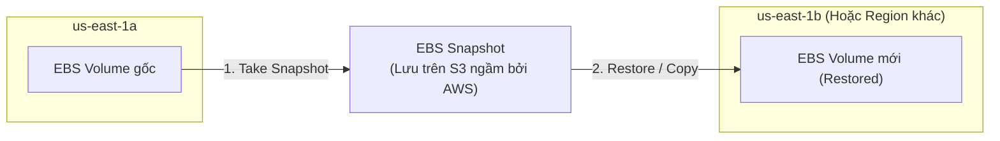

# Bài 58: EBS Snapshots

- **Phần (Section):** Section 7: EC2 Instance Storage
- **Lecture ID:** `26098276`
- **Video gốc:** `SAA_-_EBS_-_Snapshots_v3.mp4`
- **Thời lượng:** `02:08`

---

## 1. Kiến thức trọng tâm (Exam Notes)

### 1.1. Tổng quan về EBS Snapshots
- **Định nghĩa:** **EBS Snapshot** là một bản sao lưu tại một thời điểm (point-in-time backup) của ổ đĩa EBS volume.
- **Lưu ý khi chụp Snapshot:** Không bắt buộc phải tháo (detach) EBS volume khỏi EC2 instance trước khi chụp snapshot, nhưng AWS **khuyến nghị (recommended)** nên tháo hoặc dừng ghi để đảm bảo tính nhất quán dữ liệu cao nhất.
- **Di chuyển dữ liệu qua AZ hoặc Region:**
  - Bạn có thể **khôi phục (restore)** một EBS Snapshot thành một EBS Volume mới ở **bất kỳ Availability Zone (AZ) nào** trong cùng Region (đây là cách chuẩn để di chuyển một ổ EBS từ `us-east-1a` sang `us-east-1b`).
  - Bạn cũng có thể **sao chép (copy)** EBS Snapshot sang một **AWS Region khác** (dùng cho Disaster Recovery / Migration).

---

### 1.2. Ba tính năng nâng cao của EBS Snapshots (Trọng tâm thi SAA-C03)

| Tính năng | Mô tả & Cơ chế hoạt động | Lưu ý cho kỳ thi (Exam Tips) |
| :--- | :--- | :--- |
| **1. EBS Snapshot Archive** | Chuyển một EBS Snapshot sang tầng lưu trữ lạnh (**Archive Tier**) có chi phí **rẻ hơn tới 75%** so với tầng Standard. | Thời gian khôi phục (restore) một bản snapshot từ Archive Tier mất từ **24 đến 72 giờ** (không thể lấy ngay lập tức). |
| **2. Recycle Bin for EBS Snapshots** | Cho phép thiết lập các quy tắc lưu giữ (Retention Rules) để khi xóa EBS Snapshot (hoặc AMI), chúng được đưa vào **Thùng rác (Recycle Bin)** thay vì xóa vĩnh viễn ngay. | Bảo vệ khỏi việc **xóa nhầm (accidental deletion)**. Thời gian lưu giữ trong Recycle Bin có thể đặt từ **1 ngày đến 1 năm** (`1 day` – `1 year`). |
| **3. Fast Snapshot Restore (FSR)** | Buộc khởi tạo đầy đủ (**full initialization**) toàn bộ khối dữ liệu của snapshot ngay lập tức để **loại bỏ hoàn toàn độ trễ trong lần truy cập đầu tiên (no latency on first use)**. | Đặc biệt hữu ích khi snapshot có dung lượng **rất lớn** và cần khởi tạo EBS volume / EC2 instance đạt hiệu năng I/O tối đa ngay tức thì. Chi phí rất cao (`$$$`). |

---

## 2. Phụ đề chi tiết theo mốc thời gian (Full Transcript & Timestamps)

| Thời gian | Nội dung lời giảng gốc (English) | Bản dịch tiếng Việt sát nghĩa |
| :--- | :--- | :--- |
| `00:00:00` | So now let's talk about EBS Snapshots. | Bây giờ hãy cùng tìm hiểu về EBS Snapshots. |
| `00:00:02` | So, an EBS Snapshot is a backup at any point in time of your EBS volume. | Một EBS Snapshot là một bản sao lưu tại một thời điểm bất kỳ (point-in-time backup) của ổ đĩa EBS của bạn. |
| `00:00:08` | And for this, it's not necessary to detach your EBS volume from your EC2 instance but it's recommended. | Để chụp snapshot, bạn không bắt buộc phải tháo (detach) ổ đĩa EBS khỏi EC2 instance, nhưng việc đó được khuyến nghị. |
| `00:00:15` | You can copy these EBS Snapshots across different Availability Zones or even across different Region. | Bạn có thể sao chép hoặc khôi phục các bản EBS Snapshots này qua các Availability Zones khác nhau hoặc thậm chí qua các Regions khác nhau. |
| `00:00:21` | So, for example, let's take EC2 instance that has an EBS volume in `US-EAST-1A` and an EC2 instance in `US-EAST-1B`. | Ví dụ, giả sử chúng ta có một EC2 instance gắn ổ EBS ở `us-east-1a` và một EC2 instance khác ở `us-east-1b`. |
| `00:00:32` | So we can take a snapshot of the EBS volume. Okay, and thanks for that snapshot we can actually restore it in another AZ. | Chúng ta có thể chụp một bản snapshot của ổ đĩa EBS đó, và nhờ bản snapshot này chúng ta có thể khôi phục (restore) nó thành ổ đĩa mới ở một AZ khác. |
| `00:00:41` | So this is how you would transfer an EBS volume from one AZ to another. | Đó chính là cách bạn di chuyển một ổ đĩa EBS từ AZ này sang AZ khác. |
| `00:00:48` | Next, you need to know about a few EBS Snapshots feature. So the first one is called the EBS Snapshot Archive. | Tiếp theo, bạn cần nắm được một số tính năng quan trọng của EBS Snapshots. Tính năng đầu tiên là **EBS Snapshot Archive**. |
| `00:00:54` | It's the ability for you to move the snapshot to an "archive tier" that is going to be up to 75% cheaper. | Nó cho phép bạn chuyển một bản snapshot sang tầng lưu trữ **"Archive Tier"** với chi phí rẻ hơn tới **75%**. |
| `00:01:02` | So, if you do move this snapshot to an "archive tier" then it will take you from within 24 to 72 hours for restoring the archive. So it's not immediate. | Tuy nhiên, nếu bạn chuyển snapshot sang tầng Archive, bạn sẽ mất từ **24 đến 72 giờ** để khôi phục lại bản lưu trữ đó (tức là không thể dùng ngay lập tức). |
| `00:01:13` | The other thing is to have a Recycle Bin for EBS Snapshots. | Tính năng thứ hai là **Recycle Bin (Thùng rác)** dành cho EBS Snapshots. |
| `00:01:16` | So in case you do delete your EBS Snapshots instead of being permanently deleted then instead they're going to land in Recycle Bin. | Trong trường hợp bạn xóa các EBS Snapshots, thay vì bị xóa vĩnh viễn ngay lập tức thì chúng sẽ được đưa vào trong Recycle Bin. |
| `00:01:26` | And so the idea with this is that you can recover them from an accidental deletion. | Ý tưởng của tính năng này là giúp bạn có thể khôi phục lại chúng nếu chẳng may xóa nhầm (accidental deletion). |
| `00:01:31` | And the retention for your Recycle Bin can be set from anywhere between one day to one year. | Thời gian lưu giữ (retention) trong Recycle Bin có thể được thiết lập từ **1 ngày đến 1 năm**. |
| `00:01:38` | The last feature you need to know about for your EBS Snapshots is called the Fast Snapshot Restore. | Tính năng cuối cùng bạn cần biết đối với EBS Snapshots được gọi là **Fast Snapshot Restore (FSR)**. |
| `00:01:43` | So this forces a full initialization of your snapshot to have no latency on the first use. | Tính năng này ép buộc khởi tạo đầy đủ (full initialization) toàn bộ bản snapshot để không gặp bất kỳ độ trễ nào trong lần sử dụng đầu tiên (no latency on first use). |
| `00:01:49` | This is particularly helpful if your snapshot is big, very big and need to initialize an EBS volume or needs to instance out of it very quickly, | Điều này đặc biệt hữu ích nếu bản snapshot của bạn có dung lượng rất lớn và bạn cần khởi tạo một ổ EBS hoặc EC2 instance từ nó với tốc độ tối đa ngay lập tức, |
| `00:01:59` | but this feature costs a lot of money, so be careful when using it. | nhưng tính năng này tốn khá nhiều chi phí nên hãy cân nhắc kỹ khi sử dụng. |
| `00:02:02` | Okay, that's it for this lecture. I hope you liked it. And I will see you in the next lecture. | Đó là tất cả cho bài học này. Hy vọng bạn thích nó và hẹn gặp lại ở bài học tiếp theo. |
