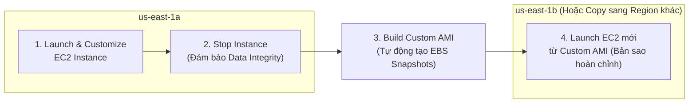

# Bài 60: AMI Overview

- **Phần (Section):** Section 7: EC2 Instance Storage
- **Lecture ID:** `26098280`
- **Video gốc:** `CCP_-_EC2_-_AMI_Overview.mp4`
- **Thời lượng:** `02:45`

---

## 1. Kiến thức trọng tâm (Exam Notes)

> [!TIP]
> **Tóm tắt nhanh dịch vụ — Amazon Machine Image (AMI) (SAA-C03 Cheat Sheet)**
> - **Là gì (1 câu):** Bản đóng gói (Image template) chứa hệ điều hành, cấu hình, phần mềm và dữ liệu khởi tạo dùng để tạo mới các EC2 instances nhanh chóng.
> - **Dùng khi nào:** Cần đóng gói sẵn phần mềm/cấu hình thành **"Golden AMI"** để tăng tốc độ boot (Auto Scaling launch time) thay vì chạy script cài đặt nặng trong User Data, hoặc sao chép máy chủ sang Region/Account khác.
> - **Khác gì dịch vụ gần giống:**
>   - **Custom AMI vs EC2 User Data:** **User Data** chạy script tải/cài đặt phần mềm mỗi lần instance khởi tạo (boot chậm hơn nhưng linh hoạt); **Golden AMI** cài sẵn mọi thứ vào image (boot cực nhanh, phù hợp khi ASG cần scale-out gấp).
> - **Điểm hay bị hỏi:**
>   - **Giới hạn & Mặc định:** AMI có phạm vi **Regional** (nằm trên S3 dưới dạng EBS snapshots ẩn) — muốn dùng ở Region khác phải **Copy AMI** sang Region đó. Khi copy AMI sang Region khác, bạn có thể đổi hoặc bật mã hóa KMS mới.
>   - **Từ khóa gợi ý:** `"Golden Image"`, `"reduce EC2 launch / boot time in Auto Scaling"`, `"copy configuration across Regions"`.

### 1.1. AMI (Amazon Machine Image) là gì?
- **Định nghĩa:** **AMI (Amazon Machine Image)** là bản đóng gói tùy chỉnh (customization) dùng để khởi chạy các **EC2 instances**.
- **Thành phần bên trong một AMI:**
  - Hệ điều hành (**Operating System** — Linux, Windows,...).
  - Các phần mềm, thư viện, gói cấu hình cài đặt sẵn (**Software configuration**).
  - Các công cụ giám sát và bảo mật (**Monitoring & Security tools**).
- **Lợi ích cốt lõi:**
  - **Thời gian khởi động (Boot time) và cấu hình nhanh hơn rất nhiều**, bởi vì toàn bộ phần mềm bạn muốn cài lên EC2 đã được đóng gói sẵn (pre-packaged) trong AMI thay vì phải tải và cài qua script EC2 User Data mỗi lần bật máy mới.
- **Phạm vi địa lý (Regional Scope — Hay hỏi trong đề thi):**
  - Mỗi AMI được xây dựng cho một **AWS Region cụ thể** (mỗi AMI ID là duy nhất trong Region đó).
  - Bạn **KHÔNG THỂ** dùng trực tiếp một AMI ở `us-east-1` để khởi chạy EC2 ở `eu-west-1`, nhưng bạn có thể **sao chép (copy) AMI đó sang Region đích** rồi dùng nó để khởi chạy EC2.

---

### 1.2. Ba nguồn AMI phổ biến & Quy trình tạo Custom AMI

#### 3 Nguồn AMI khi khởi chạy EC2:
1. **Public AMI:** Do AWS cung cấp sẵn (ví dụ: *Amazon Linux 2 AMI*, *Amazon Linux 2023*, *Ubuntu*,...).
2. **Own AMI (Custom AMI):** Do chính bạn hoặc đội ngũ của bạn tự tạo và tự duy trì/cập nhật.
3. **AWS Marketplace AMI:** Do bên thứ ba (các hãng phần mềm / vendor) đóng gói sẵn kèm giấy phép phần mềm và bán (hoặc miễn phí) trên chợ AWS Marketplace.

---

## 2. Phụ đề chi tiết theo mốc thời gian (Full Transcript & Timestamps)

| Thời gian | Nội dung lời giảng gốc (English) | Bản dịch tiếng Việt sát nghĩa |
| :--- | :--- | :--- |
| `00:00:00` | Now let's talk about what powers our EC2 instances which is an AMI, so AMI stands for Amazon machine image and they represent a customization of an EC2 instance. | Bây giờ hãy cùng nói về thứ tạo nên nền tảng cho các EC2 instances của chúng ta — đó là **AMI**. AMI là viết tắt của **Amazon Machine Image**, đại diện cho một bản tùy chỉnh của EC2 instance. |
| `00:00:11` | So you can use AMIs created by AWS or you can customize it into your own and what is in an AMI? | Bạn có thể sử dụng các AMI do AWS tạo sẵn hoặc tự tùy chỉnh thành AMI của riêng mình. Vậy bên trong một AMI có những gì? |
| `00:00:17` | Well we have our own software configuration, we can define and set up the operating system, we can set up any monitoring tool | Chúng ta có thể đưa vào cấu hình phần mềm riêng, thiết lập hệ điều hành (OS), cài đặt sẵn các công cụ giám sát (monitoring tools), |
| `00:00:25` | and if we create our own AMI we're going to get a faster boot time and configuration time because all the software that we want to install onto our EC2 instance is going to be prepackaged through the AMI. | và khi tự tạo AMI riêng, chúng ta sẽ đạt được thời gian khởi động (boot time) và thời gian cấu hình nhanh hơn rất nhiều, bởi vì toàn bộ phần mềm cần cài đặt lên EC2 đã được đóng gói sẵn (pre-packaged) bên trong AMI. |
| `00:00:37` | So we have to build our own AMIs and they can be built for a specific region and then they can be copied across region if we wanted to use it and leverage the AWS global infrastructure. | Các AMI được xây dựng cho một **Region cụ thể**, và sau đó chúng có thể được sao chép (copied) sang các Regions khác nếu chúng ta muốn tận dụng hạ tầng toàn cầu của AWS. |
| `00:00:48` | So we can launch EC2 instances from different kind of AMIs. What we've been doing so far in this course is to use a public AMI and these are provided by AWS. | Chúng ta có thể khởi chạy EC2 instances từ nhiều nguồn AMI khác nhau. Từ đầu khóa học đến giờ chúng ta đang dùng **Public AMI** do AWS cung cấp. |
| `00:00:58` | So the Amazon Linux 2 AMI is a very popular AMI for AWS and it was provided by AWS themselves | Ví dụ *Amazon Linux 2 AMI* là một AMI cực kỳ phổ biến do chính AWS phát hành. |
| `00:01:05` | but we can create our own AMI then therefore you have to make and maintain them yourself there are tools obviously to automate this but this is a task that you have to do as a cloud user | Thứ hai, chúng ta có thể tự tạo **AMI của riêng mình (Own AMI)**, khi đó bạn phải tự xây dựng và bảo trì chúng (tất nhiên có các công cụ tự động hóa việc này như EC2 Image Builder). |
| `00:01:17` | or finally you can launch an EC2 instance from an AWS Marketplace AMI which is an AMI that has been made by someone else and potentially sold by someone else | Hoặc cuối cùng, bạn có thể khởi chạy EC2 instance từ một **AWS Marketplace AMI** — tức là một AMI được tạo bởi một bên khác và có thể được bán thương mại trên đó. |
| `00:01:29` | so it is quite common to have vendors on AWS to create their own AMIs or their own software with a nice configuration and so on and then they will sell it through the marketplace AMI for you to buy it and to save some time. | Rất phổ biến việc các nhà cung cấp phần mềm (vendors) trên AWS đóng gói phần mềm của họ thành các AMI cấu hình chuẩn chỉnh rồi bán qua AWS Marketplace để giúp bạn tiết kiệm thời gian triển khai. |
| `00:01:45` | And even you as a user you could create a business of selling AMIs on the AWS marketplace, this is something that some businesses do. | Thậm chí chính bạn cũng có thể kinh doanh bằng cách đóng gói và bán các AMI trên AWS Marketplace. |
| `00:01:54` | Okay so the AMI process from an EC2 instance, how does it work? | Vậy quy trình tạo một AMI từ một EC2 instance diễn ra như thế nào? |
| `00:01:58` | Well we'll start an EC2 instance and we'll customize it. Then we will stop the instance to make sure the data integrity is correct, | Đầu tiên chúng ta khởi chạy một EC2 instance và tùy chỉnh/cài đặt phần mềm lên nó. Sau đó chúng ta dừng (Stop) instance để đảm bảo tính toàn vẹn dữ liệu (data integrity), |
| `00:02:07` | then we can build an AMI from it so this will also create EBS snapshots behind the scenes and then finally we can launch instances from other AMIs | tiếp theo chúng ta tạo (build) một AMI từ instance đó — quá trình này sẽ tự động tạo các bản **EBS Snapshots** ở phía sau hậu trường — và cuối cùng chúng ta có thể khởi chạy các instances mới từ AMI vừa tạo. |
| `00:02:16` | so this is what we'll be doing in the demo and the next lecture. | Đó chính là những gì chúng ta sẽ thực hiện trong bài thực hành tiếp theo. |
| `00:02:19` | So we have `US-EAST-1A`, and we can create the same instance as `US-EAST-1B`, so the process is we launch the instance in `US-EAST-1A`, we're going to customize it then we're going to create an AMI from it this will be our custom AMI. | Nhìn vào sơ đồ: chúng ta khởi chạy một instance ở `us-east-1a`, tùy chỉnh nó, rồi tạo ra một **Custom AMI** từ nó. |
| `00:02:34` | And then in `US-EAST-1B` we will be able to launch from that AMI and we'll effectively create a copy of our EC2 instance. | Và sau đó ở `us-east-1b`, chúng ta có thể khởi chạy máy mới từ Custom AMI đó, tạo ra một bản sao hoàn chỉnh của EC2 instance ban đầu. |
| `00:02:42` | So I hope you're excited and I will see you in the next lecture. | Hy vọng bạn thấy hào hứng, và hẹn gặp lại bạn ở bài học tiếp theo! |
