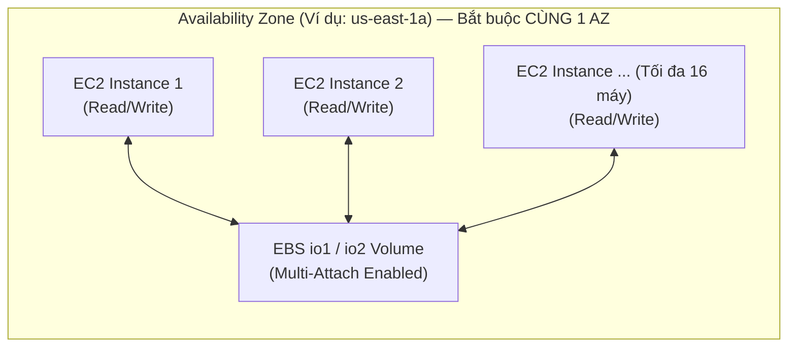

# Bài 64: EBS Multi-Attach

- **Phần (Section):** Section 7: EC2 Instance Storage
- **Lecture ID:** `26098298`
- **Video gốc:** `SAA_-_EBS_-_Multi_Attach_v2.mp4`
- **Thời lượng:** `01:45`

---

## 1. Kiến thức trọng tâm (Exam Notes)

### 1.1. Tính năng EBS Multi-Attach là gì?
- **Định nghĩa:** Cho phép gắn **cùng một ổ đĩa EBS (same EBS volume)** vào **nhiều EC2 instances cùng lúc** nằm trong **cùng một Availability Zone (same AZ)**.
- **Chỉ hỗ trợ dòng ổ đĩa:** **`io1` và `io2`** (Provisioned IOPS SSD).
- **Quyền truy cập:** Mỗi EC2 instance được gắn đều có **toàn quyền Đọc và Ghi (Full Read & Write permissions)** đồng thời lên ổ đĩa hiệu năng cao này.

---

### 1.2. Trường hợp sử dụng (Use Cases) & Các giới hạn bắt buộc nhớ cho kỳ thi SAA-C03
- **Use Cases:**
  1. Đạt tính sẵn sàng ứng dụng cao hơn (**Higher application availability**) trong các ứng dụng Linux phân cụm (**Clustered Linux applications** — ví dụ: **Teradata**).
  2. Các ứng dụng có khả năng tự quản lý các thao tác ghi đồng thời (**Manage concurrent write operations**).
- **3 Giới hạn quan trọng (Must-Know cho kỳ thi):**
  1. **Phạm vi AZ:** Chỉ hoạt động trong **cùng 1 Availability Zone (Single AZ)** — bạn KHÔNG thể dùng Multi-Attach để gắn 1 ổ EBS cho các máy EC2 ở các AZ khác nhau (muốn chia sẻ đa AZ hãy dùng **Amazon EFS**).
  2. **Số lượng máy tối đa:** Tối đa **16 EC2 instances** cùng gắn vào 1 ổ EBS tại một thời điểm.
  3. **Hệ thống tệp tin (File System):** Bắt buộc phải sử dụng một **Cluster-aware file system** (hệ thống tệp nhận biết cụm), **KHÔNG hỗ trợ** các file system tiêu chuẩn như `XFS`, `EXT4`,...

---

## 2. Phụ đề chi tiết theo mốc thời gian (Full Transcript & Timestamps)

| Thời gian | Nội dung lời giảng gốc (English) | Bản dịch tiếng Việt sát nghĩa |
| :--- | :--- | :--- |
| `00:00:00` | So now let's talk about the Multi-Attach feature of the EBS volumes. | Bây giờ hãy cùng tìm hiểu về tính năng **Multi-Attach** của các ổ đĩa EBS. |
| `00:00:05` | So as the name indicates, the Multi-Attach feature allows you to attach the same EBS volume to multiple EC2 instances in the same availability zone. | Đúng như tên gọi của nó, tính năng Multi-Attach cho phép bạn gắn **cùng một ổ đĩa EBS** vào **nhiều EC2 instances** nằm trong **cùng một Availability Zone**. |
| `00:00:15` | So what does that mean? That means that, well, we have multiple EC2 instances, and we have an `io2` volume with the Multi-Attach feature enabled. | Điều đó có nghĩa là gì? Nghĩa là khi chúng ta có nhiều EC2 instances và một ổ đĩa `io2` đã bật tính năng Multi-Attach, |
| `00:00:23` | Then this volume can be attached to multiple EC2 instances at a time, which is something that is only available for the `io1` and the `io2` family of EBS volumes. | thì ổ đĩa này có thể được gắn vào nhiều EC2 instances cùng một lúc — một tính năng **chỉ khả dụng đối với dòng ổ đĩa EBS `io1` và `io2`**. |
| `00:00:36` | Now, each instance will have full read and write permissions to the high-performance volume. And so that means that they can all write and read at the same time. | Mỗi EC2 instance sẽ có **toàn quyền đọc và ghi (full read and write permissions)** vào ổ đĩa hiệu năng cao này, nghĩa là tất cả các máy đều có thể đọc và ghi cùng một lúc. |
| `00:00:46` | So the use case for this is you have higher application availability in case of a clustered Linux application, for example, using Teradata, | Trường hợp sử dụng (use case) của tính năng này là khi bạn muốn nâng cao tính sẵn sàng cho các ứng dụng Linux chạy theo cụm (clustered Linux applications), ví dụ như **Teradata**, |
| `00:00:55` | or if your application must manage concurrent write operation. | hoặc khi bản thân ứng dụng của bạn phải tự quản lý các thao tác ghi đồng thời (concurrent write operations). |
| `00:00:59` | So just so you know, this Multi-Attach feature is only available from within a specified availability zone, of course. It doesn't allow you to attach an EBS volume from one AZ to another AZ. | Hãy lưu ý kỹ: tính năng Multi-Attach tất nhiên **chỉ hoạt động bên trong một Availability Zone cụ thể**. Nó không cho phép bạn gắn một ổ EBS xuyên từ AZ này sang AZ khác. |
| `00:01:12` | Another limitation of Multi-Attach is that it is up to 16 EC2 instances at a time that can be attaching the same volume. And this is something you have to know for the exam, so be careful to that 16 number. | Một giới hạn quan trọng khác của Multi-Attach là **tối đa 16 EC2 instances** tại một thời điểm có thể cùng gắn vào một ổ đĩa. Đây là con số bạn cần nhớ cho kỳ thi (`16 instances`). |
| `00:01:26` | Finally, for it to work, you must use a file system that is going to be cluster-aware. So it's a different file system than XFS or EXT4. | Cuối cùng, để hoạt động được mà không làm hỏng dữ liệu, bạn bắt buộc phải sử dụng một hệ thống tệp tin có khả năng nhận biết cụm (**cluster-aware file system**), chứ không dùng được các file system thông thường như `XFS` hay `EXT4`. |
| `00:01:41` | Okay, that's it for this lecture, I hope you liked it. And then we'll see you in the next lecture. | Đó là tất cả cho bài học này, hy vọng bạn thích nó và hẹn gặp lại ở bài học tiếp theo. |
