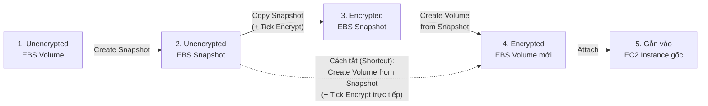

# Bài 65: EBS Encryption

- **Phần (Section):** Section 7: EC2 Instance Storage
- **Lecture ID:** `13528122`
- **Video gốc:** `SAA - EBS - Encryption v3.mp4`
- **Thời lượng:** `03:47`
- **Cheat sheet:** [topics/aws_storage.html](../../topics/aws_storage.html)

---

## 1. Kiến thức trọng tâm (Exam Notes)

### 1.1. Cơ chế Mã hóa ổ đĩa EBS (EBS Encryption)
Khi bạn tạo một **ổ đĩa EBS được mã hóa (Encrypted EBS Volume)**, bạn tự động nhận được 4 lợi ích sau:
1. **Data at rest (Dữ liệu lưu trữ tĩnh)** bên trong ổ đĩa được mã hóa.
2. **Data in flight (Dữ liệu truyền tải trên mạng)** di chuyển giữa EC2 instance và ổ đĩa EBS được mã hóa.
3. **Tất cả các bản Snapshots (All snapshots)** được tạo ra từ ổ đĩa đó đều tự động được mã hóa.
4. **Tất cả các ổ đĩa mới (All volumes)** được tạo ra từ các bản snapshot đó cũng đều được mã hóa.

#### Đặc điểm kỹ thuật:
- Toàn bộ quá trình mã hóa và giải mã diễn ra **hoàn toàn tự động và trong suốt (handled transparently)** bởi EC2 và EBS ở phía sau hậu trường — bạn không cần cài đặt hay cấu hình gì thêm trên OS.
- Tác động đến độ trễ (latency) là **cực kỳ nhỏ (minimal impact)**, gần như không nhận thấy.
- Sử dụng khóa mã hóa từ **AWS KMS (Key Management Service)** với thuật toán chuẩn **AES-256**.

---

### 1.2. Quy trình mã hóa một ổ đĩa EBS chưa được mã hóa (Encrypt an Unencrypted EBS Volume — Trọng tâm thi SAA-C03)

> [!IMPORTANT]
> Bạn **KHÔNG THỂ** bấm một nút "Encrypt" trực tiếp lên một ổ đĩa EBS đang có sẵn mà chưa được mã hóa. Để mã hóa nó, bạn phải thực hiện thông qua **EBS Snapshot** theo quy trình chuẩn sau:

1. **Bước 1:** Tạo một bản **EBS Snapshot** từ ổ đĩa EBS chưa mã hóa (bản snapshot này mặc định cũng sẽ *chưa được mã hóa*).
2. **Bước 2:** Sử dụng tính năng **Copy Snapshot** trên bản snapshot đó và tích chọn **Enable Encryption** (chọn KMS key).
3. **Bước 3:** Tạo một **EBS Volume mới** từ bản Snapshot đã mã hóa (ổ EBS mới này sẽ được mã hóa). *(Mẹo/Shortcut trên Console: Bạn cũng có thể chọn thẳng **Create volume from snapshot** từ bản snapshot chưa mã hóa ở Bước 1 và tích chọn **Encrypt this volume** ngay lúc tạo volume).*
4. **Bước 4:** Gắn (Attach) ổ đĩa EBS mới đã mã hóa vào EC2 instance ban đầu.

---

## 2. Phụ đề chi tiết theo mốc thời gian (Full Transcript & Timestamps)

| Thời gian | Nội dung lời giảng gốc (English) | Bản dịch tiếng Việt sát nghĩa |
| :--- | :--- | :--- |
| `00:00:00` | All right, finally, let's talk about the last operation, which is how do you encrypt an EBS volume? | Được rồi, bây giờ hãy cùng nói về thao tác quan trọng tiếp theo: làm thế nào để mã hóa một ổ đĩa EBS (EBS Encryption)? |
| `00:00:05` | So, when you create an encrypted EBS volume, right away you get the following: you get data at rest being encrypted inside your volume, | Khi bạn tạo một ổ đĩa EBS được mã hóa, ngay lập tức bạn nhận được các lợi ích sau: dữ liệu tĩnh (data at rest) nằm bên trong ổ đĩa được mã hóa, |
| `00:00:12` | all the data in flight between the instance and the volume is encrypted, all the snapshots will be encrypted, and all the volumes created from the snapshots are encrypted. | toàn bộ dữ liệu đang truyền tải (data in flight) giữa EC2 instance và ổ đĩa được mã hóa, tất cả các bản snapshots tạo từ nó sẽ được mã hóa, và tất cả các ổ đĩa tạo ra từ những bản snapshots đó cũng được mã hóa. |
| `00:00:20` | So, there's encryption all around the place, and the all encryption and decryption mechanism is handled transparently for you. So, you have nothing to do. It's all handled by EC2 and EBS behind the scenes. | Như vậy sự mã hóa bao phủ toàn diện mọi khâu, và toàn bộ cơ chế mã hóa/giải mã được xử lý hoàn toàn tự động và trong suốt (transparently) cho bạn bởi EC2 và EBS ở phía sau hậu trường. |
| `00:00:32` | So, encryption overall, something you should use because it has a very, very minimal impact on latency, almost nothing, and it leverages keys from KMS, so AES-256, that's something that you should know. | Nhìn chung bạn nên luôn bật mã hóa vì nó có tác động cực kỳ nhỏ đến độ trễ (gần như bằng không), và nó sử dụng khóa từ dịch vụ **KMS** với thuật toán **AES-256**. |
| `00:00:46` | And so, when you copy an unencrypted snapshot, then you enable encryption. | Khi bạn sao chép (copy) một bản snapshot chưa mã hóa, bạn có thể bật tính năng mã hóa cho bản sao. |
| `00:00:52` | So, let's talk about a very important thing, which is how do you encrypt an unencrypted EBS volume. | Điều này dẫn tới một câu hỏi cực kỳ quan trọng trong đề thi: **Làm thế nào để bạn mã hóa một ổ đĩa EBS hiện đang chưa được mã hóa?** |
| `00:00:58` | So, to encrypt an unencrypted EBS volume, you create an EBS snapshot of the volume. | Để mã hóa một ổ đĩa EBS chưa mã hóa: **Bước 1**, bạn tạo một bản EBS Snapshot của ổ đĩa đó. |
| `00:01:06` | Then you encrypt the EBS snapshot using the copy function. | **Bước 2**, bạn mã hóa bản EBS Snapshot đó bằng chức năng **Copy snapshot** (tích chọn Encrypt). |
| `00:01:09` | Then we create a new EBS volume from the snapshot and that volume will also be encrypted, and now we can attach the encrypted volume to the original instance. | **Bước 3**, chúng ta tạo một ổ đĩa EBS mới từ bản snapshot đã mã hóa (ổ đĩa mới này sẽ được mã hóa), và **Bước 4**, gắn ổ đĩa đã mã hóa đó vào lại EC2 instance ban đầu. |
| `00:01:17` | So, let's go have a look at how we do this in the console. | Hãy cùng vào AWS Console thực hành trực tiếp quy trình này. |
| `00:01:24` | So, let's create a one gigabytes EBS volume, and this one will not be encrypted. So, I will leave this setting unchecked, | Đầu tiên chúng ta tạo một ổ đĩa EBS 1 GB và để trống không chọn mã hóa (unencrypted). |
| `00:01:31` | and, therefore, when I create my volume and have a look at it, if we look at the state of encryption, it says `Not encrypted`. | Khi tạo xong và nhìn vào cột trạng thái Encryption của ổ đĩa, nó hiển thị là `Not encrypted`. |
| `00:01:38` | Okay, so what's happening is that if we do take to create a snapshot from this volume, as we can see the encryption setting will be set to `Not encrypted`. | Bây giờ nếu chúng ta chọn **Create snapshot** từ ổ đĩa này, mục Encryption của snapshot cũng sẽ tự động là `Not encrypted`. |
| `00:01:48` | So, any snapshots created from a non-encrypted EBS volume, will be not encrypted. | Tức là bất kỳ bản snapshot nào chụp từ một ổ EBS chưa mã hóa thì bản thân nó cũng chưa được mã hóa. |
| `00:01:53` | So, let's go ahead and create this snapshot, and let's go ahead to the snapshots page. And so, this snapshot, as we observe is not encrypted. | Hãy nhấn tạo bản snapshot này và chuyển sang trang **Snapshots**. Chúng ta thấy bản snapshot hiện trạng thái `Not encrypted`. |
| `00:02:02` | And so, to create an encrypted snapshot, now, what you have to do is to do action and then copy snapshot, and when you copy the snapshot, you have the option right here to enable encryption into the same destination region. | Để tạo ra một bản snapshot được mã hóa từ nó, bạn chọn **Actions -> Copy snapshot**, và trong hộp thoại Copy snapshot bạn có tùy chọn **Encrypt this snapshot** ngay trong cùng Destination Region. |
| `00:02:17` | So, now, this snapshot is going to be encrypted and you can select the KMS key, right here. So, we'll copy this snapshot and we're good. | Bạn tích chọn mã hóa, chọn khóa KMS (`aws/ebs`), rồi nhấn **Copy snapshot**. |
| `00:02:27` | Next, what I have to do is from this encrypted snapshot that is now completed I can create a volume. | Tiếp theo, từ bản snapshot đã mã hóa vừa hoàn tất (`Completed`), tôi chọn **Actions -> Create volume from snapshot**. |
| `00:02:37` | as we can see, we can create a one gigabyte EBS volume. And here encryption is enabled for this volume because my underlying snapshot is encrypted. | Như bạn thấy, khi tạo ổ EBS 1 GB từ bản snapshot này, tùy chọn **Encryption** đã được tự động bật sẵn bởi vì bản snapshot gốc bên dưới đã được mã hóa. |
| `00:02:47` | And, therefore, if I click on create volume, and have a look at my volumes on the left hand side, this one who was created from a snapshot is now available and it says encryption, `Encrypted`. | Khi nhấn **Create volume** và quay lại danh sách **Volumes**, ổ đĩa mới tạo từ snapshot hiện đã ở trạng thái `available` và cột Encryption ghi rõ là **`Encrypted`**. |
| `00:03:01` | We saw how we can encrypt one EBS volume this way, by going through a snapshot copying and so on. There's a shortcut. | Đó là quy trình đầy đủ qua bước Copy snapshot. Ngoài ra còn có một **cách tắt (shortcut)** nhanh hơn: |
| `00:03:08` | So, if you take your unencrypted snapshot, so this one is not encrypted, so if you take this snapshot and then you do action, create volume from snapshot, | Nếu bạn chọn thẳng bản snapshot **chưa mã hóa** ban đầu và nhấn **Actions -> Create volume from snapshot**, |
| `00:03:18` | you can actually on the fly enable encryption for the EBS volume directly from here, select an EBS key, and you would create an encrypted EBS volume this way through an unencrypted snapshot. | bạn thực chất có thể tích chọn bật **Encrypt this volume** ngay trực tiếp tại màn hình tạo ổ đĩa này, chọn khóa KMS và tạo ra ngay một ổ đĩa EBS đã mã hóa từ bản snapshot chưa mã hóa! |
| `00:03:30` | Okay, so let's say you've seen all the options. Just to be finished make sure to delete your snapshots by typing delete and then you would do the exact same thing on your volumes. Just delete these EBS volumes. | Vậy là bạn đã nắm được tất cả các cách. Để kết thúc bài thực hành, hãy nhớ xóa các bản snapshots và các ổ đĩa EBS vừa tạo. Hẹn gặp lại bạn ở bài học tiếp theo! |
