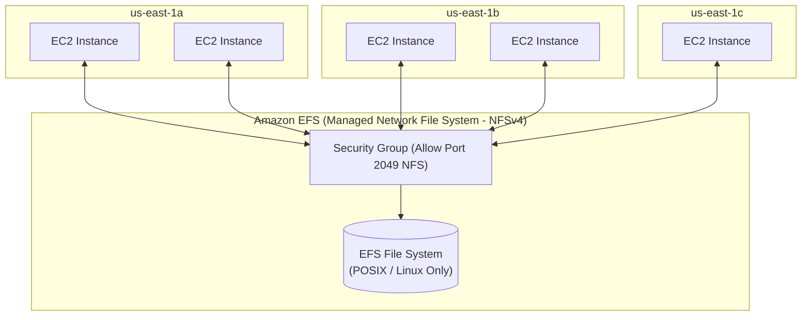

# Bài 66: Amazon EFS

- **Phần (Section):** Section 7: EC2 Instance Storage
- **Lecture ID:** `13528128`
- **Video gốc:** `SAA_-_EFS_-_Overview_v6.mp4`
- **Thời lượng:** `05:18`

---

## 1. Kiến thức trọng tâm (Exam Notes)

> [!TIP]
> **Tóm tắt nhanh dịch vụ Amazon EFS (SAA-C03 Cheat Sheet)**
> - **Là gì:** Hệ thống lưu trữ tệp mạng được quản lý hoàn toàn (**Managed NFS - Network File System**) có thể mount đồng thời lên hàng trăm máy chủ **Linux EC2** trải rộng trên **nhiều Availability Zones (Multi-AZ)**.
> - **Dùng khi nào (Use case điển hình trong đề):** Chia sẻ tệp tin chung (CMS, WordPress, thư mục dùng chung POSIX) giữa nhiều Linux EC2 instances hoặc Containers ở nhiều AZs khác nhau.
> - **Khác gì dịch vụ gần giống:**
>   - **EFS vs. EBS:** `EFS` là File Storage (NFSv4) chia sẻ **Multi-AZ** cho hàng trăm máy Linux; `EBS` là Block Storage chỉ nằm trong **1 AZ**.
>   - **EFS vs. FSx for Windows File Server:** `EFS` chỉ dùng cho **Linux (POSIX)**; nếu đề bài yêu cầu chia sẻ tệp cho máy chủ **Windows (giao thức SMB, Active Directory)** thì phải chọn **Amazon FSx for Windows File Server**.
> - **Điểm hay bị hỏi (Giới hạn, Mặc định, Từ khóa gợi ý):**
>   - **Giới hạn & Bảo mật:** Chỉ hỗ trợ **Linux**; kiểm soát truy cập mạng vào EFS thông qua **Security Group (cổng TCP `2049` - NFS)** và phân quyền ứng dụng qua **EFS Access Points**.
>   - **Tối ưu chi phí:** Bật **EFS Lifecycle Policy** để tự động chuyển các tệp ít truy cập sang **EFS Standard-IA (Infrequent Access)** hoặc chọn **EFS One Zone** cho môi trường dev/test.
>   - **Từ khóa gợi ý:** `"shared POSIX-compliant file system across multiple AZs for Linux EC2 instances"` $\rightarrow$ **Amazon EFS**.

### 1.1. Amazon EFS (Elastic File System) là gì?
- **Định nghĩa:** **Amazon EFS** là một hệ thống tệp tin mạng được quản lý toàn phần (**Managed NFS — Network File System**).
- **Đặc điểm nổi bật nhất:**
  - Có thể được gắn (**mounted**) đồng thời lên **hàng trăm / hàng nghìn EC2 instances**.
  - Hoạt động xuyên qua **nhiều Availability Zones (Multi-AZ)** cùng một lúc.
  - Tính sẵn sàng cực cao (Highly available), mở rộng tự động lên tới quy mô **Petabyte** (`10+ GB/s` throughput), chi phí cao (đắt gấp khoảng **3 lần** ổ EBS `gp2`), nhưng tính phí **Pay-per-use** (trả tiền theo số GB thực tế sử dụng, **không cần cấp phát dung lượng trước**).

#### Lưu ý bắt buộc cho kỳ thi SAA-C03:
- **Use Cases:** Content Management (CMS), Web serving, Data sharing, **WordPress**.
- **Giao thức & Hệ điều hành:** Sử dụng giao thức **NFSv4** (cổng **2049**), hệ thống tệp chuẩn **POSIX** -> **CHỈ tương thích với các EC2 chạy hệ điều hành Linux (Linux-based AMIs)**, **KHÔNG hỗ trợ Windows** (với Windows phải dùng *Amazon FSx for Windows File Server*).
- **Bảo mật & Mã hóa:** Kiểm soát quyền truy cập mạng vào EFS thông qua **Security Group** (mở cổng 2049 từ Security Group của EC2). Hỗ trợ mã hóa dữ liệu tĩnh (**Encryption at rest**) bằng **KMS**.

---

### 1.2. Các chế độ Hiệu năng (Performance Modes), Thông lượng (Throughput Modes) & Tầng lưu trữ (Storage Classes)

#### 1. Performance Mode (Thiết lập lúc tạo EFS):
| Chế độ | Đặc điểm & Use Case |
| :--- | :--- |
| **General Purpose (Mặc định)** | Độ trễ thấp (Latency-sensitive): phù hợp cho **Web server, CMS, WordPress**,... |
| **Max I/O** | Độ trễ cao hơn nhưng **thông lượng (throughput) và khả năng xử lý song song cực cao (highly parallel)**: phù hợp cho **Big Data, Media processing**. |

#### 2. Throughput Mode:
| Chế độ | Đặc điểm & Use Case |
| :--- | :--- |
| **Bursting** | Thông lượng tăng tỷ lệ thuận với dung lượng lưu trữ (`50 MB/s` trên mỗi `1 TB` + burst lên `100 MB/s`). |
| **Provisioned** | Bạn chủ động chỉ định mức thông lượng cố định **độc lập với dung lượng lưu trữ** (ví dụ: cần `1 GB/s` dù chỉ lưu `1 TB` dữ liệu). |
| **Elastic (Khuyến nghị)** | Tự động co giãn thông lượng lên/xuống theo tải thực tế (lên tới `3 GB/s` đọc và `1 GB/s` ghi), trả tiền theo mức sử dụng — lý tưởng cho **unpredictable workloads** (tải không đoán trước được). |

#### 3. Storage Classes & Availability (Tiết kiệm tới 90% chi phí):
- **Storage Tiers (Quản lý qua Lifecycle Policies tự động chuyển file sau $N$ ngày không truy cập):**
  - **EFS Standard:** Dành cho các file truy cập thường xuyên.
  - **EFS Infrequent Access (`EFS-IA`):** Chi phí lưu trữ thấp hơn rất nhiều, nhưng có tính phí nhỏ mỗi khi đọc/truy xuất file. Chuyển file từ Standard sang `EFS-IA` bằng **Lifecycle Policy** (ví dụ: sau 30 hoặc 60 ngày không truy cập).
  - **EFS Archive:** Dành cho dữ liệu hiếm khi truy cập (vài lần mỗi năm), chi phí lưu trữ rẻ nhất.
- **Availability & Durability:**
  - **Regional (Standard):** Lưu trữ dữ liệu qua **Multi-AZ**, dùng cho **Production**.
  - **One Zone (`EFS One Zone` / `EFS One Zone-IA`):** Lưu trữ trong **1 AZ duy nhất**, tuyệt vời cho môi trường **Development**, bật sẵn sao lưu tự động và tiết kiệm tới 90% chi phí.

---

## 2. Phụ đề chi tiết theo mốc thời gian (Full Transcript & Timestamps)

| Thời gian | Nội dung lời giảng gốc (English) | Bản dịch tiếng Việt sát nghĩa |
| :--- | :--- | :--- |
| `00:00:00` | Hi, and welcome to this lecture on Amazon EFS, Elastic File System. | Xin chào và chào mừng bạn đến với bài giảng về **Amazon EFS (Elastic File System)**. |
| `00:00:04` | So EFS is a managed NFS, which is a network file system. | EFS là một dịch vụ **NFS (Network File System — Hệ thống tệp tin mạng)** được quản lý toàn phần bởi AWS. |
| `00:00:08` | And because it's a network file system, it can be mounted on many EC2 instances, and these EC2 instances can also be in different availability zones, that's the whole power of EFS. | Và bởi vì là một hệ thống tệp tin mạng, nó có thể được gắn (mounted) lên rất nhiều EC2 instances cùng lúc, và các EC2 instances này có thể nằm ở các Availability Zones khác nhau — đó chính là sức mạnh cốt lõi của EFS. |
| `00:00:21` | So it's highly available, it's very scalable, it's expensive. It's about three times the cost of a GP2 EBS volume, and you pay per use so you don't have to provision capacity in advance. | Nó có tính sẵn sàng cao, khả năng mở rộng rất lớn, và chi phí khá đắt (gấp khoảng 3 lần chi phí của ổ EBS `gp2`), nhưng bạn trả tiền theo mức sử dụng thực tế (pay-per-use) nên không cần cấp phát dung lượng trước. |
| `00:00:31` | Let me explain. So you have your EFS file system and you surround it with a security group. | Hãy nhìn vào sơ đồ: bạn có hệ thống tệp EFS được bao bọc bảo vệ bởi một **Security Group**. |
| `00:00:36` | And then you can have EC2 instances, many of them in the `us-east-1a` availability zone for example, or EC2 instances in the `us-east-1b` availability zone or `us-east-1c` availability zones for your EC2 instances. | Và bạn có thể có nhiều EC2 instances ở `us-east-1a`, nhiều EC2 instances ở `us-east-1b` và `us-east-1c`. |
| `00:00:51` | And they can all connect at the same time to the same network file system through EFS. | Tất cả các máy chủ đó đều có thể kết nối đồng thời tới cùng một hệ thống tệp tin mạng thông qua EFS. |
| `00:00:58` | So the use cases of EFS are content management, web serving, data sharing, WordPress. | Các trường hợp sử dụng (use cases) điển hình của EFS là hệ thống quản trị nội dung (CMS), máy chủ web (web serving), chia sẻ dữ liệu (data sharing) và **WordPress**. |
| `00:01:04` | It uses internally the NFS protocol, and to control access to your EFS, you need to set up a security group. | Bên trong nó sử dụng giao thức **NFS**, và để kiểm soát quyền truy cập vào EFS, bạn cần thiết lập một **Security Group**. |
| `00:01:13` | Now EFS, it's very important to note that it's only compatible with Linux-based AMI and not Windows. | Một lưu ý cực kỳ quan trọng: **EFS chỉ tương thích với các AMI chạy hệ điều hành Linux (Linux-based AMI), KHÔNG hỗ trợ Windows**. |
| `00:01:20` | You can enable encryption at rest in your EFS drive using KMS, and it's a standard file system on Linux, so uses the POSIX system, and it has a standard file API. | Bạn có thể bật mã hóa dữ liệu tĩnh (encryption at rest) trên EFS bằng **KMS**; đây là hệ thống tệp tiêu chuẩn trên Linux tuân thủ chuẩn **POSIX** và có File API chuẩn. |
| `00:01:32` | And the cool thing about EFS is that you don't need to plan the capacity in advance. The file system will scale automatically, and it's pay-per-use for each gigabyte of data you use in EFS. | Điểm tuyệt vời của EFS là bạn không cần lên kế hoạch dung lượng trước — hệ thống tệp sẽ tự động mở rộng và tính phí theo từng GB dữ liệu bạn thực sự lưu trữ. |
| `00:01:44` | Then we have different performance and storage classes. So first, the scale about EFS: you get thousands of concurrent NFS clients and 10 gigabytes plus of throughput, and you can grow to a petabyte scale network file system automatically, which is really nice. | Tiếp theo là về quy mô, chế độ hiệu năng và tầng lưu trữ: EFS hỗ trợ hàng nghìn NFS clients kết nối đồng thời, thông lượng trên 10 GB/giây, và tự động mở rộng tới quy mô Petabyte. |
| `00:02:00` | You can also set the performance mode at the EFS network file system creation time, and you have several options. | Bạn có thể thiết lập **Performance Mode (Chế độ hiệu năng)** lúc tạo EFS với 2 tùy chọn: |
| `00:02:06` | The first one is General Purpose, which is the default. It's used for latency sensitive use cases such as a web server, a CMS, et cetera. | Thứ nhất là **General Purpose** (mặc định): dùng cho các tác vụ nhạy cảm với độ trễ (latency-sensitive) như web server, CMS,... |
| `00:02:14` | But if you wanted to maximize throughput, you have Max I/O, which is a high latency kind of network file system, but higher throughput and it's highly parallel. So it's great if you have big data applications or media processing needs. | Thứ hai, nếu bạn muốn tối đa hóa thông lượng, bạn chọn **Max I/O**: độ trễ cao hơn một chút nhưng thông lượng cực cao và xử lý song song mạnh mẽ — rất phù hợp cho các ứng dụng Big Data hoặc xử lý truyền thông (media processing). |
| `00:02:29` | Now, throughput mode, you have different options. The first one is Bursting. So you have one terabyte, means that it's 50 megabytes per second plus burst of up to 100 megabytes per second. | Về **Throughput Mode (Chế độ thông lượng)**, bạn có 3 tùy chọn: Thứ nhất là **Bursting** — thông lượng tăng theo dung lượng lưu trữ (ví dụ 1 TB cho 50 MB/s cơ bản và burst lên 100 MB/s). |
| `00:02:44` | Provisioned is when you want to set your throughput regardless of your storage size. So with Provisioned you can have one gigabyte per second for one terabyte of storage. That is fine because you have decorrelated your throughput from your storage. | Thứ hai là **Provisioned** — khi bạn muốn thiết lập mức thông lượng cố định bất kể dung lượng lưu trữ lớn hay nhỏ (ví dụ đạt 1 GB/s dù chỉ lưu 1 TB dữ liệu, tách biệt hoàn toàn thông lượng khỏi dung lượng). |
| `00:03:04` | And finally, to make things a little bit simpler, you have Elastic to automatically scale the throughput up and down based on your workload. | Và thứ ba là **Elastic** — tự động co giãn thông lượng lên và xuống dựa theo tải thực tế của bạn (lên tới 3 GB/s cho thao tác đọc và 1 GB/s cho thao tác ghi), rất phù hợp cho các tải công việc không đoán trước được (**unpredictable workloads**). |
| `00:03:25` | Now for storage classes we have several options. We have storage tiers, which is a lifecycle management feature to allow you to move files to different storage tiers after a certain number of days. | Về **Storage Classes (Các tầng lưu trữ)**, chúng ta có tính năng quản lý vòng đời (**Lifecycle Management**) cho phép tự động chuyển các tệp tin sang các tầng lưu trữ khác nhau sau một số ngày nhất định không được truy cập: |
| `00:03:36` | So you have the Standard tier which is used for frequently accessed files, and then you have the `EFS-IA` tier for infrequent access, which gives you a cost to retrieve files but a lower price to store these files. | Bạn có tầng **Standard** cho các tệp truy cập thường xuyên; tầng **`EFS-IA` (Infrequent Access)** cho các tệp ít truy cập hơn với giá lưu trữ rẻ hơn nhiều nhưng có một khoản phí nhỏ khi đọc lấy tệp ra; |
| `00:03:52` | And then you have the Archive storage tier. This is for rarely accessed data, so you only access, for example, data a few times a year, which is going to be a lot cheaper to store the data on that tier. | và tầng **Archive** dành cho dữ liệu hiếm khi truy cập (vài lần mỗi năm) với chi phí lưu trữ còn rẻ hơn nữa. |
| `00:04:03` | To move your files automatically between your storage tiers, you can implement lifecycle policies, which will allow you define after how many days a file should be moved to which tier. | Để tự động di chuyển tệp giữa các tầng này, bạn cấu hình **Lifecycle Policies** (ví dụ: tệp nào không được mở trong 60 ngày sẽ tự động chuyển từ EFS Standard sang `EFS-IA`). |
| `00:04:28` | Now, in terms of availability and durability, Standard is going to be great when you have a multi-AZ setup, so your EFS across multiple availability zones, which is great for your production workloads so that you're resistant to disasters. | Về mặt độ sẵn sàng và độ bền dữ liệu: chế độ **Regional (Standard)** trải rộng qua **Multi-AZ**, cực kỳ tốt cho môi trường **Production** để chống chịu thảm họa. |
| `00:04:44` | But if you just want to do development and want to have cheaper options, then you choose One Zone, which is going to give you only one availability zone, and you will still have backups on it, and it's also compatible with the IA type of storage tier (`EFS One Zone-IA`). | Nhưng nếu bạn chỉ dùng cho môi trường **Development** và muốn tiết kiệm chi phí, bạn có thể chọn **One Zone** (chỉ nằm trong 1 AZ duy nhất), vẫn có sao lưu tự động và kết hợp được với tầng IA tạo thành **`EFS One Zone-IA`** giúp tiết kiệm tới 90% chi phí. |
| `00:05:13` | So that's it for this lecture, I hope you liked it, and I will see you in the next lecture. | Đó là tất cả nội dung của bài giảng này. Hẹn gặp lại bạn ở bài thực hành tiếp theo! |
