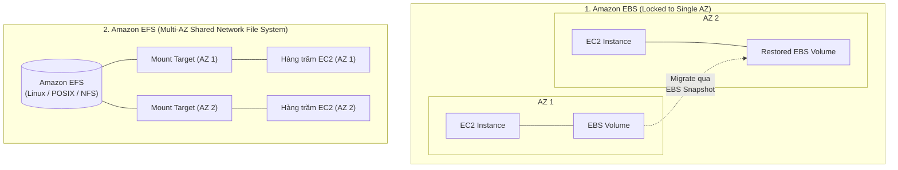

# Bài 68: EFS vs EBS

- **Phần (Section):** Section 7: EC2 Instance Storage
- **Lecture ID:** `13528138`
- **Video gốc:** `SAA_-_EFS_-_EFS_vs_EBS_v5.mp4`
- **Thời lượng:** `02:11`

---

## 1. Kiến thức trọng tâm (Exam Notes)

### 1.1. Sơ đồ kiến trúc so sánh EBS, EFS và Instance Store

---

### 1.2. Bảng tổng hợp so sánh EBS vs EFS vs Instance Store (Trọng tâm ôn thi SAA-C03)

| Tiêu chí | Amazon EBS (Elastic Block Store) | Amazon EFS (Elastic File System) | EC2 Instance Store |
| :--- | :--- | :--- | :--- |
| **Bản chất lưu trữ** | Ổ đĩa khối qua mạng (**Network Block Storage**). | Hệ thống tệp chia sẻ qua mạng (**Network File System — NFSv4**). | Ổ cứng vật lý gắn trực tiếp vào máy chủ host (**Physically attached Local Disk**). |
| **Số lượng EC2 gắn đồng thời** | **1 EC2 instance** tại một thời điểm *(ngoại trừ `io1`/`io2` bật Multi-Attach tối đa 16 máy trong cùng 1 AZ)*. | **Hàng trăm / hàng nghìn EC2 instances** cùng lúc. | Chỉ duy nhất **1 EC2 instance** chứa nó. |
| **Phạm vi Availability Zone (AZ)** | **Bị khóa trong 1 AZ (Locked at AZ level)**. Muốn chuyển sang AZ khác phải chụp **Snapshot** rồi Restore. | **Trải rộng qua nhiều AZ (Multi-AZ)** thông qua các Mount Targets ở từng AZ. | Gắn chặt với máy chủ vật lý tại 1 AZ. |
| **Hệ điều hành hỗ trợ** | Cả **Linux và Windows**. | **Chỉ hỗ trợ Linux (POSIX)**. | Cả **Linux và Windows**. |
| **Hiệu năng & Mở rộng** | - `gp2`: IOPS tăng theo dung lượng ổ. - `gp3` & `io1`/`io2`: Tăng IOPS độc lập với dung lượng. - Sao lưu (Backup/Snapshot) tiêu tốn I/O của ổ nên tránh chạy lúc tải cao. | Tự động co giãn dung lượng (Pay-per-use, tới Petabyte). Chi phí cao hơn EBS (~3x `gp2`), tối ưu chi phí nhờ **Storage Tiers (`EFS-IA`, `Archive`, `One Zone`)**. | **IOPS cao nhất tuyệt đối** (lên tới hàng triệu IOPS trên dòng `i3`). |
| **Vòng đời dữ liệu** | Root EBS volume mặc định bị xóa khi Terminate EC2 (`Delete on Termination = true` mặc định, có thể tắt). | Tồn tại độc lập hoàn toàn với vòng đời của các EC2 instances. | **Ephemeral (Tạm thời):** Mất sạch dữ liệu nếu EC2 bị **Stop**, **Hibernate**, **Terminate** hoặc lỗi phần cứng host. |

---

## 2. Phụ đề chi tiết theo mốc thời gian (Full Transcript & Timestamps)

| Thời gian | Nội dung lời giảng gốc (English) | Bản dịch tiếng Việt sát nghĩa |
| :--- | :--- | :--- |
| `00:00:00` | So now let's talk about the differences of EBS volumes and EFS file systems. | Bây giờ hãy cùng tổng kết lại những điểm khác biệt giữa **EBS volumes** và **EFS file systems**. |
| `00:00:05` | So the EBS volumes, they're attached to one instance at a time, except in the edge case of using the multi-attach feature of the `io1` and `io2` types of volume, but that is for very specific use cases. | Đối với **EBS volumes**, mỗi ổ đĩa chỉ được gắn vào **1 EC2 instance tại một thời điểm** (ngoại trừ trường hợp đặc thù dùng tính năng Multi-Attach trên dòng `io1` và `io2`). |
| `00:00:18` | EBS volumes are also locked at the AZ level, so here is an example: we have one EC2 in AZ 1 and we have one EBS volume attached to it and it cannot be attached to an EC2 instance in AZ 2. | EBS volumes cũng **bị khóa ở cấp độ Availability Zone (AZ)**: ví dụ một ổ EBS gắn với EC2 ở `AZ 1` sẽ không thể gắn trực tiếp sang một EC2 ở `AZ 2`. |
| `00:00:31` | For the `gp2` type of volume, the I/O will increase if the disk size increases, and for the `gp3` and `io1` type of volumes, you can increase the I/O independently from your disk size. | Đối với loại ổ `gp2`, hiệu năng I/O sẽ tăng khi dung lượng ổ đĩa tăng; còn đối với `gp3` và `io1`/`io2`, bạn có thể tăng I/O độc lập hoàn toàn với dung lượng ổ đĩa. |
| `00:00:46` | To migrate an EBS volume across AZ, we need to take a snapshot, so it will go into the EBS snapshots, and then we can restore the snapshot into another AZ. This is how we move from one AZ to the next. | Để di chuyển (migrate) một ổ EBS sang AZ khác, chúng ta cần chụp một bản **EBS Snapshot**, sau đó khôi phục (restore) bản snapshot đó thành một ổ EBS mới ở AZ đích. |
| `00:01:00` | Now, the EBS volumes backups, they will use I/O, and so you shouldn't run them while your application is handling a lot of traffic because that may impact the performance. | Lưu ý rằng quá trình sao lưu (chụp snapshot) ổ đĩa EBS có sử dụng tài nguyên I/O của ổ đĩa, vì vậy bạn không nên chạy sao lưu khi ứng dụng đang xử lý lưu lượng truy cập lớn vì có thể làm ảnh hưởng đến hiệu năng. |
| `00:01:10` | For your EC2 instances, the root EBS volumes of your instances will get terminated by default if the EC2 instance gets terminated, but you can disable that behavior. | Đối với các EC2 instances, ổ đĩa **Root EBS volume** mặc định sẽ bị xóa theo nếu EC2 instance bị Terminate, nhưng bạn có thể tắt hành vi đó đi. |
| `00:01:20` | Now for EFS, it's a bit different. So it's a network file system, and the goal is really to attach it to hundreds of instances across availability zone, so we really see the distinction here. | Ngược lại, đối với **Amazon EFS**, đây là một hệ thống tệp tin mạng (**Network File System**) và mục tiêu của nó là gắn đồng thời cho **hàng trăm instances trải rộng qua nhiều Availability Zones**. |
| `00:01:31` | So with one EFS file system, we can have different mount targets in different AZs, and then multiple instances can share that one file system together. | Chỉ với 1 hệ thống tệp EFS duy nhất, chúng ta có các Mount Targets ở nhiều AZ khác nhau và nhiều EC2 instances có thể chia sẻ chung hệ thống tệp đó cùng lúc. |
| `00:01:39` | So it's very helpful, for example, when you have WordPress and it's only for Linux instances because it is using the POSIX system. | Ví dụ điển hình là chạy các máy chủ web **WordPress**; và hãy nhớ EFS **chỉ dành cho các máy chủ Linux** vì nó sử dụng hệ thống tệp chuẩn **POSIX**. |
| `00:01:46` | The EFS has a higher price point than EBS, but you can leverage storage tiers for cost savings. | EFS có mức giá cao hơn EBS, nhưng bạn có thể tận dụng các tầng lưu trữ (**Storage Tiers / Lifecycle Policies**) để tiết kiệm chi phí. |
| `00:01:53` | So hopefully you understand now the difference between EFS and EBS and for the Instance Store, well it is physically attached to the EC2 instance, and so therefore if you lose your EC2 instance, you will lose the storage as well. | Còn đối với **EC2 Instance Store**, nó được gắn vật lý trực tiếp vào máy chủ chứa EC2 instance, nên nếu bạn dừng hoặc mất EC2 instance đó thì bạn cũng sẽ mất luôn dữ liệu lưu trữ trên đó. |
| `00:02:06` | All right, that's it, I hope you liked it, and I will see you in the next lecture. | Đó là tất cả cho bài học này, hy vọng bạn thích nó và hẹn gặp lại ở bài học tiếp theo! |
