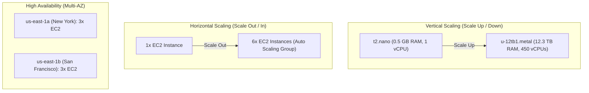

# Bài 70: High Availability and Scalability (Tính sẵn sàng cao và Khả năng mở rộng)

- **Phần (Section):** Phần 8: High Availability and Scalability: ELB & ASG
- **Mã bài học (Lecture ID):** `13531374`
- **Tệp video:** `SAA - High Availability and Scalability.mp4`
- **Thời lượng:** `05:05`

---

## 1. Kiến thức trọng tâm (Exam Notes)

### 1.1. Khái niệm cốt lõi (Core Concepts)
- **Scalability (Khả năng mở rộng):** Khả năng một hệ thống ứng dụng có thể xử lý khối lượng tải lớn hơn bằng cách thích ứng. Có 2 loại:
  1. **Vertical Scalability (Mở rộng theo chiều dọc - Scale Up / Scale Down):**
     - Tăng/giảm **kích thước của instance** (ví dụ: nâng từ `t2.micro` lên `t2.large`, hoặc từ `t2.nano` (0.5 GB RAM, 1 vCPU) lên `u-12tb1.metal` (12.3 TB RAM, 448/450 vCPUs)).
     - **Ví dụ thực tế:** Tuyển một nhân viên tổng đài mới (Junior) chỉ nghe được 5 cuộc gọi/phút -> Nâng cấp lên nhân viên giàu kinh nghiệm (Senior) nghe được 10 cuộc gọi/phút.
     - **Trường hợp sử dụng phổ biến:** Các hệ thống **không phân tán (non-distributed systems)** như cơ sở dữ liệu (**RDS**, **ElastiCache**).
     - **Giới hạn:** Luôn có giới hạn phần cứng tối đa (hardware limit).
  2. **Horizontal Scalability (Mở rộng theo chiều ngang - Scale Out / Scale In — còn gọi là Elasticity):**
     - Tăng/giảm **số lượng instances / hệ thống** cho ứng dụng (**Scale Out** = thêm instance; **Scale In** = bớt instance).
     - **Ví dụ thực tế:** Thay vì nâng cấp 1 nhân viên tổng đài, ta thuê thêm nhân viên thứ 2, thứ 3, thứ 6 cùng nghe điện thoại.
     - **Trường hợp sử dụng phổ biến:** Hệ thống phân tán (**distributed systems**), ứng dụng web hiện đại, dễ dàng thực hiện trên đám mây với **Amazon EC2** (Auto Scaling Group, Load Balancer).

- **High Availability (Tính sẵn sàng cao - HA):**
  - Thường đi đôi với Horizontal Scaling nhưng không phải lúc nào cũng giống nhau.
  - **Định nghĩa:** Chạy ứng dụng/hệ thống ở **ít nhất 2 trung tâm dữ liệu (Data Centers)** hoặc **tối thiểu 2 Availability Zones (Multi-AZ)** trong AWS.
  - **Mục tiêu:** Sống sót khi một trung tâm dữ liệu gặp sự cố (**survive a data center loss**).
  - **Ví dụ thực tế:** Đặt 3 nhân viên tổng đài ở tòa nhà tại New York và 3 nhân viên ở tòa nhà tại San Francisco. Nếu tòa nhà New York mất mạng, tòa nhà San Francisco vẫn tiếp tục nhận cuộc gọi.
  - **2 dạng High Availability:**
    - **Passive HA (Thụ động):** Ví dụ **RDS Multi-AZ** (chỉ có 1 DB chính hoạt động, DB dự phòng chờ sẵn ở AZ khác).
    - **Active HA (Chủ động):** Kết hợp với Horizontal Scaling (ví dụ: Auto Scaling Group + Load Balancer trải đều các EC2 instances đang chạy đồng thời trên nhiều AZ).

---

### 1.2. Bảng so sánh Scalability vs High Availability (trên EC2)

| Tiêu chí | Vertical Scaling | Horizontal Scaling (Elasticity) | High Availability (HA) |
| :--- | :--- | :--- | :--- |
| **Bản chất** | Tăng kích thước (Size) của từng Instance | Tăng số lượng (Number) các Instances | Chạy các Instances của cùng ứng dụng trên **nhiều AZ (Multi-AZ)** |
| **Thuật ngữ AWS** | **Scale Up** (tăng) / **Scale Down** (giảm) | **Scale Out** (thêm máy) / **Scale In** (bớt máy) | **Multi-AZ** |
| **Công cụ / Dịch vụ** | Đổi Instance Type (`t2.micro` -> `t2.large`) | **Auto Scaling Group (ASG)**, **Load Balancer (ELB)** | **ASG Multi-AZ**, **ELB Multi-AZ**, **RDS Multi-AZ** |
| **Mục đích chính** | Tăng sức mạnh xử lý trên 1 node đơn lẻ | Đáp ứng lưu lượng truy cập tăng/giảm linh hoạt | Chịu lỗi khi đứt/sập 1 Data Center (AZ) |

---

## 2. Phụ đề chi tiết theo mốc thời gian (Full Transcript & Timestamps)

| Thời gian | Nội dung lời giảng gốc (English) | Bản dịch tiếng Việt sát nghĩa |
| :--- | :--- | :--- |
| `00:00:00.200` | So, it's just a quick lecture, just to touch base on what is scalability and high availability. | Đây chỉ là một bài giảng ngắn để điểm qua khái niệm về khả năng mở rộng (scalability) và tính sẵn sàng cao (high availability). |
| `00:00:04.290` | This is quite the beginners level, so if you feel very confident about these concepts, feel free to skip this lecture. | Nội dung này ở mức độ khá cơ bản cho người mới bắt đầu, vì vậy nếu bạn đã rất tự tin với các khái niệm này, bạn có thể thoải mái bỏ qua bài giảng này. |
| `00:00:09.450` | Now, scalability means that your application system can hinder a greater load by adapting. | Bây giờ, khả năng mở rộng (scalability) có nghĩa là hệ thống ứng dụng của bạn có thể xử lý (handle) một tải trọng lớn hơn bằng cách thích ứng. |
| `00:00:14.650` | And so, there are two kind of scalability. There's going to be vertical scalability or horizontal scalability, also called elasticity. | Có hai loại khả năng mở rộng: mở rộng theo chiều dọc (vertical scalability) hoặc mở rộng theo chiều ngang (horizontal scalability - còn được gọi là tính đàn hồi / elasticity). |
| `00:00:22.650` | And so, scalability is different from high availability. They're linked but different. | Và khả năng mở rộng thì khác với tính sẵn sàng cao (high availability). Chúng có liên kết với nhau nhưng khác biệt nhau. |
| `00:00:28.520` | So, what I want to do is deep dive into all this distinction and we'll use a call center as a fun example to really put into practice how things work. | Vì vậy, điều tôi muốn làm là đi sâu vào sự khác biệt này và chúng ta sẽ sử dụng một trung tâm cuộc gọi (call center) làm ví dụ thú vị để thực sự hình dung cách mọi thứ hoạt động. |
| `00:00:36.030` | So, let's talk about vertical scalability. Vertical scalability, that means that you need to increase the size of your instance. | Hãy nói về khả năng mở rộng theo chiều dọc (vertical scalability). Mở rộng theo chiều dọc có nghĩa là bạn cần tăng kích thước của instance. |
| `00:00:43.180` | So, let's take a phone operator, for example. We have a junior operator and we just hired him. He's great but he can only take five calls per minute. | Hãy lấy một nhân viên trực tổng đài làm ví dụ. Chúng ta có một nhân viên mới (junior operator) vừa mới được tuyển. Anh ấy rất tuyệt nhưng chỉ có thể nhận 5 cuộc gọi mỗi phút. |
| `00:00:51.070` | Now, we have a senior operator and he's much greater. He can take up to ten calls per minute. | Bây giờ, chúng ta có một nhân viên kỳ cựu (senior operator) giỏi hơn nhiều. Anh ấy có thể nhận tới 10 cuộc gọi mỗi phút. |
| `00:00:57.720` | So, we've basically scaled up our junior operator into senior operator and he's faster and better. This is vertical scalability. | Vậy về cơ bản, chúng ta đã nâng cấp (scale up) nhân viên junior thành nhân viên senior, anh ấy nhanh hơn và giỏi hơn. Đó chính là mở rộng theo chiều dọc (vertical scalability). |
| `00:01:05.290` | As you can see, it goes up. So, for example, in EC2, our application runs on a t2.micro and we want to upscale that application, that means we want to run it on a t2.large. | Như bạn thấy, nó đi lên theo chiều dọc. Ví dụ trong EC2, ứng dụng của chúng ta chạy trên một máy `t2.micro` và chúng ta muốn nâng cấp ứng dụng đó, nghĩa là chúng ta muốn chạy nó trên một máy `t2.large`. |
| `00:01:16.000` | So, when do we use vertical scalability? Well, it's very common when you have non distributed system, such as a data base. | Vậy khi nào chúng ta sử dụng mở rộng theo chiều dọc? Nó rất phổ biến khi bạn có một hệ thống không phân tán (non-distributed system), chẳng hạn như cơ sở dữ liệu (database). |
| `00:01:23.510` | So, it's quite common for a data base, for example, on RDS or ElastiCache, these are services that you can just scale vertically by upgrading the underlying instance type, | Rất phổ biến đối với cơ sở dữ liệu trên RDS hoặc ElastiCache, đây là những dịch vụ mà bạn có thể mở rộng theo chiều dọc chỉ bằng cách nâng cấp loại instance bên dưới, |
| `00:01:33.940` | although, there usually are limits to how much you can vertically scale and that's a hardware limit but still, vertical scalability is fine for a lot of use cases. | mặc dù thường có giới hạn về mức độ bạn có thể mở rộng theo chiều dọc và đó là giới hạn phần cứng, nhưng dù sao thì mở rộng theo chiều dọc vẫn hoàn toàn ổn cho rất nhiều trường hợp sử dụng. |
| `00:01:44.010` | Now, let's talk about horizontal scalability. Horizontal scalability means that you increases the number of instances/systems for your application. | Bây giờ, hãy nói về khả năng mở rộng theo chiều ngang (horizontal scalability). Mở rộng theo chiều ngang có nghĩa là bạn tăng số lượng các instance/hệ thống cho ứng dụng của mình. |
| `00:01:52.560` | So, let's take again, our call center. We have an operator and he is being overloaded. I don't want to vertically scale it, I want to hire a second operator and now, I've just doubled my capacity. | Hãy lấy lại ví dụ trung tâm cuộc gọi của chúng ta. Chúng ta có một tổng đài viên và anh ấy đang bị quá tải. Tôi không muốn mở rộng theo chiều dọc, tôi muốn thuê thêm tổng đài viên thứ hai và bây giờ tôi vừa nhân đôi công suất của mình. |
| `00:02:02.900` | Actually, I'll hire a third operator. You know what? I'll hire six operators. I have horizontally scaled my call center. | Thực ra, tôi sẽ thuê thêm người thứ ba. Bạn biết gì không? Tôi sẽ thuê hẳn sáu tổng đài viên. Tôi đã mở rộng trung tâm cuộc gọi của mình theo chiều ngang. |
| `00:02:11.020` | So, when you have horizontal scaling, that implies you have distributed systems and this is quite common when you have a web application or a modern application | Khi bạn mở rộng theo chiều ngang, điều đó hàm ý bạn có các hệ thống phân tán (distributed systems), và điều này khá phổ biến khi bạn có một ứng dụng web hoặc ứng dụng hiện đại, |
| `00:02:19.130` | but remember, that not every application can be a distributed system. | nhưng hãy nhớ rằng không phải mọi ứng dụng đều có thể là một hệ thống phân tán. |
| `00:02:23.280` | And I think it's easy, now a days, to horizontally scale, thanks to the cloud offerings such as Amazon EC2 because we just right click on the web page and boom, | Và tôi nghĩ ngày nay việc mở rộng theo chiều ngang rất dễ dàng nhờ các dịch vụ đám mây như Amazon EC2, bởi vì chúng ta chỉ cần nhấp chuột phải trên trang web và "bùm", |
| `00:02:34.130` | all of the sudden we have a new EC2 instance and we can just horizontally scale our application. | ngay lập tức chúng ta có một EC2 instance mới và có thể mở rộng ứng dụng theo chiều ngang. |
| `00:02:40.040` | Now let's talk about high availability. High availability, that goes usually hand in hand with horizontal scaling but not all the time. | Bây giờ hãy nói về tính sẵn sàng cao (high availability). Tính sẵn sàng cao thường đi đôi với mở rộng theo chiều ngang, nhưng không phải mọi lúc. |
| `00:02:46.270` | High availability, that means that you're running your application or system in at least two data centers, or two availability zones in AWS. | Tính sẵn sàng cao có nghĩa là bạn đang chạy ứng dụng hoặc hệ thống của mình ở ít nhất hai trung tâm dữ liệu, hoặc hai vùng sẵn sàng (Availability Zones - AZ) trong AWS. |
| `00:02:54.410` | And the goal of high availability is to be able to survive a data center loss, so in case one center goes down, then we're still running. | Và mục tiêu của tính sẵn sàng cao là có thể sống sót qua sự cố mất một trung tâm dữ liệu, để trong trường hợp một trung tâm bị sập thì hệ thống của chúng ta vẫn tiếp tục chạy. |
| `00:03:02.320` | So, let's talk about our phone operators. Maybe I'll have three of my phone operators in the first building in New York and maybe I'll have three of my phone operators in the second building on the other side of the United States, in San Francisco. | Hãy nói về các tổng đài viên của chúng ta. Có thể tôi sẽ đặt ba tổng đài viên ở tòa nhà thứ nhất tại New York và ba tổng đài viên ở tòa nhà thứ hai ở phía bên kia nước Mỹ, tại San Francisco. |
| `00:03:14.230` | Now, if my building in New York loses their internet connection or their call connection, then that's okay, they can't work | Bây giờ, nếu tòa nhà của tôi ở New York bị mất kết nối internet hoặc kết nối điện thoại, thì không sao cả, họ không thể làm việc |
| `00:03:21.640` | but my second building in San Francisco is still fine and they can still take the phone calls. So, in that case, my call center is highly available. | nhưng tòa nhà thứ hai của tôi ở San Francisco vẫn ổn và họ vẫn có thể nhận các cuộc gọi. Trong trường hợp đó, trung tâm cuộc gọi của tôi có tính sẵn sàng cao (highly available). |
| `00:03:30.250` | Now, high availability, can also be passive, for example, when we have RDS Multi AZ, for example, we have a passive kind of high availability | Tính sẵn sàng cao cũng có thể ở dạng thụ động (passive), chẳng hạn khi chúng ta có RDS Multi-AZ, đó là dạng sẵn sàng cao thụ động, |
| `00:03:38.870` | but it can also be active and this is when we have a horizontal scaling, so this is where, for example, I have all my phone calls in two buildings in New York. They're all taking calls at the same time. | nhưng nó cũng có thể ở dạng chủ động (active) và đó là khi chúng ta kết hợp mở rộng theo chiều ngang, ví dụ như tất cả nhân viên ở hai tòa nhà đều đang nhận cuộc gọi cùng một lúc. |
| `00:03:48.190` | So, for EC2, what does that mean? Well, vertical scaling again, increasing the instance size, it's going to scale up or down. | Vậy đối với EC2, điều đó có nghĩa là gì? Mở rộng theo chiều dọc (vertical scaling) là tăng/giảm kích thước instance, gọi là scale up hoặc scale down. |
| `00:03:54.740` | So, for example, the smallest kind of instance you can get in AWS today is t2.nano and this is 0.5 gigs of RAM, 1 vCPU | Ví dụ, loại instance nhỏ nhất bạn có thể lấy trong AWS hiện nay là `t2.nano` với 0.5 GB RAM và 1 vCPU, |
| `00:04:02.160` | and the biggest is a u-12tb1.metal, which has 12.3 terabytes of RAM and 450 vCPUs, so quite a big instance and I'm sure these things will get bigger as time goes along. | và loại lớn nhất là `u-12tb1.metal`, có 12.3 terabyte RAM và 450 vCPU, một instance cực lớn và tôi chắc chắn những con số này sẽ còn lớn hơn nữa theo thời gian. |
| `00:04:15.130` | So, you can vertically scale from something very, very small to something extremely large. | Vì vậy, bạn có thể mở rộng theo chiều dọc từ một thứ rất, rất nhỏ lên một thứ cực kỳ lớn. |
| `00:04:19.150` | Horizontal scaling, that means you increase the number of instances you have and in AWS terms, it's called scale out or scale in. | Mở rộng theo chiều ngang (horizontal scaling) có nghĩa là bạn tăng số lượng instance bạn có, và trong thuật ngữ của AWS, nó được gọi là scale out hoặc scale in. |
| `00:04:26.170` | Out, when you increase the number of instances. In, when you decrease number of instances and this could be used for auto scaling groups or load balancers. | Scale out là khi bạn tăng số lượng instance. Scale in là khi bạn giảm số lượng instance, và cơ chế này được dùng cho Auto Scaling Groups hoặc Load Balancers. |
| `00:04:34.480` | And then finally, high availability is when you run the same instance of the same application across multiple AZ and so this is for an auto scaling group that has multi AZ enabled or a load balancer that has multi AZ enabled, as well. | Và cuối cùng, tính sẵn sàng cao (high availability) là khi bạn chạy các instance của cùng một ứng dụng trải rộng trên nhiều AZ, áp dụng cho Auto Scaling Group bật Multi-AZ hoặc Load Balancer bật Multi-AZ. |
| `00:04:47.100` | So, that's it. Just a quick run down were fine on the terms high availability and scalability. | Vậy đó. Chỉ là một lượt điểm qua nhanh về các thuật ngữ tính sẵn sàng cao và khả năng mở rộng. |
| `00:04:51.880` | They're necessary for you to understand when you look at the exam questions 'cause they can trick you sometime, so make sure you're very confident with those. | Bạn bắt buộc phải hiểu rõ chúng khi đọc các câu hỏi thi vì đôi khi đề thi có thể đánh lừa bạn, nên hãy chắc chắn rằng bạn thật sự tự tin với các khái niệm này. |
| `00:04:58.470` | They're pretty easy when you think about it. Remember the call center in your mind when you have these questions. Okay, that's good. I will see you in the next lecture. | Chúng khá dễ khi bạn suy ngẫm về nó. Hãy nhớ tới hình ảnh trung tâm cuộc gọi trong đầu khi gặp những câu hỏi dạng này. Tốt rồi, hẹn gặp lại bạn ở bài giảng tiếp theo. |
