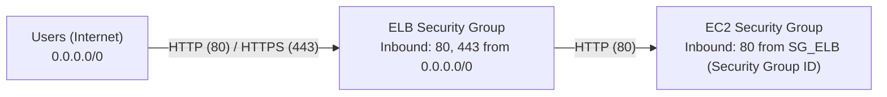

# Bài 71: Elastic Load Balancing (ELB) Overview (Tổng quan về Cân bằng tải ELB)

- **Phần (Section):** Phần 8: High Availability and Scalability: ELB & ASG
- **Mã bài học (Lecture ID):** `13528090`
- **Tệp video:** `SAA - ELB - Overview v4.mp4`
- **Thời lượng:** `06:15`

---

## 1. Kiến thức trọng tâm (Exam Notes)

> [!TIP]
> **Tóm tắt nhanh dịch vụ Elastic Load Balancing - ELB (SAA-C03 Cheat Sheet)**
> - **Là gì:** Dịch vụ cân bằng tải được quản lý hoàn toàn (Managed Load Balancer) giúp phân phối tự động lưu lượng truy cập tới nhiều máy chủ đích (EC2, Containers, IP, Lambda) across Multiple AZs.
> - **Dùng khi nào & Khác nhau giữa 3 loại ELB:**
>   - **`ALB` (Application Load Balancer - Layer 7):** Dùng cho **HTTP/HTTPS/gRPC/WebSocket**, định tuyến nâng cao theo URL Path (`/api`), Hostname, Header, Query String cho Microservices/Containers.
>   - **`NLB` (Network Load Balancer - Layer 4):** Dùng cho **TCP/UDP/TLS** cần hiệu năng cực đại (hàng triệu requests/s, độ trễ ~100 ms) hoặc cần **1 Static IP / Elastic IP cố định trên mỗi AZ** để đối tác Whitelist IP.
>   - **`GWLB` (Gateway Load Balancer - Layer 3):** Dùng để đưa toàn bộ lưu lượng IP đi qua cụm thiết bị bảo mật ảo của bên thứ 3 (**3rd-party Firewalls, IDS/IPS, Deep Packet Inspection**) qua cổng **`GENEVE 6081`**.
> - **Điểm hay bị hỏi (Giới hạn, Mặc định, Từ khóa gợi ý):**
>   - **Mặc định Cross-Zone Load Balancing:**
>     - Trên **`ALB`:** Luôn **BẬT mặc định** và **miễn phí** truyền dữ liệu liên AZ.
>     - Trên **`NLB` & `GWLB`:** Mặc định **TẮT**, và nếu bật sẽ **bị tính phí** truyền dữ liệu liên AZ.
>   - **Mặc định khác:** IP gốc của Client được truyền qua HTTP Header **`X-Forwarded-For`**; thời gian **Connection Draining (Deregistration Delay)** mặc định là **300 giây**.

### 1.1. Load Balancing là gì và Tại sao cần sử dụng?
- **Khái niệm:** Load Balancer (Bộ cân bằng tải) là một máy chủ hoặc một tập hợp các máy chủ làm nhiệm vụ chuyển tiếp lưu lượng mạng (forward traffic) nhận được tới nhiều máy chủ hoặc EC2 instances phía sau (backend / downstream EC2 instances).
- **Lợi ích cốt lõi của Elastic Load Balancer (ELB):**
  1. **Phân tán tải (Spread load):** Chia đều lưu lượng truy cập qua nhiều downstream instances.
  2. **Một điểm truy cập duy nhất (Single point of access / DNS endpoint):** Người dùng không biết mình đang kết nối tới backend instance nào, chỉ kết nối qua một hostname DNS duy nhất của ELB.
  3. **Xử lý lỗi mượt mà (Seamlessly handle failures):** Tự động kiểm tra sức khỏe (**Health Checks**) và ngừng gửi traffic tới các instance bị lỗi.
  4. **SSL Termination:** Cung cấp kết nối HTTPS mã hóa ở đầu vào tại ELB.
  5. **Enforce stickiness with cookies:** Gắn kết phiên làm việc của người dùng vào cùng một instance thông qua cookie.
  6. **High Availability across zones:** Hoạt động trải rộng trên nhiều Availability Zones (Multi-AZ).
  7. **Tách biệt public traffic và private traffic:** Phân tách lưu lượng công khai ngoài Internet với mạng nội bộ đám mây.

---

### 1.2. Đặc điểm của Managed ELB & Hệ sinh thái tích hợp
- **Managed Load Balancer:** AWS quản lý hoàn toàn việc nâng cấp (upgrades), bảo trì (maintenance) và tính sẵn sàng cao (HA). Người dùng chỉ cần chỉnh một vài thiết lập cấu hình (configuration knobs).
- **Chi phí & Khả năng mở rộng:** Rẻ hơn và dễ mở rộng hơn rất nhiều so với việc tự cài đặt và quản lý load balancer riêng trên EC2.
- **Tích hợp sâu với nhiều dịch vụ AWS:**
  - EC2, Auto Scaling Groups (ASG), Amazon ECS, AWS Certificate Manager (ACM), CloudWatch, Route 53, AWS WAF, AWS Global Accelerator.

---

### 1.3. Cơ chế Health Checks (Kiểm tra sức khỏe)
- **Mục đích:** Giúp ELB xác minh xem EC2 instance phía sau có đang hoạt động bình thường hay không.
- **Cách hoạt động:** Thực hiện trên một **Giao thức (Protocol)**, một **Cổng (Port)** và một **Đường dẫn (Route / Endpoint)** cụ thể (ví dụ: `HTTP`, port `4567`, endpoint `/health`).
- Nếu EC2 instance **không trả về mã `200 OK`**, instance đó sẽ bị đánh dấu là **Unhealthy**, và ELB sẽ **ngừng gửi lưu lượng** tới instance đó.

---

### 1.4. Bốn loại Managed Load Balancers trên AWS

| Loại Load Balancer | Năm ra mắt | Tầng OSI | Giao thức hỗ trợ (Protocols) | Ghi chú cho kỳ thi SAA-C03 |
| :--- | :--- | :--- | :--- | :--- |
| **1. Classic Load Balancer (CLB)** | 2009 (`v1` - cũ) | Layer 4 & 7 | HTTP, HTTPS, TCP, SSL (Secure TCP) | **Deprecated (Đã lỗi thời)**, AWS không khuyến khích dùng nữa. |
| **2. Application Load Balancer (ALB)** | 2016 (`v2`) | **Layer 7** | **HTTP, HTTPS, WebSocket, gRPC** | Lý tưởng cho ứng dụng Web, Microservices, Containers. |
| **3. Network Load Balancer (NLB)** | 2017 (`v2`) | **Layer 4** | **TCP, TLS (Secure TCP), UDP** | Hiệu năng cực cao (triệu request/s), độ trễ cực thấp, có Static IP / Elastic IP. |
| **4. Gateway Load Balancer (GWLB)** | 2020 | **Layer 3** | **Network Layer - IP Protocol (GENEVE port 6081)** | Triển khai tường lửa (Firewall), IDS/IPS, Deep Packet Inspection của bên thứ 3. |

> [!NOTE]
> Các Load Balancer có thể được thiết lập ở chế độ **Internal (Private)** cho mạng nội bộ hoặc **External (Public / Internet-facing)** cho website công khai.

---

### 1.5. Thiết kế Security Group chuẩn giữa ELB và EC2 (Exam Must-Know!)

- **Security Group của Load Balancer:**
  - Inbound Rule: Cho phép cổng `80` (HTTP) và `443` (HTTPS) từ nguồn `0.0.0.0/0` (Anywhere).
- **Security Group của EC2 Instance:**
  - Inbound Rule: Cho phép cổng `80` (HTTP) với **Source KHÔNG PHẢI là dải IP**, mà là **Security Group của Load Balancer**.
  - **Ý nghĩa bảo mật:** Đảm bảo người dùng bên ngoài **không thể truy cập trực tiếp** vào EC2 instance; mọi lưu lượng bắt buộc phải đi qua Load Balancer.

---

## 2. Phụ đề chi tiết theo mốc thời gian (Full Transcript & Timestamps)

| Thời gian | Nội dung lời giảng gốc (English) | Bản dịch tiếng Việt sát nghĩa |
| :--- | :--- | :--- |
| `00:00:00.110` | Now let's learn about load balancing. And a question you may have is what is load balancing? | Bây giờ chúng ta hãy tìm hiểu về cân bằng tải (load balancing). Và một câu hỏi bạn có thể đặt ra là cân bằng tải là gì? |
| `00:00:04.560` | Well, a load balancer is going to be a server or a set of servers that will forward traffic that is received to multiple backend or downstream EC2 instances or servers. | Bộ cân bằng tải (load balancer) là một máy chủ hoặc một tập hợp các máy chủ sẽ chuyển tiếp lưu lượng truy cập nhận được tới nhiều máy chủ hoặc EC2 instance ở phía sau (backend / downstream). |
| `00:00:16.970` | So the idea is that for example, we have three EC2 instances and they're going to be fronted by an elastic load balancer, which is a set of servers behind the scenes. | Ý tưởng là ví dụ chúng ta có ba EC2 instance và đứng trước chúng là một Elastic Load Balancer, thực chất là một tập hợp các máy chủ ở phía hậu trường. |
| `00:00:26.550` | Now, what happens when you have, for example, three users directly connecting into your elastic load balancer? | Điều gì sẽ xảy ra khi bạn có ba người dùng kết nối trực tiếp vào Elastic Load Balancer của bạn? |
| `00:00:32.330` | Well, the first one is going to have its load being sent in one backend EC2 instance and because there's load balancing well, if another user is connecting to your elastic load balancer, then it will be sent to another EC2 instance. | Người dùng đầu tiên sẽ được gửi tải tới một EC2 instance phía sau, và vì có cân bằng tải nên nếu một người dùng khác kết nối vào Elastic Load Balancer của bạn, người đó sẽ được chuyển tới một EC2 instance khác. |
| `00:00:46.960` | And then finally, while if a third user is connecting to your elastic load balancer, that user will again be load balance and sent to the third EC2 instance. | Và cuối cùng, nếu người dùng thứ ba kết nối vào Elastic Load Balancer, người dùng đó lại tiếp tục được cân bằng tải và gửi tới EC2 instance thứ ba. |
| `00:00:55.540` | So the idea is that the more users you have, the more the load is going to be balanced across EC2 instances. | Vì vậy, ý tưởng là bạn càng có nhiều người dùng thì tải sẽ càng được phân bổ đều qua các EC2 instance. |
| `00:01:01.003` | But the idea is that your users do not know which backend instances they're connected to. They just know that they have to connect to your elastic load balancer, which gives them one end point of connectivity only. | Nhưng điểm mấu chốt là người dùng của bạn không hề biết họ đang kết nối tới backend instance nào. Họ chỉ biết rằng họ phải kết nối tới Elastic Load Balancer của bạn, nơi cung cấp cho họ một điểm kết nối (endpoint) duy nhất. |
| `00:01:14.020` | Now, why should you use a load balancer where you spread the load across multiple downstream instances, you're going to expose a single point of access to your applications as I just said. | Tại sao bạn nên sử dụng bộ cân bằng tải? Thứ nhất, bạn phân tán tải qua nhiều downstream instance; thứ hai, bạn cung cấp một điểm truy cập duy nhất (DNS) cho ứng dụng như tôi vừa nói. |
| `00:01:23.850` | You're going to seamlessly handle failures of downstream instances because the load balancer will have some health check mechanisms and can understand to which instances it cannot send traffic to. | Bạn sẽ xử lý mượt mà các sự cố của downstream instance bởi vì bộ cân bằng tải có cơ chế kiểm tra sức khỏe (health check) và có thể hiểu được instance nào đang lỗi để không gửi lưu lượng tới đó. |
| `00:01:34.110` | You can do health checks on your instances. You can provide SSL termination. So if you have HTTPS encrypted traffic for your websites, | Bạn có thể thực hiện kiểm tra sức khỏe trên các instance, cung cấp SSL termination nếu bạn muốn có lưu lượng mã hóa HTTPS cho trang web của mình, |
| `00:01:42.100` | you can enforce stickiness with cookies, high availability across zones and separate public traffic from private traffic on your cloud. | bạn có thể áp dụng gắn kết phiên (stickiness) bằng cookie, đảm bảo tính sẵn sàng cao qua nhiều vùng (zones) và tách biệt lưu lượng công khai khỏi lưu lượng nội bộ trên đám mây. |
| `00:01:50.600` | And we'll explore these concepts obviously in a deeper dive. | Và tất nhiên chúng ta sẽ khám phá sâu hơn các khái niệm này. |
| `00:01:54.490` | So the elastic load balancer is a managed load balancer as such. AWS will be managing it, and will guarantee that it will be working no matter what. | Elastic Load Balancer là một bộ cân bằng tải được quản lý (managed load balancer). AWS sẽ quản lý nó và đảm bảo rằng nó sẽ luôn hoạt động trong mọi tình huống. |
| `00:02:03.660` | AWS will take care of upgrades, maintenance and high availability. And it will provide you a few configuration knobs to tweak the behavior of the load balancer. | AWS sẽ lo việc nâng cấp, bảo trì và tính sẵn sàng cao. Và họ chỉ cung cấp cho bạn một vài nút tinh chỉnh cấu hình để điều chỉnh hành vi của bộ cân bằng tải. |
| `00:02:14.010` | The idea is that using an elastic load balancer is a no-brainer because it will cost you less than setting up your own load balancer. | Việc sử dụng Elastic Load Balancer là một lựa chọn hiển nhiên không cần đắn đo (no-brainer) vì nó tốn ít chi phí hơn so với việc tự thiết lập bộ cân bằng tải của riêng bạn. |
| `00:02:20.570` | And also if you had to manage your own load balancer, it will be a nightmare from a scalability perspective. | Hơn nữa, nếu bạn phải tự quản lý bộ cân bằng tải của riêng mình, đó sẽ là một cơn ác mộng xét từ góc độ khả năng mở rộng. |
| `00:02:25.800` | So also the load balancer is integrated with so many AWS offerings and services. | Ngoài ra, bộ cân bằng tải còn được tích hợp với rất nhiều sản phẩm và dịch vụ của AWS. |
| `00:02:31.970` | The idea is that it can be integrated with of course, EC2 instances, but also we'll see later on with auto scaling groups, Amazon ECS, Certificate Manager, CloudWatch, Route 53, WAF, Global Accelerator, and most likely more over time. | Nó có thể tích hợp với EC2 instances, và như chúng ta sẽ thấy sau này là với Auto Scaling Groups, Amazon ECS, Certificate Manager (ACM), CloudWatch, Route 53, WAF, Global Accelerator, và nhiều dịch vụ khác nữa theo thời gian. |
| `00:02:46.090` | So the idea is that the load balancer is a no-brainer when it comes to load balancing on AWS. | Vì vậy, dùng ELB là lựa chọn hiển nhiên khi nói đến cân bằng tải trên AWS. |
| `00:02:50.960` | Now I mentioned health checks. So health checks is a way for your elastic load balancer to verify whether or not an EC2 instance is properly working, because if it's not working properly, then we don't want to send any traffic to that instance. | Bây giờ tôi đã đề cập đến kiểm tra sức khỏe (health checks). Health checks là cách để Elastic Load Balancer xác minh xem một EC2 instance có đang hoạt động bình thường hay không, bởi vì nếu nó không hoạt động tốt, chúng ta không muốn gửi bất kỳ lưu lượng nào tới instance đó. |
| `00:03:04.990` | So they're crucial for load balancers and they are done by using a port and a route to check the health on. | Chúng cực kỳ quan trọng đối với bộ cân bằng tải và được thực hiện bằng cách sử dụng một cổng (port) và một đường dẫn (route) để kiểm tra sức khỏe. |
| `00:03:14.030` | So for example, in this example, I have the protocol being HTTP, the port being 4567 and the endpoint to be /health because maybe this route is an easy way from an application perspective to check the health of my application. | Ví dụ ở đây, tôi có giao thức là HTTP, cổng là `4567` và endpoint là `/health`, vì có thể đường dẫn này là cách dễ dàng từ góc độ ứng dụng để kiểm tra tình trạng hoạt động của ứng dụng. |
| `00:03:28.150` | And if the EC2 instance does not respond with an okay response, which is usually the 200 status code of HTTP, then the instance will be marked as unhealthy. And the elastic load balancer will not send traffic to that instance. | Và nếu EC2 instance không phản hồi lại bằng kết quả OK (thường là mã trạng thái `200` của HTTP), thì instance đó sẽ bị đánh dấu là không khỏe mạnh (unhealthy). Và Elastic Load Balancer sẽ không gửi lưu lượng tới instance đó nữa. |
| `00:03:43.542` | Okay, so now you have four kinds of managed load balancers on AWS. | Được rồi, hiện tại bạn có bốn loại bộ cân bằng tải được quản lý trên AWS. |
| `00:03:49.210` | You have the classic load balancer, which are called older generation or V1, which is from 2009, and it's called CLB. | Đầu tiên là Classic Load Balancer, thuộc thế hệ cũ hay v1, ra mắt từ năm 2009 và được gọi tắt là CLB. |
| `00:03:56.170` | Now, it's compatible with HTTP, HTTPS, TCP, SSL, or secure TCP. And overall AWS does not want you to use that load balancer anymore. | Nó tương thích với HTTP, HTTPS, TCP, SSL (hay secure TCP). Nhìn chung AWS không muốn bạn sử dụng bộ cân bằng tải này nữa. |
| `00:04:07.260` | So it is going to be shown as deprecated within the console, but still available to use. | Vì vậy nó sẽ hiển thị là đã lỗi thời (deprecated) trong bảng điều khiển, dù vẫn còn có thể tạo được. |
| `00:04:12.230` | Then we have newer generations load balancer. So we have the application load balancer from 2016 or so-called ALB. And this one supports HTTP, HTTPS and WebSocket protocol. | Tiếp theo chúng ta có các bộ cân bằng tải thế hệ mới hơn. Chúng ta có Application Load Balancer ra mắt năm 2016, gọi tắt là ALB. Loại này hỗ trợ giao thức HTTP, HTTPS và WebSocket. |
| `00:04:23.980` | Then we have the network load balancer from 2017, which supports the TCP, TLS (secure TCP) and UDP protocols. | Sau đó là Network Load Balancer ra mắt năm 2017 (NLB), hỗ trợ các giao thức TCP, TLS (secure TCP) và UDP. |
| `00:04:32.343` | And then finally we have the gateway load balancer from 2020, GWLB, which operates at the network layer, so layer 3 and the IP protocol. | Và cuối cùng là Gateway Load Balancer từ năm 2020 (GWLB), hoạt động ở tầng mạng (Layer 3) và giao thức IP. |
| `00:04:41.956` | So overall it is definitely recommended for you to use the newer generation load balancers as they provide more features. | Nhìn chung, bạn chắc chắn được khuyến nghị sử dụng các bộ cân bằng tải thế hệ mới vì chúng cung cấp nhiều tính năng hơn. |
| `00:04:48.230` | And some load balancers can be set up as internal, so private and private access for the network or external public load balancers, for example, for your websites and public applications. | Ngoài ra, các bộ cân bằng tải có thể được thiết lập ở dạng nội bộ (internal - truy cập riêng tư cho mạng) hoặc dạng công khai bên ngoài (external public load balancer) cho các trang web và ứng dụng công cộng của bạn. |
| `00:05:00.820` | Finally, you need to understand the security around the load balancers. So the users can access your load balancer from anywhere using HTTP or HTTPS. | Cuối cùng, bạn cần hiểu về tính bảo mật xoay quanh bộ cân bằng tải. Người dùng có thể truy cập bộ cân bằng tải của bạn từ bất cứ đâu bằng HTTP hoặc HTTPS. |
| `00:05:10.780` | And therefore the security group rule is going to look like something like this, where the port range is going to be 80 or 443. And the source is going to be 0.0.0.0/0, which means anywhere. | Do đó, quy tắc Security Group của Load Balancer sẽ trông như thế này: dải cổng là `80` hoặc `443`, và nguồn (Source) là `0.0.0.0/0`, có nghĩa là từ bất kỳ đâu. |
| `00:05:21.310` | And so we allow the users to connect to our load balancer, but then the cool thing is that EC2 instances should only allow traffic coming directly from the load balancer. | Như vậy chúng ta cho phép người dùng kết nối tới bộ cân bằng tải, nhưng điều tuyệt vời tiếp theo là các EC2 instance chỉ nên cho phép lưu lượng đi đến trực tiếp từ bộ cân bằng tải mà thôi. |
| `00:05:31.400` | And therefore the security group rule of your EC2 instances is going to look a little bit different. So it's going to allow HTTP traffic on port 80 and the source of it is not going to be an IP range, it is going to be a security group. | Do đó, quy tắc Security Group của các EC2 instance sẽ trông hơi khác một chút. Nó sẽ cho phép lưu lượng HTTP trên cổng `80` và nguồn (Source) của nó không phải là một dải IP, mà là một Security Group. |
| `00:05:45.580` | So we're going to link the security group of the EC2 instance to the security group of the load balancer. | Chúng ta sẽ liên kết Security Group của EC2 instance với Security Group của bộ cân bằng tải. |
| `00:05:51.660` | And effectively what this will do is that it will say that the EC2 instance is only allowing traffic if the traffic originates from the load balancer, which is an enhanced security mechanism. | Về mặt hiệu quả, thiết lập này quy định rằng EC2 instance chỉ cho phép lưu lượng đi vào nếu lưu lượng đó xuất phát từ bộ cân bằng tải — đây là một cơ chế bảo mật nâng cao. |
| `00:06:03.270` | So that's it for the overview of load balancers. I hope you liked it. And obviously in this section, we're going to discuss a lot more around classic, application load balancers and network load balancers. So I will see you in the next lecture. | Đó là toàn bộ phần tổng quan về bộ cân bằng tải. Hy vọng bạn thích bài học này. Trong phần này chúng ta sẽ còn thảo luận sâu hơn nhiều về ALB, NLB và GWLB. Hẹn gặp lại bạn trong bài giảng tiếp theo. |
