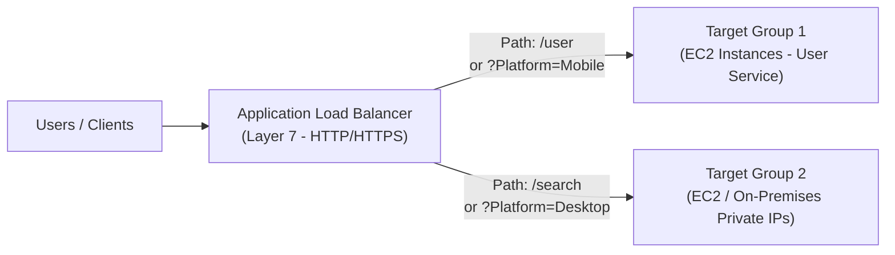

# Bài 72: Application Load Balancer (ALB)

- **Phần (Section):** Phần 8: High Availability and Scalability: ELB & ASG
- **Mã bài học (Lecture ID):** `18078003`
- **Tệp video:** `SAA_-_ELB_-_Application_Load_Balancer_v3.mp4`
- **Thời lượng:** `05:49`

---

## 1. Kiến thức trọng tâm (Exam Notes)

> [!TIP]
> **Tóm tắt nhanh dịch vụ — Application Load Balancer (ALB) (SAA-C03 Cheat Sheet)**
> - **Là gì (1 câu):** Bộ cân bằng tải hoạt động ở tầng ứng dụng (Layer 7 — HTTP/HTTPS/gRPC/WebSocket), định tuyến thông minh dựa trên nội dung gói tin HTTP.
> - **Dùng khi nào:** Định tuyến cho kiến trúc **Microservices / Containers (ECS, EKS)** hoặc ứng dụng Web cần chia luồng theo đường dẫn URL (`Path-based`), tên miền (`Host-based`), `Query String`, `HTTP Header`, hoặc chuyển hướng HTTP sang HTTPS.
> - **Khác gì dịch vụ gần giống:**
>   - **ALB vs NLB:** **ALB** hoạt động ở Layer 7 (chỉ HTTP/HTTPS/gRPC), hỗ trợ routing thông minh và tích hợp trực tiếp AWS WAF, nhưng **không có Static IP** cố định; **NLB** hoạt động ở Layer 4 (TCP/UDP), hiệu năng cực cao và có **Static/Elastic IP** theo từng AZ.
> - **Khác gì API Gateway:** ALB cân bằng tải vào EC2/ECS/Lambda trong VPC; API Gateway là dịch vụ Serverless quản lý toàn diện vòng đời REST/WebSocket API (throttling, API keys, caching, SDK generation).
> - **Điểm hay bị hỏi:**
>   - **Giới hạn & Mặc định:** Có **DNS Name cố định** nhưng không có IP tĩnh (muốn có Static IP phía trước ALB phải ghép **NLB -> ALB** hoặc **AWS Global Accelerator -> ALB**). Client IP thật được truyền qua header `X-Forwarded-For`.
>   - **Từ khóa gợi ý:** `"Layer 7 / HTTP / HTTPS / gRPC / WebSocket"`, `"microservices / dynamic port mapping on ECS"`, `"path-based / host-based / header routing"`, `"X-Forwarded-For"`.

### 1.1. Đặc điểm cốt lõi của Application Load Balancer (ALB)
- **Hoạt động ở Tầng 7 (Layer 7 - Application Layer / HTTP):**
  - Hỗ trợ giao thức **HTTP, HTTPS, HTTP/2, WebSocket** (và gRPC).
  - Hỗ trợ tự động chuyển hướng (**Redirect**), ví dụ: tự động chuyển hướng từ `HTTP` sang `HTTPS` ngay tại tầng Load Balancer.
  - Phù hợp nhất cho kiến trúc **Microservices** và **Container-based applications** (như Docker & **Amazon ECS**) nhờ tính năng **Dynamic Port Mapping** (ánh xạ cổng động tới nhiều container trên cùng 1 EC2 instance).
  - Trong khi với Classic Load Balancer (CLB) bạn phải tạo nhiều CLB cho nhiều ứng dụng, thì chỉ cần **1 ALB duy nhất** đứng trước nhiều ứng dụng (nhiều Target Groups).

---

### 1.2. Các quy tắc định tuyến thông minh (Routing Rules) trên ALB
ALB có thể định tuyến lưu lượng tới các **Target Groups** khác nhau dựa trên:
1. **URL Path (Đường dẫn URL):** Ví dụ `example.com/users` -> Target Group 1; `example.com/posts` hoặc `/search` -> Target Group 2.
2. **Hostname trong URL (Host Header):** Ví dụ `one.example.com` -> Target Group 1; `other.example.com` -> Target Group 2.
3. **Query Strings & Parameters / HTTP Headers:** Ví dụ `example.com/reserves?id=123&order=false` hoặc `?Platform=Mobile` -> Target Group 1; `?Platform=Desktop` -> Target Group 2.

---

### 1.3. Các loại mục tiêu trong Target Groups của ALB (4 Loại)
ALB định tuyến tới một hoặc nhiều **Target Groups** (Health Checks được cấu hình ở cấp độ **Target Group**):
1. **EC2 Instances** (có thể được quản lý bởi Auto Scaling Group) - giao thức HTTP/HTTPS.
2. **ECS Tasks** ( được quản lý bởi chính ECS) - giao thức HTTP/HTTPS.
3. **AWS Lambda Functions** (ALB dịch HTTP request thành JSON event và gọi hàm Lambda — rất hay hỏi trong đề thi!).
4. **IP Addresses** — **BẮT BUỘC phải là Private IP Addresses** (ví dụ: địa chỉ IP riêng của máy chủ On-Premises kết nối qua VPN/Direct Connect hoặc EC2 ở VPC khác).

---

### 1.4. Lưu ý quan trọng cho kỳ thi: Client IP & `X-Forwarded-*` Headers
- ALB cung cấp một **Fixed Hostname** (`XXX.region.elb.amazonaws.com`).
- Khi Client (`12.34.56.78`) kết nối tới ALB, ALB thực hiện **Connection Termination** và mở kết nối mới tới EC2 instance bằng **Private IP của ALB**.
- Do đó, EC2 instance **không nhìn thấy trực tiếp IP của Client** ở gói tin IP, mà phải đọc từ các HTTP Headers do ALB chèn thêm vào:
  - **`X-Forwarded-For`**: Chứa **True IP Address** (địa chỉ IP thật) của Client.
  - **`X-Forwarded-Port`**: Chứa cổng (Port) mà Client đã dùng để kết nối tới ALB.
  - **`X-Forwarded-Proto`**: Chứa giao thức (Protocol: `http` hoặc `https`) mà Client đã sử dụng.

---

## 2. Phụ đề chi tiết theo mốc thời gian (Full Transcript & Timestamps)

| Thời gian | Nội dung lời giảng gốc (English) | Bản dịch tiếng Việt sát nghĩa |
| :--- | :--- | :--- |
| `00:00:00.070` | Now, let's get into the second kind of load balancers we'll see is the application load balancer. | Bây giờ, chúng ta hãy đi vào loại bộ cân bằng tải thứ hai mà chúng ta sẽ tìm hiểu: Application Load Balancer (ALB). |
| `00:00:05.230` | So it's a layer seven only load balancer. So that means HTTP. And it allows you to route to multiple HTTP applications across machines. | Đây là bộ cân bằng tải chỉ hoạt động ở tầng 7 (Layer 7), nghĩa là tầng HTTP. Và nó cho phép bạn định tuyến tới nhiều ứng dụng HTTP trên nhiều máy chủ khác nhau. |
| `00:00:13.930` | And these machines are going to be grouped in something called a target group. And it will make a lot of sense once we get into the hands-on. | Các máy chủ này sẽ được nhóm lại trong một thứ gọi là nhóm mục tiêu (Target Group). Điều này sẽ rất dễ hiểu khi chúng ta bước vào bài thực hành. |
| `00:00:20.760` | It allows you to load balance to multiple applications on the same EC2 instance. So using containers and using ECS as we'll see. | Nó cho phép bạn cân bằng tải tới nhiều ứng dụng chạy trên cùng một EC2 instance, thông qua việc sử dụng containers và dịch vụ ECS như chúng ta sẽ thấy sau này. |
| `00:00:28.770` | And it has support for HTTP/2 and WebSockets. It supports redirect as well. So if you want it to redirect traffic from HTTP to HTTPS automatically, it could be done at the load balancer level. | Nó hỗ trợ HTTP/2 và WebSockets. Nó cũng hỗ trợ chuyển hướng (redirect). Vì vậy nếu bạn muốn tự động chuyển hướng lưu lượng từ HTTP sang HTTPS, việc đó có thể được thực hiện ngay tại cấp độ bộ cân bằng tải. |
| `00:00:40.610` | It also supports route routing. So there's routing based on different target groups. For example, you can route based on the target path of your URL. | Nó cũng hỗ trợ định tuyến theo đường dẫn (route tables/rules) tới các Target Group khác nhau. Ví dụ, bạn có thể định tuyến dựa trên đường dẫn đích (path) của URL. |
| `00:00:49.670` | For example, example.com/users and example.com/posts. /users and /posts are different routes in your URL, different path, and so you can redirect these two things into different target groups. We'll see what that means in a second. | Chẳng hạn: `example.com/users` và `example.com/posts`. `/users` và `/posts` là các đường dẫn (path) khác nhau trong URL, nên bạn có thể chuyển hướng hai đường dẫn này tới các Target Group khác nhau. Chúng ta sẽ thấy ý nghĩa của nó ngay sau đây. |
| `00:01:04.070` | You can also do routing based on the host name of the URL. So if your load balancer is accessed using one.example.com or other.example.com, it could be routed to different target groups, | Bạn cũng có thể định tuyến dựa trên tên miền (hostname) của URL. Nếu bộ cân bằng tải của bạn được truy cập bằng `one.example.com` hoặc `other.example.com`, chúng có thể được định tuyến tới các Target Group khác nhau, |
| `00:01:15.970` | and you could also be routing based on the query strings and headers. So for example, example.com/reserves and id=123&order=false could be routed to a different target group. | và bạn cũng có thể định tuyến dựa trên chuỗi truy vấn (query strings) và tiêu đề (headers). Ví dụ: `example.com/reserves?id=123&order=false` có thể được định tuyến tới một Target Group khác. |
| `00:01:27.330` | So ALB, and this is the short for application load balancers, they're great when you have micro services and container-based application. | Vì vậy ALB (viết tắt của Application Load Balancer) cực kỳ tuyệt vời khi bạn có kiến trúc vi dịch vụ (microservices) và ứng dụng dựa trên container. |
| `00:01:35.430` | So as soon as we'll go into learning what docker is and Amazon ECS, ALB are going to be the go-to load balancers, because they have a port mapping features, which allows you to redirect to a dynamic port on the ECS instance, and again, more on that directly into the ECS section. | Ngay khi chúng ta học về Docker và Amazon ECS, ALB sẽ là bộ cân bằng tải chủ lực vì chúng có tính năng ánh xạ cổng (port mapping), cho phép chuyển hướng tới một cổng động (dynamic port) trên ECS instance — chúng ta sẽ tìm hiểu kỹ hơn trong phần ECS. |
| `00:01:51.350` | And in comparison, if we want it to have multiple applications, okay, behind a classic load balancer, we would have to have multiple classic load balancer. We need to actually have one per application, whereas with load balancers, we're able to have one application load balancer in front of many applications. | Để so sánh, nếu chúng ta muốn đặt nhiều ứng dụng phía sau Classic Load Balancer, chúng ta sẽ phải tạo nhiều Classic Load Balancer — mỗi ứng dụng một cái, trong khi với ALB, chúng ta chỉ cần một Application Load Balancer duy nhất đứng trước nhiều ứng dụng. |
| `00:02:11.340` | So maybe a graph will help. So we have our external application load balancer. It's public facing, and behind it, we have our first target group made of EC2 instances. And this one is going to be routing for the route /user. | Một sơ đồ có lẽ sẽ giúp bạn dễ hình dung hơn. Chúng ta có một Application Load Balancer hướng ra ngoài (external/public-facing), và phía sau nó là Target Group đầu tiên gồm các EC2 instance, chịu trách nhiệm xử lý đường dẫn `/user`. |
| `00:02:26.560` | And we have a second target group made of EC2 instances again, and this one is going to be our search application, and there's going to be a health check as well with it. And it's going to be routed through rules for the /search routes. | Và chúng ta có một Target Group thứ hai cũng gồm các EC2 instance cho ứng dụng tìm kiếm (search), đi kèm kiểm tra sức khỏe riêng, và được định tuyến thông qua quy tắc cho đường dẫn `/search`. |
| `00:02:39.650` | So as you can see here, we have two independent microservices that do different things. The first one is the user application. The second one is a search application. | Như bạn có thể thấy ở đây, chúng ta có hai microservice độc lập làm những công việc khác nhau: ứng dụng người dùng và ứng dụng tìm kiếm. |
| `00:02:48.340` | But they're behind the same application load balancer, which knows how to intelligently route to these target groups based on the route that is being used in the URL. | Nhưng chúng cùng nằm sau một Application Load Balancer duy nhất, vốn biết cách định tuyến thông minh tới các Target Group này dựa trên đường dẫn được sử dụng trong URL. |
| `00:02:58.440` | So the target groups, what are they? The first one is that they can be EC2 instances, and they can be managed as we'll see very, very soon. They can be managed by Auto Scaling Group. | Vậy các Target Group có thể chứa những gì? Thứ nhất, chúng có thể là các EC2 instance (và có thể được quản lý bởi Auto Scaling Group như chúng ta sẽ sớm học). |
| `00:03:08.494` | It could be ECS tasks and we'll see this in the ECS section. | Thứ hai, nó có thể là các ECS tasks (sẽ học trong phần ECS). |
| `00:03:11.760` | It could be Lambda functions, and this is something that's not very known. So application load balancers can be in front of lambda functions, and we'll see what Lambda functions are in the future section, but they're the base of everything called serverless in AWS. | Thứ ba, nó có thể là các hàm Lambda (Lambda functions) — đây là điều không phải ai cũng biết. Application Load Balancer có thể đứng trước các hàm Lambda, nền tảng của kiến trúc Serverless trong AWS. |
| `00:03:26.420` | And finally, it can be a front to IP addresses, and they must be private IP addresses. | Và cuối cùng, nó có thể định tuyến tới các địa chỉ IP, và các địa chỉ IP này bắt buộc phải là địa chỉ IP riêng (Private IP addresses). |
| `00:03:32.520` | So ALB can route to multiple target groups, and the health checks are going to be done at the target group level. | Tóm lại, ALB có thể định tuyến tới nhiều Target Group, và việc kiểm tra sức khỏe (Health Checks) sẽ được thực hiện ở cấp độ Target Group. |
| `00:03:38.690` | So let's take another example. And we have an ALB and we have two target groups. The first one is based on AWS with EC2 instances, and the second one is going to have private servers on premises, so in our own data center. | Hãy lấy một ví dụ khác: chúng ta có một ALB và hai Target Group. Nhóm thứ nhất nằm trên AWS với các EC2 instance, còn nhóm thứ hai là các máy chủ riêng tại chỗ (on-premises) trong trung tâm dữ liệu của chính chúng ta. |
| `00:03:52.250` | And so for the target groups to be able to exist, we need to specify the private IP of our servers into the target group, just for them to be registered. | Để Target Group thứ hai hoạt động, chúng ta cần chỉ định địa chỉ Private IP của các máy chủ on-premises vào trong Target Group để đăng ký chúng. |
| `00:04:01.460` | And now say we have an application that is serving a request through the ALB. And what we want is to send to the first target group on the mobile-based traffic, and to the second target group on the desktop-based traffic. | Giả sử chúng ta có một ứng dụng phục vụ yêu cầu qua ALB, và chúng ta muốn gửi lưu lượng từ thiết bị di động (mobile) tới Target Group thứ nhất, còn lưu lượng từ máy tính để bàn (desktop) tới Target Group thứ hai. |
| `00:04:16.660` | For this, we can use, for example, a query string or parameters routing. So if, in the URL that the clients are trying to use, there is a ?Platform=Mobile, we can write a rule in the ALB redirection rules, the routing rules, to redirect to the first target group. | Để làm việc này, chúng ta có thể sử dụng định tuyến theo query string / tham số. Nếu trong URL mà client gọi có `?Platform=Mobile`, ta có thể viết một quy tắc định tuyến trên ALB để chuyển tới Target Group thứ nhất. |
| `00:04:34.900` | And if you have ?Platform=Desktop, so this is a query string or parameter, then we can say it to redirect to the target group number two. I don't know where you would do this, but this is just an example I'm providing you, okay? | Và nếu có `?Platform=Desktop` (một query string/tham số), ta có thể cấu hình chuyển hướng tới Target Group số hai. Đây là một ví dụ minh họa để bạn nắm rõ cách hoạt động. |
| `00:04:48.120` | So good to know before we go into the hands-on, the first one is that you also get a fixed host name with your application load balancers, just like the classic one. | Những điều cần biết trước khi vào thực hành: thứ nhất là bạn sẽ nhận được một tên máy chủ cố định (fixed hostname) với ALB, giống như CLB. |
| `00:04:56.720` | The application servers don't see the IP of the client directly. The true IP of the clients is going to be inserted instead in the header called X-Forwarded-For. | Các máy chủ ứng dụng phía sau không nhìn thấy trực tiếp IP của client. Thay vào đó, địa chỉ IP thật của client sẽ được chèn vào một HTTP header có tên là `X-Forwarded-For`. |
| `00:05:06.420` | And so you can also get the port using X-Forwarded-Port and the protocol being used using X-Forwarded-Proto. | Và bạn cũng có thể lấy thông tin cổng bằng header `X-Forwarded-Port` và giao thức đang được sử dụng bằng header `X-Forwarded-Proto`. |
| `00:05:14.650` | And so what that means is that our client IP, which is 12.34.56.78 is directly talking to our load balancer, which performs something called a connection termination. | Điều đó có nghĩa là IP của client (`12.34.56.78`) nói chuyện trực tiếp với bộ cân bằng tải của chúng ta, và bộ cân bằng tải thực hiện một việc gọi là ngắt kết nối (connection termination). |
| `00:05:26.440` | And when your load balancer talks to your EC2 instance, it's going to use the load balancer IP, which is a private IP into your EC2 instance. | Và khi bộ cân bằng tải nói chuyện với EC2 instance của bạn, nó sẽ sử dụng địa chỉ IP riêng (Private IP) của chính bộ cân bằng tải để gửi tới EC2 instance. |
| `00:05:34.140` | And so for the EC2 instance to know the client IP, it will have to look at these extra headers in your HTTP request, which are called X-Forwarded-For, Port and Proto. | Vì vậy, để EC2 instance biết được IP của client, nó sẽ phải đọc các header bổ sung này trong HTTP request, được gọi là `X-Forwarded-For`, `X-Forwarded-Port` và `X-Forwarded-Proto`. |
| `00:05:44.880` | All right, that's it. Now, let's go into the hands-on, and create our first application load balancer. | Được rồi, đó là tất cả lý thuyết. Bây giờ chúng ta hãy bắt tay vào thực hành và tạo Application Load Balancer đầu tiên. |
