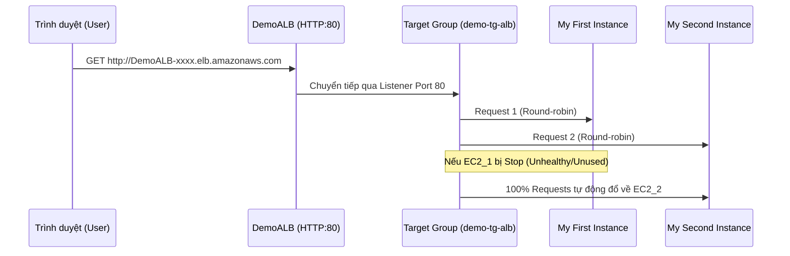

# Bài 73: Application Load Balancer (ALB) - Hands On - Part 1 (Thực hành ALB - Phần 1)

- **Phần (Section):** Phần 8: High Availability and Scalability: ELB & ASG
- **Mã bài học (Lecture ID):** `35136194`
- **Tệp video:** `CCP_-_ELB_-_Hands_On_v4D.mp4`
- **Thời lượng:** `08:34`
- **Cheat sheet:** [topics/aws_elb_asg.html](../../topics/aws_elb_asg.html)

---

## 1. Kiến thức trọng tâm (Exam Notes)

### 1.1. Quy trình triển khai Application Load Balancer (ALB) trong thực tế
1. **Bước 1: Khởi tạo các EC2 Instances làm Backend:**
   - Khởi chạy 2 máy chủ EC2 (`My First Instance`, `My Second Instance`) dùng Amazon Linux 2, `t2.micro`.
   - Cấu hình **EC2 User Data** để cài đặt Apache HTTP Server trả về dòng chữ `"Hello World from <hostname>"`.
   - Gắn Security Group cho phép HTTP (cổng `80`).
2. **Bước 2: Khởi tạo Application Load Balancer (`DemoALB`):**
   - **Scheme:** `Internet-facing` (công khai ra Internet) hoặc `Internal` (nội bộ).
   - **IP address type:** `IPv4` (hoặc `Dualstack` cho cả IPv4 & IPv6).
   - **Network Mapping:** Chọn VPC và đánh dấu chọn **tất cả các Availability Zones** để đảm bảo tính sẵn sàng cao (Multi-AZ).
   - **Security Group cho ALB:** Tạo mới `demo-sg-load-balancer` cho phép Inbound **HTTP (Port 80)** từ `0.0.0.0/0` (Anywhere), gỡ bỏ default security group.
   - **Listeners and Routing:** Cấu hình Listener lắng nghe trên giao thức `HTTP : 80` và chuyển tiếp (forward) tới một **Target Group**.
3. **Bước 3: Tạo Target Group (`demo-tg-alb`) và Đăng ký Targets:**
   - **Target type:** `Instances` (ngoài ra còn có `IP addresses`, `Lambda function`, `Application Load Balancer` - khi dùng NLB đứng trước ALB).
   - **Protocol / Port:** `HTTP` trên cổng `80`, giao thức `HTTP1`.
   - **Register targets:** Chọn cả 2 EC2 instances và nhấn **Include as pending below** -> **Create target group**.
4. **Bước 4: Kiểm tra cân bằng tải và Health Checks:**
   - Truy cập qua **DNS Name** của ALB: Khi nhấn Refresh liên tục, phản hồi trả về luân phiên giữa IP của Instance 1 và Instance 2 (Round-robin).
   - Khi **Stop** Instance 1: Target Group phát hiện Instance 1 không phản hồi Health Check (chuyển sang trạng thái `unused` / `unhealthy`), và ALB tự động định tuyến **100% lưu lượng** sang Instance 2 đang chạy. Khi Start lại Instance 1, nó đi qua trạng thái `initial` rồi về `healthy` và nhận lại lưu lượng bình thường.

---

## 2. Phụ đề chi tiết theo mốc thời gian (Full Transcript & Timestamps)

| Thời gian | Nội dung lời giảng gốc (English) | Bản dịch tiếng Việt sát nghĩa |
| :--- | :--- | :--- |
| `00:00:00.000` | So we are going to practice launching a load balancer, but first, we need to send traffic to something. So first we're going to launch EC2 Instances. | Chúng ta sẽ thực hành khởi chạy một bộ cân bằng tải, nhưng trước tiên chúng ta cần có đích đến để gửi lưu lượng tới. Vì vậy đầu tiên chúng ta sẽ khởi chạy các EC2 Instance. |
| `00:00:08.940` | So I'm gonna go into launch instances and I will launch two instances. So on the right hand side I can say two instances and the name's going to be My First Instance. We'll rename the second one when it comes to it. | Tôi sẽ vào mục Launch instances và khởi chạy hai máy chủ. Ở phía bên phải tôi nhập số lượng là 2 instance và đặt tên là `My First Instance`. Chúng ta sẽ đổi tên máy thứ hai sau khi nó được tạo. |
| `00:00:22.050` | We're going to use Amazon Linux 2 on this architecture. We're going to use a t2.micro, and then we are going to proceed without a key pair because we don't need SSH capability. We can use EC2 Instance Connect if we ever need to. | Chúng ta sẽ sử dụng Amazon Linux 2 trên kiến trúc này, chọn loại máy `t2.micro`, và tiếp tục mà không cần key pair (`Proceed without a key pair`) vì chúng ta không cần SSH. Nếu cần ta có thể dùng EC2 Instance Connect. |
| `00:00:36.030` | Then for network settings we can select an existing security group and we will use the Launch Wizard 1 security group which allowed us to do HTTP traffic and SSH traffic into our EC2 instance. So that's perfect. | Tiếp theo ở phần cài đặt mạng (Network settings), chúng ta chọn một Security Group hiện có là `launch-wizard-1`, vốn đã cho phép lưu lượng HTTP và SSH đi vào EC2 instance. Rất hoàn hảo. |
| `00:00:52.133` | We're going to use the basic storage and for advanced details, I will scroll down and I will add some EC2 user data, and to do so I'm going to copy what I have here and paste it here. | Chúng ta giữ nguyên ổ cứng cơ bản, và trong phần chi tiết nâng cao (Advanced details), tôi cuộn xuống và thêm đoạn mã EC2 User Data bằng cách sao chép đoạn script có sẵn và dán vào đây. |
| `00:01:05.670` | So this will just launch the EC2 instances the same way we've launched them before using this EC2 user data script. So let's launch our two instances | Đoạn script này sẽ khởi chạy các EC2 instance cài đặt sẵn web server giống hệt như cách chúng ta đã làm trước đây. Hãy nhấn khởi chạy hai instance này. |
| `00:01:17.130` | and now we're going to view all instances. So I'm going to rename the second one My Second Instance and save. So let's wait for these instances to be ready. | Bây giờ chúng ta vào xem tất cả instance. Tôi sẽ đổi tên máy thứ hai thành `My Second Instance` và lưu lại. Hãy đợi cho các instance này sẵn sàng hoạt động. |
| `00:01:30.510` | So my EC2 instances are now ready. I'm going to copy the first IPv4 address and paste it, and I will visit the URL and as you can see, I get a hello world from my instance so this is great. | Các EC2 instance của tôi hiện đã sẵn sàng. Tôi sao chép địa chỉ IPv4 đầu tiên, dán vào trình duyệt và truy cập URL. Như bạn thấy, tôi nhận được dòng chữ "Hello World" từ instance đầu tiên, rất tuyệt. |
| `00:01:42.570` | And then I'm gonna go to my second instance right here. I will copy again the IPv4 and then paste it, press enter, and I get a hello world again. | Sau đó tôi chuyển sang instance thứ hai ngay tại đây, sao chép địa chỉ IPv4 của nó, dán vào trình duyệt và nhấn Enter, tôi lại nhận được một dòng "Hello World" khác. |
| `00:01:51.660` | So as you can see, two instances give us two hello worlds, and the last part is changing. And so what we'd like to do is to have only one URL to access these two EC2 instances and balance the load between them. | Như bạn thấy, hai instance trả về hai dòng Hello World với phần địa chỉ IP ở cuối khác nhau. Điều chúng ta muốn làm bây giờ là chỉ có một URL duy nhất để truy cập cả hai EC2 instance này và cân bằng tải giữa chúng. |
| `00:02:06.510` | So for this of course, we're going to use a load balancer. So let's scroll down and look at load balancers. And here you can create a load balancer. | Tất nhiên để làm điều này, chúng ta sẽ sử dụng bộ cân bằng tải. Hãy cuộn xuống thanh menu bên trái và chọn Load Balancers, sau đó nhấn Create load balancer. |
| `00:02:15.330` | So we have different load balancer types, and in this demo we're going to only look at the application load balancer, but you need to understand the difference between the ALB, the network load balancer, and the gateway load balancer. | Chúng ta có các loại bộ cân bằng tải khác nhau. Trong bản demo này chúng ta sẽ chỉ thực hành Application Load Balancer, nhưng bạn cần hiểu rõ sự khác biệt giữa ALB, Network Load Balancer (NLB) và Gateway Load Balancer (GWLB). |
| `00:02:27.810` | So for the application load balancer, you can see here it is for HTTP and HTTPS kind of traffic. | Đối với Application Load Balancer, bạn có thể thấy ở đây nó dành cho loại lưu lượng HTTP và HTTPS. |
| `00:02:35.160` | For the network load balancer it's going to be on the TCP and UDP protocol or TLS over TCP. And this is something you're going to use when you need ultra high performance. That means millions of requests per second while maintaining ultra low latency. So this is a very high performance load balancer, this one. | Đối với Network Load Balancer, nó hoạt động trên giao thức TCP, UDP hoặc TLS trên nền TCP. Đây là loại bạn sẽ dùng khi cần hiệu năng cực cao — tức là hàng triệu yêu cầu mỗi giây trong khi vẫn duy trì độ trễ cực thấp. |
| `00:02:54.510` | And then finally the gateway load balancer right here, as you can see, it's used for security, for intrusion detection, for firewalls and so on. So it's to analyze the network traffic. | Và cuối cùng là Gateway Load Balancer ngay tại đây, được dùng cho bảo mật, phát hiện xâm nhập (intrusion detection), tường lửa (firewalls), v.v. — tức là để phân tích lưu lượng mạng. |
| `00:03:06.960` | When it goes to the classic load balancer, by the time you watch this video, this may be gone because the classic load balancer is going away and so therefore I'm not going to discuss it and touch it. | Còn đối với Classic Load Balancer, vào thời điểm bạn xem video này có thể nó đã biến mất vì CLB đang dần bị loại bỏ, do đó tôi sẽ không thảo luận hay đụng tới nó. |
| `00:03:17.820` | Okay, so let's focus on creating the application load balancer. So I'm going to call this one DemoALB. | Được rồi, hãy tập trung vào việc tạo Application Load Balancer. Tôi sẽ đặt tên cho nó là `DemoALB`. |
| `00:03:25.980` | And if you wanted to read about how load balancing works, you can read it here, but hopefully the previous lecture was enough for you. | Nếu bạn muốn đọc thêm về cách hoạt động của cân bằng tải thì có thể xem sơ đồ trên giao diện, nhưng hy vọng bài giảng trước đã đủ rõ ràng cho bạn. |
| `00:03:32.370` | So this scheme is internet facing and the address type is IPv4. For network mapping, we need to decide where to deploy the load balancer and how many availability zones. So let's deploy it in all of them. | Scheme ở đây là `Internet-facing` và loại địa chỉ là `IPv4`. Về phần ánh xạ mạng (Network mapping), chúng ta cần quyết định triển khai bộ cân bằng tải ở đâu và trên bao nhiêu Availability Zone. Hãy chọn triển khai trên tất cả các AZ. |
| `00:03:46.680` | Great, and then we need to assign a security group to our load balancer. So it turns out that I'm going to create a new security group for it and we need to only allow HTTP traffic. | Tuyệt vời, tiếp theo chúng ta cần gán một Security Group cho bộ cân bằng tải. Tôi sẽ tạo một Security Group mới cho nó và chỉ cho phép lưu lượng HTTP. |
| `00:03:57.630` | So I'll call it demo-sg-load-balancer. Allow HTTP into load balancer, into ALB, and the inbound rules is going to allow all HTTP from anywhere. | Tôi sẽ đặt tên là `demo-sg-load-balancer`, mô tả là "Allow HTTP into ALB", và quy tắc Inbound sẽ cho phép toàn bộ lưu lượng HTTP từ bất kỳ đâu (`0.0.0.0/0`). |
| `00:04:17.640` | Okay, and the outbound rules are fine. Let's create this security group. So it is now created and I can go back in here, refresh this page, choose my demo-sg-load-balancer and remove the default security group so that I'm only left with one security group. | Quy tắc Outbound giữ nguyên. Hãy nhấn tạo Security Group này. Bây giờ nó đã được tạo, tôi quay lại trang cấu hình ALB, làm mới danh sách, chọn `demo-sg-load-balancer` và xóa Security Group mặc định đi để chỉ còn lại duy nhất một Security Group. |
| `00:04:35.970` | So let's scroll down. And we are under listeners and routing. And so we need to route the traffic from HTTP on port 80 to a target group. And a target group is nothing more than a group of my EC2 instances that were created. | Hãy cuộn xuống phần Listeners and routing. Chúng ta cần định tuyến lưu lượng từ HTTP trên cổng `80` tới một Target Group. Và Target Group chẳng qua chỉ là một nhóm gồm các EC2 instance mà chúng ta đã tạo. |
| `00:04:51.450` | So for this we need to create a target group. So let's click here to create one. And the basic configuration tells us that we want to group instances together, but you can see you have other options. | Để làm việc này, chúng ta nhấn vào liên kết Create target group. Trong cấu hình cơ bản, chúng ta chọn nhóm các `Instances` lại với nhau (bạn có thể thấy các tùy chọn khác như IP addresses, Lambda function, ALB). |
| `00:05:03.270` | So we want to group instances together and I'll call this one demo-tg-alb. The protocol is HTTP on port 80. You have different options, but based on the option you choose, it's going to be a target group for a different kind of load balancer. | Chúng ta chọn `Instances` và đặt tên là `demo-tg-alb`. Giao thức là `HTTP` trên cổng `80`. Bạn có các tùy chọn giao thức khác, nhưng tùy thuộc vào lựa chọn của bạn mà nó sẽ dành cho loại bộ cân bằng tải tương ứng. |
| `00:05:18.300` | So we'll keep it as HTTP on port 80, the version of HTTP is 1 so we'll keep it as 1. The health check is good. And then let's click on next. | Chúng ta giữ nguyên là HTTP trên cổng `80`, phiên bản giao thức là `HTTP1`. Phần cấu hình Health check giữ mặc định, sau đó nhấn Next. |
| `00:05:29.580` | And then we need to register our targets. So we're going to register both EC2 instances on port 80, and let's include them as pending below. So now my instances are registered and let's create this target group. | Tiếp theo chúng ta cần đăng ký các mục tiêu (Register targets). Chúng ta chọn cả hai EC2 instance trên cổng `80` và nhấn "Include as pending below". Bây giờ các instance đã được đưa vào danh sách đăng ký, hãy nhấn Create target group. |
| `00:05:43.380` | So it's created, and now I need to refresh my page and actually I had created one before so the one I wanna use is demo-tg-alb. | Nó đã được tạo xong. Bây giờ tôi quay lại trang tạo ALB, làm mới danh sách và chọn `demo-tg-alb`. |
| `00:05:52.440` | So this target group is created and it's linked to the listener on my load balancer on port 80. So now I'm good to go and I can go ahead and create my load balancer. | Target Group này đã được liên kết với Listener trên cổng `80` của bộ cân bằng tải. Mọi thứ đã sẵn sàng, tôi nhấn Create load balancer. |
| `00:06:05.160` | So I'm going to click on view load balancer, and I'm back into this page where I can have a look at my load balancer. And right now it is in the provisioning state so we need to wait until it is provisioned. | Tôi nhấn vào View load balancer để quay lại trang danh sách. Hiện tại nó đang ở trạng thái khởi tạo (`Provisioning`), chúng ta cần đợi cho đến khi nó hoàn tất. |
| `00:06:15.540` | So my ALB is now active, it's ready. And as you can see, there's a DNS name available for me. So I'm going to copy this, paste it in a new tab and through the application load balancer I'm able to get a hello world. | Bây giờ ALB của tôi đã chuyển sang trạng thái `Active` (sẵn sàng). Như bạn thấy, có một tên miền DNS (DNS name) được cấp cho tôi. Tôi sao chép nó, dán vào một tab mới và thông qua ALB, tôi đã nhận được kết quả "Hello World". |
| `00:06:27.900` | But the cool thing about it is that if I refresh this page and keep on refreshing it, then as you can see the target is changing. That's because my application load balancer is actually redirecting between both my EC2 instances, which is very cool. | Điều tuyệt vời là nếu tôi làm mới (refresh) trang này liên tục, bạn sẽ thấy địa chỉ IP của máy chủ đích thay đổi luân phiên. Đó là bởi vì Application Load Balancer đang thực sự chuyển hướng qua lại giữa cả hai EC2 instance của tôi. |
| `00:06:42.623` | And that's the proof that load balancing is actually happening. How do we know? Well, if we go to our target group, this one, and we look at the targets of my target group, as you can see they're both healthy. | Và đó là bằng chứng cho thấy việc cân bằng tải đang thực sự diễn ra. Làm sao chúng ta kiểm tra chi tiết hơn? Nếu vào Target Group và xem tab Targets, bạn sẽ thấy cả hai instance đều đang ở trạng thái `healthy`. |
| `00:06:57.390` | That means that the application load balancer through the target group is going to send traffic to both of them, one after the other. | Điều đó có nghĩa là Application Load Balancer thông qua Target Group sẽ gửi lưu lượng tới cả hai máy, lần lượt từng máy một. |
| `00:07:05.160` | And the target group is very smart because if I take my first instance for example and I stop it, through this, what we're doing is that we're stopping our EC2 instance and so therefore it's going to be unhealthy because it cannot respond anymore to the traffic coming in. | Và Target Group rất thông minh, bởi vì nếu tôi chọn instance đầu tiên và nhấn Stop nó, máy chủ đó sẽ dừng lại và trở nên `unhealthy` do không thể phản hồi các yêu cầu kiểm tra sức khỏe được nữa. |
| `00:07:21.480` | And so if I go in my target group, maybe I'm too fast, let's see, and refresh, so I will wait about 30 seconds. And now as you can see the first instance is unused because it's in stopped state. | Nếu tôi quay lại Target Group và đợi khoảng 30 giây rồi làm mới trang, bạn sẽ thấy instance đầu tiên chuyển sang trạng thái `unused` vì nó đang ở trạng thái `stopped`. |
| `00:07:36.900` | And so therefore, if I go back to my application load balancer and refresh, the only response I'm getting for this instance is that one instance that is still up and running. | Do đó, nếu tôi quay lại tab trình duyệt của Application Load Balancer và nhấn refresh liên tục, phản hồi duy nhất mà tôi nhận được chỉ đến từ instance thứ hai vẫn đang chạy. |
| `00:07:47.670` | This is the power of using load balancers because they know when the targets are healthy or not healthy. | Đây chính là sức mạnh của việc sử dụng bộ cân bằng tải, vì chúng biết rõ khi nào các mục tiêu khỏe mạnh hay gặp sự cố. |
| `00:07:53.730` | And so this instance is stopped, but of course if I recover it, if I start it again then it's going to boot up and is going to create the service behind the scenes. | Hiện instance đầu tiên đang dừng, nhưng nếu tôi khôi phục nó bằng cách nhấn Start lại, nó sẽ khởi động lên và chạy lại dịch vụ web ở phía sau. |
| `00:08:03.900` | And so let's wait for the instance to be started and hopefully we'll see it again as being healthy in our target group. The instance is now up and we are in the initial health status as you can see and now we are in a healthy status. | Hãy đợi instance khởi động xong. Hiện máy đã bật lên, đi qua trạng thái sức khỏe `initial` (đang kiểm tra ban đầu) và bây giờ đã trở lại trạng thái `healthy`. |
| `00:08:15.960` | So the instance was deemed healthy and so therefore if I go back to my application balancer and refresh, as you can see now, the hello world is coming from both instances. | Khi instance đã được đánh giá là khỏe mạnh trở lại, nếu tôi quay lại đường dẫn ALB và nhấn refresh, thông điệp Hello World lại được trả về luân phiên từ cả hai instance. |
| `00:08:26.130` | So that's it, we've practiced load balancer, we created one as well as two targets in the target group. I hope you liked it, and I will see you in the next lecture. | Vậy là xong, chúng ta đã thực hành tạo bộ cân bằng tải cùng với hai mục tiêu trong Target Group. Hy vọng bạn thích bài học này và hẹn gặp lại trong bài giảng tiếp theo. |
