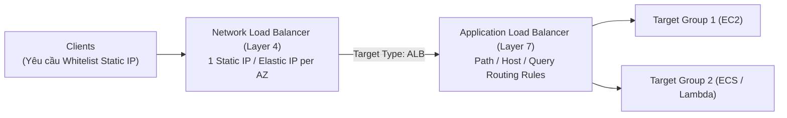

# Bài 75: Network Load Balancer (NLB)

- **Phần (Section):** Phần 8: High Availability and Scalability: ELB & ASG
- **Mã bài học (Lecture ID):** `18078013`
- **Tệp video:** `SAA - ELB - Network Load Balancer v6.mp4`
- **Thời lượng:** `03:24`

---

## 1. Kiến thức trọng tâm (Exam Notes)

> [!TIP]
> **Tóm tắt nhanh dịch vụ — Network Load Balancer (NLB) (SAA-C03 Cheat Sheet)**
> - **Là gì (1 câu):** Bộ cân bằng tải tầng giao vận (Layer 4 — TCP, UDP, TLS) có khả năng xử lý hàng triệu requests/giây với độ trễ cực thấp (~100 ms) và cung cấp địa chỉ IP tĩnh cố định.
> - **Dùng khi nào:** Ứng dụng yêu cầu hiệu năng cực cao, giao thức **TCP/UDP** (gaming, IoT, video streaming, non-HTTP), hoặc khách hàng yêu cầu cung cấp **địa chỉ Static/Elastic IP cố định** để mở whitelist trên Firewall.
> - **Khác gì dịch vụ gần giống:**
>   - **NLB vs ALB:** **NLB** hoạt động ở Layer 4 (TCP/UDP/TLS), có **1 Static IP / Elastic IP trên mỗi AZ**, giữ nguyên Source IP gốc của Client và độ trễ ~100ms; **ALB** hoạt động ở Layer 7 (HTTP/HTTPS), độ trễ ~400ms, không có Static IP nhưng hỗ trợ path/header routing.
> - **Điểm hay bị hỏi:**
>   - **Giới hạn & Mặc định:** Có thể đặt **NLB đứng trước ALB** (ALB-type Target Group) khi vừa cần **Static IP (từ NLB)** vừa cần **Layer 7 routing / WAF (từ ALB)**. **Cross-Zone Load Balancing mặc định TẮT** trên NLB và **TÍNH PHÍ** chuyển dữ liệu liên AZ nếu bật lên (ngược với ALB luôn bật và miễn phí).
>   - **Từ khóa gợi ý:** `"Layer 4 / TCP / UDP"`, `"millions of requests per second / ultra-low latency"`, `"static IP / Elastic IP per AZ / whitelisting"`, `"preserve client source IP"`.

### 1.1. Đặc điểm nhận diện Network Load Balancer (NLB) trong đề thi SAA-C03
Khi gặp bất kỳ từ khóa nào sau đây trong đề bài, hãy nghĩ ngay tới **Network Load Balancer (NLB)**:
1. **Layer 4 (Transport Layer):** Chuyển tiếp lưu lượng **TCP** và **UDP** (hoặc **TLS**).
2. **Hiệu năng cực cao (Extreme Performance) & Độ trễ cực thấp (Ultra-low Latency):**
   - Xử lý **hàng triệu yêu cầu mỗi giây (millions of requests per second)**.
   - Độ trễ cực thấp (~100 ms so với ~400 ms của ALB).
3. **Địa chỉ IP Tĩnh (Static IP) / Elastic IP:**
   - NLB có **đúng 1 địa chỉ Static IP cho mỗi Availability Zone (1 static IP per AZ)**.
   - Hỗ trợ gắn **Elastic IP** cho từng AZ — cực kỳ hữu ích khi khách hàng/đối tác yêu cầu **whitelist một danh sách địa chỉ IP cố định** trên tường lửa (firewall rules).

---

### 1.2. Các loại mục tiêu trong Target Groups của NLB (3 Loại)
1. **EC2 Instances:** Chuyển tiếp lưu lượng TCP/UDP trực tiếp tới EC2 instances.
2. **IP Addresses (Bắt buộc phải là Private IPs):** Địa chỉ IP riêng của EC2 instances hoặc máy chủ đặt tại trung tâm dữ liệu **On-Premises** (qua VPN / Direct Connect).
3. **Application Load Balancer (ALB):**
   - Đặt **NLB đứng trước ALB** để vừa tận dụng được **Fixed Static IP / Elastic IP** của NLB, vừa tận dụng được các **quy tắc định tuyến tầng HTTP (Layer 7 rules)** phức tạp của ALB!

---

### 1.3. Giao thức Health Checks của NLB
Target Group của NLB hỗ trợ **3 giao thức kiểm tra sức khỏe (Health Check Protocols)**:
- **`TCP`**
- **`HTTP`**
- **`HTTPS`**
*(Nếu ứng dụng backend trên EC2 có hỗ trợ HTTP/HTTPS, bạn hoàn toàn có thể cấu hình NLB kiểm tra sức khỏe bằng giao thức HTTP/HTTPS thay vì chỉ kiểm tra kết nối TCP).*

---

## 2. Phụ đề chi tiết theo mốc thời gian (Full Transcript & Timestamps)

| Thời gian | Nội dung lời giảng gốc (English) | Bản dịch tiếng Việt sát nghĩa |
| :--- | :--- | :--- |
| `00:00:00.240` | So now let's talk about the network load balancer. So it's a Layer 4 load balancer and therefore it allows you to deal with TCP and UDP traffic. | Bây giờ hãy nói về Network Load Balancer (NLB). Đây là bộ cân bằng tải ở Tầng 4 (Layer 4) và do đó nó cho phép bạn xử lý lưu lượng TCP và UDP. |
| `00:00:10.890` | This is lower level, Layer 7 was HTTP and Layer 4 is going to be TCP and UDP traffic. | Đây là tầng thấp hơn: Tầng 7 là HTTP, còn Tầng 4 là lưu lượng TCP và UDP. |
| `00:00:17.760` | So these work for the network load balancer and therefore when in the exam you see UDP think network load balancer or even TCP. | Vì vậy trong kỳ thi, bất cứ khi nào bạn nhìn thấy từ khóa UDP hoặc TCP, hãy nghĩ ngay đến Network Load Balancer. |
| `00:00:27.000` | Okay, also on top of it, the network load balancer is really, really high performance and therefore it can handle millions of requests per second and it has ultra low latency. | Hơn thế nữa, Network Load Balancer có hiệu năng cực kỳ cao, do đó nó có thể xử lý hàng triệu yêu cầu mỗi giây và có độ trễ cực thấp (ultra-low latency). |
| `00:00:39.630` | Now, another specificity of the network load balancer is that it only has one static IP per availability zone and you can assign an elastic IP to each AZ. | Một điểm đặc trưng khác của Network Load Balancer là nó chỉ có một địa chỉ IP tĩnh (static IP) cho mỗi Availability Zone, và bạn có thể gán một địa chỉ Elastic IP cho từng AZ. |
| `00:00:52.590` | So this is very helpful when you need to expose your application with a set of static IPs. And this can be elastic IPs. | Điều này rất hữu ích khi bạn cần phơi bày (expose) ứng dụng của mình qua một tập hợp các địa chỉ IP cố định (có thể là các Elastic IP). |
| `00:01:00.930` | So when in the exam you see, "Hey, your application can only be accessed within one, two, or three different IPs," then you need to think about the network load balancer as an option. | Vì vậy khi đi thi, nếu bạn thấy đề bài nói rằng ứng dụng của bạn chỉ được phép truy cập thông qua 1, 2 hoặc 3 địa chỉ IP cố định, bạn cần nghĩ ngay đến phương án Network Load Balancer. |
| `00:01:11.790` | So if you see extreme performance, TCP or UDP, or static IPs, think network load balancer. | Tóm lại: nếu thấy hiệu năng cực cao (extreme performance), TCP hoặc UDP, hoặc địa chỉ IP tĩnh (static IPs), hãy nghĩ tới Network Load Balancer. |
| `00:01:19.440` | So let's have a look at how that works. So it works very similarly to the application load balancer. We create target groups and then the network load balancer will redirect to them. | Hãy xem cách nó hoạt động. Nó hoạt động rất giống với Application Load Balancer: chúng ta tạo các Target Group và sau đó Network Load Balancer sẽ chuyển hướng lưu lượng tới chúng. |
| `00:01:31.560` | So we can use for example, the TCP traffic or for example, in the backend, HTTP, but still in the front end use TCP. | Ví dụ ở đầu vào chúng ta nhận lưu lượng TCP hoặc UDP, và chuyển tiếp tới các nhóm mục tiêu ở phía sau. |
| `00:01:42.270` | So what about the target groups? This is the important part. So the target groups can be EC2 instances. That means that your network load balancer can redirect to your EC2 instances and send TCP or UDP traffic to them. | Vậy còn các Target Group của NLB thì sao? Đây là phần quan trọng. Thứ nhất, Target Group có thể là các EC2 instance — nghĩa là NLB chuyển hướng và gửi lưu lượng TCP hoặc UDP tới các EC2 instance của bạn. |
| `00:01:56.820` | But you can also register IP addresses and these IP addresses when they're hard coded and they must be hard coded, they must be private IPs. | Thứ hai, bạn cũng có thể đăng ký các địa chỉ IP cố định (hard-coded), và các địa chỉ IP này bắt buộc phải là địa chỉ IP riêng (Private IPs). |
| `00:02:05.250` | So why would you do this? Well, you can of course send the private IP of the EC2 instance that you own, but also you could use the private IP of a server that you have in your own data center and therefore both of them can be fronted by the same network load balancer. | Tại sao bạn lại làm vậy? Tất nhiên bạn có thể điền Private IP của các EC2 instance bạn sở hữu, nhưng bạn cũng có thể dùng Private IP của các máy chủ đặt tại trung tâm dữ liệu riêng (on-premises) của bạn, để cả hai cùng đứng sau một Network Load Balancer duy nhất. |
| `00:02:23.310` | And it's also possible for you to have a network load balancer in front of an application load balancer. So in that case, the NLB is in front of your ALB. | Thứ ba, bạn hoàn toàn có thể đặt một Network Load Balancer đứng trước một Application Load Balancer (NLB đứng trước ALB). |
| `00:02:33.480` | So why would you do this? Well, thanks to the network load balancer you would get, for example, the fixed IP addresses, and then thanks to the application load balancer, you can get all the rules that you have around handling HTTP type of traffic. So it is a valid combination. | Tại sao bạn lại kết hợp như vậy? Nhờ có Network Load Balancer ở ngoài, bạn có được các địa chỉ IP cố định (Fixed/Static IP), và sau đó nhờ có Application Load Balancer ở trong, bạn có được toàn bộ các quy tắc định tuyến thông minh để xử lý lưu lượng HTTP. Đây là một sự kết hợp hoàn toàn hợp lệ và phổ biến. |
| `00:02:50.610` | Now one last thing you need to know for the exam is that the health checks performed by the network load balancer target groups support three different kind of protocols. | Một điều cuối cùng bạn cần biết cho kỳ thi là việc kiểm tra sức khỏe (Health Checks) thực hiện bởi Target Group của Network Load Balancer hỗ trợ 3 giao thức khác nhau: |
| `00:03:01.230` | They support the TCP protocol, the HTTP protocol and the HTTPS protocol. So if your backend application supports the HTTP or HTTPS protocol, then it is definitely possible for you to define a health check on these protocols. | Chúng hỗ trợ giao thức `TCP`, giao thức `HTTP` và giao thức `HTTPS`. Vì vậy, nếu ứng dụng backend của bạn có hỗ trợ HTTP hoặc HTTPS, bạn hoàn toàn có thể định nghĩa kiểm tra sức khỏe trên các giao thức này. |
| `00:03:19.320` | So that's it for the network load balancer. I hope you liked it and I will see you in the next lecture. | Đó là tất cả về Network Load Balancer. Hy vọng bạn thích bài học này và hẹn gặp lại bạn trong bài giảng tiếp theo. |
