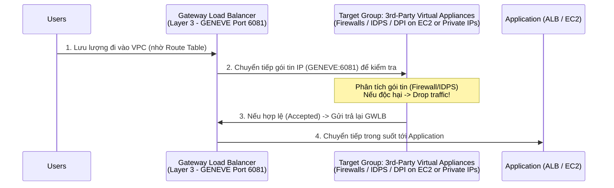

# Bài 77: Gateway Load Balancer (GWLB)

- **Phần (Section):** Phần 8: High Availability and Scalability: ELB & ASG
- **Mã bài học (Lecture ID):** `28874688`
- **Tệp video:** `SAA_-_ELB_-_Gateway_Load_Balancer_-_Overview_v1.mp4`
- **Thời lượng:** `03:47`
- **Cheat sheet:** [topics/aws_elb_asg.html](../../topics/aws_elb_asg.html)

---

## 1. Kiến thức trọng tâm (Exam Notes)

> [!TIP]
> **Tóm tắt nhanh dịch vụ — Gateway Load Balancer (GWLB) (SAA-C03 Cheat Sheet)**
> - **Là gì (1 câu):** Bộ cân bằng tải hoạt động ở tầng mạng (Layer 3 — IP Packets), dùng để triển khai, mở rộng và quản lý đội ngũ thiết bị mạng ảo của bên thứ ba (Third-party Virtual Network Appliances).
> - **Dùng khi nào:** Cần định tuyến **toàn bộ lưu lượng mạng (IP traffic)** đi qua một cụm thiết bị bảo mật ảo chạy trên EC2 như **Firewall, IDS/IPS (Intrusion Detection/Prevention System), Deep Packet Inspection (DPI)** trước khi vào ứng dụng.
> - **Khác gì dịch vụ gần giống:**
>   - **GWLB vs ALB/NLB:** **ALB (Layer 7)** và **NLB (Layer 4)** phân phối lưu lượng trực tiếp tới máy chủ ứng dụng đích; **GWLB (Layer 3)** là cổng trung gian trong suốt (Transparent Network Gateway + Load Balancer) đẩy gói tin qua thiết bị kiểm duyệt trên cổng **GENEVE (Port 6081)** rồi nhận lại gói tin đã lọc để chuyển tiếp.
> - **Điểm hay bị hỏi:**
>   - **Giới hạn & Mặc định:** Hoạt động ở **Layer 3 (Network Layer)** và sử dụng giao thức đóng gói **GENEVE trên cổng UDP 6081**. Thường kết hợp với **Gateway Load Balancer Endpoint (GWLBE)** để kiểm tra lưu lượng xuyên suốt qua nhiều VPCs.
>   - **Từ khóa gợi ý:** `"third-party virtual security appliances"`, `"inline firewall / IDS / IPS / deep packet inspection"`, `"Layer 3 IP packets / GENEVE protocol port 6081"`.

### 1.1. Mục đích và Trường hợp sử dụng của Gateway Load Balancer (GWLB)
- **Mục đích cốt lõi:** Dùng để triển khai, mở rộng (scale) và quản lý một đội ngũ (fleet) các **thiết bị mạng ảo của bên thứ ba (3rd-party network virtual appliances)** trong AWS.
- **Khi nào sử dụng GWLB (Từ khóa nhận diện trong bài thi SAA-C03):**
  - Khi bạn muốn **toàn bộ lưu lượng mạng (all network traffic)** đi qua các thiết bị kiểm tra bảo mật trước khi đến ứng dụng:
    - **Firewalls (Tường lửa)**
    - **Intrusion Detection and Prevention Systems (IDPS - Hệ thống phát hiện và ngăn chặn xâm nhập)**
    - **Deep Packet Inspection (DPI - Hệ thống kiểm tra sâu gói tin)**
    - Sửa đổi payload (payload manipulation) ở cấp độ mạng.

---

### 1.2. Cơ chế hoạt động của GWLB (Layer 3 & Giao thức GENEVE)
- **Hoạt động ở Tầng 3 (Layer 3 - Network Layer — IP Packets):** Thấp hơn cả ALB (Layer 7) và NLB (Layer 4).
- **Kết hợp 2 chức năng trong 1:**
  1. **Transparent Network Gateway (Cổng mạng trong suốt):** Là một điểm vào/ra duy nhất (**single entry/exit**) cho mọi lưu lượng trong VPC (thông qua việc cập nhật các bảng định tuyến - **Route Tables**).
  2. **Load Balancer (Bộ cân bằng tải):** Phân phối lưu lượng IP đó đều qua một Target Group gồm các thiết bị ảo (virtual appliances).
- **Giao thức đặc trưng (Exam Keyword):** Sử dụng giao thức **GENEVE** trên **cổng `6081`**.

---

### 1.3. Các loại mục tiêu trong Target Groups của GWLB (2 Loại)
1. **EC2 Instances** (đăng ký theo Instance ID).
2. **IP Addresses — Bắt buộc phải là Private IPs** (ví dụ: các thiết bị bảo mật ảo chạy trong trung tâm dữ liệu On-Premises của bạn).

---

## 2. Phụ đề chi tiết theo mốc thời gian (Full Transcript & Timestamps)

| Thời gian | Nội dung lời giảng gốc (English) | Bản dịch tiếng Việt sát nghĩa |
| :--- | :--- | :--- |
| `00:00:00.000` | So now let's talk about the newest kind of load balancer called the gateway load balancer. | Bây giờ hãy nói về loại bộ cân bằng tải mới nhất được gọi là Gateway Load Balancer (GWLB). |
| `00:00:04.410` | So it is used to deploy, scale and manage your fleet of third-party network virtual appliances in AWS. And I will explain what that means in a second. | Nó được sử dụng để triển khai, mở rộng và quản lý đội ngũ các thiết bị mạng ảo của bên thứ ba (third-party network virtual appliances) trong AWS. Tôi sẽ giải thích ý nghĩa của nó ngay sau đây. |
| `00:00:12.350` | So you would use a gateway load balancer if you wanted to have all traffic of your network to go through a firewall that you have, or an intrusion detection and prevention system (so IDPS) or a deep packet inspection system, or you want to modify some payloads, but at the network level. Okay. | Bạn sẽ sử dụng Gateway Load Balancer nếu muốn toàn bộ lưu lượng mạng của mình phải đi qua một tường lửa (firewall), hoặc hệ thống phát hiện và ngăn chặn xâm nhập (IDPS), hoặc hệ thống kiểm tra sâu gói tin (deep packet inspection), hoặc khi bạn muốn sửa đổi dữ liệu payload ngay ở cấp độ mạng. |
| `00:00:29.730` | So let's have a look to make it very simple with a diagram. So, say we have users and these users are used to access your applications. | Hãy xem một sơ đồ để làm cho mọi thứ thật đơn giản. Giả sử chúng ta có những người dùng đang truy cập vào ứng dụng của bạn. |
| `00:00:37.050` | Now we know that the users, for example, can access our applications directly using a load balancer, for example, an application load balancer. And then the traffic goes directly from the users to the ALB, to the application. | Thông thường, người dùng có thể truy cập trực tiếp vào ứng dụng thông qua một bộ cân bằng tải như Application Load Balancer (ALB). Khi đó lưu lượng đi thẳng từ người dùng -> tới ALB -> tới ứng dụng. |
| `00:00:48.310` | But what if you wanted all that network traffic to be inspected first, before being sent to your application? You have actually deployed a bunch of third party virtual appliances, for example, EC2 instances that you want all traffic to go through before the traffic reaches your application. | Nhưng điều gì sẽ xảy ra nếu bạn muốn toàn bộ lưu lượng mạng đó phải được kiểm tra (inspect) trước khi được gửi tới ứng dụng? Bạn đã triển khai một loạt thiết bị ảo của bên thứ ba (chẳng hạn trên các EC2 instance) và muốn mọi lưu lượng phải đi qua chúng trước khi chạm tới ứng dụng. |
| `00:01:05.830` | So to do so, it used to be very complicated, but now with a gateway load balancer, it is actually very simple. | Trước đây việc thiết lập kiến trúc này cực kỳ phức tạp, nhưng giờ đây với Gateway Load Balancer, mọi thứ trở nên rất đơn giản. |
| `00:01:11.330` | So you're going to create a gateway load balancer and what's going to happen is that behind the scenes, the route tables have to be updated in your VPC. Now this is quite advanced and it's more in the networking side, but bear with me. | Bạn sẽ tạo một Gateway Load Balancer, và ở phía hậu trường, các bảng định tuyến (Route Tables) trong VPC của bạn sẽ được cập nhật. Phần này hơi nâng cao về phía mạng, nhưng hãy theo dõi luồng đi nhé. |
| `00:01:22.120` | So the route tables are modified. And now what happens is that all users traffic first goes through a gateway load balancer and the gateway load balancer will then spread that traffic across a target group of your virtual appliances. | Khi bảng định tuyến được cập nhật, mọi lưu lượng từ người dùng trước tiên sẽ đi qua Gateway Load Balancer, và sau đó Gateway Load Balancer sẽ phân bổ lưu lượng đó qua một Target Group gồm các thiết bị mạng ảo của bạn. |
| `00:01:35.570` | And so all the traffic will reach these appliances, then the appliances will analyze the traffic, you know, do whatever they have to do. So for example, firewall again, intrusion detection and so on. | Toàn bộ lưu lượng sẽ đến các thiết bị ảo này, chúng sẽ phân tích lưu lượng và thực hiện nhiệm vụ của mình (như tường lửa, phát hiện xâm nhập,...). |
| `00:01:45.700` | And then if they're happy with it, they can send it back to the gateway load balancer. If they're not happy with it, they can just drop the traffic. For example, for a firewall, you would drop the traffic, | Sau đó, nếu lưu lượng hợp lệ, chúng sẽ gửi trả lại cho Gateway Load Balancer. Còn nếu phát hiện bất thường, chúng có thể hủy bỏ (drop) gói tin ngay lập tức — giống như cách tường lửa chặn lưu lượng xấu. |
| `00:01:54.090` | but if it's accepted, then it goes through your gateway load balancer again, and then the gateway load balancer will forward the traffic all the way to your application, and for your application, this is transparent. | Nếu lưu lượng được chấp nhận, nó sẽ quay trở lại Gateway Load Balancer, và GWLB sẽ chuyển tiếp lưu lượng đó tới ứng dụng của bạn. Đối với ứng dụng của bạn, toàn bộ quá trình này diễn ra hoàn toàn trong suốt (transparent). |
| `00:02:04.250` | The only thing that has happened now is that all the traffic has gone through the gateway load balancer and your third-party virtual appliances, for you to analyze all that network traffic and possibly drop it. | Điều duy nhất thay đổi là giờ đây toàn bộ lưu lượng đều đã đi qua Gateway Load Balancer và các thiết bị ảo của bên thứ ba để được phân tích và lọc bỏ nếu độc hại. |
| `00:02:15.520` | So this is the power of the gateway load balancer: it is to analyze network traffic and so on. | Đó chính là sức mạnh của Gateway Load Balancer: dùng để kiểm tra và phân tích lưu lượng mạng. |
| `00:02:19.760` | So how does that work? Well, the gateway load balancer operates at a lower level than all the load balancers we've seen. This is layer three, which is the network layer for IP packets. | Vậy nó hoạt động ở tầng nào? Gateway Load Balancer hoạt động ở tầng thấp hơn tất cả các bộ cân bằng tải mà chúng ta đã học: Tầng 3 (Layer 3 - Network Layer), xử lý các gói tin IP (IP packets). |
| `00:02:28.450` | So what's going to happen is that your gateway load balancer has two functions. The first one is a transparent network gateway because all the traffic in your VPC will go through a single entry and a single exit, which is going to be your gateway load balancer, | Gateway Load Balancer đảm nhận hai chức năng: Thứ nhất, nó là một cổng mạng trong suốt (Transparent Network Gateway), vì mọi lưu lượng trong VPC sẽ đi qua một điểm vào và một điểm ra duy nhất chính là GWLB; |
| `00:02:41.190` | and then it is going to be a load balancer because it distributes that traffic across a set of virtual appliances in your target group. | Thứ hai, nó là một bộ cân bằng tải (Load Balancer) vì nó phân phối lưu lượng đó qua một tập hợp các thiết bị ảo trong Target Group của bạn. |
| `00:02:49.220` | So this is basically what you remember about the gateway load balancer. And finally, if you see on an exam that you want to use the GENEVE protocol on port 6081, then again, this will be right away your gateway load balancer. | Cuối cùng, một mẹo cực kỳ quan trọng cho kỳ thi: nếu bạn thấy đề thi nhắc đến giao thức **GENEVE** trên cổng **6081**, hãy chọn ngay **Gateway Load Balancer**. |
| `00:03:02.770` | So hopefully this diagram makes sense. Now, what can be target groups for the gateway load balancers? So this is your third party appliances. They can either be EC2 instances and you register them by instance ID, | Vậy Target Group của Gateway Load Balancer có thể chứa những loại mục tiêu nào? Đó chính là nơi đặt các thiết bị bảo mật của bên thứ ba: chúng có thể là các **EC2 instances** (đăng ký theo Instance ID), |
| `00:03:13.130` | or they can be IP addresses. In that case, they must be private IPs. And for example, if you are running these virtual appliances on your own network, on your own data center, then you can register them by IP manually. | hoặc có thể là các **IP addresses** (bắt buộc phải là **Private IPs**) — ví dụ khi bạn chạy các thiết bị ảo này trên mạng riêng hoặc trung tâm dữ liệu on-premises của mình. |
| `00:03:24.690` | So that's it for the gateway load balancer. It is extremely difficult to do a hands-on on it. So I will skip one. Okay. | Đó là tất cả về Gateway Load Balancer. Việc làm lab thực hành cho dịch vụ này cực kỳ phức tạp vì cần thiết bị ảo bên thứ ba nên tôi sẽ bỏ qua phần hands-on. |
| `00:03:29.870` | But just so you know, again, the most important thing to remember is that one diagram on the right-hand side, if you understand this diagram, you understand gateway load balancers. | Điều quan trọng nhất cần nhớ là sơ đồ kiến trúc ở bên phải: hiểu được sơ đồ đó là bạn đã nắm trọn vẹn về Gateway Load Balancer cho kỳ thi. |
| `00:03:38.910` | And I don't think any deep dive question will be asked on it, just at a high level, what it means and how it works. Okay. So that's it. I hope you liked it, and I will see you in the next lecture. | Đề thi sẽ không hỏi quá sâu về cấu hình bên trong mà chỉ hỏi ở mức tổng quan về công dụng và luồng hoạt động của nó. Hẹn gặp lại bạn trong bài giảng tiếp theo. |
