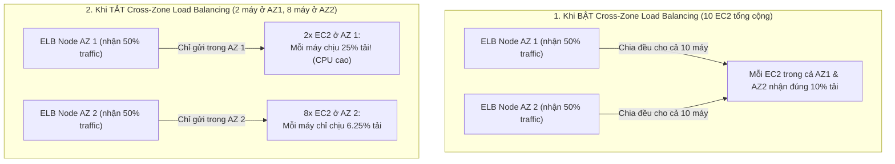

# Bài 79: Elastic Load Balancer - Cross-Zone Load Balancing (Cân bằng tải liên vùng)

- **Phần (Section):** Phần 8: High Availability and Scalability: ELB & ASG
- **Mã bài học (Lecture ID):** `18078093`
- **Tệp video:** `SAA_-_ELB_-_Cross_Zone_Load_Balancing_v5D.mp4`
- **Thời lượng:** `05:53`
- **Cheat sheet:** [topics/aws_elb_asg.html](../../topics/aws_elb_asg.html)

---

## 1. Kiến thức trọng tâm (Exam Notes)

### 1.1. So sánh Có và Không có Cross-Zone Load Balancing
Giả sử bài toán kinh điển trong đề thi SAA-C03:
- Bạn có **2 Availability Zones (AZ1 và AZ2)**, mỗi AZ có 1 ELB Node nhận **50% lưu lượng** từ Clients.
- **AZ 1** chỉ có **2 EC2 instances**.
- **AZ 2** có tới **8 EC2 instances** (Tổng cộng toàn hệ thống có **10 EC2 instances**).

| Chế độ | Cách phân phối lưu lượng | Tải trên mỗi EC2 ở AZ 1 (2 máy) | Tải trên mỗi EC2 ở AZ 2 (8 máy) | Hệ quả |
| :--- | :--- | :--- | :--- | :--- |
| **CÓ Cross-Zone Load Balancing (Enabled)** | Mỗi ELB Node phân phối đều lưu lượng nó nhận được sang **TẤT CẢ các instances đã đăng ký trên MỌI AZ** | **10%** / instance | **10%** / instance | Tất cả 10 EC2 instances đều nhận tải bằng nhau (**10% mỗi máy**). |
| **KHÔNG CÓ Cross-Zone Load Balancing (Disabled)** | Mỗi ELB Node **chỉ** phân phối lưu lượng cho các instances nằm **trong cùng AZ với nó** | **25%** / instance (`50% / 2`) | **6.25%** / instance (`50% / 8`) | Các máy ở AZ 1 bị quá tải gấp 4 lần các máy ở AZ 2! |

---

### 1.2. Bảng tổng hợp Mặc định & Chi phí Inter-AZ theo từng loại ELB (Cực kỳ quan trọng!)

| Loại Load Balancer | Trạng thái Mặc định (Default) | Có thể Tắt/Bật ở đâu? | Chi phí truyền dữ liệu liên vùng (Inter-AZ Data Charges) |
| :--- | :--- | :--- | :--- |
| **Application Load Balancer (ALB)** | **Enabled (Luôn bật ở cấp ALB)** | Có thể **Tắt (Disable)** ở cấp độ **Target Group** | **Miễn phí (No charges)** cho dữ liệu đi qua lại giữa các AZ. |
| **Network Load Balancer (NLB)** | **Disabled (Tắt mặc định)** | Bật/Tắt trong **Load Balancer Attributes** (hoặc Target Group) | **CÓ TÍNH PHÍ (You pay charges ($))** cho dữ liệu truyền giữa các AZ nếu bật lên! |
| **Gateway Load Balancer (GWLB)** | **Disabled (Tắt mặc định)** | Bật/Tắt trong **Load Balancer Attributes** | **CÓ TÍNH PHÍ (You pay charges ($))** cho dữ liệu truyền giữa các AZ nếu bật lên! |
| **Classic Load Balancer (CLB)** | **Disabled** (khi tạo bằng CLI/API) / **Enabled** (khi tạo bằng Console) | Bật/Tắt trong Load Balancer | **Miễn phí (No charges)** nếu bật lên. |

---

## 2. Phụ đề chi tiết theo mốc thời gian (Full Transcript & Timestamps)

| Thời gian | Nội dung lời giảng gốc (English) | Bản dịch tiếng Việt sát nghĩa |
| :--- | :--- | :--- |
| `00:00:00.510` | Now let's talk about cross zone load balancing. So let's take an example of a very imbalanced situation but it will illustrate the point. | Bây giờ hãy nói về cân bằng tải liên vùng (Cross-Zone Load Balancing). Hãy lấy một ví dụ về tình huống phân bổ rất mất cân đối nhưng sẽ minh họa cực rõ vấn đề này. |
| `00:00:08.100` | So we have two availability zones and the first one has a load balancer with two EC2 instances. And the second one also has a load balancer (a load balancer instance obviously) with eight EC2 instances. | Chúng ta có hai Availability Zone: AZ thứ nhất có một node bộ cân bằng tải cùng với **2 EC2 instances**; AZ thứ hai cũng có một node bộ cân bằng tải nhưng có tới **8 EC2 instances**. |
| `00:00:19.770` | The load balancer instances are part of the same more general load balancer. So the client is accessing these load balancers. | Hai node bộ cân bằng tải này thuộc cùng một Elastic Load Balancer chung. Các client sẽ gửi lưu lượng truy cập vào các node này. |
| `00:00:28.950` | And so with cross zone load balancing each load balancer instance will distribute evenly across all registered instances in all availability zones. | Khi bật **Cross-Zone Load Balancing**, mỗi node bộ cân bằng tải sẽ phân phối lưu lượng **đồng đều qua tất cả các instance đã đăng ký ở tất cả các Availability Zone**. |
| `00:00:39.270` | So the client itself is sending 50% of the traffic to the first ALB instance and 50% of traffic to the other ALB instance. | Bản thân các client sẽ gửi 50% lưu lượng tới node ALB thứ nhất (ở AZ 1) và 50% lưu lượng tới node ALB thứ hai (ở AZ 2) thông qua DNS. |
| `00:00:49.080` | But each ALB is going to redirect the traffic across all 10 EC2 instances regardless of which availability zones they're in. This is why it's called cross zone load balancing. | Nhưng mỗi node ALB sẽ chuyển hướng lưu lượng nó nhận được chia đều cho **cả 10 EC2 instances** bất kể chúng nằm ở Availability Zone nào. Đó là lý do tại sao nó được gọi là cân bằng tải liên vùng (Cross-Zone Load Balancing). |
| `00:01:01.140` | So if you take a look at the second ALB instance, it's going to send 10% of the traffic it receives to all these instances because we have 10 instances. So each of them gets 10% of the traffic. | Nếu bạn nhìn vào node ALB thứ hai, nó sẽ gửi 1/10 lưu lượng nó nhận được tới từng instance vì chúng ta có tổng cộng 10 instance. |
| `00:01:16.890` | And same story with the first ALB instance. It's going to send also 10% of traffic to all these instances. So in this example with cross zone load balancing we are distributing the traffic evenly across all EC2 instances. | Và câu chuyện tương tự cũng diễn ra với node ALB thứ nhất. Tổng hợp lại, với Cross-Zone Load Balancing, mỗi EC2 instance trong tổng số 10 máy sẽ nhận đúng **10% tổng lưu lượng** — lưu lượng được phân phối hoàn toàn đồng đều. |
| `00:01:31.230` | And that may be something you want to have or not, who knows, but at least this behavior is available to you. | Đó có thể là hành vi bạn mong muốn hoặc không tùy kiến trúc, nhưng tính năng này luôn sẵn có cho bạn. |
| `00:01:37.710` | The second behavior that's available to you is to not have cross zone load balancing. So we take the same example but without cross zone load balancing. | Hành vi thứ hai là **không bật Cross-Zone Load Balancing**. Hãy lấy lại đúng ví dụ trên nhưng khi tắt Cross-Zone Load Balancing. |
| `00:01:46.920` | The requests are distributed in the instances of the node of the elastic load balancer. So in this example, what we have is that the client sends 50% of the traffic to the first AZ and 50% of traffic to the second AZ, okay? | Lúc này, các yêu cầu chỉ được phân phối cho các instance nằm trong cùng AZ với node của bộ cân bằng tải đó. Client vẫn gửi 50% lưu lượng tới AZ thứ nhất và 50% lưu lượng tới AZ thứ hai. |
| `00:02:02.400` | But the first ALB instance is going to send the traffic to only the EC2 instances in its Availability Zone. So that means that each EC2 instance in this availability zone is going to get 25% of the traffic overall, okay? So half and half. | Nhưng node ELB ở AZ thứ nhất sẽ chỉ gửi lưu lượng cho 2 EC2 instance nằm trong chính AZ của nó. Điều đó có nghĩa là mỗi EC2 instance trong AZ 1 sẽ phải gánh tới **25% tổng lưu lượng** (chia đôi của 50%). |
| `00:02:18.090` | And the one on the right hand side will again divide up the traffic it receives into the EC2 instances that are registered within its AZ, so AZ2. | Còn node ELB ở bên phải (AZ 2) sẽ chia 50% lưu lượng nó nhận được cho 8 EC2 instance đăng ký trong AZ 2 (mỗi máy chỉ nhận 6.25% tổng lưu lượng). |
| `00:02:26.340` | So we can see here without cross zone load balancing the traffic is contained within each AZ. But if there are an imbalanced number of EC2 instances in each AZ, then some EC2 instances of a specific AZ will receive more traffic than others. | Như vậy khi không có Cross-Zone Load Balancing, lưu lượng được giữ gói gọn bên trong từng AZ. Nhưng nếu số lượng EC2 instance giữa các AZ không bằng nhau, các EC2 instance ở AZ có ít máy hơn sẽ phải nhận nhiều lưu lượng hơn hẳn các AZ khác. |
| `00:02:42.720` | It's just an option to know about. There's no right or wrong answer. It depends on the use case, obviously. | Đây là một tùy chọn kiến trúc quan trọng cần nắm rõ. |
| `00:02:48.840` | So for the application load balancer, by default cross zone load balancing is going to be enabled, but you can disable it at the target group level and there's going to be no charges if your data goes across availability zones | Đối với **Application Load Balancer (ALB)**, mặc định Cross-Zone Load Balancing được **bật sẵn (Enabled)** (bạn có thể tắt nó ở cấp độ Target Group), và bạn sẽ **không bị tính phí** khi dữ liệu đi xuyên qua các Availability Zone, |
| `00:03:03.660` | because usually in AWS, if data goes from one AZ to another one, you're going to pay some money. But for the application load balancer because cross zone load balancing is enabled by default you won't have any charges for inter-AZ data. | bởi vì thông thường trong AWS, nếu dữ liệu truyền từ AZ này sang AZ khác thì bạn phải trả phí truyền dữ liệu liên vùng (inter-AZ data transfer), nhưng với ALB thì hoàn toàn miễn phí. |
| `00:03:19.290` | Now, if you consider the network load balancer and the gateway load balancer, then cross zone load balancing is disabled by default. And if you enable it then you're going to pay some amount of money because the data is going to go from one AZ to the next. | Ngược lại, đối với **Network Load Balancer (NLB)** và **Gateway Load Balancer (GWLB)**, Cross-Zone Load Balancing mặc định bị **tắt (Disabled)**. Và nếu bạn bật nó lên, bạn **sẽ phải trả phí** truyền dữ liệu giữa các AZ! |
| `00:03:36.270` | Finally, for the classic load balancer it is disabled by default, and in case you enable it you're not going to be charged for inter-AZ data transfers. | Cuối cùng, đối với **Classic Load Balancer (CLB)**, mặc định nó bị tắt (khi tạo qua CLI/API), và nếu bạn bật nó lên thì bạn không bị tính phí truyền dữ liệu liên vùng. |
| `00:03:48.930` | Okay, so just for the sake of doing a hands on I've created a network load balancer, an application load balancer and a gateway load balancer. So let's first have a look at the network load balancer. | Để minh họa trực tiếp trên giao diện Console, tôi đã tạo sẵn một NLB, một ALB và một GWLB. Đầu tiên hãy xem xét Network Load Balancer. |
| `00:04:00.060` | So if I scroll down and click on attributes, as you can see cross zone load balancing is off, but I can edit this and turn this on. And as you can see, I will enable cross zone load balancing and this may include some regional charges for your NLB. | Khi cuộn xuống phần **Attributes** của NLB, bạn có thể thấy **Cross-zone load balancing** đang ở trạng thái **Off**, nhưng tôi có thể nhấn Edit để bật nó lên, kèm dòng cảnh báo có thể phát sinh chi phí truyền dữ liệu vùng. |
| `00:04:18.030` | So this is a similar setting for the gateway load balancer because they have a similar behavior in that regard. So for the attributes, again, cross zone load balancing is off, but I can edit it and turn it on. And this will imply data charges. | Thiết lập này hoàn toàn tương tự trên Gateway Load Balancer: trong phần Attributes, Cross-zone load balancing mặc định là **Off**, bạn có thể chỉnh sửa để bật lên và sẽ chịu phí truyền dữ liệu. |
| `00:04:33.180` | Now if you have a look at the application load balancer it is a little bit different. So if you go to attributes you can see that cross zone load balancing is on by default. | Còn nếu bạn nhìn vào Application Load Balancer thì sẽ hơi khác một chút. Trong phần Attributes của ALB, bạn thấy Cross-zone load balancing luôn là **On** theo mặc định. |
| `00:05:01.380` | So cross zone load balancing is always on for your ALB. But if you go to your actual target group, so if I go to my target group that has been created for this and I go to attributes of the target group, we can actually do edit. | Ở cấp độ ALB thì Cross-zone load balancing luôn bật, nhưng nếu bạn vào **Target Group** của ALB và mở tab **Attributes -> Edit**, |
| `00:05:15.630` | And for the cross zone load balancing here, we can either inherit settings from the load balancer attributes which is on by default or force on or off and turn it off for that one specific target group. | tại mục **Cross-zone load balancing**, bạn có thể chọn kế thừa từ Load Balancer (mặc định là On) hoặc chủ động **Tắt (Off)** cho riêng Target Group cụ thể đó. |
| `00:05:28.890` | And when it comes to doing the demo for the classic load balancer, I will not include it this time because the classic load balancer is going away. It is previous generation and is going to be retired very soon. | Tôi sẽ không demo trên Classic Load Balancer nữa vì nó thuộc thế hệ cũ và sắp bị loại bỏ hoàn toàn. |
| `00:05:43.920` | Okay, so let's see. For this lecture, just make sure if you wanted to follow along to delete the load balancers. I hope you liked it and I will see you in the next lecture. | Nếu bạn có tạo thử các bộ cân bằng tải để quan sát theo bài học này thì hãy nhớ xóa các NLB/GWLB dư thừa đi nhé. Hẹn gặp lại bạn ở bài giảng tiếp theo. |
