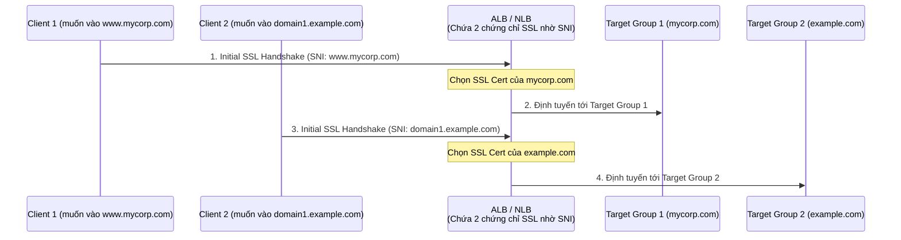

# Bài 80: Elastic Load Balancer - SSL Certificates (Chứng chỉ bảo mật SSL/TLS & SNI)

- **Phần (Section):** Phần 8: High Availability and Scalability: ELB & ASG
- **Mã bài học (Lecture ID):** `18078099`
- **Tệp video:** `SAA_-_ELB_-_SSL_Certificates_Overview_-_v3.mp4`
- **Thời lượng:** `06:03`

---

## 1. Kiến thức trọng tâm (Exam Notes)

### 1.1. Khái niệm cơ bản về SSL / TLS & SSL Termination trên ELB
- **SSL (Secure Sockets Layer) & TLS (Transport Layer Security - phiên bản mới hơn của SSL):**
  - Cho phép mã hóa lưu lượng giữa Client và Load Balancer khi truyền trên mạng (**In-flight Encryption**).
  - Chứng chỉ SSL công khai (X.509 certificate) được cấp bởi các **Certificate Authorities (CA)** như Comodo, Symantec, GoDaddy, GlobalSign, DigiCert, Let's Encrypt,... và có ngày hết hạn (cần gia hạn định kỳ).
- **Cách hoạt động trên ELB (SSL Termination):**
  - **Client -> ELB:** Kết nối qua **HTTPS** (được mã hóa an toàn qua Internet công cộng).
  - **Tại ELB:** Thực hiện **SSL Certificate Termination** (giải mã lưu lượng HTTPS). Quản lý chứng chỉ thông qua **ACM (AWS Certificate Manager)** hoặc tự upload chứng chỉ lên ACM / IAM.
  - **ELB -> Backend EC2 Instances:** Giao tiếp qua **HTTP** (không mã hóa, nhưng đi bên trong mạng nội bộ **Private VPC** nên vẫn đảm bảo an toàn và giảm tải CPU giải mã cho EC2).
- Khi cấu hình HTTPS Listener:
  - Phải chỉ định một **Default Certificate**.
  - Có thể cấu hình **Security Policy** để hỗ trợ các phiên bản SSL/TLS cũ hơn cho các **legacy clients**.

---

### 1.2. Server Name Indication (SNI) — Kiến thức Trọng Tâm Kỳ Thi SAA-C03!
- **Bài toán SNI giải quyết:** Làm thế nào để nạp **nhiều chứng chỉ SSL (multiple SSL certificates)** lên **cùng một máy chủ web / một Listener duy nhất** để phục vụ nhiều trang web (nhiều tên miền như `www.mycorp.com` và `domain1.example.com`)?
- **Cơ chế của SNI (Server Name Indication):**
  - Là một phần mở rộng giao thức mới hơn, yêu cầu **Client phải gửi kèm tên miền đích (`hostname`) ngay trong bước bắt tay SSL ban đầu (initial SSL handshake)**.
  - Nhờ biết được hostname mà Client muốn truy cập, Load Balancer (ALB/NLB) sẽ tự động chọn **đúng chứng chỉ SSL tương ứng** để mã hóa kết nối và định tuyến tới đúng Target Group!

---

### 1.3. Bảng so sánh hỗ trợ Multiple SSL Certificates (SNI)

| Dịch vụ | Có hỗ trợ nhiều SSL Certificates (SNI) không? | Ghi chú cho kỳ thi SAA-C03 |
| :--- | :--- | :--- |
| **Classic Load Balancer (CLB - v1)** | **KHÔNG (Chỉ hỗ trợ 1 chứng chỉ SSL)** | Nếu muốn dùng nhiều tên miền với nhiều SSL Cert trên CLB, bắt buộc phải tạo nhiều CLB. |
| **Application Load Balancer (ALB - v2)** | **CÓ (Hỗ trợ qua SNI)** | Hỗ trợ nhiều Listeners với **nhiều chứng chỉ SSL** trên cùng 1 ALB. |
| **Network Load Balancer (NLB - v2)** | **CÓ (Hỗ trợ qua SNI)** | Hỗ trợ nhiều Listeners với **nhiều chứng chỉ SSL/TLS** trên cùng 1 NLB. |
| **Amazon CloudFront** | **CÓ (Hỗ trợ qua SNI)** | Cũng hỗ trợ SNI cho nhiều tên miền. |

---

## 2. Phụ đề chi tiết theo mốc thời gian (Full Transcript & Timestamps)

| Thời gian | Nội dung lời giảng gốc (English) | Bản dịch tiếng Việt sát nghĩa |
| :--- | :--- | :--- |
| `00:00:00.300` | Okay, so now let's talk about SSL and TLS Certificates. So this is a dumbed down version of how this works. This is obviously way more complicated, but I want to introduce you to the concepts in case you don't know it. | Bây giờ chúng ta hãy nói về chứng chỉ SSL và TLS. Đây là phiên bản giải thích ngắn gọn và dễ hiểu về nguyên lý hoạt động của chúng. |
| `00:00:13.140` | And even if you do know SSL and TLS, please watch this lecture. I'm going to talk about SNI and I'm going to talk about the integrations with load balancers. So bear with me please. | Và ngay cả khi bạn đã biết về SSL và TLS, hãy vẫn theo dõi bài giảng này vì tôi sẽ nói về **SNI** và cách tích hợp với các bộ cân bằng tải. |
| `00:00:21.750` | So an SSL certificate allows the traffic between your clients and your load balancer to be encrypted while in transit. This is called in-flight encryption. | Chứng chỉ SSL cho phép lưu lượng truy cập giữa client và bộ cân bằng tải của bạn được mã hóa trong quá trình truyền tải trên mạng. Điều này được gọi là mã hóa trên đường truyền (**in-flight encryption**). |
| `00:00:31.650` | So that means the data as it goes through a network is going to be encrypted and only going to be able to be decrypted by the sender and the receiver. | Điều đó có nghĩa là dữ liệu khi đi qua mạng sẽ được mã hóa và chỉ có thể được giải mã bởi người gửi và người nhận. |
| `00:00:38.940` | So, SSL refers to Secure Sockets Layer and it's used to encrypt transfer connections. And TLS is the newer version of SSL and it refers to Transport Layer Security. | **SSL** là viết tắt của *Secure Sockets Layer*, dùng để mã hóa các kết nối truyền tải. Còn **TLS** là phiên bản mới hơn của SSL, viết tắt của *Transport Layer Security*. |
| `00:00:51.810` | But the thing is, nowadays, TLS certificates are the ones that are mainly used, but people, including myself, I will still refer to this as SSL. So I'm making a mistake, but I'm making it on purpose, okay? | Ngày nay, chứng chỉ TLS mới là thứ được sử dụng chủ yếu, nhưng mọi người (bao gồm cả tôi) vẫn thường quen miệng gọi chung là SSL cho dễ hiểu. |
| `00:01:11.070` | So public SSL certificates are issued by Certificate Authorities, and they include something like Comodo, Symantec, GoDaddy, GlobalSign, Digicert, Letsencrypt, and so on. | Các chứng chỉ SSL công khai được cấp phát bởi các tổ chức chứng thực chữ ký số (**Certificate Authorities - CA**), chẳng hạn như Comodo, Symantec, GoDaddy, GlobalSign, DigiCert, Let's Encrypt, v.v. |
| `00:01:21.030` | And using this public SSL certificate attached to our load balancer, we're able to encrypt the connection between the clients and the load balancer. | Bằng cách gắn chứng chỉ SSL công khai này vào bộ cân bằng tải, chúng ta có thể mã hóa kết nối giữa các client và bộ cân bằng tải. |
| `00:01:29.640` | So whenever you go to a website, for example google.com or anything, any other website, and you have a lock or a green lock, that means that your traffic is encrypted. | Bất cứ khi nào bạn truy cập một trang web như `google.com` và thấy biểu tượng ổ khóa trên thanh địa chỉ, điều đó có nghĩa là lưu lượng của bạn đã được mã hóa. |
| `00:01:37.980` | And if traffic is not encrypted, you'll have a red sign saying, "Hey, traffic is not encrypted. Don't put your credit card details. Don't put your login information because it's not secure." | Còn nếu lưu lượng không được mã hóa, trình duyệt sẽ hiện cảnh báo không bảo mật, khuyên bạn không nên nhập thông tin thẻ tín dụng hay mật khẩu đăng nhập. |
| `00:01:47.310` | So the SSL certificates, they have an expiration date that you set and they must be renewed regularly to make sure that they're authentic, okay? | Các chứng chỉ SSL đều có ngày hết hạn (expiration date) và phải được gia hạn định kỳ để đảm bảo tính xác thực. |
| `00:01:56.070` | So how does it work from a load balancer perspective? So users connect over HTTPS, and it's S because it's using SSL certificates and it's encrypted. It's secure, and it connects over the public internet to your load balancer. | Vậy từ góc độ bộ cân bằng tải, nó hoạt động như thế nào? Người dùng kết nối qua giao thức **HTTPS** (chữ S nghĩa là Secure - sử dụng chứng chỉ SSL và được mã hóa) đi qua mạng Internet công cộng tới bộ cân bằng tải của bạn. |
| `00:02:09.960` | And internally, your load balancer does something called SSL certificate termination. And in the backend, it can talk to your EC2 instance using HTTP, so not encrypted, but the traffic goes over your VPC, which is a private traffic network. And that is somewhat secure. | Ở bên trong, bộ cân bằng tải thực hiện việc giải mã gọi là **SSL certificate termination**. Và ở phía backend, nó có thể giao tiếp với các EC2 instance bằng giao thức **HTTP** (không mã hóa), nhưng vì lưu lượng này đi bên trong mạng riêng ảo **VPC** của bạn nên vẫn đảm bảo an toàn. |
| `00:02:27.150` | So the load balancer will load an X.509 certificate, which is called an SSL or TLS server certificate. And you can manage these SSL certificates in AWS using ACM, meaning AWS Certificate Manager. | Bộ cân bằng tải sẽ nạp một chứng chỉ chuẩn X.509 (gọi là SSL/TLS server certificate). Bạn có thể quản lý các chứng chỉ SSL này trong AWS bằng dịch vụ **ACM (AWS Certificate Manager)**. |
| `00:02:45.180` | Now, you can also upload your own certificates to ACM if you wanted to. And when you set up an HTTPS listener, you must specify a default certificate. | Bạn cũng có thể tự tải chứng chỉ của riêng mình lên ACM nếu muốn. Khi thiết lập một HTTPS Listener, bạn bắt buộc phải chỉ định một chứng chỉ mặc định (**default certificate**). |
| `00:02:54.150` | Then you can add an optional list of certs to support multiple domains, and clients can use something called SNI or Server Name Indication to specify the hostname they reach. | Sau đó, bạn có thể thêm một danh sách các chứng chỉ tùy chọn để hỗ trợ nhiều tên miền (multiple domains), và các client có thể sử dụng giao thức gọi là **SNI (Server Name Indication)** để chỉ định tên miền mà chúng muốn truy cập. |
| `00:03:03.630` | Now don't worry, I'm going to explain what SNI is in details in the next slide because it is really, really important for you to understand what it means. | Tôi sẽ giải thích chi tiết về SNI ở slide tiếp theo vì việc hiểu rõ nó cực kỳ quan trọng cho kỳ thi. |
| `00:03:10.500` | And you can also, finally for HTTPS, set a specific security policy if you wanted to support older versions of SSL and TLS, called also legacy clients. | Ngoài ra đối với HTTPS, bạn có thể thiết lập một chính sách bảo mật (**security policy**) cụ thể nếu muốn hỗ trợ các phiên bản SSL và TLS cũ hơn (dành cho các **legacy clients**). |
| `00:03:21.660` | Okay, so let's talk about SNI 'cause it is so important. SNI solves a very important problem, which is how do you load multiple SSL certificates onto one web server in order for that web server to serve multiple websites? | Hãy nói kỹ về **SNI** vì nó vô cùng quan trọng. SNI giải quyết một bài toán rất lớn: làm thế nào để nạp **nhiều chứng chỉ SSL** lên **cùng một máy chủ web** để máy chủ đó có thể phục vụ nhiều trang web khác nhau? |
| `00:03:35.490` | And there's a newer protocol that now requires the client to indicate the hostname of the target server in the initial SSL handshake. | SNI là một giao thức mới hơn, yêu cầu client phải chỉ rõ tên miền (**hostname**) của máy chủ đích ngay trong bước bắt tay SSL đầu tiên (**initial SSL handshake**). |
| `00:03:43.890` | So the client will say, "I want to connect to this website." And the server will know what certificate to load. | Nghĩa là client sẽ báo rằng: "Tôi muốn kết nối tới trang web này." Và máy chủ sẽ biết chính xác cần phải nạp chứng chỉ SSL nào lên để phản hồi. |
| `00:03:50.430` | And so, this is a newer protocol and this is something new. Not every client supports this. So it only works when you use the application load balancer and the network load balancer, so the newer generations, or CloudFront. | Trong AWS, tính năng SNI chỉ hoạt động khi bạn sử dụng các bộ cân bằng tải thế hệ mới là **Application Load Balancer (ALB)**, **Network Load Balancer (NLB)**, hoặc dịch vụ **CloudFront**. |
| `00:04:04.050` | And it does not work when you use the classic load balancer because it is older generation. So anytime you see multiple SSL certificates onto your load balancer, think ALB or NLB. | Nó **không hoạt động** với Classic Load Balancer (CLB) vì đó là thế hệ cũ. Vì vậy, bất cứ khi nào bạn thấy đề thi nhắc đến việc gắn **nhiều chứng chỉ SSL (multiple SSL certificates)** lên bộ cân bằng tải, hãy nghĩ ngay tới **ALB** hoặc **NLB**! |
| `00:04:16.110` | So as a diagram, what does it look like? We have our ALB here and we have two target groups. The first one is www.mycorp.com, and the second one is Domain1.example.com. | Hãy nhìn vào sơ đồ minh họa: chúng ta có một ALB và hai Target Group phía sau. Nhóm thứ nhất phục vụ `www.mycorp.com`, và nhóm thứ hai phục vụ `Domain1.example.com`. |
| `00:04:26.940` | So the ALB will be routing to these target groups based on some rules and the rules may be directly linked, in this case to the hostname. | ALB sẽ định tuyến tới các Target Group này dựa trên các quy tắc gắn với tên miền (hostname). |
| `00:04:34.260` | So the ALB will have two SSL certificates: Domain1.example.com and www.mycorp.com, which corresponds to the corresponding target groups. | Trên ALB sẽ lưu trữ cả hai chứng chỉ SSL cho `Domain1.example.com` và `www.mycorp.com` tương ứng với hai Target Group. |
| `00:04:43.740` | Now the client connects to our ALB and says, "I would like www.mycorp.com", and that is part of server name indication. | Khi một client kết nối tới ALB và nói: "Tôi muốn truy cập `www.mycorp.com`" — thông tin đó chính là nhờ Server Name Indication (SNI). |
| `00:04:52.890` | And the ALB says, "Okay, I've seen that you want mycorp.com. Let me use the correct SSL certificate to fill that request." So it's going to take the right SSL certificate, encrypt the traffic, and then thanks to the routes, it's going to know to redirect to the correct target group, mycorp.com. | ALB sẽ nhận biết được client cần `mycorp.com`, lấy đúng chứng chỉ SSL của `mycorp.com` để mã hóa lưu lượng, và sau đó dựa vào quy tắc định tuyến để chuyển tiếp yêu cầu tới đúng Target Group `mycorp.com`. |
| `00:05:08.490` | And obviously, if you have another client connecting to your ALB for Domain1.example.com, then you will be able to pull the right SSL certificate again and connect to the right target group. | Và tất nhiên, nếu một client khác kết nối tới cùng ALB đó để truy cập `Domain1.example.com`, ALB sẽ lấy chứng chỉ SSL của `Domain1.example.com` và chuyển tiếp tới Target Group thứ hai. |
| `00:05:17.790` | So using SNI or server name indication, you are able to have multiple target groups for different websites using different SSL certificates. Excellent. | Như vậy, nhờ sử dụng SNI, bạn có thể phục vụ nhiều trang web khác nhau với nhiều chứng chỉ SSL khác nhau trên cùng một ALB/NLB. |
| `00:05:28.440` | So finally, what is supported for SSL certificates? So classic load balancer: you can only support one SSL certificate. And if you want multiple hostnames with multiple SSL certificates, the best way is to use multiple classic load balancers. | Tóm tắt lại về hỗ trợ chứng chỉ SSL: **Classic Load Balancer (CLB)** chỉ hỗ trợ **1 chứng chỉ SSL duy nhất** (muốn nhiều chứng chỉ cho nhiều hostname trên CLB thì phải tạo nhiều CLB). |
| `00:05:43.500` | For ALB, the v2, you can support multiple listeners with multiple SSL certificates. And that's the great part of it, and it uses SNI to make it work. And for the NLB or network load balancer, it supports, again, multiple listeners with multiple SSL certificates, and it will use SNI again to make it work. | Đối với **ALB (v2)** và **NLB (v2)**, cả hai đều hỗ trợ nhiều Listeners với **nhiều chứng chỉ SSL (multiple SSL certificates)** và sử dụng giao thức **SNI** để vận hành. |
