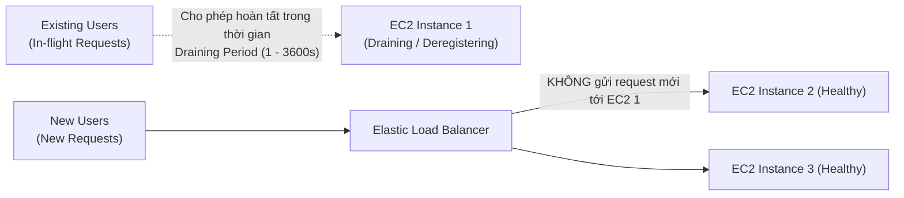

# Bài 82: Elastic Load Balancer - Connection Draining (Deregistration Delay)

- **Phần (Section):** Phần 8: High Availability and Scalability: ELB & ASG
- **Mã bài học (Lecture ID):** `18611524`
- **Tệp video:** `SAA_-_ELB_-_Connection_Draining_v3.mp4`
- **Thời lượng:** `02:22`
- **Cheat sheet:** [topics/aws_elb_asg.html](../../topics/aws_elb_asg.html)

---

## 1. Kiến thức trọng tâm (Exam Notes)

### 1.1. Tên gọi và Khái niệm
Tính năng này có **2 tên gọi** tùy thuộc vào loại Load Balancer (cần nhớ cả hai cho kỳ thi SAA-C03):
- **`Connection Draining`**: Tên gọi trên **Classic Load Balancer (CLB)**.
- **`Deregistration Delay`**: Tên gọi trên **Application Load Balancer (ALB)** và **Network Load Balancer (NLB)** (cấu hình ở cấp độ Target Group).

**Cơ chế hoạt động:**
1. Dành một khoảng thời gian chờ để EC2 instance **hoàn tất các yêu cầu đang xử lý dở (in-flight / active requests)** khi instance đó đang trong quá trình **hủy đăng ký (de-registering)** hoặc bị đánh dấu là **không khỏe mạnh (unhealthy)**.
2. Ngay khi bước vào trạng thái draining, ELB **ngừng gửi các yêu cầu mới (stops sending new requests)** tới EC2 instance đó và chỉ định tuyến kết nối mới sang các EC2 instances khỏe mạnh khác.

---

### 1.2. Thông số cấu hình (Parameters)
- **Khoảng giá trị:** Từ **`1` đến `3,600` giây** (1 giờ).
- **Giá trị mặc định (Default):** **`300` giây (5 phút)**.
- **Vô hiệu hóa (Disable):** Đặt giá trị bằng **`0`** (không chờ draining, ngắt kết nối ngay lập tức).
- **Mẹo tối ưu hóa:**
  - Nếu các request rất ngắn (< 1 giây): Nên đặt giá trị thấp (ví dụ: **`30` giây**) để instance nhanh chóng được đưa ra khỏi hệ thống (offline) và thay thế nhanh hơn.
  - Nếu có các request kéo dài (ví dụ: upload file lớn): Nên đặt giá trị cao để không làm đứt quãng quá trình upload của người dùng.

---

## 2. Phụ đề chi tiết theo mốc thời gian (Full Transcript & Timestamps)

| Thời gian | Nội dung lời giảng gốc (English) | Bản dịch tiếng Việt sát nghĩa |
| :--- | :--- | :--- |
| `00:00:00.200` | So now let's talk about a feature that can come up in the exam, which is called Connection Draining. So it has two names, actually. | Bây giờ hãy nói về một tính năng có thể xuất hiện trong kỳ thi, được gọi là **Connection Draining**. Thực ra nó có hai tên gọi khác nhau. |
| `00:00:06.530` | If you're using a Classic Load Balancer, it is called Connection Draining, but if you're using an Application Load Balancer or a Network Load Balancer, this is called a Deregistration Delay. | Nếu bạn đang sử dụng Classic Load Balancer (CLB), nó được gọi là **Connection Draining**; nhưng nếu bạn sử dụng Application Load Balancer (ALB) hoặc Network Load Balancer (NLB), nó được gọi là **Deregistration Delay** (Độ trễ hủy đăng ký). |
| `00:00:16.360` | And the idea behind this concept is that it will give some time for your instances to complete the in-flight requests or the active requests while the instance is being deregistered or marked unhealthy. | Ý tưởng đằng sau khái niệm này là nó sẽ dành một khoảng thời gian cho các instance của bạn hoàn tất các yêu cầu đang xử lý dở (**in-flight requests** hay **active requests**) trong khi instance đó đang được hủy đăng ký (deregistered) hoặc bị đánh dấu là không khỏe mạnh (unhealthy). |
| `00:00:28.330` | And once a connection is being drained, so once an instance is being drained, then the ELB will stop sending new requests to the EC2 instance that is being drained while being deregistered. | Và một khi một instance đang trong quá trình rút kết nối (draining), ELB sẽ **ngừng gửi các yêu cầu mới** tới EC2 instance đó. |
| `00:00:39.170` | So let's have a look at a diagram to understand better. So we have three EC2 instances and in one of them we'll set it in draining mode. | Hãy nhìn vào sơ đồ để hiểu rõ hơn. Chúng ta có ba EC2 instance và một trong số chúng đang ở chế độ draining. |
| `00:00:46.830` | So the users that are already connected to that EC2 instance are going to be given enough time, which is the draining period, okay, to complete their existing connection and to complete their existing request. And then once everything's done, then all the connections will be shut down. | Những người dùng đã kết nối sẵn tới EC2 instance đó từ trước sẽ được cho đủ thời gian (chính là khoảng thời gian draining period) để hoàn tất kết nối và yêu cầu hiện tại của họ. Khi mọi thứ hoàn tất, các kết nối sẽ được đóng lại. |
| `00:01:02.600` | Now, if new users try to connect to our ELB, our ELB is smart enough to know that because our EC2 instance is in draining state, then it will only establish new connections with other EC2 instances, for example, my second EC2 instance or my third EC2 instance. | Trong lúc đó, nếu những người dùng mới kết nối vào ELB, ELB đủ thông minh để biết rằng instance thứ nhất đang ở trạng thái draining nên sẽ chỉ thiết lập các kết nối mới tới các EC2 instance khỏe mạnh khác (instance số 2 và số 3). |
| `00:01:18.140` | Now you can parameterize these Connection Draining parameters. So you can set it anywhere between 1 to 3,600 seconds. By default, it is 300 seconds, so five minutes, and you can disable it altogether if you set the value to zero, which means that there's no draining happening. | Bạn có thể tùy chỉnh tham số Connection Draining / Deregistration Delay này từ **1 đến 3,600 giây**. Mặc định là **300 giây (5 phút)**, và bạn có thể tắt hoàn toàn tính năng này nếu đặt giá trị bằng **0** (không chờ draining). |
| `00:01:36.060` | Now, if you set it to a low value, okay, this is good if your requests are short, for example, if they are very, very short requests for, let's say, less than one second, well, it's a good idea to set the draining connection parameter to maybe 30 seconds, okay, because then this will allow your EC2 instance to be drained really fast and then be taken offline, maybe to be replaced or something like this. | Nếu bạn đặt giá trị thấp (ví dụ **30 giây**), điều này rất tốt khi các yêu cầu của bạn ngắn (< 1 giây), vì nó giúp EC2 instance hoàn tất rút kết nối thật nhanh để được đưa ra khỏi hệ thống (offline) hoặc thay thế nhanh chóng. |
| `00:01:58.230` | If your requests can be quite long, for example, if you have uploads or long-lived requests, then you want to set it to something pretty high, but the trade-off is that your EC2 instance is not going to go away as soon as possible, okay, it's going to have to wait until this Connection Draining period is done, okay? | Ngược lại, nếu các yêu cầu của bạn kéo dài (như tải tệp lớn lên máy chủ hoặc kết nối dài hạn), bạn nên đặt giá trị cao, với sự đánh đổi là EC2 instance sẽ phải đợi hết thời gian draining đó mới được tắt hẳn. |
| `00:02:15.610` | So this is what you need to know about this setting at a high level. I hope you liked it and I will see you in the next lecture. | Đó là những điều cốt lõi bạn cần nắm về thiết lập này. Hẹn gặp lại bạn trong bài giảng tiếp theo. |
