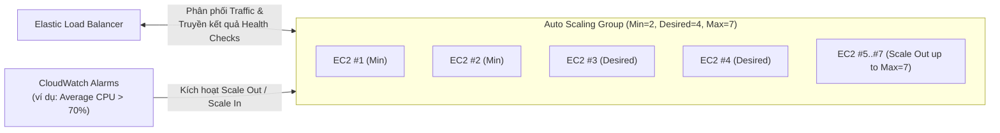

# Bài 83: Auto Scaling Groups (ASG) Overview (Tổng quan về Auto Scaling Groups)

- **Phần (Section):** Phần 8: High Availability and Scalability: ELB & ASG
- **Mã bài học (Lecture ID):** `13528102`
- **Tệp video:** `SAA - ASG - Overview v3.mp4`
- **Thời lượng:** `04:42`
- **Cheat sheet:** [topics/aws_elb_asg.html](../../topics/aws_elb_asg.html)

---

## 1. Kiến thức trọng tâm (Exam Notes)

> [!TIP]
> **Tóm tắt nhanh dịch vụ Amazon EC2 Auto Scaling Group - ASG (SAA-C03 Cheat Sheet)**
> - **Là gì:** Dịch vụ tự động tăng (`Scale Out`) hoặc giảm (`Scale In`) số lượng EC2 instances theo tải thực tế, tự động thay thế các instances bị lỗi (`Unhealthy`) và đăng ký chúng vào Load Balancer.
> - **Dùng khi nào (Use case điển hình trong đề):** Đảm bảo tính sẵn sàng cao và khả năng co giãn đàn hồi theo tải cho tầng EC2 thông qua các **Scaling Policies**:
>   - **`Target Tracking`:** Đơn giản nhất — giữ một chỉ số ở ngưỡng mục tiêu (ví dụ: giữ Average CPU ở mức `40%`).
>   - **`Step / Simple Scaling`:** Tăng/giảm theo từng nấc khi CloudWatch Alarm vượt ngưỡng.
>   - **`Scheduled Scaling`:** Chủ động tăng dung lượng theo lịch biết trước (ví dụ: tối thứ Sáu hàng tuần).
>   - **`Predictive Scaling`:** Dùng Machine Learning phân tích lịch sử tải để dự báo và mở rộng trước cho các chu kỳ lặp lại.
> - **Khác gì dịch vụ gần giống:**
>   - **ASG (Horizontal Scaling) vs. Vertical Scaling:** `ASG` tăng giảm **số lượng máy** (Scale Out/In - High Availability); `Vertical Scaling` nâng cấp kích thước máy (ví dụ `t2.micro` $\rightarrow$ `m5.2xlarge`, đòi hỏi dừng máy).
> - **Điểm hay bị hỏi (Giới hạn, Mặc định, Từ khóa gợi ý):**
>   - **Mặc định:** **Default Cooldown Period** = **`300 giây`**; **Default Termination Policy** khi Scale In sẽ chọn **AZ có nhiều EC2 instances nhất**, sau đó xóa instance có **Launch Template cũ nhất**.
>   - **Mẹo xử lý lỗi:** Nếu ASG terminate nhầm instance mới khởi tạo do script cài đặt quá lâu, hãy tăng **Health Check Grace Period** hoặc chuyển sang dùng **Golden AMI**.

### 1.1. Mục tiêu và Chức năng của Auto Scaling Group (ASG)
Khi triển khai website/ứng dụng thực tế, tải truy cập thay đổi liên tục theo thời gian. **Auto Scaling Group (ASG)** giúp tự động hóa hoàn toàn việc quản lý số lượng EC2 instances:
1. **Scale Out (Mở rộng ra):** Tự động **thêm EC2 instances** để đáp ứng khi tải tăng cao (increased load).
2. **Scale In (Thu hẹp lại):** Tự động **xóa/chấm dứt EC2 instances** để tiết kiệm chi phí khi tải giảm xuống (decreased load).
3. **Đảm bảo biên độ số lượng máy:** Giữ cho số lượng EC2 instances luôn nằm trong khoảng **Minimum Capacity** và **Maximum Capacity** đã định sẵn.
4. **Tự động đăng ký vào Load Balancer:** Tự động đăng ký các EC2 instances mới được tạo vào Target Group của Load Balancer đi kèm.
5. **Tự phục hồi lỗi (Self-healing):** Nếu một EC2 instance bị đánh giá là **Unhealthy** (do lỗi phần cứng EC2 hoặc trượt bài kiểm tra ELB Health Check), ASG sẽ **tự động Terminate instance đó và khởi tạo một instance mới** để thay thế!
6. **Chi phí:** Bản thân dịch vụ **ASG hoàn toàn miễn phí (Free)** — bạn chỉ trả tiền cho các tài nguyên AWS bên dưới được khởi tạo (như EC2 instances, EBS volumes).

---

### 1.2. Ba thông số dung lượng của ASG (Capacity Settings)
- **`Minimum Capacity`**: Số lượng EC2 instances tối thiểu luôn phải chạy trong ASG (ví dụ: `2`).
- **`Desired Capacity`**: Số lượng EC2 instances mong muốn đang chạy tại thời điểm hiện tại (ví dụ: `4`).
- **`Maximum Capacity`**: Số lượng EC2 instances tối đa mà ASG được phép Scale Out lên (ví dụ: `7`). *(Lưu ý đề thi: ASG **không bao giờ** tự động scale out vượt quá `Maximum Capacity` dù CPU có lên 100%)*.

---

### 1.3. Launch Template và Tích hợp CloudWatch Alarms
- **Launch Template** *(Launch Configurations cũ đã bị deprecated)*: Chứa toàn bộ thông số cấu hình để ASG biết cách khởi chạy EC2 instances mới:
  - **AMI ID** + **Instance Type**
  - **EC2 User Data**
  - **EBS Volumes**
  - **Security Groups**
  - **SSH Key Pair**
  - **IAM Roles** cho EC2 instances
  - Thông tin **VPC & Subnets**, **Load Balancer / Target Group**.
- **Tích hợp CloudWatch Alarms:**
  - ASG có thể tự động **Scale Out** hoặc **Scale In** dựa trên các cảnh báo **CloudWatch Alarms** theo dõi các chỉ số (Metrics) như **Average CPU Utilization** hoặc bất kỳ **Custom Metric** nào.

---

## 2. Phụ đề chi tiết theo mốc thời gian (Full Transcript & Timestamps)

| Thời gian | Nội dung lời giảng gốc (English) | Bản dịch tiếng Việt sát nghĩa |
| :--- | :--- | :--- |
| `00:00:00.000` | So now let's talk about what is an auto scaling group. So when we deploy a website or an application, the load can change over time because we may have more users visiting our websites over time. | Bây giờ hãy tìm hiểu Auto Scaling Group (ASG) là gì. Khi chúng ta triển khai một trang web hoặc ứng dụng, tải trọng có thể thay đổi theo thời gian vì số lượng người dùng truy cập tăng giảm khác nhau. |
| `00:00:11.130` | And we've seen that in the cloud, in AWS, it's possible for us to create and also get rid of servers very quickly with the EC2 instance creation API call. So, if you wanna automate this, we can create an auto-scaling group. | Trong đám mây AWS, chúng ta có thể tạo và hủy máy chủ cực kỳ nhanh chóng thông qua các lệnh gọi API của EC2. Để tự động hóa quy trình này, chúng ta tạo một Auto Scaling Group (ASG). |
| `00:00:25.160` | So the goal of the ASG is to scale out, that means add EC2 instances and you need to remember this, scale out to match an increased load or to scale in that means removing EC2 instances to match a decreased load. | Mục tiêu của ASG là: **Scale Out** — tức là **thêm** các EC2 instance để đáp ứng khi tải tăng lên (hãy nhớ kỹ thuật ngữ này); hoặc **Scale In** — tức là **gỡ bỏ/xóa** các EC2 instance khi tải giảm xuống. |
| `00:00:39.520` | And so therefore the size of our ASG is going to vary over time. Overall, we can also define parameters to ensure we'll have a minimum and a maximum number of EC2 instances running at any time in our ASG. | Do đó kích thước của ASG sẽ thay đổi linh hoạt theo thời gian. Chúng ta cũng có thể định nghĩa các tham số để đảm bảo luôn có một số lượng EC2 instance tối thiểu (minimum) và tối đa (maximum) chạy trong ASG ở mọi thời điểm. |
| `00:00:51.840` | ASG also have the superpower that if you are pairing it with a load balancer, then any EC2 instances as part of the ASG will be linked to the load balancer. | ASG còn có một "siêu năng lực" là khi bạn ghép nối nó với một bộ cân bằng tải (Load Balancer), bất kỳ EC2 instance nào được tạo ra trong ASG sẽ tự động được đăng ký vào bộ cân bằng tải đó. |
| `00:01:02.290` | Another superpower is that if one instance is deemed unhealthy, it is terminated and a new EC2 instance is created to replace it. | Một "siêu năng lực" khác là nếu một instance bị đánh giá là không khỏe mạnh (**unhealthy**), nó sẽ tự động bị chấm dứt (terminated) và một EC2 instance mới tinh sẽ được tạo ra để thay thế. |
| `00:01:10.750` | So, auto scaling groups are free and you're only going to pay for whatever resources are created underneath such as your EC2 instances. | Auto Scaling Groups hoàn toàn miễn phí — bạn chỉ phải trả tiền cho những tài nguyên bên dưới được nó khởi tạo ra, chẳng hạn như các EC2 instance và ổ cứng EBS. |
| `00:01:18.460` | So let's see how an ASG works in AWS. So we set a minimum capacity, which is how many instances you want at minimum in your ASG. For example, two. | Hãy xem cách ASG hoạt động trong AWS. Đầu tiên chúng ta đặt dung lượng tối thiểu (**Minimum capacity**) — số lượng instance ít nhất phải có trong ASG, ví dụ là `2`. |
| `00:01:28.650` | Then you set a desired capacity, which is how many instances you want in your ASG, for example, four and then you set a maximum capacity which is how many instances at a maximum do I want in my ASG. | Tiếp theo bạn đặt dung lượng mong muốn (**Desired capacity**) — số lượng instance bạn muốn chạy hiện tại, ví dụ là `4`. Và bạn đặt dung lượng tối đa (**Maximum capacity**) — số lượng instance tối đa được phép có trong ASG. |
| `00:01:40.410` | And then that means that if you move the desired capacity to a higher number, but that's still less than the maximum capacity, then you can scale out as needed. That means scale out means adding EC2 instances and so therefore your ASG can grow bigger and bigger and bigger. In this instance, the maximum capacity is seven. | Nếu bạn tăng Desired capacity lên một con số cao hơn (nhưng vẫn nhỏ hơn hoặc bằng Maximum capacity, trong ví dụ này tối đa là `7`), ASG sẽ thực hiện **Scale Out** (thêm các EC2 instance) tương ứng. |
| `00:01:58.870` | As I said, the ASG also works with a load balancer. So if we have four instances registered in our ASG, then the ELB is going to distribute traffic to all these instances right away and so your users can access a load balanced website. | Khi kết hợp ASG với Elastic Load Balancer (ELB), nếu có 4 instance trong ASG thì ELB sẽ phân phối lưu lượng tới cả 4 instance này ngay lập tức. |
| `00:02:14.530` | But the ELB also has the ability to check for the health of your EC2 instances using the health check and that health check can be passed on to the ASG. That means that the ASG can terminate EC2 instances if they are deemed unhealthy by the load balancer, which is very handy. | Hơn nữa, ELB có khả năng kiểm tra sức khỏe của các EC2 instance bằng Health Checks và chuyển kết quả đó cho ASG. Nghĩa là ASG có thể tự động hủy (terminate) các EC2 instance nếu chúng bị bộ cân bằng tải đánh giá là `unhealthy`. |
| `00:02:32.970` | Also, if you scale out, that means if you add EC2 instances, then of course the ELB is going to send traffic to them as well and spread the load. Therefore, it's a really great combination to use a load balancer and an auto scaling group. | Và khi ASG thực hiện Scale Out thêm các EC2 instance mới, ELB cũng tự động gửi lưu lượng tới các máy mới đó để chia tải. Vì vậy ELB + ASG là một bộ đôi hoàn hảo. |
| `00:02:47.110` | Now, in terms of attributes to create your ASG, you need to create a launch template. There used to be a thing called launch configurations but it's deprecated, but the idea is the same. | Để tạo ASG, bạn cần tạo một **Launch Template** (trước đây có *Launch Configurations* nhưng hiện đã bị khai tử/deprecated). |
| `00:02:55.460` | A launch template contains information on how to launch EC2 instances within your ASG. So you have information about the AMI and the instance type, the EC2 user data, the EBS volumes, security groups, SSH key pair, IAM roles for your EC2 instances, network and subnet information as well as load balancer information and more if you want. | Một Launch Template chứa toàn bộ thông tin về cách khởi chạy các EC2 instance bên trong ASG: bao gồm AMI, Instance Type, EC2 User Data, EBS Volumes, Security Groups, SSH Key Pair, IAM Roles cho EC2, thông tin mạng/subnet và Load Balancer. |
| `00:03:18.120` | And so all these parameters look a lot like the ones we specified when we created an EC2 instance. On top of it, your ASG has a min size, a max size and an initial capacity we need to define as well as scaling policies. | Tất cả các tham số này giống hệt như những gì chúng ta chọn khi tạo một EC2 instance đơn lẻ. Ngoài ra trên ASG, chúng ta định nghĩa thêm Min size, Max size, Desired/Initial capacity và các chính sách mở rộng (**Scaling Policies**). |
| `00:03:33.130` | Talking about scaling policies, let's see how CloudWatch alarm integrates with auto scaling. So you don't know what CloudWatch is yet of course, but let me just tell you a little bit about it right now. | Nói về Scaling Policies, hãy xem cách **CloudWatch Alarms** tích hợp với Auto Scaling. |
| `00:03:42.700` | So it's possible to scale in and out an ASG based on CloudWatch alarms. So for example, we have an ASG right here with three EC2 instances and the alarm is going to be triggered and therefore we're going to get a scale out activity. | Bạn có thể cho ASG tự động Scale Out và Scale In dựa trên các cảnh báo CloudWatch Alarms. Ví dụ khi cảnh báo bị kích hoạt (triggered), nó sẽ ra lệnh cho ASG thực hiện hành động Scale Out. |
| `00:03:54.770` | So what would trigger an alarm? Well, it's a metric you can monitor, for example, for the average CPU or any custom metric you want. | Điều gì kích hoạt một cảnh báo (alarm)? Đó là một chỉ số (metric) mà bạn theo dõi, chẳng hạn như mức sử dụng CPU trung bình (**Average CPU**) của toàn bộ ASG hoặc bất kỳ chỉ số tùy chỉnh (**custom metric**) nào. |
| `00:04:05.270` | So for example, if the average CPU as a whole for your ASG is too high, then you need to add EC2 instances and therefore the alarm is going to be triggered and is going to trigger a scaling activity in your auto scaling group | Ví dụ nếu mức CPU trung bình của toàn bộ ASG quá cao, cảnh báo sẽ chuyển sang trạng thái Alarm và kích hoạt hoạt động mở rộng (thêm máy) trong Auto Scaling Group của bạn. |
| `00:04:19.430` | and this is why it's called an auto scaling group because paired with alarms, there is an automatic aspect of scaling behind the scenes. | Đó chính là lý do nó có tên là *Auto* Scaling Group — vì khi kết hợp với các cảnh báo CloudWatch, quá trình tăng giảm số lượng máy chủ diễn ra hoàn toàn tự động ở phía sau. |
| `00:04:27.110` | So based on the alarm, we can create scale out policies (that means increasing the number of instances) or we can create scale in policies to decrease the number of instances. And all these things together are what composes ASG. I hope you liked it and I will see you in the next lecture. | Dựa trên các cảnh báo, chúng ta có thể tạo chính sách Scale Out để tăng số lượng instance và chính sách Scale In để giảm số lượng instance. Hẹn gặp lại bạn ở bài thực hành tiếp theo. |
