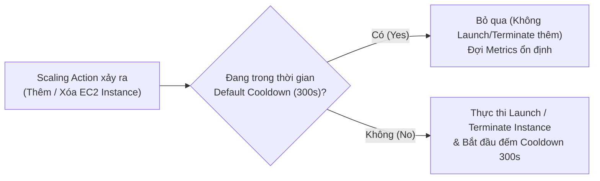

# Bài 85: Auto Scaling Groups - Scaling Policies (Các chính sách mở rộng tự động của ASG)

- **Phần (Section):** Phần 8: High Availability and Scalability: ELB & ASG
- **Mã bài học (Lecture ID):** `26148326`
- **Tệp video:** `SAA_-_ASG_-_Scaling_Policies_v5.mp4`
- **Thời lượng:** `04:23`
- **Cheat sheet:** [topics/aws_elb_asg.html](../../topics/aws_elb_asg.html)

---

## 1. Kiến thức trọng tâm (Exam Notes)

### 1.1. Bốn loại chính sách mở rộng (Scaling Policies) trong ASG

| Loại Scaling Policy | Nhóm | Cách thức hoạt động | Trường hợp sử dụng điển hình (Exam Scenarios) |
| :--- | :--- | :--- | :--- |
| **1. Target Tracking Scaling** | Dynamic Scaling | Thiết lập đơn giản nhất: Chọn 1 metric và 1 giá trị mục tiêu (ví dụ: giữ **Average ASG CPU Utilization ở mức ~`40%`** hoặc `RequestCountPerTarget` ở mức `1,000`). ASG tự tạo CloudWatch Alarms để Scale Out / Scale In. | Khi muốn giữ mức tải hoặc số lượng kết nối trung bình trên mỗi instance ổn định quanh một con số cố định. |
| **2. Simple / Step Scaling** | Dynamic Scaling | Dựa trên các **CloudWatch Alarms** tự định nghĩa theo từng nấc (steps): Ví dụ khi CPU > 70% thì thêm 2 instances; khi CPU > 90% thì thêm 4 instances; khi CPU < 30% thì bớt 1 instance. | Khi cần kiểm soát chi tiết số lượng/phần trăm instances thêm/bớt theo từng ngưỡng cảnh báo cụ thể. |
| **3. Scheduled Actions (Scheduled Scaling)** | Dựa trên thời gian | Chủ động mở rộng trước dựa trên **khung giờ/lịch trình đã biết trước** (ví dụ: tăng `Min capacity` lên `10` vào đúng **5:00 chiều thứ Sáu hàng tuần** hoặc trước đợt Flash Sale). | Khi biết rõ thời điểm chính xác lưu lượng sẽ tăng cao định kỳ hoặc theo sự kiện đã lên lịch. |
| **4. Predictive Scaling** | Machine Learning | Liên tục phân tích **dữ liệu tải lịch sử (historical load)** bằng Machine Learning, tạo dự báo (**forecast**) cho tương lai và tự động lên lịch mở rộng **trước khi tải tăng (ahead of time)**. | Khi ứng dụng có **chu kỳ lặp lại theo thời gian (cyclical traffic patterns)** hàng ngày / hàng tuần. |

---

### 1.2. Các chỉ số (Metrics) tốt để dùng cho Scaling
1. **`CPUUtilization`**: Mức sử dụng CPU trung bình trên các instances (phù hợp với hầu hết ứng dụng tính toán).
2. **`RequestCountPerTarget`**: Số lượng yêu cầu đang xử lý trung bình trên mỗi EC2 instance đằng sau ALB (ví dụ: giữ ổn định `1,000 requests per target`).
3. **`Average Network In / Out`**: Dùng cho các ứng dụng bị giới hạn bởi băng thông mạng (network-bound, nhiều upload/download).
4. **Custom Metric (Chỉ số tùy chỉnh trên CloudWatch)**: Đẩy từ ứng dụng lên CloudWatch (ví dụ: số lượng kết nối tới Database mỗi phút, số lượng tin nhắn đang chờ trong hàng đợi SQS).

---

### 1.3. Cơ chế Scaling Cooldown (Thời gian nghỉ sau khi Scale)
- **Định nghĩa:** Sau khi một hoạt động mở rộng (**Scaling Activity** — thêm hoặc xóa instance) hoàn tất, ASG bước vào giai đoạn **Cooldown Period** (mặc định là **`300 giây` = 5 phút**).
- **Hành vi trong thời gian Cooldown:** ASG **sẽ KHÔNG khởi chạy thêm hoặc chấm dứt thêm bất kỳ instance nào** (bỏ qua các sự kiện kích hoạt mới) nhằm cho phép các chỉ số (metrics) kịp ổn định và instance mới kịp hoàn tất cấu hình để bắt đầu nhận tải.
- **Lời khuyên kiến trúc (Best Practice):**
  - Sử dụng một **AMI đã cài đặt sẵn mọi thứ (Ready-to-use / Golden AMI)** thay vì cài đặt lâu qua User Data khi boot -> Giúp EC2 instance mới sẵn sàng phục vụ request nhanh hơn -> Có thể **giảm thời gian Cooldown Period xuống** để mở rộng linh hoạt hơn!
  - Bật **Detailed Monitoring** (cập nhật metric mỗi **1 phút** thay vì 5 phút mặc định) để CloudWatch Alarms phản ứng nhanh hơn.

---

## 2. Phụ đề chi tiết theo mốc thời gian (Full Transcript & Timestamps)

| Thời gian | Nội dung lời giảng gốc (English) | Bản dịch tiếng Việt sát nghĩa |
| :--- | :--- | :--- |
| `00:00:00.210` | So we have several scaling policies for auto scaling group. The first one is dynamic scaling and within this category, we have the target tracking scaling, which is very simple to set up. | Chúng ta có một số chính sách mở rộng (Scaling Policies) cho Auto Scaling Group. Nhóm đầu tiên là mở rộng động (**Dynamic Scaling**), và bên trong nhóm này chúng ta có **Target Tracking Scaling** — loại cực kỳ đơn giản để thiết lập. |
| `00:00:10.470` | The idea is that you define a metric for your ASG, for example, the CPU utilization and you define a target value, for example, 40%. And automatically, the ASG is going to scale out or in to allow you to keep this metric to around 40%. | Ý tưởng là bạn chọn một chỉ số (metric) cho ASG của mình (chẳng hạn mức sử dụng CPU) và đặt một giá trị mục tiêu (ví dụ `40%`). ASG sẽ tự động Scale Out hoặc Scale In để duy trì chỉ số này luôn xoay quanh mức `40%`. |
| `00:00:28.590` | We also have the simple or step scaling and the idea is that you define CloudWatch alarms that are being triggered when you want to add units of capacity to your auto scaling group or when you want to remove units of capacity to your auto scaling group. | Tiếp theo trong nhóm Dynamic Scaling là **Simple Scaling** hoặc **Step Scaling**: bạn định nghĩa các cảnh báo CloudWatch Alarms cụ thể để khi vượt ngưỡng sẽ thêm bao nhiêu đơn vị dung lượng (instances) hoặc khi xuống thấp sẽ bớt bao nhiêu đơn vị dung lượng theo từng bậc (steps). |
| `00:00:43.830` | Then we have scheduled scaling. So this is when you anticipate a scaling based on a known usage pattern. For example, you say that you know that every time at 5:00 PM on Fridays, you're going to get new users and therefore, you want to increase the minimum capacity to 10. | Nhóm thứ hai là mở rộng theo lịch trình (**Scheduled Scaling / Scheduled Actions**): dùng khi bạn lường trước được nhu cầu tăng tải dựa trên thói quen sử dụng đã biết. Ví dụ bạn biết cứ 5 giờ chiều thứ Sáu hàng tuần lượng người dùng sẽ tăng vọt, nên bạn lên lịch tự động tăng Minimum capacity lên `10` vào thời điểm đó. |
| `00:01:00.630` | Then we have predictive scaling. So this is when you continuously forecast load and then you start scheduling ahead of time. So this is very good when you have patterns that repeat themselves. | Nhóm thứ ba là mở rộng dự đoán (**Predictive Scaling**): liên tục dự báo tải trọng (forecast load) và chủ động lên lịch mở rộng trước khi tải thực sự tăng. Chính sách này cực kỳ hiệu quả khi ứng dụng có các quy luật lưu lượng lặp lại theo chu kỳ. |
| `00:01:11.250` | So automatically, the ASG is going to analyze historical load then generate a forecast and then schedule scaling actions based on the forecast, which can be very handy if you have cyclical data. | ASG sẽ tự động phân tích dữ liệu tải lịch sử bằng Machine Learning, tạo ra bản dự báo tương lai và tự động lên lịch các hành động mở rộng dựa trên dự báo đó. |
| `00:01:24.420` | So some good metrics to scale on is a big question. So it depends really on what your application is doing and how it's working. But usually, here are a few. | Vậy đâu là những chỉ số (metrics) tốt để dùng làm căn cứ mở rộng? Điều đó phụ thuộc vào đặc thù ứng dụng của bạn, nhưng dưới đây là những chỉ số phổ biến nhất: |
| `00:01:34.050` | So number one is CPU utilization, because every time your instances receive a request, usually, they will do some sort of computation and so it will use some CPU. | Số một là **CPU Utilization** (mức sử dụng CPU trung bình): mỗi khi instance nhận một yêu cầu, nó thường thực hiện tính toán và tiêu tốn CPU. Nếu CPU trung bình trên toàn bộ các instance tăng cao, đó là dấu hiệu tốt để mở rộng thêm máy. |
| `00:01:53.880` | Another metric to scale on, it's more application-specific, but it is a RequestCountPerTarget, which is based on your testing, you know that your EC2 instances operate at an optimal request of 1,000 requests per target at a time and so maybe this is the target you want to have for your scaling. | Chỉ số thứ hai mang tính hướng ứng dụng hơn là **`RequestCountPerTarget`** (Số lượng yêu cầu trên mỗi mục tiêu): qua kiểm thử, bạn biết mỗi EC2 instance hoạt động tối ưu ở mức `1,000` yêu cầu tại một thời điểm, vì vậy bạn đặt con số này làm mục tiêu mở rộng. |
| `00:02:11.760` | So here as an example. You have an auto scaling group with three EC2 instances and your ALB is currently spreading the request across all of them. So right now the value of the request count per target metric is three, because each EC2 instance, on average, has three requests outstanding. | Ví dụ trên sơ đồ: bạn có một ASG gồm 3 EC2 instance đứng sau một ALB và đang có tổng cộng 9 kết nối từ người dùng chia đều cho 3 máy -> Giá trị của `RequestCountPerTarget` lúc này là `3`. |
| `00:02:30.930` | Next if your application is network-bound, so for example there's a lot of uploads and downloads and you know that network is going to be a bottleneck for your EC2 instances, then you may want to scale on the average network in or out to make sure that if you reach some certain threshold, then you're going to scale based on that. | Thứ ba, nếu ứng dụng của bạn phụ thuộc nặng vào băng thông mạng (**network-bound** — ví dụ có rất nhiều lượt tải lên và tải xuống khiến mạng trở thành nút thắt cổ chai), bạn nên mở rộng dựa trên chỉ số **Average Network In / Out**. |
| `00:02:48.780` | Or any custom metric that you push to CloudWatch, so you can set up your own metrics that are going to be application-specific and based on that, you can set up your scaling policies. | Hoặc thứ tư, bất kỳ chỉ số tùy chỉnh nào (**Custom Metric**) mà bạn đẩy lên CloudWatch đặc thù cho ứng dụng của riêng bạn. |
| `00:02:57.990` | Now one last thing you need to know about scaling policies is what's called a scaling cooldown. So the idea is that after there is a scaling activity, so whenever you add or you remove instances, you are entering the cooldown period, which is, by default, five minutes or 300 seconds. | Điều cuối cùng bạn cần biết về các chính sách mở rộng là khái niệm **Scaling Cooldown** (Thời gian nghỉ sau khi mở rộng). Sau mỗi khi một hoạt động mở rộng hoàn tất (thêm hoặc bớt instance), ASG sẽ bước vào giai đoạn Cooldown, mặc định là **5 phút (300 giây)**. |
| `00:03:13.200` | And during that cooldown period, the ASG will not launch or terminate additional instances. And the reason behind this reasoning is that you allow for metrics to stabilize, for your new instance to enter into effect and to see what the new metric will become. | Trong suốt khoảng thời gian Cooldown đó, ASG sẽ **không khởi chạy hoặc chấm dứt thêm bất kỳ instance nào nữa**. Lý do là để cho phép các chỉ số (metrics) kịp ổn định trở lại sau khi instance mới đi vào hoạt động và gánh bớt tải. |
| `00:03:30.240` | So the idea is that when there is a scaling action that occurs, the question is, is there a default cooldown in effect? If yes, then ignore the action. If no, then proceed with the scaling action, which is to launch or terminate instances. | Quy trình xử lý như sau: khi có một yêu cầu mở rộng mới xảy ra, hệ thống kiểm tra xem có đang trong thời gian Default Cooldown hay không? Nếu Có -> Bỏ qua yêu cầu đó. Nếu Không -> Thực thi việc thêm/xóa instance và bắt đầu đếm thời gian Cooldown. |
| `00:03:42.480` | And so an advice to you is to use a ready-to-use AMI to reduce the configuration time for your EC2 instances in order for them to be serving the request faster. | Một lời khuyên kiến trúc quan trọng dành cho bạn là hãy sử dụng một **AMI đã được cài đặt sẵn sàng (ready-to-use AMI)** để giảm thời gian cấu hình khi khởi động EC2 instance, giúp chúng bắt đầu phục vụ yêu cầu nhanh hơn. |
| `00:03:52.650` | So if you don't spend time configuring your EC2 instance, then they can be in effect right away. And then because they can be active way faster, then the cooldown period can be decreased and you can have a more dynamic scaling up and down of your ASG. | Khi không tốn thời gian cài đặt lúc khởi động, các instance mới sẽ hoạt động ngay lập tức, nhờ đó bạn có thể giảm thời gian Cooldown xuống và giúp ASG mở rộng ra/vào linh hoạt, nhạy bén hơn nhiều. |
| `00:04:07.860` | And of course, you need to make sure to enable something like detailed monitoring for your ASG to get access to metrics every one minute and to make sure that you have these metrics being updated fast enough. So that's it for this lecture. I hope you liked it and I will see you in the next lecture. | Và tất nhiên, bạn nên bật **Detailed Monitoring** (giám sát chi tiết) để cập nhật số liệu metric mỗi **1 phút** một lần. Hẹn gặp lại bạn trong bài thực hành tiếp theo. |
