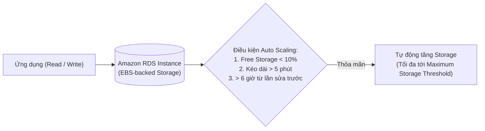

# Bài 87: Amazon RDS Overview (Tổng quan về Amazon RDS)

- **Phần (Section):** Section 9: AWS Fundamentals: RDS + Aurora + ElastiCache
- **Bài học (Lecture):** #87 (`id: 13528150`)
- **Video gốc:** `SAA - RDS - Overview v6.mp4`
- **Thời lượng:** `03:38` (218 giây)
- **Cheat sheet:** [topics/aws_databases.html](../../topics/aws_databases.html)

---

## 1. Kiến thức trọng tâm (Exam Notes)

> [!TIP]
> **Tóm tắt nhanh dịch vụ Amazon RDS (SAA-C03 Cheat Sheet)**
> - **Là gì:** Dịch vụ cơ sở dữ liệu quan hệ (SQL) được quản lý hoàn toàn (Managed Database Service) cho 6 engines: **PostgreSQL, MySQL, MariaDB, Oracle, Microsoft SQL Server, IBM Db2** (cùng **Amazon Aurora**).
> - **Dùng khi nào (Use case điển hình trong đề):** Chạy CSDL quan hệ truyền thống với chi phí vận hành tối thiểu (**least operational overhead**): dùng **RDS Read Replicas** để mở rộng tải đọc (**Scale Reads / Reporting**) và dùng **RDS Multi-AZ** để đảm bảo tính sẵn sàng cao / chống lỗi (**High Availability / Disaster Recovery**).
> - **Khác gì dịch vụ gần giống:**
>   - **RDS vs. Database trên EC2 / RDS Custom:** Bạn **không thể SSH** vào `RDS`; nếu bắt buộc cần quyền OS Admin/SSH để cài đặt bản vá hoặc gói phần mềm đặc thù trên **Oracle** hoặc **MS SQL Server**, hãy dùng **`RDS Custom`**.
>   - **RDS Read Replicas vs. RDS Multi-AZ:** `Read Replicas` (tối đa 15 bản) sao chép **Bất đồng bộ (Asynchronous)** để phục vụ đọc; `Multi-AZ` sao chép **Đồng bộ (Synchronous)** sang Standby DB chỉ để dự phòng Failover (Standby không phục vụ đọc).
> - **Điểm hay bị hỏi (Giới hạn, Mặc định, Từ khóa gợi ý):**
>   - **Giới hạn & Mặc định:** Lưu trữ **Automated Backups** tối đa **35 ngày** (muốn giữ lâu hơn phải tạo **Manual Snapshot**); nhân bản dữ liệu sang Read Replica trong **cùng Region là MIỄN PHÍ** (khác Region mới tính phí).
>   - **Từ khóa gợi ý:** `"managed relational DB with automated backups & point-in-time recovery"` $\rightarrow$ **Amazon RDS**; `"OS-level access / SSH for Oracle or SQL Server on managed RDS"` $\rightarrow$ **RDS Custom**.

### 1.1. Amazon RDS là gì?
- **RDS (Relational Database Service):** Dịch vụ cơ sở dữ liệu quan hệ được quản lý hoàn toàn (Managed Database Service) sử dụng ngôn ngữ truy vấn **SQL (Structured Query Language)**.
- **Các Database Engine được hỗ trợ bởi Amazon RDS (7 loại cần nhớ cho kỳ thi):**
  1. **PostgreSQL**
  2. **MySQL**
  3. **MariaDB**
  4. **Oracle**
  5. **Microsoft SQL Server**
  6. **IBM Db2**
  7. **Amazon Aurora** (Cơ sở dữ liệu độc quyền của AWS, tương thích PostgreSQL & MySQL).

> [!WARNING]
> **Lưu ý kỳ thi SAA-C03:** Các cơ sở dữ liệu NoSQL như **MongoDB**, **Cassandra**, **DynamoDB**, hoặc **Couchbase** **KHÔNG** được hỗ trợ trên Amazon RDS!

### 1.2. Tại sao dùng RDS thay vì tự cài Database trên EC2?
RDS là dịch vụ được quản lý (Managed Service), cung cấp sẵn nhiều lợi ích vượt trội so với việc tự triển khai DB trên EC2:
- Tự động cấp phát (Automated provisioning) và tự động vá lỗi hệ điều hành (OS patching).
- Sao lưu liên tục (Continuous backups) và khôi phục về một thời điểm cụ thể (**Point in Time Restore** - xuống tới từng giây).
- Bảng điều khiển giám sát hiệu năng (Monitoring dashboards).
- **Read Replicas** để cải thiện hiệu năng đọc (Horizontal scaling cho reads).
- Thiết lập **Multi-AZ** phục vụ Khôi phục sau thảm họa (Disaster Recovery - DR).
- Cửa sổ bảo trì (Maintenance windows) cho việc nâng cấp.
- Khả năng mở rộng (Scaling): cả **Vertical** (tăng Instance Type) và **Horizontal** (thêm Read Replicas).
- Lưu trữ (Storage) phía dưới được hậu thuẫn bởi **Amazon EBS**.
- **Giới hạn quan trọng:** Bạn **KHÔNG THỂ SSH** vào các RDS instances (trừ khi sử dụng **RDS Custom**).

### 1.3. RDS Storage Auto Scaling (Tự động mở rộng dung lượng lưu trữ)
- Khi tạo RDS DB, bạn chọn dung lượng ban đầu (ví dụ: `20 GB`), nhưng nếu bật **RDS Storage Auto Scaling**, RDS sẽ tự động phát hiện khi sắp hết dung lượng và tự động mở rộng (scale) ổ cứng mà không cần ngừng DB.
- Bạn cần thiết lập **Maximum Storage Threshold** (hạn mức dung lượng tối đa cho phép tăng tới).
- **Điều kiện kích hoạt tự động tăng dung lượng (3 điều kiện):**
  1. Dung lượng trống (Free storage) còn **ít hơn 10%** tổng dung lượng đã cấp phát (Allocated storage).
  2. Tình trạng thiếu dung lượng (Low-storage) kéo dài **hơn 5 phút**.
  3. Đã trôi qua ít nhất **6 giờ** kể từ lần chỉnh sửa dung lượng gần nhất.
- Cực kỳ hữu ích cho các ứng dụng có tải công việc không thể dự đoán trước (unpredictable workloads) và hỗ trợ **tất cả các RDS database engines**.

---

## 2. Phụ đề chi tiết theo mốc thời gian (Full Transcript & Timestamps)

| Thời gian | Nội dung lời giảng gốc (English) | Bản dịch tiếng Việt sát nghĩa |
| :--- | :--- | :--- |
| `00:00:00.330 --> 00:00:03.750` | So let's get started with an overview of AWS RDS. | Hãy cùng bắt đầu với phần tổng quan về AWS RDS. |
| `00:00:03.750 --> 00:00:15.090` | RDS stands for Relational Database Service, and what it means is that it's a managed database service for database that use SQL as a query language. | RDS viết tắt của Relational Database Service (Dịch vụ Cơ sở dữ liệu Quan hệ), có nghĩa là một dịch vụ cơ sở dữ liệu được quản lý dành cho các cơ sở dữ liệu sử dụng SQL làm ngôn ngữ truy vấn. |
| `00:00:15.090 --> 00:00:21.600` | So SQL is a structured language to a query database. It's very well-adapted and it's running on many engines. | SQL là một ngôn ngữ có cấu trúc để truy vấn cơ sở dữ liệu. Nó được áp dụng rất rộng rãi và chạy trên nhiều engine khác nhau. |
| `00:00:21.600 --> 00:00:29.460` | So it allows you to create databases, the RDS service in the cloud, and these databases will be managed by AWS and you get a lot of benefits from it. | Vì vậy, dịch vụ RDS cho phép bạn tạo các cơ sở dữ liệu trên đám mây, các cơ sở dữ liệu này sẽ được AWS quản lý và bạn nhận được rất nhiều lợi ích từ đó. |
| `00:00:29.460 --> 00:00:34.470` | So what types of database engine are managed by AWS? Well, the first one is PostgreSQL. | Vậy những loại database engine nào được AWS quản lý? Đầu tiên là PostgreSQL. |
| `00:00:34.470 --> 00:00:46.770` | Then we have MySQL, MariaDB, Oracle, Microsoft SQL Server, IBM DB2, and Aurora, which is a proprietary database from AWS that we'll study in depth. | Tiếp theo chúng ta có MySQL, MariaDB, Oracle, Microsoft SQL Server, IBM DB2, và Aurora — một cơ sở dữ liệu độc quyền của AWS mà chúng ta sẽ tìm hiểu chuyên sâu. |
| `00:00:46.770 --> 00:00:51.450` | So you have to remember the types of engines that are supported by Amazon RDS. | Bạn cần phải ghi nhớ các loại engine được hỗ trợ bởi Amazon RDS. |
| `00:00:51.450 --> 00:00:59.730` | So why would we use RDS versus deploying our own database service on top of, say, an EC2 instance? Because this is possible. | Vậy tại sao chúng ta lại sử dụng RDS thay vì tự triển khai dịch vụ cơ sở dữ liệu của riêng mình trên một EC2 instance? Bởi vì điều đó hoàn toàn khả thi. |
| `00:00:59.730 --> 00:01:06.720` | Well, RDS is a managed service and as such, AWS provides a lot of services on top of just giving us a database. | Lý do là RDS là một dịch vụ được quản lý, và do đó AWS cung cấp rất nhiều dịch vụ đi kèm ngoài việc chỉ đưa cho chúng ta một cơ sở dữ liệu. |
| `00:01:06.720 --> 00:01:13.530` | For example, the provisioning of the database is fully automated, and so is the underlying operating system patching. | Ví dụ, việc cấp phát cơ sở dữ liệu được tự động hóa hoàn toàn, và việc vá lỗi hệ điều hành bên dưới cũng vậy. |
| `00:01:13.530 --> 00:01:21.390` | There is continuous backups being made and you are able to restore to a specific timestamp. It's called Point in Time Restore. | Có các bản sao lưu liên tục được thực hiện và bạn có thể khôi phục về một mốc thời gian cụ thể. Tính năng đó được gọi là Point in Time Restore (Khôi phục tại một thời điểm). |
| `00:01:21.390 --> 00:01:24.720` | You can also have monitoring dashboards to view the performance of your database. | Bạn cũng có các bảng điều khiển giám sát để xem hiệu năng của cơ sở dữ liệu. |
| `00:01:24.720 --> 00:01:28.680` | You can have read replicas, and we have a dedicated lecture on read replicas in this course. | Bạn có thể có các bản sao chỉ đọc (Read Replicas), và chúng ta có một bài giảng riêng về Read Replicas trong khóa học này. |
| `00:01:28.680 --> 00:01:36.300` | To improve read performance, you can set up a multi AZ, and so we do have also sections on multi AZ that will be helpful for disaster recovery. | Để cải thiện hiệu năng đọc (nhờ Read Replicas), bạn cũng có thể thiết lập Multi-AZ, và chúng ta cũng có phần nói về Multi-AZ sẽ rất hữu ích cho việc khôi phục sau thảm họa (Disaster Recovery). |
| `00:01:36.300 --> 00:01:46.470` | You have maintenance windows for the upgrades, and you have scaling public capabilities, both vertical, by increasing the instance-type type, and horizontal by adding read replicas. | Bạn có các khung giờ bảo trì (maintenance windows) cho việc nâng cấp, và có khả năng mở rộng (scaling) cả theo chiều dọc (vertical) bằng cách tăng loại instance, lẫn theo chiều ngang (horizontal) bằng cách thêm các Read Replicas. |
| `00:01:46.470 --> 00:01:56.760` | Filing the storage is backed by EBS, so this is something we already know, but the only thing we do not have is we cannot SSH into the instances, the RDS instances. | Cuối cùng, dung lượng lưu trữ được hậu thuẫn bởi EBS — điều này chúng ta đã biết, nhưng điều duy nhất chúng ta không có là chúng ta không thể SSH vào các RDS instances. |
| `00:01:56.760 --> 00:02:03.720` | So because this is a managed service, AWS provides us a service, and we don't have access to the underlying EC2 instance. | Bởi vì đây là một dịch vụ được quản lý, AWS cung cấp dịch vụ cho chúng ta và chúng ta không có quyền truy cập vào EC2 instance bên dưới. |
| `00:02:03.720 --> 00:02:11.940` | But this is not too bad, because we get all these things that we would have to set up on our own if we wanted to deploy our own database engine on EC2. | Nhưng điều này không tệ chút nào, bởi vì chúng ta nhận được tất cả những tính năng mà lẽ ra chúng ta phải tự mình thiết lập nếu muốn tự triển khai database engine trên EC2. |
| `00:02:11.940 --> 00:02:16.980` | So here is one feature that can come up in the exam, and is around RDS Storage Auto Scaling. | Đây là một tính năng có thể xuất hiện trong đề thi, xoay quanh RDS Storage Auto Scaling. |
| `00:02:16.980 --> 00:02:23.310` | So the idea is that when you create an RDS database, you need to say how much storage you want, for example, you want 20 gigabytes of storage, | Ý tưởng là khi bạn tạo một cơ sở dữ liệu RDS, bạn cần chỉ định mức dung lượng lưu trữ mong muốn, ví dụ bạn muốn 20 GB lưu trữ, |
| `00:02:23.310 --> 00:02:35.580` | but say you are using your database a lot, and you're about to run out of free space, then with this feature enabled, the RDS Storage Auto Scaling, RDS will detect that and will scale automatically the storage for you, | nhưng giả sử bạn sử dụng cơ sở dữ liệu rất nhiều và sắp hết dung lượng trống, thì khi bật tính năng RDS Storage Auto Scaling này, RDS sẽ phát hiện điều đó và tự động mở rộng dung lượng lưu trữ cho bạn, |
| `00:02:35.580 --> 00:02:41.220` | so you don't have to do any kind of operations, such as taking down database to increase the storage. | nhờ vậy bạn không phải thực hiện bất kỳ thao tác vận hành nào như tắt cơ sở dữ liệu để tăng dung lượng lưu trữ. |
| `00:02:41.220 --> 00:02:54.060` | So the idea is that your application does a lot of read and writes to your RDS database, and then automatically with some threshold we'll see in a second. Then the storage can autoscale, and that is a feature of RDS. That is a very, very nice feature. | Ý tưởng là ứng dụng của bạn thực hiện rất nhiều thao tác đọc và ghi vào cơ sở dữ liệu RDS, và tự động theo một số ngưỡng mà chúng ta sẽ xem ngay sau đây, dung lượng lưu trữ có thể tự động co giãn — đó là một tính năng rất tuyệt vời của RDS. |
| `00:02:54.060 --> 00:03:01.500` | So, this always meant to make you avoid the operation of scaling manually your database storage. | Tính năng này giúp bạn tránh phải thực hiện thao tác mở rộng dung lượng lưu trữ cơ sở dữ liệu secara thủ công. |
| `00:03:01.500 --> 00:03:09.480` | For this, you need to set a maximum storage threshold, so maximum limits for how much you want the storage to grow, 'cause you don't want it to grow infinitely maybe. | Để làm việc này, bạn cần đặt một ngưỡng lưu trữ tối đa (Maximum Storage Threshold), tức là giới hạn tối đa mà bạn cho phép dung lượng phát triển, vì có lẽ bạn không muốn nó tăng lên vô hạn. |
| `00:03:09.480 --> 00:03:22.530` | And you can automatically modify storage if the free storage is less than 10% of what has been allocated and the low-storage has been lasting for more than five minutes and six hours have passed since the last modification. | Hệ thống sẽ tự động điều chỉnh dung lượng lưu trữ nếu dung lượng trống còn dưới 10% so với mức đã cấp phát, tình trạng dung lượng thấp này đã kéo dài hơn 5 phút, và đã qua 6 giờ kể từ lần điều chỉnh gần nhất. |
| `00:03:22.530 --> 00:03:25.980` | If that's the case, then the storage will auto increase when you enable it. | Nếu thỏa mãn các điều kiện đó, dung lượng lưu trữ sẽ tự động tăng lên khi bạn bật tính năng này. |
| `00:03:25.980 --> 00:03:34.320` | This is very helpful for applications that have an unpredictable workload and this supports all database engines for RDS. | Điều này rất hữu ích cho các ứng dụng có khối lượng công việc không thể đoán trước và hỗ trợ tất cả các database engines của RDS. |
| `00:03:34.320 --> 00:03:37.980` | So that's it for this lecture, I hope you liked it, and I will see you in the next lecture. | Đó là tất cả cho bài giảng này, hy vọng bạn thích nó, và hẹn gặp lại bạn ở bài giảng tiếp theo. |
