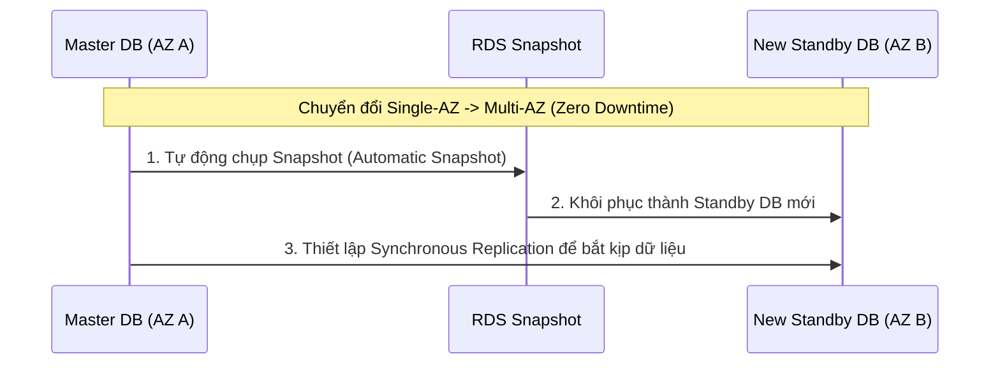

# Bài 88: RDS Read Replicas vs Multi-AZ (So sánh Read Replicas và Multi-AZ trên RDS)

- **Phần (Section):** Section 9: AWS Fundamentals: RDS + Aurora + ElastiCache
- **Bài học (Lecture):** #88 (`id: 18078177`)
- **Video gốc:** `SAA_-_RDS_-_Read_Replicas_and_Multi_AZ_v3.mp4`
- **Thời lượng:** `07:22` (442 giây)

---

## 1. Kiến thức trọng tâm (Exam Notes)

### 1.1. RDS Read Replicas (Mở rộng khả năng đọc - Scale Reads)
- **Mục đích chính:** Mở rộng quy mô đọc (**Scale Reads**), tách tải các tác vụ báo cáo/phân tích (Reporting / Analytics workloads) khỏi cơ sở dữ liệu Production chính.
- **Số lượng tối đa:** Lên tới **15 Read Replicas**.
- **Vị trí triển khai (3 tùy chọn):**
  1. Trong cùng một Availability Zone (**Within AZ**).
  2. Khác Availability Zone nhưng cùng Region (**Cross-AZ**).
  3. Khác Region (**Cross-Region**).
- **Cơ chế sao chép:** **Asynchronous replication** (Sao chép bất đồng bộ) $\rightarrow$ Dữ liệu đọc từ Read Replica mang tính nhất quán cuối cùng (**Eventually Consistent**).
- **Quảng bá (Promotion):** Một Read Replica có thể được nâng cấp (**promoted**) thành một Database độc lập (có khả năng nhận cả Read & Write) và tách khỏi chu trình replication ban đầu.
- **Kết nối ứng dụng:** Ứng dụng phải **cập nhật chuỗi kết nối (connection string)** để trỏ tới danh sách các DNS endpoints riêng biệt của từng Read Replica.
- **Giới hạn câu lệnh SQL:** Read Replicas **CHỈ phục vụ câu lệnh `SELECT`** (đọc), không thể nhận `INSERT`, `UPDATE`, `DELETE`.
- **Chi phí mạng (Networking Cost) cho Replication:**
  - **Cùng Region (dù khác AZ, ví dụ `us-east-1a` sang `us-east-1b`):** **MIỄN PHÍ** chi phí truyền dữ liệu replication vì RDS là dịch vụ được quản lý (Managed Service).
  - **Khác Region (Cross-Region, ví dụ `us-east-1` sang `eu-west-1`):** **CÓ TÍNH PHÍ** truyền dữ liệu mạng liên vùng (Cross-region replication fee).

### 1.2. RDS Multi-AZ (Khôi phục sau thảm họa & Tính sẵn sàng cao - Disaster Recovery / HA)
- **Mục đích chính:** **Disaster Recovery (DR)** và tăng tính sẵn sàng (**High Availability**). **KHÔNG** dùng để mở rộng hiệu năng đọc (Not used for scaling).
- **Cơ chế sao chép:** **Synchronous replication** (Sao chép đồng bộ) từ **Master DB instance (AZ A)** sang **Standby DB instance (AZ B)**. Mọi thay đổi ghi vào Master phải được sao chép sang Standby mới được xác nhận.
- **Kết nối & Failover tự động:**
  - Chỉ sử dụng **1 DNS name duy nhất**. Ứng dụng không cần đổi connection string khi xảy ra sự cố.
  - Tự động chuyển đổi dự phòng (**Automatic Failover**) sang Standby khi: mất toàn bộ AZ, mất kết nối mạng, hoặc lỗi instance/storage trên Master.
  - **Không ai có thể đọc hay ghi trực tiếp vào Standby DB** khi hệ thống đang hoạt động bình thường.
- **Kết hợp Read Replica + Multi-AZ:** Bạn **CÓ THỂ** thiết lập một Read Replica ở chế độ Multi-AZ để phục vụ Disaster Recovery!

### 1.3. Bảng so sánh RDS Read Replicas vs Multi-AZ (Trọng tâm đề thi)

| Tiêu chí | RDS Read Replicas | RDS Multi-AZ |
| :--- | :--- | :--- |
| **Mục đích chính** | Mở rộng khả năng đọc (**Scale Reads** / Analytics) | Khôi phục thảm họa & Sẵn sàng cao (**DR / HA**) |
| **Kiểu sao chép (Replication)** | **Asynchronous** (Bất đồng bộ - Eventually Consistent) | **Synchronous** (Đồng bộ) |
| **Số lượng** | Tối đa **15** Read Replicas | 1 Standby Instance (hoặc Multi-AZ DB Cluster) |
| **Phạm vi địa lý** | Same AZ, Cross-AZ, hoặc **Cross-Region** | **Cross-AZ** (trong cùng 1 Region) |
| **Đọc/Ghi trên bản phụ** | Chỉ đọc (`SELECT` only) | **Không thể đọc hoặc ghi** trực tiếp vào Standby |
| **Connection String** | Mỗi Read Replica có DNS riêng (phải sửa ứng dụng) | **1 DNS name duy nhất** (tự động Failover) |

### 1.4. Chuyển đổi từ Single-AZ sang Multi-AZ (Zero Downtime)
- Việc nâng cấp RDS từ **Single-AZ lên Multi-AZ** là thao tác **Zero Downtime** (không cần dừng cơ sở dữ liệu): chỉ cần nhấn **Modify** trên DB và bật **Multi-AZ**.
- **Quá trình diễn ra ngầm (Behind the scenes):**
  1. RDS tự động chụp một bản **Snapshot** của cơ sở dữ liệu Master.
  2. Bản Snapshot đó được khôi phục (**Restored**) thành một **Standby DB** mới ở AZ khác.
  3. Thiết lập kết nối đồng bộ (**Synchronization**) để Standby bắt kịp (catch up) dữ liệu với Master.

---

## 2. Phụ đề chi tiết theo mốc thời gian (Full Transcript & Timestamps)

| Thời gian | Nội dung lời giảng gốc (English) | Bản dịch tiếng Việt sát nghĩa |
| :--- | :--- | :--- |
| `00:00:00.090 --> 00:00:08.900` | Going into the exam is going to be extremely important to understand the difference between RDS Read Replicas and Multi AZ and understand exactly the use cases for those. | Khi bước vào kỳ thi, việc hiểu rõ sự khác biệt giữa RDS Read Replicas và Multi-AZ cũng như nắm chính xác các trường hợp sử dụng của chúng là cực kỳ quan trọng. |
| `00:00:08.900 --> 00:00:14.730` | So this lecture is really dedicated to understanding Read Replicas and Multi AZ. So let's get started with the Read Replicas. | Vì vậy, bài giảng này được dành riêng để hiểu sâu về Read Replicas và Multi-AZ. Hãy bắt đầu với Read Replicas. |
| `00:00:14.730 --> 00:00:19.530` | Read Replicas as the name indicates help you to scale your reads. | Read Replicas, đúng như tên gọi của nó, giúp bạn mở rộng quy mô đọc (scale reads). |
| `00:00:19.530 --> 00:00:29.490` | So let's have an example. Here, we have our application and we have an RDS database instance and our application performs reads and writes to our database instance, | Hãy xem một ví dụ. Ở đây chúng ta có ứng dụng và một RDS database instance, ứng dụng thực hiện cả đọc và ghi vào database instance đó, |
| `00:00:29.490 --> 00:00:36.210` | but say we want to scale the reads because that's, main database instance can not scale enough. It receives too many requests. | nhưng giả sử chúng ta muốn mở rộng việc đọc bởi vì database instance chính không thể chịu tải đủ. Nó nhận quá nhiều yêu cầu. |
| `00:00:36.210 --> 00:00:48.700` | Well, we can create up to 15 Read Replicas and they can be within the same availability zone, cross availability zone, or cross region. So three different options and they're very important to remember. | Khi đó, chúng ta có thể tạo tối đa 15 Read Replicas và chúng có thể nằm trong cùng một Availability Zone, khác Availability Zone, hoặc khác Region. Có ba tùy chọn khác nhau và chúng rất quan trọng cần ghi nhớ. |
| `00:00:48.700 --> 00:01:01.000` | So say we have another RDS instance Read Replica and another one and what will happen is that they will be an asynchronous replication between the main RDS database instance and the two Read Replicas. | Giả sử chúng ta có thêm một Read Replica và một cái nữa, điều sẽ xảy ra là có một quá trình sao chép bất đồng bộ (asynchronous replication) giữa RDS database instance chính và hai Read Replicas. |
| `00:01:01.000 --> 00:01:18.560` | Asynchronous, that means that the reads are eventually consistent. What that means is that, for example, if your application reads from the Read Replica before they had the chance to replicate the data then you may get all data. And this is why it's called eventually consistent asynchronous replication. | Bất đồng bộ (Asynchronous) có nghĩa là dữ liệu đọc mang tính nhất quán cuối cùng (eventually consistent). Nghĩa là nếu ứng dụng đọc từ Read Replica trước khi dữ liệu kịp sao chép sang thì bạn có thể nhận được dữ liệu cũ. Đó là lý do nó được gọi là sao chép bất đồng bộ nhất quán cuối cùng. |
| `00:01:18.560 --> 00:01:33.350` | And these replicas, they can be awesome for reading for scaling reads but they can also be promoted to their own database. So you can take one of these replicas and say, okay I want it to be its own database now and take rights. And so you promote it to its own database. | Những bản sao này rất tuyệt để mở rộng khả năng đọc, nhưng chúng cũng có thể được nâng cấp (promoted) thành cơ sở dữ liệu độc lập. Bạn có thể chọn một replica và biến nó thành database riêng nhận cả lệnh ghi. |
| `00:01:33.350 --> 00:01:40.090` | It's completely out of the replication mechanism after that but it's lives and has its own life cycle afterwards. | Sau đó nó hoàn toàn tách khỏi cơ chế sao chép ban đầu và có vòng đời độc lập của riêng mình. |
| `00:01:40.090 --> 00:01:53.713` | So in case you wanna use Read Replicas, the main application in orange in the top of the screen must update the connection string to leverage the list of all the Read Replicas you have in your RDS cluster. Okay, very nice. | Trong trường hợp bạn muốn dùng Read Replicas, ứng dụng chính màu cam ở phía trên màn hình phải cập nhật chuỗi kết nối (connection string) để tận dụng danh sách tất cả các Read Replicas trong cụm RDS. |
| `00:01:54.630 --> 00:02:08.590` | So let's talk about a classic use case for you to Read Replica. So in this example, we have a production database and it is taking on normal load. So here we go. Our production database is having read and writes to our main RDS database instance. | Hãy nói về một trường hợp sử dụng kinh điển của Read Replica. Trong ví dụ này, chúng ta có cơ sở dữ liệu Production đang nhận tải bình thường, thực hiện đọc và ghi vào RDS instance chính. |
| `00:02:08.590 --> 00:02:25.600` | And the new team comes in and say, we want to run some reporting and some analytics on top of your data. And so if you plug in that reporting application onto the main RDS database instance then it's going to overload it and possibly slow down the production application and you don't want that. | Một nhóm mới đến và nói rằng họ muốn chạy báo cáo (reporting) và phân tích (analytics) trên dữ liệu đó. Nếu bạn cắm ứng dụng báo cáo đó trực tiếp vào RDS instance chính, nó sẽ làm quá tải và làm chậm ứng dụng Production — điều bạn không hề muốn. |
| `00:02:25.600 --> 00:02:45.570` | So instead what you do as a solutions architect is you create a Read Replica to run the new workload there. So you create a Read Replica. There is some asynchronous, a replication that happens between your main RDS DB database instance and your Read Replica and then your reporting application can just do reads from your Read Replica and run the analytics there. | Thay vào đó, với tư cách là Solutions Architect, bạn tạo một Read Replica để chạy khối lượng công việc mới ở đó. Quá trình sao chép bất đồng bộ diễn ra giữa DB chính và Read Replica, rồi ứng dụng báo cáo chỉ việc đọc từ Read Replica và chạy phân tích tại đó. |
| `00:02:45.570 --> 00:02:50.290` | The production application is completely unaffected in this case and that's perfect. | Ứng dụng Production hoàn toàn không bị ảnh hưởng trong trường hợp này, thật hoàn hảo. |
| `00:02:50.290 --> 00:03:09.530` | So remember, if you have a Read Replica you need to ensure that it is only for SELECT type of statements and SELECT is a SQL keyword. SELECT means read. And so you can not use keywords such as INSERT, UPDATE or DELETE, which change database itself. Okay, Read Replicas is only for reads. | Hãy nhớ rằng với Read Replica, bạn phải đảm bảo nó chỉ dùng cho các câu lệnh dạng `SELECT` (`SELECT` là từ khóa SQL nghĩa là đọc). Bạn không thể dùng các từ khóa làm thay đổi dữ liệu như `INSERT`, `UPDATE` hay `DELETE`. Read Replicas chỉ dành cho việc đọc. |
| `00:03:09.530 --> 00:03:26.580` | So, let's talk about the networking cost associated with RDS Read Replica. So in AWS, you should know that's normally there is a cost when the data goes from one availability zone to another but there are exceptions and these exceptions are usually for managed services. | Hãy nói về chi phí mạng liên quan đến RDS Read Replica. Trong AWS, thông thường sẽ tốn phí khi dữ liệu đi từ Availability Zone này sang Availability Zone khác, nhưng có những ngoại lệ và các ngoại lệ đó thường dành cho các dịch vụ được quản lý (managed services). |
| `00:03:26.580 --> 00:03:59.450` | So for RDS Read Replica, this is a managed service. If your Read Replica is within the same region, okay? Different AZ, but same region, you're not paying that fee. So what this means that if you have a RDS DB instance in us-east-1a and then a Read Replica in us-east-1b, and there is asynchronous replication because this is a Read Replica, even though the traffic goes from one AZ to a different AZ that replication traffic is going to be free because RDS is a managed service and they give you that traffic for free. | Đối với RDS Read Replica, đây là dịch vụ được quản lý. Nếu Read Replica nằm trong cùng một Region (khác AZ nhưng cùng Region), bạn không phải trả khoản phí đó. Nghĩa là nếu bạn có RDS DB instance ở `us-east-1a` và Read Replica ở `us-east-1b`, dù lưu lượng sao chép bất đồng bộ đi từ AZ này sang AZ khác nhưng lưu lượng replication đó hoàn toàn miễn phí. |
| `00:03:59.450 --> 00:04:18.903` | But if you are using a cross region replica, so you are in one region, us-east-1 and you go to another region, eu-west-1, for example then your RDS DB instance and your Read Replica will have replication that will go across regions and this will incur a replication fee for your network. | Nhưng nếu bạn sử dụng bản sao liên vùng (Cross-Region Replica), ví dụ từ `us-east-1` sang `eu-west-1`, thì quá trình sao chép giữa RDS DB instance và Read Replica đi qua các Region khác nhau và sẽ phát sinh phí sao chép mạng. |
| `00:04:20.120 --> 00:04:32.720` | Finally, let's talk about RDS Multi AZ and Multi AZ is mainly used for Disaster Recovery. So we have our application and it performs the reads and writes to our Master database instance which is in availability zone A | Cuối cùng, hãy nói về RDS Multi-AZ. Multi-AZ chủ yếu được sử dụng cho Khôi phục sau thảm họa (Disaster Recovery). Chúng ta có ứng dụng thực hiện đọc và ghi vào Master database instance nằm ở Availability Zone A. |
| `00:04:32.720 --> 00:04:50.250` | and what we thinks you have is a synchronous replication to a standby instance in AZ B, and they will replicate every single change in the Master synchronously. So that means that when your application writes to the Master, that change needs to also be replicated to the standby to be accepted. | Và chúng ta sẽ có cơ chế sao chép đồng bộ (synchronous replication) sang một Standby instance ở AZ B; mọi thay đổi trên Master đều được sao chép đồng bộ. Nghĩa là khi ứng dụng ghi vào Master, thay đổi đó cũng phải được sao chép sang Standby thì mới được chấp nhận. |
| `00:04:50.250 --> 00:05:07.023` | And so what we get out of it is one DNS name. So your application talks to one DNS name and in case there is a problem with the Master, there will be an automatic failover to the standby database. Thanks to that one DNS name. So thanks to this, we increase the availability. | Những gì chúng ta nhận được là một tên DNS duy nhất. Ứng dụng giao tiếp với một tên DNS đó và nếu có sự cố với Master, hệ thống sẽ tự động chuyển đổi dự phòng (automatic failover) sang cơ sở dữ liệu Standby nhờ tên DNS duy nhất này, giúp tăng tính sẵn sàng. |
| `00:05:07.023 --> 00:05:22.420` | This is why it's called Multi AZ and they will be failover in case we lose an entire AZ or we lose the network or there is an instance or storage failure for the Master database. In which case, obviously the standby database will become the new Master. | Đó là lý do nó được gọi là Multi-AZ, và failover sẽ diễn ra trong trường hợp mất toàn bộ một AZ, mất mạng, hoặc lỗi instance hay ổ cứng lưu trữ của Master database. Khi đó, cơ sở dữ liệu Standby hiển nhiên sẽ trở thành Master mới. |
| `00:05:22.420 --> 00:05:34.980` | He don't need to do any manual intervention in your apps as long as it tries to keep on connecting to your database automatically at some point, it will fail over to the standby that will be promoted as the Master, and you'll be good and it's not used for scaling. | Bạn không cần can thiệp thủ công vào ứng dụng; miễn là ứng dụng tự động thử kết nối lại tới database, nó sẽ chuyển sang bản Standby đã được nâng lên làm Master, và lưu ý là cơ chế này không dùng để mở rộng quy mô (scaling). |
| `00:05:34.980 --> 00:05:47.130` | So as you can see here, the standby database is just for standby. No one can read to it. No one can write to it, it's just here as a failover in case anything goes on with your Master database. | Như bạn thấy ở đây, cơ sở dữ liệu Standby chỉ dùng để dự phòng. Không ai có thể đọc từ nó, không ai có thể ghi vào nó; nó chỉ ở đó để failover phòng khi có bất kỳ sự cố nào xảy ra với Master database. |
| `00:05:47.130 --> 00:06:02.430` | So, quick question is, is there a possibility to have the Read Replicas being set up as Multi AZ for Disaster Recovery? And the answer is yes, you can set up your Read Replica as a Multi AZ if you want it to. And that is a common exam question, okay? | Một câu hỏi nhanh: Liệu có thể thiết lập các Read Replicas ở chế độ Multi-AZ để phục vụ Disaster Recovery không? Câu trả lời là CÓ, bạn hoàn toàn có thể thiết lập Read Replica thành Multi-AZ nếu muốn. Và đó là một câu hỏi thi rất phổ biến. |
| `00:06:02.430 --> 00:06:11.090` | So that's it for the difference between Read Replicates and Multi AZ, but you need to absolutely understand this going into the exam because a lot of questions will go and be about it. | Đó là sự khác biệt giữa Read Replicas và Multi-AZ, bạn bắt buộc phải nắm thật vững khi đi thi vì sẽ có rất nhiều câu hỏi xoay quanh chủ đề này. |
| `00:06:11.090 --> 00:06:28.430` | So a question that can come up in the exam is around how do we make an RDS database go from Single AZ to Multi AZ? So what you should know is that it is a zero downtime operation. That means you do not need to stop the database to go from Single AZ to Multi AZ. | Một câu hỏi khác có thể xuất hiện trong đề thi là làm thế nào để chuyển một cơ sở dữ liệu RDS từ Single-AZ sang Multi-AZ? Điều bạn cần biết là đây là một thao tác không có thời gian chết (zero downtime operation). Nghĩa là bạn không cần dừng cơ sở dữ liệu để chuyển từ Single-AZ sang Multi-AZ. |
| `00:06:28.430 --> 00:06:45.730` | The only thing you need to do is to click on modify for the database and enable Multi AZ. That means that your RDS database instance is going to go to have a Master, to have a standby DB with synchronous replication without you doing anything except modifying that setting and the database will not stop. | Điều duy nhất bạn cần làm là nhấn vào Modify trên cơ sở dữ liệu và bật Multi-AZ. Khi đó RDS database instance của bạn sẽ có thêm một Standby DB với cơ chế sao chép đồng bộ mà bạn không cần làm gì ngoài việc sửa cài đặt đó, và cơ sở dữ liệu sẽ không bị dừng. |
| `00:06:45.730 --> 00:06:53.820` | Now, this is what the exam will ask you but I wanna show you what will happen behind the scenes for it to work. So, the following will happen internally. | Đó là điều đề thi sẽ hỏi bạn, nhưng tôi muốn chỉ cho bạn những gì thực sự diễn ra ở hậu trường để cơ chế này hoạt động. Nội bộ hệ thống sẽ diễn ra như sau. |
| `00:06:53.820 --> 00:07:04.270` | There will be a snapshot taken by RDS automatically of your main database and that this snapshot will be restored into a new standby database, okay? | Đầu tiên, RDS sẽ tự động chụp một bản snapshot của cơ sở dữ liệu chính, và bản snapshot này sẽ được khôi phục thành một cơ sở dữ liệu Standby mới. |
| `00:07:04.270 --> 00:07:17.920` | And then once the standby database is restored, there will be synchronization established between the two database and so therefore the standby database will catch up to the main RDS database and there you go, you will be in a Multi AZ setup. | Sau khi cơ sở dữ liệu Standby được khôi phục xong, quá trình đồng bộ hóa sẽ được thiết lập giữa hai cơ sở dữ liệu để bản Standby bắt kịp dữ liệu với RDS database chính, và thế là bạn đã có thiết lập Multi-AZ. |
| `00:07:17.920 --> 00:07:22.040` | So that's it for this lecture. I hope you liked it, and I will see you in the next lecture. | Đó là tất cả cho bài giảng này. Hy vọng bạn thích nó, và hẹn gặp lại bạn ở bài giảng tiếp theo. |
