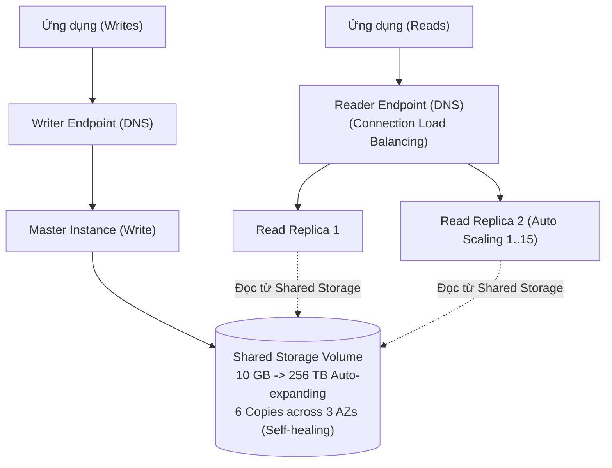

# Bài 91: Amazon Aurora (Tổng quan và kiến trúc Amazon Aurora)

- **Phần (Section):** Section 9: AWS Fundamentals: RDS + Aurora + ElastiCache
- **Bài học (Lecture):** #91 (`id: 13528160`)
- **Video gốc:** `SAA - Aurora - Overview v6.mp4`
- **Thời lượng:** `06:27` (387 giây)
- **Cheat sheet:** [topics/aws_databases.html](../../topics/aws_databases.html)

---

## 1. Kiến thức trọng tâm (Exam Notes)

> [!TIP]
> **Tóm tắt nhanh dịch vụ Amazon Aurora (SAA-C03 Cheat Sheet)**
> - **Là gì:** Công nghệ CSDL quan hệ đám mây độc quyền của AWS tương thích hoàn toàn với **MySQL** và **PostgreSQL**, lưu trữ phân tán **6 bản sao trên 3 Availability Zones** với hiệu năng gấp 5 lần MySQL và 3 lần PostgreSQL.
> - **Dùng khi nào (Use case điển hình trong đề):** Cần CSDL quan hệ hiệu năng cực cao, dung lượng tự động mở rộng (từ **10 GB tới 128/256 TB**), **Failover tức thì (< 30 giây)**, tạo bản sao DB nhanh cho môi trường test (**Aurora Cloning**), tải biến thiên thất thường (**Aurora Serverless**), hoặc kiến trúc đa vùng toàn cầu (**Aurora Global Database**).
> - **Khác gì dịch vụ gần giống:**
>   - **Aurora vs. RDS thông thường:** Trên `Aurora`, tất cả **15 Aurora Replicas** đều dùng chung tầng **Shared Storage** tự phục hồi nên vừa phục vụ tải đọc thông qua **Reader Endpoint**, vừa đóng vai trò mục tiêu Failover Multi-AZ.
> - **Điểm hay bị hỏi (Giới hạn, Mặc định, Từ khóa gợi ý):**
>   - **Giới hạn & Mặc định:** Ghi cần tối thiểu **4/6 bản sao**, đọc cần tối thiểu **3/6 bản sao**; **Aurora Global Database** có độ trễ sao chép Cross-Region **< 1 giây** và thời gian khôi phục thảm họa (RTO) **< 1 phút** (hỗ trợ tối đa 5 Secondary Regions).
>   - **Từ khóa gợi ý:** `"fast database cloning for staging/testing without copying data (copy-on-write)"` $\rightarrow$ **Aurora Cloning**; `"MySQL/Postgres compatible with 6 copies across 3 AZs and Reader Endpoint"` $\rightarrow$ **Amazon Aurora**.

### 1.1. Tổng quan về Amazon Aurora
- **Amazon Aurora** là công nghệ cơ sở dữ liệu độc quyền (proprietary technology) của AWS (không phải mã nguồn mở), được tối ưu hóa riêng cho đám mây (cloud-optimized).
- **Tương thích với 2 hệ quản trị CSDL (Cần nhớ cho kỳ thi):**
  1. **PostgreSQL** (`Aurora PostgreSQL-compatible`)
  2. **MySQL** (`Aurora MySQL-compatible`)
- **Hiệu năng vượt trội:**
  - Nhanh gấp **5 lần (5x)** so với MySQL trên RDS.
  - Nhanh gấp **3 lần (3x)** so với PostgreSQL trên RDS.
- **Chi phí:** Đắt hơn khoảng **20%** so với RDS thông thường, nhưng hiệu quả hơn rất nhiều ở quy mô lớn (at scale).

### 1.2. Kiến trúc Lưu trữ & Độ sẵn sàng cao của Aurora (Aurora Storage & High Availability)
- **Tự động mở rộng dung lượng (Auto-expanding Storage):**
  - Bắt đầu từ **10 GB** và tự động mở rộng (tăng từng bước) lên tới **256 TB** mà DBA không cần giám sát hay can thiệp.
- **6 bản sao trên 3 Availability Zones (6 Copies across 3 AZs):**
  - Mỗi khi bạn ghi dữ liệu vào Aurora, nó luôn lưu trữ **6 bản sao (6 copies)** của dữ liệu trải đều trên **3 Availability Zones**.
  - **Quorum cho Ghi (Writes):** Chỉ cần **4 trên 6 bản sao (4 out of 6)** để ghi thành công (nếu 1 AZ bị sập mất 2 bản sao, vẫn còn 4 bản sao $\rightarrow$ việc ghi không bị gián đoạn).
  - **Quorum cho Đọc (Reads):** Chỉ cần **3 trên 6 bản sao (3 out of 6)** để đọc thành công.
  - **Tự phục hồi (Self-healing):** Nếu dữ liệu bị hỏng (corrupted), Aurora tự động sửa lỗi bằng cơ chế sao chép ngang hàng (peer-to-peer replication) ở tầng backend trên hàng trăm phân vùng ổ đĩa (striped across hundreds of volumes).

### 1.3. Kiến trúc Cụm Aurora (Aurora DB Cluster: Master, Replicas & Endpoints)
- **Master (Writer Instance):** Chỉ có **1 Master instance duy nhất** nhận các thao tác ghi (Writes).
- **Read Replicas:**
  - Hỗ trợ tối đa **15 Read Replicas** (cùng dùng chung tầng Shared Storage Volume, nên độ trễ sao chép cực thấp: **dưới 10 ms**).
  - Hỗ trợ **Auto Scaling** cho Read Replicas (tự động thêm/bớt từ 1 đến 15 Read Replicas).
  - Hỗ trợ **Cross-Region Replication**.
  - **Failover tức thì (Instantaneous Failover):** Nếu Master gặp sự cố, bất kỳ một trong 15 Read Replicas nào cũng có thể được nâng lên làm Master mới trong trung bình **dưới 30 giây**.
- **2 Endpoints quan trọng (Bắt buộc nhớ khi đi thi):**
  1. **Writer Endpoint:** Tên DNS luôn trỏ tới **Master instance** hiện tại (tự động chuyển hướng khi xảy ra Failover).
  2. **Reader Endpoint:** Tên DNS tự động cân bằng tải kết nối (**Connection-level Load Balancing** — lưu ý là cân bằng tải ở mức **kết nối (connection level)** chứ không phải ở mức từng câu lệnh SQL) tới tất cả các **Aurora Read Replicas**.
- **Tính năng Backtrack:** Cho phép tua ngược (restore/rewind) cơ sở dữ liệu về bất kỳ thời điểm nào trước đó (ví dụ: hôm qua lúc 4:00 chiều rồi đổi ý sang 5:00 chiều) **mà không cần khôi phục từ bản sao lưu (backups) sang DB mới**.

---

## 2. Phụ đề chi tiết theo mốc thời gian (Full Transcript & Timestamps)

| Thời gian | Nội dung lời giảng gốc (English) | Bản dịch tiếng Việt sát nghĩa |
| :--- | :--- | :--- |
| `00:00:00.060 --> 00:00:12.720` | So let's talk about Amazon Aurora because the exam is starting to ask you a lot of question about it. Now, you don't need deep knowledge on it, but you need enough high-level overview to understand exactly how it works, so this is what I'm going to give you in this lecture. | Hãy cùng nói về Amazon Aurora vì đề thi đang hỏi rất nhiều câu hỏi về dịch vụ này. Bạn không cần kiến thức quá sâu về nội tại bên trong, nhưng cần nắm đủ bức tranh tổng quan để hiểu chính xác cách nó hoạt động, và đó là những gì tôi sẽ cung cấp trong bài giảng này. |
| `00:00:12.720 --> 00:00:29.820` | Aurora is going to be a proprietary technology from AWS. It's not open-sourced. But they made it so it's going to be compatible with PostgreSQL and MySQL. And basically, your Aurora database will have compatible drivers. That means that if you connect as if you were connecting to your PostgreSQL or a MySQL database, then it will work. | Aurora là công nghệ độc quyền của AWS, không phải mã nguồn mở. Nhưng AWS đã thiết kế để nó tương thích hoàn toàn với PostgreSQL và MySQL. Về cơ bản, cơ sở dữ liệu Aurora sử dụng các trình điều khiển (drivers) tương thích, nghĩa là nếu bạn kết nối giống như đang kết nối vào PostgreSQL hay MySQL thì mọi thứ đều hoạt động bình thường. |
| `00:00:29.820 --> 00:00:51.390` | Aurora is very special, and I won't go too deep into the internals, but they made it cloud-optimized. And by doing a lot of optimization and smart stuff, basically they get 5x performance improvements over MySQL on the RDS, or 3x extra performance of PostgreSQL on RDS. Not just that, but in many different ways, they also get more performance improvements. To me, I watch it, it's really, really smart, but I won't go into the details of it. | Aurora rất đặc biệt vì được tối ưu hóa cho đám mây (cloud-optimized). Nhờ rất nhiều tối ưu hóa thông minh, nó đạt hiệu năng cao gấp 5 lần so với MySQL trên RDS, hoặc gấp 3 lần so với PostgreSQL trên RDS, cùng nhiều cải thiện hiệu năng khác. |
| `00:00:51.390 --> 00:01:15.390` | Now, Aurora storage automatically grows, and I think this is one of the main features that is quite awesome. You start at 10 gigabytes, but as you put more data into your database, it grows automatically up to 256 terabytes. Again, this has to do with how to design it, but the awesome thing is that now as a DBA or a SysOps, you don't need to worry about monitoring your disk, you just know it will grow automatically with time. | Dung lượng lưu trữ của Aurora tự động tăng trưởng — đây là một trong những tính năng tuyệt vời nhất. Bạn bắt đầu ở mức 10 GB, và khi bạn đưa thêm dữ liệu vào cơ sở dữ liệu, nó sẽ tự động mở rộng lên tới 256 TB. Nhờ vậy, với tư cách là DBA hay SysOps, bạn không cần lo lắng về việc giám sát dung lượng đĩa nữa vì nó sẽ tự động tăng theo thời gian. |
| `00:01:15.390 --> 00:01:38.670` | Or I can have up to 15 read replicas, and the replication process is going to be faster than MySQL. You will see sub-10-millisecond replica lag, typically. Now, if you do failover in Aurora, it was going to be instantaneous. So it's going to be much faster than a failover from Multi-AZ on MySQL or RDS. And because it's cloud-native, by default, you get high availability. | Aurora có thể có tối đa 15 Read Replicas và quá trình sao chép nhanh hơn nhiều so với MySQL, với độ trễ bản sao (replica lag) thường dưới 10 mili-giây. Khi thực hiện chuyển đổi dự phòng (failover) trong Aurora, quá trình diễn ra gần như tức thì, nhanh hơn nhiều so với Multi-AZ trên RDS thông thường. Vì là cloud-native nên mặc định bạn có sẵn tính sẵn sàng cao (High Availability). |
| `00:01:38.670 --> 00:01:51.990` | Now, although the cost is a little bit more than RDS, about 20% more, it is so much more efficient that at scale, it makes a lot more sense for savings. So let's talk about the aspect that are super important, which is high availability and read scaling. | Mặc dù chi phí cao hơn RDS một chút (khoảng 20%), nhưng nó hiệu quả hơn rất nhiều nên ở quy mô lớn sẽ tiết kiệm hơn. Bây giờ hãy nói về khía cạnh cực kỳ quan trọng: tính sẵn sàng cao (High Availability) và mở rộng khả năng đọc (Read Scaling). |
| `00:01:51.990 --> 00:02:14.100` | So Aurora is special because it's going to store six copies of your data anytime you write anything across three AZ. And so, Aurora is made such as it's available, so it only needs four copies out of six for writes. So that means that if one AZ is down, you're fine. And it only needs you have three copies out of six needed for reads. So, again, that means that it's highly available for reads. | Aurora đặc biệt ở chỗ nó lưu trữ 6 bản sao (6 copies) dữ liệu của bạn trên 3 AZ mỗi khi bạn ghi bất cứ thứ gì. Để đảm bảo tính sẵn sàng, Aurora chỉ cần 4 trên 6 bản sao để ghi thành công (nghĩa là nếu 1 AZ bị sập thì bạn vẫn hoàn toàn ổn), và chỉ cần 3 trên 6 bản sao để đọc thành công. |
| `00:02:14.100 --> 00:02:33.450` | There is some kind of self-healing process that happens, which is quite cool, which is that if some data is corrupted or bad, then it does self-healing with peer-to-peer replication in the backend, and it's quite cool. And you don't rely on just one volume, you rely on hundreds of volumes. Again, not something for you to manage, it happens in the backend, but that means that you just reduce the risk by so much. | Ngoài ra còn có quá trình tự phục hồi (self-healing): nếu một phần dữ liệu bị lỗi hoặc hỏng, hệ thống tự động sửa chữa thông qua sao chép ngang hàng (peer-to-peer replication) ở tầng backend. Bạn không phụ thuộc vào chỉ một ổ đĩa mà dữ liệu được phân tán trên hàng trăm volumes ở hậu trường, giúp giảm thiểu rủi ro đi rất nhiều. |
| `00:02:33.450 --> 00:03:04.020` | So if you look at it from the diagram perspective, you have three AZ and you have a shared storage volume, but it's a logical volume, and it does replication, self-healing, and auto-expanding, which is a lot of features. So if you were to write some data, maybe blue data, you'll see the six copies of it in three different AZ. Then if you write some orange data, again, six copies of it in different AZ. And then as you write more and more data, it's basically going to go, again, six copies of it in three different AZ. The cool thing is that it goes on different volumes and it's striped and it works really, really well. | Nhìn từ góc độ sơ đồ, bạn có 3 AZ và một vùng lưu trữ dùng chung (Shared Storage Volume) mang tính logic, tự động sao chép, tự phục hồi và tự mở rộng. Khi bạn ghi dữ liệu màu xanh, có 6 bản sao trên 3 AZ; ghi dữ liệu màu cam, lại có 6 bản sao trên 3 AZ. Dữ liệu được chia nhỏ (striped) trên nhiều volumes khác nhau và hoạt động cực kỳ hiệu quả. |
| `00:03:04.020 --> 00:03:24.990` | Now we need to know about storage and that's it. But you don't actually interface with the storage, it's just a design that Amazon made, and I want to give it to you as well, so you understand what Aurora takes. Now, Aurora is like Multi-AZ for RDS. Basically there's only one instance that takes writes, so there is a master in Aurora, and that's where we'll take writes. | Bạn không trực tiếp thao tác với tầng lưu trữ này vì đó là thiết kế nội bộ của Amazon. Giống như Multi-AZ của RDS, trên Aurora chỉ có duy nhất một instance nhận lệnh ghi — gọi là Master. |
| `00:03:24.990 --> 00:03:49.110` | And then if the master doesn't work, the failover will happen in less than 30 seconds on average. So it's really, really quick failover. And on top of the master, you can have up to 15 read replicas, all serving reads. So you can have a lot of them, and this is how you scale your read workload. And so any of these read replicas can become the master in case the master fails, so it's quite different from how RDS works. | Nếu Master ngừng hoạt động, quá trình failover sẽ diễn ra trung bình dưới 30 giây — cực kỳ nhanh. Ngoài Master, bạn có thể có tối đa 15 Read Replicas cùng phục vụ việc đọc để mở rộng tải đọc. Bất kỳ Read Replica nào trong số này đều có thể trở thành Master nếu Master gặp sự cố — điểm này khá khác so với RDS truyền thống. |
| `00:03:49.110 --> 00:04:11.820` | But by default, you only have one master. The cool thing about these read replicas is that it supports cross-region replication. So if you look at Aurora on the right-hand side of the diagram, this is what you should remember: One master, multiple replicas, and the storage is going to be replicated, self-healing, auto-expanding, little blocks by little blocks. | Mặc định bạn chỉ có 1 Master, và các Read Replicas này cũng hỗ trợ sao chép liên vùng (Cross-Region Replication). Hãy nhớ sơ đồ bên phải: 1 Master, nhiều Replicas, và tầng lưu trữ tự nhân bản, tự phục hồi, tự mở rộng từng khối nhỏ. |
| `00:04:11.820 --> 00:04:42.180` | Now, let's have a look at how Aurora is as a cluster. So this is more around how Aurora works when you have clients, how do you interface with all these instances? So as we said, we have a shared storage volume that is auto-expanding. Your master is the only thing that will write to your storage. And because the master can change and failover, what Aurora provides you is what's called a writer endpoint. So it's a DNS name, a writer endpoint, and it's always pointing to the master. So even if the master fails over, your client still talks to the writer endpoint and is automatically redirected to the right instance. | Hãy xem cách cụm Aurora (Aurora Cluster) giao tiếp với trình khách (clients). Chúng ta có vùng lưu trữ chung tự mở rộng và chỉ Master mới ghi vào đó. Vì Master có thể thay đổi khi failover, Aurora cung cấp cho bạn một **Writer Endpoint** (một tên DNS luôn trỏ tới Master hiện hành). Ngay cả khi Master failover, client vẫn chỉ cần gọi tới Writer Endpoint và sẽ tự động được chuyển hướng tới đúng instance. |
| `00:04:42.180 --> 00:05:11.400` | Now, as I said before, you also have a lot of read replicas. What I didn't say is that they can have auto-scaling on top of these read replicas. So you can have one up to 15 read replicas and you can set up auto-scaling, such as you always have the right number of read replicas. Now, because you have auto-scaling, it can be really, really hard for your applications to keep track of where are your read replicas, what's the URL, how do I connect to them. So for it, you have to remember this absolutely for going for the exam: There is something called a reader endpoint. | Ngoài ra, với tối đa 15 Read Replicas, bạn có thể thiết lập Auto Scaling trên các Read Replicas này để luôn duy trì số lượng phù hợp. Vì có Auto Scaling nên ứng dụng sẽ rất khó theo dõi địa chỉ URL của từng Read Replica. Do đó, bạn bắt buộc phải nhớ khái niệm này cho kỳ thi: **Reader Endpoint**. |
| `00:05:11.400 --> 00:05:36.840` | And a reader endpoint has the exact same feature as a writer endpoint. It helps with connection load balancing, and it connects automatically to all the read replicas. So anytime the client connects to the reader endpoint, it will get connected to one of the read replicas, and they will be load balancing done this way. Just notice that the load balancing happens at the connection level, not the statement level. So this is how it works for Aurora. | Reader Endpoint giúp cân bằng tải kết nối (connection load balancing) và tự động kết nối tới tất cả các Read Replicas. Mỗi khi client kết nối vào Reader Endpoint, nó sẽ được phân phối tới một trong các Read Replicas. Lưu ý rằng việc cân bằng tải diễn ra ở cấp độ kết nối (connection level), không phải ở cấp độ câu lệnh (statement level). |
| `00:05:36.840 --> 00:06:06.150` | Remember writer endpoint, reader endpoint. Remember auto-scaling. Remember shared storage volume that auto-expands. Remember this diagram because once you get it, you'll understand how Aurora works. Now, if we go deep into the feature, you get a lot of things I already told you, automatic failover, backup and recovery, isolation and security, industry compliance, push-button scaling by auto-scaling. Automated patching with zero downtime, so it's kind of cool the magic they do in the backend. Advanced monitoring, routine maintenance. So all these things are handled for you. | Hãy nhớ Writer Endpoint, Reader Endpoint, Auto Scaling và Shared Storage Volume tự mở rộng. Ngoài ra bạn còn có tự động failover, sao lưu và phục hồi, bảo mật cô lập, tuân thủ tiêu chuẩn ngành, vá lỗi tự động không thời gian chết (zero downtime patching), giám sát nâng cao và bảo trì định kỳ. |
| `00:06:06.150 --> 00:06:27.300` | And you also get this feature called backtrack, which is giving you the ability to restore data at any point of time, and actually doesn't rely on backups, it relies on something different. But you can always say, "I want to go back to yesterday at 4:00 PM." And you say, "Oh, no, actually I wanted to do yesterday at 5:00 PM." And it will work as well, which is super, super neat. So that's it for Aurora, and I will see you in the next lecture. | Bạn cũng có tính năng gọi là **Backtrack**, cho phép khôi phục dữ liệu về bất kỳ thời điểm nào mà không cần dựa vào bản backup. Bạn có thể nói "Tôi muốn quay lại hôm qua lúc 4 giờ chiều", rồi đổi ý "Ồ không, thực ra tôi muốn quay lại lúc 5 giờ chiều hôm qua" và nó vẫn hoạt động cực kỳ gọn gàng. Đó là tất cả về tổng quan Aurora, hẹn gặp lại bạn ở bài giảng tiếp theo. |
