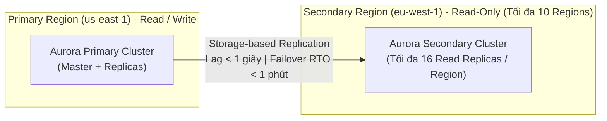

# Bài 93: Amazon Aurora - Advanced Concepts (Các khái niệm nâng cao về Amazon Aurora)

- **Phần (Section):** Section 9: AWS Fundamentals: RDS + Aurora + ElastiCache
- **Bài học (Lecture):** #93 (`id: 26099176`)
- **Video gốc:** `SAA - Aurora - Advanced Concepts v7.mp4`
- **Thời lượng:** `07:31` (451 giây)

---

## 1. Kiến thức trọng tâm (Exam Notes)

### 1.1. Aurora Replica Auto Scaling
- Khi lưu lượng đọc qua **Reader Endpoint** tăng cao làm tăng CPU usage trên các Aurora Replicas, **Replica Auto Scaling** sẽ tự động thêm mới các Aurora Replicas.
- **Reader Endpoint** tự động mở rộng để bao phủ các Replicas mới và phân bổ lưu lượng đọc sang chúng.

### 1.2. Aurora Custom Endpoints (Điểm cuối tùy chỉnh)
- Định nghĩa một nhóm con (subset) các Aurora instances cụ thể dưới một tên DNS riêng (**Custom Endpoint**).
- **Tình huống sử dụng điển hình (Exam Use Case):**
  - Trong cụm có một số Read Replicas cấu hình thường (`db.r3.large`) và một số Read Replicas cấu hình cực mạnh (`db.r5.2xlarge`).
  - Bạn tạo một **Custom Endpoint** trỏ riêng vào nhóm `db.r5.2xlarge` để chạy các **truy vấn phân tích nặng (Analytical queries)** mà không làm ảnh hưởng đến các truy vấn đọc thông thường.
- Lưu ý: Sau khi đã định nghĩa các Custom Endpoints cho các nhóm tải khác nhau, thông thường người ta không dùng **Reader Endpoint** chung nữa (dù nó không biến mất).

### 1.3. Aurora Serverless
- Tự động khởi tạo cơ sở dữ liệu (automated database instantiation) và tự động mở rộng (auto-scaling) dựa trên mức sử dụng thực tế.
- **Tình huống sử dụng (Exam Keywords):** Tải công việc **không thường xuyên (infrequent)**, **ngắt quãng (intermittent)**, hoặc **không thể dự đoán trước (unpredictable workloads)**.
- Không cần lập kế hoạch dung lượng trước (No capacity planning).
- **Cách tính phí:** Trả tiền theo **từng giây (pay per second)** cho các Aurora instances được bật lên.
- **Kiến trúc:** Client kết nối vào một **Proxy Fleet** được quản lý bởi Aurora; phía sau (backend) các Aurora instances được bật/tắt tự động.

### 1.4. Aurora Global Database (Cơ sở dữ liệu Aurora Toàn cầu)
- Có 2 cách thiết lập đa vùng trên Aurora:
  1. **Aurora Cross-Region Read Replicas:** Hữu ích cho Disaster Recovery, dễ thiết lập.
  2. **Aurora Global Database (Khuyến nghị):**
     - **1 Primary Region:** Nơi diễn ra mọi thao tác Đọc và Ghi (Read/Write).
     - **Tối đa 10 Secondary (Read-Only) Regions:** Độ trễ sao chép (Replication lag) liên vùng trung bình **dưới 1 giây (< 1 second)**.
     - **Tối đa 16 Read Replicas trên mỗi Secondary Region:** Giúp giảm độ trễ đọc (low latency reads) cho người dùng trên toàn cầu.
     - **Khôi phục thảm họa (DR):** Nếu Primary Region gặp sự cố, việc nâng cấp (promote) một Secondary Region lên làm vùng Read/Write mới có **RTO (Recovery Time Objective) dưới 1 phút (< 1 minute)**.

### 1.5. Aurora Machine Learning (Tích hợp Học máy bằng SQL)
- Cho phép thực hiện các dự đoán dựa trên Học máy (ML-based predictions) trực tiếp từ ứng dụng thông qua **giao diện truy vấn SQL** mà không cần kinh nghiệm chuyên sâu về ML.
- Tích hợp tối ưu, bảo mật và đơn giản giữa Aurora và **2 dịch vụ AWS ML (Cần nhớ cho kỳ thi):**
  1. **Amazon SageMaker** (Sử dụng bất kỳ mô hình ML tùy chỉnh nào ở backend).
  2. **Amazon Comprehend** (Phân tích cảm xúc văn bản - Sentiment analysis).
- **Use cases:** Phát hiện gian lận (Fraud detection), nhắm mục tiêu quảng cáo (Ads targeting), phân tích cảm xúc (Sentiment analysis), gợi ý sản phẩm (Product recommendations).

### 1.6. Babelfish for Aurora PostgreSQL
- Giúp **Amazon Aurora PostgreSQL** hiểu được các câu lệnh truy vấn viết bằng ngôn ngữ **T-SQL** (ngôn ngữ độc quyền của **Microsoft SQL Server**) và giao thức truyền thông của SQL Server (`TDS`).
- **Lợi ích khi di chuyển (Migration Use Case):**
  - Ứng dụng đang dùng **MS SQL Server** có thể chuyển sang **Aurora PostgreSQL** mà **gần như không cần sửa đổi mã nguồn (little to no code changes)** và giữ nguyên **SQL Server Client Driver** (thay vì phải viết lại sang `PL/pgSQL` và đổi sang PostgreSQL Driver).
  - Kết hợp với **AWS SCT (Schema Conversion Tool)** và **AWS DMS (Database Migration Service)** để di chuyển dữ liệu.

---

## 2. Phụ đề chi tiết theo mốc thời gian (Full Transcript & Timestamps)

| Thời gian | Nội dung lời giảng gốc (English) | Bản dịch tiếng Việt sát nghĩa |
| :--- | :--- | :--- |
| `00:00:00.540 --> 00:00:07.710` | So now let's discuss advanced concepts of Aurora that you need to know going into the exam. So let's talk about replica auto-scaling. | Bây giờ hãy thảo luận về các khái niệm nâng cao của Aurora mà bạn cần biết khi bước vào kỳ thi. Đầu tiên là tự động co giãn bản sao (Replica Auto Scaling). |
| `00:00:07.710 --> 00:00:29.520` | So let's say we have a client and we have three Aurora instances right now. So one will be writing through the writer endpoint and the other two would be reading through the reader endpoint, okay? Now let's say that we are having many, many requests, read requests on the reader endpoint, and so therefore, the Amazon Aurora databases have an increased CPU usage. | Giả sử chúng ta có một client và 3 Aurora instances: 1 instance ghi thông qua Writer Endpoint và 2 instances đọc thông qua Reader Endpoint. Giả sử có rất nhiều yêu cầu đọc gửi vào Reader Endpoint khiến các cơ sở dữ liệu Aurora bị tăng mức sử dụng CPU. |
| `00:00:29.520 --> 00:00:56.553` | In that case, we can set up replica auto-scaling. And what this will do is that it will add obviously Amazon Aurora replicas, and then what will happen is that automatically, the reader endpoint is going to be extended to cover these new replicas. And therefore, these new replicas will start receiving some traffic and the reads will be happening in a more distributed fashion, hopefully bringing down the overall CPU usage. So this is replica auto-scaling. | Trong trường hợp đó, chúng ta có thể thiết lập Replica Auto Scaling. Nó sẽ tự động thêm các Aurora Replicas mới, và Reader Endpoint sẽ tự động mở rộng để bao gồm cả các Replicas mới này. Nhờ đó các Replicas mới bắt đầu nhận lưu lượng truy cập, việc đọc được phân tán đều hơn và kéo mức sử dụng CPU tổng thể xuống. |
| `00:00:57.840 --> 00:01:23.010` | The second thing is custom endpoints. So let's say we have the same setup, but this time, we have two different kinds of replicas. As you can see, we have some db.r3.large and some db.r5.2xlarge. So some read replicas are bigger than others. And the reason you would do this is that you wanna define a subset of your Aurora instances as a custom endpoint. | Khái niệm thứ hai là điểm cuối tùy chỉnh (**Custom Endpoints**). Giả sử chúng ta có cùng thiết lập nhưng có hai loại Read Replicas kích thước khác nhau: một số là `db.r3.large` và một số là `db.r5.2xlarge` lớn hơn. Lý do làm vậy là vì bạn muốn định nghĩa một tập hợp con (subset) các Aurora instances thành một Custom Endpoint. |
| `00:01:23.010 --> 00:01:53.940` | So let's say we define a custom endpoint on these two bigger Aurora instances. The reason we would do so is, for example, that we know that these instances are more powerful and therefore they're going to be better to run analytical queries on these specific replicas. So when you do so, you have a custom endpoint that's defined. And when you have a custom endpoint, generally the reader endpoint itself is not used after defining custom endpoints. So it would not disappear, but you would not use it anymore. | Giả sử chúng ta định nghĩa một Custom Endpoint trỏ vào hai Aurora instances lớn hơn này vì chúng mạnh hơn và phù hợp hơn để chạy các truy vấn phân tích (analytical queries). Khi đã định nghĩa Custom Endpoints, thông thường Reader Endpoint mặc định sẽ không còn được sử dụng nữa (dù nó không biến mất). |
| `00:01:53.940 --> 00:02:07.083` | And what you would do, like practically speaking, is set up many custom endpoints for many different kind of workloads, therefore allowing you to query only a subsets of your Aurora replicas. | Trên thực tế, bạn sẽ thiết lập nhiều Custom Endpoints cho các loại khối lượng công việc khác nhau, cho phép truy vấn riêng từng nhóm con các Aurora Replicas. |
| `00:02:08.310 --> 00:02:31.650` | Next, we have serverless. So this is going to give you automated database instantiation and auto-scaling based on actual usage, which is great when you have infrequent, intermittent, or unpredictable workloads. And therefore, you don't need to do any capacity planning. You're going to pay per the second of each Aurora instance that is being spun up, and this can be a lot more cost-effective. | Tiếp theo là **Aurora Serverless**. Nó cung cấp khả năng tự động khởi tạo cơ sở dữ liệu và tự động co giãn dựa trên mức sử dụng thực tế — rất tuyệt vời khi bạn có khối lượng công việc không thường xuyên (infrequent), ngắt quãng (intermittent) hoặc không thể dự đoán (unpredictable). Bạn không cần lập kế hoạch dung lượng trước và trả phí theo từng giây cho mỗi Aurora instance được bật lên, giúp tiết kiệm chi phí hơn nhiều. |
| `00:02:31.650 --> 00:02:48.270` | So how does that work? Well, the client is going to talk to a proxy fleet that is managed by Aurora. And in the backend, many Aurora instances will be created based on your workload in a serverless fashion, so you don't have to provision capacity at all in advance. | Cách hoạt động của nó là: Client giao tiếp với một đội ngũ proxy (proxy fleet) do Aurora quản lý, và ở phía sau (backend), các Aurora instances sẽ được tạo ra tự động theo tải công việc dưới dạng serverless mà bạn không cần cấp phát dung lượng trước. |
| `00:02:48.270 --> 00:03:19.050` | Finally, we have Global Aurora. So in case we have Aurora Cross Region Read Replica, it's going to be very helpful for disaster recovery. Very simple to put in place, but you can also set up the Aurora Global Database, which is the recommended way of doing things today. In this case, you have one primary region where all the reads and writes happen. You can set up up to 10 secondary read-only regions where the replication lag should be less than one second and up to 16 read replicas per secondary region. | Tiếp theo là **Global Aurora**. Bạn có thể dùng Aurora Cross-Region Read Replica cho mục đích khôi phục thảm họa rất đơn giản, hoặc thiết lập **Aurora Global Database** — phương pháp được khuyến nghị hiện nay. Với Aurora Global Database, bạn có **1 Primary Region** nơi diễn ra mọi thao tác đọc/ghi, và có thể thiết lập tối đa **10 Secondary (Read-Only) Regions** với độ trễ sao chép (replication lag) **dưới 1 giây**, cùng tối đa **16 Read Replicas trên mỗi Secondary Region**. |
| `00:03:19.050 --> 00:03:36.090` | And this will help you decrease latency for the read workloads all over the world, but also in case you have a database outage in one region. Promoting another region for disaster recovery purposes has an RTO, so recovery time objective, of less than one minute, so it takes less than one minute to recover into another region. | Điều này giúp giảm độ trễ cho tải công việc đọc trên toàn thế giới, đồng thời nếu xảy ra sự cố ngừng hoạt động ở vùng chính, việc nâng cấp (promote) một vùng phụ để khôi phục sau thảm họa có **RTO (Recovery Time Objective) dưới 1 phút**. |
| `00:03:36.090 --> 00:03:50.970` | And here is a sentence you should look out for from an exam perspective, it takes on average less than one second to replicate data across region for your Aurora Global Database. So this is something that if you see in the exam, it's a hint to use a Global Aurora. | Đây là câu văn bạn cần đặc biệt chú ý trong đề thi: *"Mất trung bình dưới 1 giây để sao chép dữ liệu liên vùng cho Aurora Global Database"* — nếu thấy gợi ý này trong bài thi, hãy chọn ngay Aurora Global Database. |
| `00:03:50.970 --> 00:04:15.450` | So let's have a look. We have us-east-1 as our primary region, which is where the applications do the read and writes, and then we'll set up a secondary region in eu-west-1 or some replication happening with a global database of Aurora. And the applications there can do read-only from that setup. But in case us-east-1 fails, then we can failover to eu-west-1 by promoting it as a read-write Aurora cluster. | Hãy xem sơ đồ: `us-east-1` là Primary Region nơi ứng dụng đọc và ghi, và `eu-west-1` là Secondary Region nhận sao chép qua Global Database để ứng dụng tại đó đọc dữ liệu. Nếu `us-east-1` gặp sự cố, chúng ta có thể failover sang `eu-west-1` bằng cách nâng cấp nó thành cụm Aurora đọc-ghi (Read-Write). |
| `00:04:15.450 --> 00:04:46.530` | Aurora also has an integration with machine learning services within AWS. So the idea with Aurora Machine Learning is that you can have ML-based predictions to your applications via the SQL interface. It's a simple, optimized, and secure integration between Aurora and different AWS machine learning services. So two supported services are SageMaker, which allows you to use any kind of machine learning model in the backend, or Amazon Comprehend, if you want to do sentiment analysis. Now, you don't need to be an expert in SageMaker or Comprehend. You just need to know that Aurora has an integration with those. | Aurora cũng tích hợp với các dịch vụ Machine Learning trong AWS (**Aurora Machine Learning**), cho phép thực hiện các dự đoán dựa trên ML cho ứng dụng thông qua giao diện SQL. Đây là tích hợp đơn giản, tối ưu và bảo mật giữa Aurora với hai dịch vụ được hỗ trợ là **Amazon SageMaker** (cho phép dùng bất kỳ mô hình ML nào ở backend) và **Amazon Comprehend** (dùng để phân tích cảm xúc - sentiment analysis). |
| `00:04:46.530 --> 00:05:18.990` | So in order to use Aurora Machine Learning, you don't need to have a machine learning experience. And the use cases for this would be to have fraud detection, ads targeting, sentiment analysis, or product recommendation all within Aurora. So to give you the architecture idea, Aurora is going to be connected to the machine learning services in AWS. And your application can just run a very simple SQL query. For example, what are the recommended products? Aurora will send some data into the machine learning services, such as, for example, the user's profile, the shopping history, et cetera, et cetera. | Bạn không cần có kinh nghiệm về ML để sử dụng Aurora Machine Learning. Các trường hợp sử dụng gồm phát hiện gian lận, nhắm mục tiêu quảng cáo, phân tích cảm xúc hoặc gợi ý sản phẩm ngay trong Aurora. Ứng dụng chỉ cần chạy một câu truy vấn SQL đơn giản (ví dụ: tìm sản phẩm gợi ý), Aurora sẽ gửi hồ sơ người dùng và lịch sử mua sắm sang dịch vụ ML, |
| `00:05:18.990 --> 00:05:35.580` | And then the machine learning service will return a prediction directly to Aurora. For example, the user should buy a red shirt and blue pants, and then Aurora can just return the query results to the application, all through as a result of the SQL query, which is very handy. | sau đó dịch vụ ML trả kết quả dự đoán trực tiếp về cho Aurora (ví dụ: người dùng nên mua áo đỏ và quần xanh), rồi Aurora trả kết quả truy vấn đó về cho ứng dụng như kết quả của một câu lệnh SQL thông thường. |
| `00:05:35.580 --> 00:06:08.970` | So let's talk about Babelfish for Aurora PostgreSQL. So this is a feature that allows Amazon Aurora PostgreSQL to understand commands that are targeted for Microsoft SQL Server using the language T-SQL. So let me explain so it's clearer. If you have an application in your company today that's using Microsoft SQL Server as a database, then your applications are going to be written and they're going to use a driver called the SQL Server Client Driver, which is going to send the commands to your Microsoft SQL Server using T-SQL. | Cuối cùng, hãy nói về **Babelfish for Aurora PostgreSQL**. Đây là tính năng cho phép Amazon Aurora PostgreSQL hiểu được các câu lệnh vốn nhắm tới Microsoft SQL Server sử dụng ngôn ngữ **T-SQL**. Cụ thể, nếu ứng dụng hiện tại của công ty bạn đang dùng Microsoft SQL Server, ứng dụng đó sẽ dùng **SQL Server Client Driver** và gửi lệnh bằng ngôn ngữ **T-SQL**. |
| `00:06:08.970 --> 00:06:40.800` | But tomorrow, you want to migrate to the cloud. And so you migrate to Aurora PostgreSQL, which is a scalable database in the cloud that you like, but the engine is PostgreSQL. So that means that your applications must be converted to using the PostgreSQL driver. And the SQL language is a little bit different. It's using the PL/pgSQL language. So it's just a different language. You don't need to remember the name of it. So the idea is that how do we make sure that our SQL Server application does not have to be migrated to be rewritten? | Khi bạn muốn di chuyển lên đám mây sang **Aurora PostgreSQL**, vì engine là PostgreSQL (dùng ngôn ngữ `PL/pgSQL`), lẽ ra ứng dụng của bạn phải chuyển sang dùng PostgreSQL Driver và viết lại mã truy vấn. Vậy làm sao để ứng dụng SQL Server không phải viết lại code? |
| `00:06:40.800 --> 00:07:09.060` | For this, we use Babelfish and Babelfish is going to be enabled on Aurora PostgreSQL, and this allows your application to just communicate to Aurora PostgreSQL using the T-SQL language through Babelfish. And so there's almost nothing to change. So that means that your SQL Server applications can now work on Aurora PostgreSQL with little to no code changes using the same driver. And so this is very handy because well, migrations are super easy. | Để giải quyết việc này, chúng ta bật **Babelfish** trên Aurora PostgreSQL. Nó cho phép ứng dụng giao tiếp trực tiếp với Aurora PostgreSQL bằng ngôn ngữ T-SQL thông qua Babelfish. Nhờ đó các ứng dụng SQL Server có thể hoạt động trên Aurora PostgreSQL mà gần như không cần thay đổi code và dùng nguyên driver cũ, giúp việc di chuyển trở nên cực kỳ dễ dàng. |
| `00:07:09.060 --> 00:07:26.930` | Now to do the migration, you use something called, and we'll see this later on this course, something called AWS SCT and DMS to migrate from, for example, SQL Server to Aurora PostgreSQL. But Babelfish is here to do the translation of T-SQL queries into Aurora PostgreSQL. | Để thực hiện di chuyển dữ liệu, bạn sẽ dùng **AWS SCT** và **AWS DMS** (sẽ học ở phần sau), còn Babelfish đóng vai trò biên dịch các câu truy vấn T-SQL sang Aurora PostgreSQL. |
