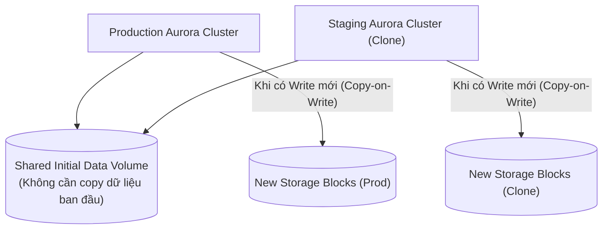

# Bài 94: RDS & Aurora - Backup and Monitoring (Sao lưu, Khôi phục và Nhân bản trên RDS & Aurora)

- **Phần (Section):** Section 9: AWS Fundamentals: RDS + Aurora + ElastiCache
- **Bài học (Lecture):** #94 (`id: 33878680`)
- **Video gốc:** `SAA_-_RDS_-_Backup_and_Monitoring_v2.mp4`
- **Thời lượng:** `05:36` (336 giây)
- **Cheat sheet:** [topics/aws_databases.html](../../topics/aws_databases.html)

---

## 1. Kiến thức trọng tâm (Exam Notes)

### 1.1. Sao lưu trên RDS vs Aurora (Automated Backups & Manual DB Snapshots)

| Tính năng | Amazon RDS | Amazon Aurora |
| :--- | :--- | :--- |
| **Automated Backups** | - Sao lưu toàn bộ mỗi ngày (Daily full backup) trong Backup window. - Sao lưu Transaction logs **mỗi 5 phút**. - Khôi phục về bất kỳ thời điểm nào (**Point-in-Time Recovery**) cho tới **5 phút trước**. - Lưu trữ từ **1 đến 35 ngày**. - **Có thể tắt** bằng cách đặt retention = `0`. | - Lưu trữ từ **1 đến 35 ngày**. - Hỗ trợ **Point-in-Time Recovery** trong khung thời gian đó. - **KHÔNG THỂ TẮT** (Cannot be disabled). |
| **Manual DB Snapshots** | - Kích hoạt thủ công bởi người dùng. - Lưu giữ **vô thời hạn** (cho tới khi bạn chủ động xóa). | - Kích hoạt thủ công bởi người dùng. - Lưu giữ **vô thời hạn** (cho tới khi bạn chủ động xóa). |

> [!TIP]
> **Mẹo tiết kiệm chi phí trong đề thi (Cost-saving Trick):**
> Nếu bạn có một RDS Database chỉ sử dụng rất ít (ví dụ **2 giờ mỗi tháng**), việc chỉ Stop DB vẫn sẽ tốn phí lưu trữ EBS hàng tháng. Giải pháp tiết kiệm chi phí nhất là: **Chụp một bản Manual Snapshot rồi xóa (Delete) RDS Database gốc**. Chi phí lưu trữ Snapshot rẻ hơn nhiều so với ổ đĩa RDS đang tồn tại; khi cần dùng lại chỉ việc **Restore Snapshot** thành DB mới.

### 1.2. Các phương thức Khôi phục (Restore Options)
1. **Khôi phục từ RDS / Aurora Backup hoặc Snapshot:** Luôn tạo ra một **cơ sở dữ liệu MỚI (creates a new database)** với một DNS Endpoint mới.
2. **Khôi phục cơ sở dữ liệu On-Premises lên RDS MySQL từ Amazon S3:**
   - Tạo bản sao lưu (backup file) của DB on-premises $\rightarrow$ tải lên **Amazon S3** $\rightarrow$ khôi phục trực tiếp từ S3 thành một **RDS MySQL instance mới**.
3. **Khôi phục cơ sở dữ liệu On-Premises lên Aurora MySQL từ Amazon S3:**
   - Tạo bản sao lưu của DB on-premises bằng phần mềm **Percona XtraBackup** $\rightarrow$ tải file lên **Amazon S3** $\rightarrow$ khôi phục từ S3 thành một **Aurora MySQL cluster mới**.

### 1.3. Aurora Database Cloning (Nhân bản nhanh cơ sở dữ liệu Aurora)
- Cho phép tạo một cụm **Aurora DB Cluster mới** từ một cụm đang có (ví dụ: tạo môi trường **Staging / Testing** từ **Production DB** để chạy thử nghiệm cả Read & Write trên dữ liệu thật).
- **Nhanh hơn rất nhiều và tiết kiệm chi phí hơn** so với việc chụp Snapshot rồi Restore.
- **Cơ chế hoạt động: Giao thức `Copy-on-Write`:**
  - Ban đầu, bản Clone **dùng chung cùng một Data Volume** với cụm Aurora Production gốc (không cần copy dữ liệu nên diễn ra gần như tức thì).
  - Chỉ khi có các cập nhật (writes/updates) mới được thực hiện trên Production hoặc trên bản Clone thì dung lượng lưu trữ bổ sung mới được cấp phát để tách riêng phần dữ liệu thay đổi đó (**Copy-on-Write**), hoàn toàn không gây ảnh hưởng tới hiệu năng của Production DB.

---

## 2. Phụ đề chi tiết theo mốc thời gian (Full Transcript & Timestamps)

| Thời gian | Nội dung lời giảng gốc (English) | Bản dịch tiếng Việt sát nghĩa |
| :--- | :--- | :--- |
| `00:00:00.120 --> 00:00:13.440` | So now let's talk about RDS Backup. So first of all, you have automated backups and what it means that this service, RDS service, will automatically do a daily full backup of the database during your database backup window. | Bây giờ hãy nói về sao lưu trên RDS (RDS Backup). Đầu tiên là sao lưu tự động (Automated backups), nghĩa là dịch vụ RDS sẽ tự động thực hiện sao lưu toàn bộ cơ sở dữ liệu hàng ngày trong khung giờ sao lưu (backup window) của bạn. |
| `00:00:13.440 --> 00:00:31.500` | But on top of it, every five minutes there's going to be the transactions log being backed-up. That means that the earliest backup you have is five minutes before now. That means that from these automated backups you can restore to any point of time up until five minutes ago. | Ngoài ra, cứ mỗi 5 phút nhật ký giao dịch (transaction logs) sẽ được sao lưu một lần. Nghĩa là bản sao lưu gần nhất bạn có cách thời điểm hiện tại 5 phút, và từ các bản sao lưu tự động này bạn có thể khôi phục về bất kỳ thời điểm nào cho tới 5 phút trước. |
| `00:00:31.500 --> 00:00:43.050` | And for the automated backup retention, you can say between one to 35 days of retention. And if you wanted to disable this feature you would set zero to disable automated backups. | Thời gian lưu giữ bản sao lưu tự động (retention) có thể đặt từ 1 đến 35 ngày. Nếu muốn tắt tính năng này trên RDS, bạn đặt giá trị bằng `0`. |
| `00:00:43.050 --> 00:01:07.920` | The second option is to do manual DB Snapshots, manual database snapshots. And these, as the name indicates, are manually triggered by the user. But the benefit of it is that this backup, that you do manually, you can retain it for as long as you want. So automated backups expire, whereas DB Snapshots that are manual can be retained for as long as you want. | Tùy chọn thứ hai là chụp DB Snapshots thủ công (Manual DB Snapshots) do người dùng chủ động kích hoạt. Lợi ích của nó là bạn có thể lưu giữ bản sao lưu thủ công này bao lâu tùy thích. Sao lưu tự động sẽ hết hạn (tối đa 35 ngày), trong khi Manual DB Snapshots được giữ lại vô thời hạn cho đến khi bạn xóa. |
| `00:01:07.920 --> 00:01:29.580` | So here is a trick. When would you use backups, obviously, to back up your data, but also if you want to save some costs. So say for example, you have an RDS database and you know that you're going to use it only two hours per month. Instead of stopping the database in which, for example, you will still have to pay for the storage even though your database is stopped. | Đây là một mẹo nhỏ: Khi nào bạn dùng Snapshots? Tất nhiên là để sao lưu dữ liệu, nhưng còn để tiết kiệm chi phí nữa. Giả sử bạn có một cơ sở dữ liệu RDS chỉ sử dụng 2 giờ mỗi tháng. Nếu bạn chỉ dừng (stop) cơ sở dữ liệu, bạn vẫn phải trả tiền cho dung lượng lưu trữ (storage) ngay cả khi DB đang dừng. |
| `00:01:29.580 --> 00:01:51.540` | What you can do is that after using it for two hours you do a snapshot and then you delete the original database. The snapshot is costing you way less than the actual storage of the RDS database. And when you're ready to use again the database you would restore the snapshot and use that. So it's a little trick and it can come up in the exam. | Thay vào đó, sau khi dùng xong 2 giờ, bạn chụp một bản Snapshot rồi xóa cơ sở dữ liệu gốc đi. Chi phí lưu Snapshot rẻ hơn rất nhiều so với dung lượng lưu trữ thực tế của RDS. Khi cần dùng lại, bạn chỉ việc khôi phục (restore) bản Snapshot đó. Đây là một mẹo hay xuất hiện trong đề thi. |
| `00:01:52.710 --> 00:02:24.810` | Now for Aurora backups, it is actually quite similar. You have automated backups from one to 35 days but they cannot be disabled. So on RDS, they could be disabled, but not on Aurora. And you have a point-in-time recovery at any point of time in that timeframe, so you can recover to whatever you want. Now for manual DB Snapshots, they can also be manually triggered by the user and you retain them for as long as you want. So you can see Aurora and RDS Backups are quite similar. | Đối với sao lưu trên Aurora, cơ chế cũng rất giống: bạn có Automated backups từ 1 đến 35 ngày nhưng **không thể tắt được** (trên RDS thì tắt được, còn Aurora thì không), kèm khả năng khôi phục về bất kỳ thời điểm nào (Point-in-time recovery). Với Manual DB Snapshots trên Aurora, người dùng cũng kích hoạt thủ công và lưu giữ bao lâu tùy ý. |
| `00:02:24.810 --> 00:02:42.450` | Now what about the restore options? The first thing is that you can restore an RDS or Aurora backup or snapshots, they're the same thing, into a new database. So anytime you restore an automated backup or a manual snapshot, then it will create a new database. | Về các tùy chọn khôi phục (Restore options): Đầu tiên, mỗi khi bạn khôi phục một bản sao lưu tự động hoặc một bản Snapshot thủ công của RDS hay Aurora, hệ thống sẽ luôn tạo ra một **cơ sở dữ liệu mới (a new database)**. |
| `00:02:42.450 --> 00:03:14.433` | The other option is that you can restore a MySQL RDS database from S3. And S3, we haven't seen it yet, it's a way to store objects in the cloud on AWS, it's a very popular service, And the idea is that you will create a backup of your on-premises database, and then you will place it onto Amazon S3, which is some object storage. And finally, there is the option in RDS to restore the backup file from Amazon S3 onto a new RDS instance running MySQL. | Tùy chọn tiếp theo là khôi phục cơ sở dữ liệu RDS MySQL từ Amazon S3 (dịch vụ lưu trữ đối tượng trên đám mây). Ý tưởng là bạn tạo một bản sao lưu của cơ sở dữ liệu tại chỗ (on-premises), tải file đó lên Amazon S3, và dùng tùy chọn trong RDS để khôi phục file backup từ S3 thành một RDS instance mới chạy MySQL. |
| `00:03:15.360 --> 00:03:40.950` | And if you wanted to, instead, restore to MySQL Aurora cluster, what you can do is that you take a backup again of your on-premises database, so externally, and then you used to use a software called Percona XtraBackup. It only works with this for now. Then the backup file of Percona XtraBackup goes onto Amazon S3. And from this you can restore the backup file onto a new Aurora cluster running MySQL. | Còn nếu bạn muốn khôi phục lên cụm **Aurora MySQL**, bạn cũng sao lưu cơ sở dữ liệu on-premises nhưng phải sử dụng phần mềm **Percona XtraBackup**, sau đó đưa file sao lưu của Percona XtraBackup lên Amazon S3 và khôi phục thành một cụm Aurora MySQL mới. |
| `00:03:40.950 --> 00:04:04.980` | So the difference here is that for restoring into RDS MySQL you just need a backup of your database for restoring into Aurora MySQL. What you need to do is to do a backup using Percona Xtrabackup, and then from S3 into your Aurora DB cluster. Okay, so those are restore options for either the snapshots or the database dumps onto Amazon S3. | Như vậy sự khác biệt là để khôi phục vào RDS MySQL bạn chỉ cần bản backup thông thường trên S3, còn để khôi phục vào Aurora MySQL bạn cần tạo bản backup bằng **Percona XtraBackup** rồi đưa qua S3. |
| `00:04:04.980 --> 00:04:38.640` | And finally, there's a last feature you need to know about called Aurora Database Cloning. So this allows you to create a new Aurora database cluster from an existing one. So say you have a production database in Aurora and you want to actually run test on it but you want to copy the data because your test application must be in a staging environment. Well, for this you're just going to clone your production Aurora database. It's going to give you a new database, and you can call it, for example, the Staging Aurora database. And it's going to be very quick. It's faster than doing a snapshot and restore. | Cuối cùng là một tính năng rất quan trọng gọi là **Aurora Database Cloning** (Nhân bản cơ sở dữ liệu Aurora), cho phép tạo một cụm Aurora mới từ một cụm hiện có. Giả sử bạn có cơ sở dữ liệu Aurora Production và muốn tạo môi trường Staging có đầy đủ dữ liệu để chạy thử nghiệm, bạn chỉ cần Clone cơ sở dữ liệu Production thành Staging Aurora DB. Quá trình này cực kỳ nhanh, nhanh hơn nhiều so với việc chụp Snapshot rồi Restore. |
| `00:04:38.640 --> 00:05:13.560` | So why, while cloning uses the copy-on-write protocol, how does that work? Well, initially, when you create a database clone it's going to be using the same data volume as the original database cluster, which is going to be fast and efficient because you don't have any copying of data. And then as the updates are being made to the production Aurora database, or to the Staging Aurora database, then new additional storage is going to be allocated and data is going to be copied and separated. So that means you have the best of both worlds. | Tại sao lại nhanh như vậy? Bởi vì tính năng Cloning sử dụng giao thức **Copy-on-Write**. Ban đầu, khi mới tạo bản Clone, nó sử dụng chung cùng một Data Volume với cụm cơ sở dữ liệu gốc nên không tốn thời gian sao chép dữ liệu. Sau đó, khi có các cập nhật được thực hiện trên DB Production hoặc trên DB Staging, dung lượng lưu trữ mới sẽ được cấp phát thêm để sao chép và tách riêng các khối dữ liệu thay đổi đó. |
| `00:05:13.560 --> 00:05:36.153` | So doing a database cloning is very fast and cost effective, and it's extremely useful to have a staging database from a production database without impacting the production database and without going through snapshot and restore features. Okay, that's it. We've seen all the options for backup and restore as well as cloning. I hope you liked it. And I will see you in the next lecture. | Nhờ vậy, việc nhân bản cơ sở dữ liệu (Database Cloning) diễn ra rất nhanh, tiết kiệm chi phí, và cực kỳ hữu ích khi cần tạo cơ sở dữ liệu Staging từ Production mà không làm ảnh hưởng đến Production DB và không cần qua bước Snapshot & Restore. Hẹn gặp lại bạn ở bài giảng tiếp theo. |
