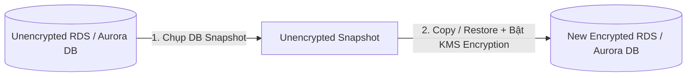

# Bài 95: RDS & Aurora Security (Bảo mật trên Amazon RDS và Aurora)

- **Phần (Section):** Section 9: AWS Fundamentals: RDS + Aurora + ElastiCache
- **Bài học (Lecture):** #95 (`id: 13528156`)
- **Video gốc:** `SAA_-_RDS_-_Security_v1.mp4`
- **Thời lượng:** `02:32` (152 giây)

---

## 1. Kiến thức trọng tâm (Exam Notes)

### 1.1. Mã hóa dữ liệu (Encryption At-Rest & In-Flight)
- **At-Rest Encryption (Mã hóa dữ liệu lưu trữ trên ổ đĩa):**
  - Mã hóa cả Master và mọi Replicas bằng **AWS KMS (Key Management Service)**, được định nghĩa ngay tại thời điểm khởi tạo (launch time).
  - **Quy tắc quan trọng:** Nếu **Master database KHÔNG được mã hóa**, thì các **Read Replicas KHÔNG THỂ được mã hóa**.
  - **Cách mã hóa một DB đang chưa được mã hóa (Unencrypted DB -> Encrypted DB):**
    1. Chụp một bản **DB Snapshot** của cơ sở dữ liệu chưa mã hóa đó.
    2. Sao chép (Copy) hoặc Khôi phục (**Restore**) bản Snapshot đó thành một cơ sở dữ liệu mới có **bật tính năng mã hóa (Encrypted)**.
- **In-Flight Encryption (Mã hóa dữ liệu trên đường truyền):**
  - Mặc định mọi cơ sở dữ liệu RDS và Aurora đều hỗ trợ sẵn mã hóa đường truyền (**TLS/SSL**). Client sử dụng **AWS TLS root certificates** khi kết nối.

### 1.2. Xác thực, Kiểm soát mạng & Audit Logs
- **Database Authentication (Xác thực người dùng):**
  1. **Username & Password** truyền thống.
  2. **IAM Database Authentication:** Cho phép EC2 instances (thông qua IAM Role) hoặc IAM Users xác thực trực tiếp vào RDS/Aurora mà không cần dùng mật khẩu tĩnh.
- **Network Access Control:** Sử dụng **Security Groups** để kiểm soát cổng (ports), IP hoặc Security Group nguồn được phép kết nối vào DB.
- **Access Management (SSH):** Không có quyền truy cập SSH vào RDS và Aurora (ngoại trừ **RDS Custom**).
- **Audit Logs (Nhật ký kiểm toán):**
  - Có thể bật **Audit Logs** để theo dõi các truy vấn được thực hiện trên RDS và Aurora.
  - Vì nhật ký trên DB sẽ bị xóa sau một thời gian ngắn, để **lưu trữ lâu dài (long-term retention)** bạn cần cấu hình gửi chúng sang **Amazon CloudWatch Logs**.

---

## 2. Phụ đề chi tiết theo mốc thời gian (Full Transcript & Timestamps)

| Thời gian | Nội dung lời giảng gốc (English) | Bản dịch tiếng Việt sát nghĩa |
| :--- | :--- | :--- |
| `00:00:00.210 --> 00:00:05.550` | Now, here is a quick lecture around RDS and Aurora Security. | Bây giờ là một bài giảng ngắn xoay quanh bảo mật trên RDS và Aurora. |
| `00:00:05.550 --> 00:00:24.390` | So you can encrypt the data at-rest on your RDS and Aurora database. That means that the data is encrypted on the volumes. For this, you will be having the master and any replica encrypted using KMS. And this is defined at launch time during the first launch of your database. | Bạn có thể mã hóa dữ liệu lúc nghỉ (at-rest) trên cơ sở dữ liệu RDS và Aurora, nghĩa là dữ liệu được mã hóa trên các ổ đĩa lưu trữ. Khi đó, cả Master và mọi bản sao (Replicas) đều được mã hóa bằng AWS KMS, và cài đặt này được xác định ngay tại thời điểm khởi tạo đầu tiên của cơ sở dữ liệu. |
| `00:00:24.390 --> 00:00:31.650` | If somehow you haven't encrypted the master database, the main database, then the read replicas cannot be encrypted. | Nếu vì lý do nào đó bạn chưa mã hóa cơ sở dữ liệu Master (cơ sở dữ liệu chính), thì các Read Replicas cũng **không thể** được mã hóa. |
| `00:00:31.650 --> 00:00:50.280` | Also, if you wanted to encrypt an already existing unencrypted database, what you would have to do is to take a database snapshot from that un-encrypted database, and then you restore that database snapshot as an encrypted database. Okay? So you have to go through a snapshot and restore operation. | Ngoài ra, nếu bạn muốn mã hóa một cơ sở dữ liệu hiện có đang chưa được mã hóa, bạn phải chụp một bản DB Snapshot từ cơ sở dữ liệu chưa mã hóa đó, sau đó sao chép/khôi phục bản Snapshot đó thành một cơ sở dữ liệu mới được bật mã hóa. Tức là bạn phải đi qua thao tác Snapshot và Restore. |
| `00:00:50.280 --> 00:01:11.133` | So this is for at-rest encryption. Then you have in-flight encryption. So between your clients and your database. So each database on RDS and Aurora is ready to have in-flight encryption by default. And so therefore, your clients must use the TLS root certificates from AWS. They're provided on the AWS website. | Tiếp theo là mã hóa trên đường truyền (in-flight encryption) giữa trình khách (clients) và cơ sở dữ liệu. Mặc định mọi cơ sở dữ liệu trên RDS và Aurora đều sẵn sàng hỗ trợ mã hóa đường truyền; trình khách chỉ cần sử dụng các chứng chỉ gốc TLS (TLS root certificates) do AWS cung cấp. |
| `00:01:12.390 --> 00:01:39.030` | In terms of database authentication. Because this is RDS and Aurora, you can use the classic combo of username and password. But because it says AWS, you can also use IAM roles to connect to your database. That means that's, for example, if you're EC2 instances had IAM roles, they can authenticate to your database directly using that and not a username and a password, which can help you manage all the security within AWS and IAM. | Về xác thực cơ sở dữ liệu (Database authentication): Bạn có thể dùng bộ đôi truyền thống là Username và Password. Nhưng vì đây là AWS, bạn cũng có thể dùng **IAM Roles** (hoặc IAM Users) để kết nối vào cơ sở dữ liệu. Ví dụ nếu các EC2 instances của bạn có gắn IAM Role, chúng có thể xác thực trực tiếp vào cơ sở dữ liệu bằng IAM Role đó mà không cần username và password, giúp quản lý bảo mật tập trung trong AWS IAM. |
| `00:01:39.030 --> 00:01:49.800` | You can also control network access to your database using security groups. So you can allow or block specific ports, specific IP, specific security groups. | Bạn cũng có thể kiểm soát quyền truy cập mạng vào cơ sở dữ liệu bằng **Security Groups** để cho phép hoặc chặn các cổng, địa chỉ IP hoặc các Security Groups cụ thể. |
| `00:01:49.800 --> 00:02:00.920` | And then finally RDS and Aurora do not have SSH access, of course, because they're managed services, except if you use the RDS custom service from AWS. | Cuối cùng, RDS và Aurora tất nhiên không có quyền truy cập SSH vì chúng là dịch vụ được quản lý, ngoại trừ trường hợp bạn sử dụng dịch vụ **RDS Custom** của AWS. |
| `00:02:01.560 --> 00:02:24.210` | And if you wanted Audit Logs. So to know what queries are being made on RDS and Aurora over time and what's happening on databases, you can enable Audit Logs. And then they will be lost after a bit of time. Therefore, if you wanted to keep them for a long period of time, what you need to do is to send them into a dedicated service called the CloudWatch Logs service on AWS. | Nếu bạn muốn có nhật ký kiểm toán (**Audit Logs**) để biết những câu truy vấn nào đang được thực hiện trên RDS và Aurora theo thời gian, bạn có thể bật Audit Logs. Vì chúng sẽ bị mất sau một khoảng thời gian ngắn trên DB, nên nếu muốn lưu giữ lâu dài, bạn cần gửi chúng sang dịch vụ **Amazon CloudWatch Logs**. |
| `00:02:24.210 --> 00:02:32.400` | So that's it for the short lecture on the summary options for security, for RDS and Aurora. I hope you liked it. And I will see you in the next lecture. | Đó là tất cả cho bài giảng ngắn tổng hợp các tùy chọn bảo mật trên RDS và Aurora. Hẹn gặp lại bạn ở bài giảng tiếp theo. |
