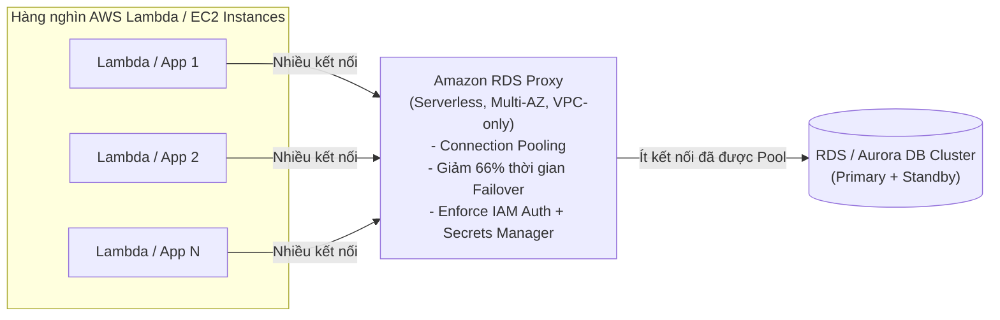

# Bài 96: Amazon RDS Proxy (Quản lý kết nối CSDL với Amazon RDS Proxy)

- **Phần (Section):** Section 9: AWS Fundamentals: RDS + Aurora + ElastiCache
- **Bài học (Lecture):** #96 (`id: 33878690`)
- **Video gốc:** `SAA_-_RDS_-_RDS_Proxy_v2.mp4`
- **Thời lượng:** `04:32` (272 giây)
- **Cheat sheet:** [topics/aws_databases.html](../../topics/aws_databases.html)

---

## 1. Kiến thức trọng tâm (Exam Notes)

> [!TIP]
> **Tóm tắt nhanh dịch vụ Amazon RDS Proxy (SAA-C03 Cheat Sheet)**
> - **Là gì:** Dịch vụ quản lý tập trung và chia sẻ các kết nối cơ sở dữ liệu (**Fully Managed, Serverless Database Connection Pooling**) cho RDS và Aurora.
> - **Dùng khi nào (Use case điển hình trong đề):** Khi hàng trăm/nghìn hàm **AWS Lambda** đồng thời mở kết nối mới làm cạn kiệt tài nguyên kết nối (`Too many connections` / `Connection timeouts`) của RDS/Aurora, hoặc khi cần **giảm tới 66% thời gian Failover** và bắt buộc xác thực **IAM Authentication + AWS Secrets Manager**.
> - **Khác gì dịch vụ gần giống:**
>   - **RDS Proxy vs. ElastiCache:** `RDS Proxy` gộp và tái sử dụng **kết nối mạng tới DB (Connection Pooling)** mà **không cần sửa code ứng dụng** (chỉ đổi connection endpoint); `ElastiCache` lưu bộ nhớ đệm cho **dữ liệu kết quả truy vấn** và đòi hỏi sửa code ứng dụng.
> - **Điểm hay bị hỏi (Giới hạn, Mặc định, Từ khóa gợi ý):**
>   - **Mặc định:** RDS Proxy **chỉ truy cập được từ bên trong VPC** (không bao giờ truy cập công khai từ Internet).
>   - **Từ khóa gợi ý:** `"Lambda functions exhausting database connections"`, `"connection pooling"`, `"reduce RDS/Aurora failover time by up to 66%"` $\rightarrow$ **Amazon RDS Proxy**.

### 1.1. Amazon RDS Proxy là gì và giải quyết vấn đề gì?
- **Amazon RDS Proxy** là một Database Proxy được quản lý hoàn toàn (Fully managed), **Serverless**, **Auto-scaling**, và có tính sẵn sàng cao (**Highly Available - Multi-AZ**).
- **3 Lợi ích cốt lõi cần nhớ cho kỳ thi SAA-C03:**
  1. **Gộp và chia sẻ kết nối (Connection Pooling & Sharing):**
     - Thay vì để hàng trăm/hàng nghìn ứng dụng mở kết nối trực tiếp vào RDS DB instance, ứng dụng kết nối vào **RDS Proxy**; Proxy sẽ gộp (pool) chúng lại thành ít kết nối hơn tới DB chính.
     - Giúp cải thiện hiệu suất DB (giảm tải CPU & RAM trên DB) và giảm thiểu tình trạng quá nhiều kết nối mở (open connections) hoặc lỗi hết thời gian chờ (**connection timeouts**).
  2. **Giảm thời gian Failover lên tới 66% (Reduce Failover Time by up to 66%):**
     - Khi RDS hoặc Aurora chuyển đổi dự phòng (failover) từ Primary sang Standby instance, RDS Proxy giữ nguyên kết nối với ứng dụng và tự động xử lý việc điều hướng sang instance mới ở phía sau, giúp giảm thời gian gián đoạn failover tới **66%**.
  3. **Bắt buộc xác thực IAM & Lưu trữ thông tin đăng nhập trong Secrets Manager:**
     - Có thể bắt buộc (**enforce**) sử dụng **IAM Authentication** cho cơ sở dữ liệu và lưu trữ an toàn thông tin đăng nhập (DB credentials) trong **AWS Secrets Manager**.

### 1.2. Đặc điểm kỹ thuật & Use Case với AWS Lambda
- **Hỗ trợ các Database Engines:** MySQL, PostgreSQL, MariaDB, Microsoft SQL Server, và Aurora (MySQL & PostgreSQL). *(Không yêu cầu thay đổi mã nguồn ứng dụng, chỉ cần đổi chuỗi kết nối trỏ sang endpoint của RDS Proxy).*
- **Bảo mật mạng:** RDS Proxy **KHÔNG BAO GIỜ có thể truy cập công khai từ Internet (Never publicly accessible)** — nó chỉ có thể được truy cập từ **bên trong VPC**.
- **Use Case kinh điển: AWS Lambda + RDS Proxy:**
  - Các hàm **AWS Lambda** có thể nhân bản (scale out) lên hàng trăm/hàng nghìn instances chỉ trong tích tắc, liên tục mở và đóng kết nối tới cơ sở dữ liệu.
  - Nếu Lambda kết nối trực tiếp vào RDS sẽ làm cạn kiệt kết nối và gây timeout. Giải pháp chuẩn là đặt **RDS Proxy** ở giữa để **gộp kết nối (pool connections)** từ các hàm Lambda.

---

## 2. Phụ đề chi tiết theo mốc thời gian (Full Transcript & Timestamps)

| Thời gian | Nội dung lời giảng gốc (English) | Bản dịch tiếng Việt sát nghĩa |
| :--- | :--- | :--- |
| `00:00:00.270 --> 00:00:12.030` | So now, let's talk Amazon RDS Proxy. So we know we can deploy our RDS database within our VPC, but now we can also deploy a fully managed database proxy for RDS. | Bây giờ hãy nói về Amazon RDS Proxy. Chúng ta biết rằng có thể triển khai cơ sở dữ liệu RDS bên trong VPC, nhưng giờ đây chúng ta còn có thể triển khai một database proxy được quản lý hoàn toàn dành cho RDS. |
| `00:00:12.030 --> 00:00:28.230` | So you may say, "Okay, we can access our RDS database directly. Why do we need a proxy to access our database?" Well, if you use an As an RDS Proxy, this will allow you, your application, to pool and share the database connections established with the database. | Bạn có thể hỏi: "Chúng ta có thể truy cập trực tiếp vào cơ sở dữ liệu RDS, vậy tại sao lại cần một proxy?" Lý do là khi sử dụng RDS Proxy, nó cho phép ứng dụng của bạn gộp (pool) và chia sẻ các kết nối cơ sở dữ liệu được thiết lập tới database. |
| `00:00:28.230 --> 00:00:42.180` | So instead of having every single application connect to your RDS database instance, they will be instead connecting to the proxy, and the proxy will pool these connections together into less connections to the RDS database instance. | Thay vì để từng ứng dụng riêng lẻ kết nối thẳng vào RDS database instance, chúng sẽ kết nối vào RDS Proxy, và Proxy sẽ gộp các kết nối này lại thành ít kết nối hơn đi vào RDS database instance. |
| `00:00:42.180 --> 00:01:03.240` | So why may you do this? Well, this makes a lot of sense if you have a lot of connections into your RDS database instance, and it's going to improve your database efficiency by reducing the stress on database resources, for example, CPU and RAM, and also minimize the open connections and the timeouts into your database. So that's one thing you need to look out for from the exam perspective. | Tại sao chúng ta làm vậy? Điều này cực kỳ hợp lý khi bạn có rất nhiều kết nối đi vào RDS database instance; nó giúp cải thiện hiệu quả cơ sở dữ liệu bằng cách giảm áp lực lên tài nguyên DB (như CPU và RAM), đồng thời giảm thiểu số lượng kết nối mở và lỗi hết thời gian chờ (timeouts). Đó là điểm đầu tiên cần chú ý cho kỳ thi. |
| `00:01:03.240 --> 00:01:34.560` | Now, as I said, the RDS Proxy is fully serverless. It's auto scaling, so you don't need to manage its capacity. And it's highly available. It's across multiple AZ. And therefore, in case, for example, there is a failover that happens on your RDS database instance. For example, it goes from the primary instance to the standby instance, then it will, thanks to the RDS Proxy, reduce the failover time by up to 66%. So this is true for RDS and Aurora. | RDS Proxy hoàn toàn là Serverless, tự động mở rộng (auto-scaling) nên bạn không cần quản lý dung lượng của nó, và có tính sẵn sàng cao trên nhiều AZ. Nhờ vậy, khi có quá trình chuyển đổi dự phòng (failover) diễn ra trên RDS hoặc Aurora (từ Primary sang Standby instance), RDS Proxy giúp giảm thời gian failover lên tới **66%**. |
| `00:01:34.560 --> 00:01:58.410` | So again, instead of having all your applications connect to the main RDS database instance and then handle the feller themselves, they will just connect to the RDS Proxy, which does not know any failover. And the RDS Proxy will, itself, handle the failover of the RDS database instance, therefore improving your failover time. So something else you need to look for from an exam perspective. | Thay vì để tất cả các ứng dụng kết nối vào RDS DB chính và tự xử lý khi có failover, các ứng dụng chỉ cần kết nối tới RDS Proxy, và chính RDS Proxy sẽ đứng ra xử lý việc failover của cơ sở dữ liệu ở phía sau, giúp rút ngắn đáng kể thời gian chuyển đổi dự phòng. |
| `00:01:58.410 --> 00:02:21.540` | So the RDS Proxy supports MySQL, PostgreSQL, MariaDB, Microsoft SQL Server, as well as Aurora for MySQL and PostgreSQL. It doesn't require you to do any code change in your application. Just instead of connecting to your RDS database instance or your Aurora database, you'd now just connect to your RDS Proxy and you are done. | RDS Proxy hỗ trợ MySQL, PostgreSQL, MariaDB, Microsoft SQL Server, cũng như Aurora (MySQL và PostgreSQL). Nó không yêu cầu bạn phải thay đổi bất kỳ dòng code nào trong ứng dụng — chỉ cần đổi địa chỉ kết nối sang RDS Proxy là xong. |
| `00:02:21.540 --> 00:02:46.770` | On top of it, there's a third advantage to using an RDS Proxy. It is to enforce IAM authentication for your database. So to make sure that people can only connect to your RDS database instance using IAM. And then these credentials can be securely stored in another service called the AWS Secrets Manager. So again, if you need to see a way to enforce IAM authentication for your database, think RDS Proxy. | Ngoài ra còn có lợi thế thứ ba khi dùng RDS Proxy: bạn có thể bắt buộc (enforce) xác thực bằng IAM đối với cơ sở dữ liệu (chỉ cho phép kết nối qua IAM), và lưu trữ an toàn thông tin xác thực DB trong dịch vụ **AWS Secrets Manager**. Nếu đề bài hỏi cách bắt buộc xác thực IAM cho cơ sở dữ liệu, hãy nghĩ ngay tới RDS Proxy. |
| `00:02:46.770 --> 00:02:58.530` | And finally, the RDS Proxy is never publicly accessible. So it's only accessible from within your VPC. So you cannot connect over the internet to your RDS Proxy, which is enhanced security. | Và cuối cùng, RDS Proxy không bao giờ có thể truy cập công khai (never publicly accessible) — nó chỉ có thể được truy cập từ bên trong VPC của bạn, không thể kết nối trực tiếp qua Internet, giúp tăng cường bảo mật. |
| `00:02:58.530 --> 00:03:36.660` | And so one service we haven't seen that is going for sure to be very helped by the RDS Proxy is called the Lambda functions. And the Lambda functions, they will execute pieces of code. We'll see them later on in this course. Okay, you don't need to know them right now, but we have to tackle them right now because of the RDS Proxy feature. And so the Lambda functions, they can multiply, multiply many, many times. And they will appear and disappear very, very fast. And therefore, imagine you have 100 or 1,000 Lambda functions appearing and disappearing just like that, and opening up connections into your RDS database instance, they will be a big problem because it will leave open connections and timeouts, and it will be a mess. | Một dịch vụ được hưởng lợi rất lớn từ RDS Proxy là **AWS Lambda functions**. Các hàm Lambda thực thi mã nguồn và có thể nhân bản lên hàng trăm, hàng nghìn lần, xuất hiện rồi biến mất cực kỳ nhanh. Hãy tưởng tượng có 100 hay 1.000 hàm Lambda liên tục bật tắt và mở kết nối trực tiếp vào RDS database instance — điều đó sẽ gây ra vấn đề lớn với hàng loạt kết nối treo và lỗi timeout. |
| `00:03:36.660 --> 00:04:06.150` | And therefore what you do is that you use the RDS Proxy to pool connections for your Lambda functions, and then the Lambda functions will overload the RDS Proxy, but it's meant to be overload. And the RDS Proxy will pool these connections into less connections to the RDS database instance, thus, solving your problems, okay? So that's it for this lecture. I hope you liked it. And don't worry, we'll review the proxy once again once we go into the Lambda lectures. | Giải pháp là sử dụng RDS Proxy để gộp kết nối cho các hàm Lambda. Các hàm Lambda sẽ đổ kết nối vào RDS Proxy (vốn được thiết kế để chịu tải đó), và RDS Proxy sẽ gộp chúng lại thành ít kết nối hơn đi vào RDS database instance, giải quyết triệt để vấn đề. |
| `00:04:06.150 --> 00:04:32.310` | But again, RDS Proxy is used to minimize and pool connections on your RDS database instance. It's also used to minimize failover time and reduce it by up to 66%. And also, it's used to enforce IAM authentication for your database and to securely store its credentials in the Secrets Manager service. All right, that's it. I hope you liked it. And I will see you in the next lecture. | Tóm lại, RDS Proxy được dùng để giảm thiểu và gộp kết nối vào RDS DB, giảm thời gian failover lên tới 66%, bắt buộc xác thực IAM và lưu trữ thông tin đăng nhập an toàn trong AWS Secrets Manager. Hẹn gặp lại bạn ở bài giảng tiếp theo. |
