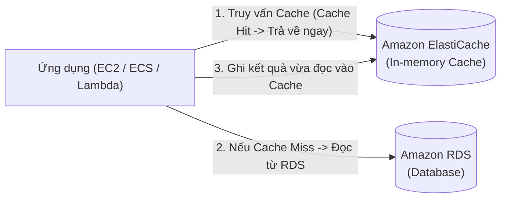

# Bài 97: ElastiCache Overview (Tổng quan về Amazon ElastiCache: Redis vs Memcached)

- **Phần (Section):** Section 9: AWS Fundamentals: RDS + Aurora + ElastiCache
- **Bài học (Lecture):** #97 (`id: 13528166`)
- **Video gốc:** `SAA_-_ElastiCache_-_Overview_v4.mp4`
- **Thời lượng:** `04:42` (282 giây)

---

## 1. Kiến thức trọng tâm (Exam Notes)

> [!TIP]
> **Tóm tắt nhanh dịch vụ Amazon ElastiCache (SAA-C03 Cheat Sheet)**
> - **Là gì:** Dịch vụ cơ sở dữ liệu và bộ nhớ đệm trên RAM được quản lý hoàn toàn (**Managed In-Memory Data Store & Cache**) hỗ trợ hai engine là **Redis** và **Memcached** với độ trễ dưới một phần nghìn giây (sub-millisecond).
> - **Dùng khi nào (Use case điển hình trong đề):** Giảm tải đọc lặp đi lặp lại cho RDS/Aurora (**Lazy Loading / Write-Through**), lưu trữ phiên đăng nhập người dùng (**Stateless User Session Store**), hoặc tạo bảng xếp hạng thời gian thực (**Gaming Leaderboards**).
> - **Khác gì dịch vụ gần giống:**
>   - **ElastiCache for Redis vs. Memcached:**
>     - **`Redis`:** Hỗ trợ **Multi-AZ với Auto-Failover**, **Read Replicas**, sao lưu bền vững (**Backup & Restore**), **HIPAA compliant**, **Redis AUTH / IAM Auth**, và cấu trúc **`Sorted Sets`** (cho **Gaming Leaderboards**).
>     - **`Memcached`:** Kiến trúc phân mảnh đa luồng thuần túy (**Multi-threaded, Sharding**), **KHÔNG có High Availability**, **KHÔNG có Backup/Restore**.
>   - **ElastiCache vs. DAX (DynamoDB Accelerator):** `DAX` chỉ dành riêng cho DynamoDB; `ElastiCache` dùng cho RDS, Aurora và các nhu cầu cache đa dụng (nhưng đòi hỏi sửa code ứng dụng).
> - **Điểm hay bị hỏi (Giới hạn, Mặc định, Từ khóa gợi ý):**
>   - **Từ khóa gợi ý:** `"in-memory cache to offload RDS reads"`, `"store user session state to make EC2 stateless"` $\rightarrow$ **ElastiCache**; `"real-time gaming leaderboards"` $\rightarrow$ **ElastiCache for Redis (Sorted Sets)**.

### 1.1. Amazon ElastiCache là gì?
- Giống như RDS dùng để quản lý cơ sở dữ liệu quan hệ (Relational Databases), **Amazon ElastiCache** là dịch vụ quản lý **Redis (hoặc Valkey)** và **Memcached**.
- **Cache (Bộ nhớ đệm)** là các cơ sở dữ liệu lưu trữ trên bộ nhớ RAM (**in-memory databases**) có hiệu năng cực cao (high performance) và độ trễ cực thấp (low latency - dưới mili-giây).
- **2 Công dụng chính trong kiến trúc AWS (Cực kỳ quan trọng cho kỳ thi):**
  1. **Giảm tải cho cơ sở dữ liệu (Reduce load off of databases)** đối với các tải công việc đọc nhiều (**read-intensive workloads**): Lưu kết quả các câu truy vấn phổ biến vào Cache.
  2. **Làm cho ứng dụng trở nên phi trạng thái (Make applications Stateless):** Lưu trữ trạng thái phiên đăng nhập của người dùng (**User Session State**) vào Amazon ElastiCache để bất kỳ EC2 instance nào cũng có thể đọc được phiên làm việc đó.
- **Lợi ích Managed Service:** AWS lo việc bảo trì OS, vá lỗi (patching), tối ưu hóa, cài đặt, cấu hình, giám sát, phục hồi lỗi và sao lưu.
- **Lưu ý quan trọng:** Việc áp dụng ElastiCache **ĐÒI HỎI thay đổi mã nguồn ứng dụng đáng kể (requires heavy application code changes)** vì ứng dụng phải được lập trình để chủ động kiểm tra Cache trước/sau khi truy vấn Database (không giống như RDS Proxy chỉ cần đổi connection string).

### 1.2. Hai mẫu kiến trúc điển hình của ElastiCache
1. **DB Cache (Cache Hit vs Cache Miss):**
   - Ứng dụng truy vấn ElastiCache trước:
     - Nếu có dữ liệu (**Cache Hit**): Lấy kết quả trả về ngay, tiết kiệm một lượt truy vấn vào RDS.
     - Nếu chưa có dữ liệu (**Cache Miss**): Ứng dụng đọc dữ liệu từ RDS, sau đó ghi dữ liệu đó vào ElastiCache để các lần truy vấn tiếp theo đạt Cache Hit.
   - Cần có chiến lược xóa/làm mới bộ nhớ đệm (**Cache invalidation strategy**) để đảm bảo dữ liệu trong Cache không bị lỗi thời.
2. **User Session Store (Stateless Application):**
   - Người dùng đăng nhập $\rightarrow$ EC2 instance ghi dữ liệu Session vào ElastiCache.
   - Khi người dùng được điều hướng sang một EC2 instance khác $\rightarrow$ EC2 mới lấy trực tiếp Session từ ElastiCache $\rightarrow$ người dùng vẫn giữ trạng thái đăng nhập mà không cần bật Sticky Sessions trên Load Balancer.

### 1.3. So sánh Redis vs Memcached (Trọng tâm đề thi SAA-C03)

| Tiêu chí | ElastiCache for Redis (Valkey / Redis OSS) | ElastiCache for Memcached |
| :--- | :--- | :--- |
| **Độ sẵn sàng cao (HA)** | **Multi-AZ với Auto-Failover** | **Không** có Multi-AZ / Không tự động Failover (trừ bản Serverless) |
| **Mở rộng đọc (Read Scaling)** | Hỗ trợ **Read Replicas** để mở rộng đọc & tăng HA | **Không** có Replication |
| **Độ bền dữ liệu (Durability)** | Bền vững dữ liệu nhờ **AOF persistence** (Append-Only File) | **Không** lưu trữ bền vững (Mất node là mất cache) |
| **Sao lưu & Khôi phục** | Hỗ trợ đầy đủ **Backup and Restore** | Chỉ hỗ trợ trên bản Serverless (không hỗ trợ trên bản tự quản lý node) |
| **Kiểu dữ liệu nâng cao** | Hỗ trợ **Sets** và **Sorted Sets** (dùng cho **Gaming Leaderboards**) | Key-Value đơn giản, không hỗ trợ Sorted Sets |
| **Kiến trúc phân vùng** | Nhân bản từ Primary sang Read Replicas (hoặc Cluster Shards) | Phân mảnh dữ liệu trên nhiều nodes (**Multi-node Sharding**), kiến trúc đa luồng (**Multi-threaded**) |

---

## 2. Phụ đề chi tiết theo mốc thời gian (Full Transcript & Timestamps)

| Thời gian | Nội dung lời giảng gốc (English) | Bản dịch tiếng Việt sát nghĩa |
| :--- | :--- | :--- |
| `00:00:00.270 --> 00:00:12.870` | Let's talk about Amazon ElastiCache. So the same way you get RDS to have managed relational databases, ElastiCache is going to help you get managed Redis or Memcached, which are cache technologies. | Hãy nói về Amazon ElastiCache. Giống như cách bạn dùng RDS để có các cơ sở dữ liệu quan hệ được quản lý, ElastiCache giúp bạn có được **Redis** hoặc **Memcached** được quản lý — đây là các công nghệ bộ nhớ đệm (cache). |
| `00:00:12.870 --> 00:00:27.720` | So what are caches? Well, they are in-memory databases with really high performance and low latency. And what the cache will help you with is to help reduce the load off of databases for read-intensive workloads. | Vậy bộ nhớ đệm (caches) là gì? Chúng là các cơ sở dữ liệu lưu trên bộ nhớ RAM (in-memory databases) với hiệu năng cực cao và độ trễ cực thấp. Cache giúp giảm tải cho cơ sở dữ liệu chính đối với các khối lượng công việc thiên về đọc (read-intensive workloads). |
| `00:00:27.720 --> 00:00:37.920` | The idea is that the common queries are going to be cached, and therefore, your database will not be queried every time. Just your cache can be used to retrieve the results of these queries. | Ý tưởng là các câu truy vấn phổ biến sẽ được lưu vào bộ nhớ đệm, do đó cơ sở dữ liệu của bạn không bị truy vấn lặp đi lặp lại mỗi lần nữa mà chỉ cần lấy kết quả trực tiếp từ cache. |
| `00:00:37.920 --> 00:00:45.450` | What this also helps you do is make your application stateless by putting the state of your application into Amazon ElastiCache. | Nó cũng giúp biến ứng dụng của bạn thành phi trạng thái (stateless) bằng cách đưa trạng thái (state) của ứng dụng vào lưu trong Amazon ElastiCache. |
| `00:00:45.450 --> 00:00:58.320` | And because we have the same benefits for RDS, AWS will take the same maintenance of the operating system, the patching, the optimization, the setup, configuration, monitoring, failure recovery, and backups. | Và tương tự như lợi ích của RDS, AWS sẽ đảm nhận việc bảo trì hệ điều hành, vá lỗi, tối ưu hóa, thiết lập, cấu hình, giám sát, khôi phục sau sự cố và sao lưu. |
| `00:00:58.320 --> 00:01:16.983` | Now, if you use Amazon ElastiCache, just so you know that it will require you to do some heavy application code changes for your application. This is not something you just enable, and off you go, you have a cache. You need to change your application to query the cache before or after querying the database and we'll see the strategies in a minute. | Lưu ý rằng việc sử dụng Amazon ElastiCache đòi hỏi bạn phải thay đổi mã nguồn ứng dụng khá nhiều (heavy application code changes). Đây không phải là tính năng chỉ cần bật lên là tự động chạy; bạn phải sửa code ứng dụng để truy vấn vào cache trước hoặc sau khi truy vấn cơ sở dữ liệu. |
| `00:01:18.210 --> 00:01:47.490` | So now let's talk about the architecture for using ElastiCache. And there can be many, but I'm just giving you an example. So, let's say we have Amazon ElastiCache and RDS database and your application. The application will query ElastiCache to see if the query are already being made. And if this has already been made and it is stored in ElastiCache, then it's called a cache hit, and then it just gets the answer straight from Amazon ElastiCache and we're saving a trip to the database to do the query. | Hãy xem kiến trúc sử dụng ElastiCache cùng với RDS và ứng dụng. Ứng dụng sẽ truy vấn ElastiCache trước để xem truy vấn đó đã từng được thực hiện và lưu trong ElastiCache chưa. Nếu đã có sẵn trong ElastiCache, trường hợp đó gọi là **Cache Hit** — ứng dụng lấy câu trả lời thẳng từ ElastiCache và tiết kiệm được một chuyến truy vấn vào cơ sở dữ liệu. |
| `00:01:47.490 --> 00:02:11.130` | Now, in case of a cache miss, then we need to fetch the data from the database. We're going to read it from the database. And then for other application or other instances where the same query will be made, we can write the data back into the cache so that such as the same query next time will result in a cache hit. The idea is that it will help to relieve load from your RDS database. | Ngược lại, trong trường hợp **Cache Miss** (chưa có dữ liệu trong cache), ứng dụng sẽ đọc dữ liệu từ cơ sở dữ liệu RDS, sau đó ghi dữ liệu đó ngược vào lại cache để lần tới khi có cùng truy vấn đó sẽ đạt được Cache Hit. Cơ chế này giúp giảm tải đáng kể cho cơ sở dữ liệu RDS. |
| `00:02:11.130 --> 00:02:24.360` | And because you're storing data in the cache, there must be a cache invalidation strategy to make sure that only the most current data is used in there. And this is the whole difficulty around using caching technologies. | Vì bạn lưu trữ dữ liệu trong cache, cần phải có một chiến lược làm mới/vô hiệu hóa cache (cache invalidation strategy) để đảm bảo chỉ dữ liệu mới nhất được sử dụng. |
| `00:02:24.360 --> 00:02:59.310` | Another architecture is around storing the user session to make your application stateless. So the idea is that your user will do login into any kind of your applications, and then the application will write the session data into Amazon ElastiCache. Now, if your user is redirected to another instance of your application, then your application can retrieve the session case, the session directly from the Amazon ElastiCache, and therefore your user is still logged in and it doesn't need to log in one more time. And so the idea is that now you made your application stateless by writing the session data of your user into Amazon ElastiCache. | Một kiến trúc phổ biến khác là lưu trữ phiên làm việc của người dùng (User Session) để giúp ứng dụng trở nên phi trạng thái (stateless). Khi người dùng đăng nhập vào bất kỳ instance nào của ứng dụng, ứng dụng sẽ ghi dữ liệu phiên (session data) vào Amazon ElastiCache. Nếu sau đó người dùng được chuyển hướng sang một instance khác, instance mới đó có thể lấy trực tiếp dữ liệu phiên từ ElastiCache, nhờ vậy người dùng vẫn duy trì đăng nhập mà không cần đăng nhập lại. |
| `00:02:59.310 --> 00:03:27.990` | So if we compare Redis and Memcached, so for Redis we have multi-availability zone with auto-failover as a feature, and you can create read replicas to scale the reads and have high availability. You also get data durability using AOF persistence, and you have a backup and restore features on the open source version of Redis. It also supports sets and sorted sets, which are a very nice way to create leaderboards and provide you with some very nice features in a cache. | Khi so sánh **Redis** và **Memcached**: Đối với **Redis**, chúng ta có Multi-AZ kèm tự động chuyển đổi dự phòng (Auto-Failover), có thể tạo các Read Replicas để mở rộng việc đọc và tăng tính sẵn sàng cao. Bạn cũng có độ bền dữ liệu (data durability) nhờ cơ chế AOF persistence, có tính năng sao lưu và khôi phục (Backup and Restore), và hỗ trợ Sets cùng **Sorted Sets** — cực kỳ lý tưởng để tạo bảng xếp hạng (**Leaderboards**). |
| `00:03:27.990 --> 00:03:41.220` | So the way I like to think of Redis is a Redis node being replicated into another one to give you an idea of how it works. Of course, Redis is evolving fast and this may not be general, but this is a simplification. | Cách dễ hình dung nhất về Redis là một node chính được sao chép (replicated) sang một node dự phòng khác. |
| `00:03:41.220 --> 00:04:19.140` | And for memcached, the idea is that you have a multiple nodes set up and they're partitioning your data. That means it's called charting so you have multiple nodes together. And there's no high availability, there's no replication. Again, not everything may be true, for example, for the serverless version of of memcached, but I'm just trying to draw a simple image here. It's not personal data. So if you have an issue with memcached, you may lose your entire cache and you have backup and restore features only for the serverless version of memcached, not the self-managed version of memcached on ElastiCache. You also have a multi-thread architecture, which may be good for performance. | Còn đối với **Memcached**, ý tưởng là bạn có nhiều nodes cùng phân vùng dữ liệu (data partitioning / sharding). Không có tính sẵn sàng cao (no high availability), không có sao chép (no replication), và dữ liệu không bền vững (not persistent) — nếu gặp sự cố bạn có thể mất dữ liệu cache (Backup & Restore chỉ có trên bản Serverless của Memcached chứ không có trên bản quản lý theo node thông thường). Memcached có kiến trúc đa luồng (multi-threaded architecture). |
| `00:04:19.140 --> 00:04:42.333` | So the way I like to think of memcached is they're sharding so you have multiple nodes next to each other, which are partitioning, which are sharing the data, okay? So the exam may not ask you many questions or any question about choosing Redis versus Memcached but it's good for you to know as a reference point based on the use case if that appears at the exam. Alright, that's it, I hope you liked it and I will see you in the next lecture. | Tóm lại, hãy hình dung Memcached là nhiều nodes đứng cạnh nhau cùng chia nhỏ (sharding) dữ liệu. Việc nắm rõ sự khác biệt giữa Redis và Memcached sẽ là điểm tham chiếu rất tốt nếu bạn gặp câu hỏi tình huống trong đề thi. Hẹn gặp lại bạn ở bài giảng tiếp theo. |
