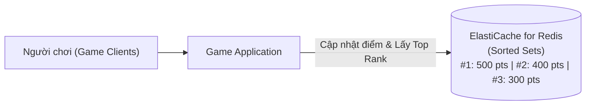

# Bài 99: ElastiCache for Solution Architects (Kiến trúc và Bảo mật ElastiCache cho Solutions Architect)

- **Phần (Section):** Section 9: AWS Fundamentals: RDS + Aurora + ElastiCache
- **Bài học (Lecture):** #99 (`id: 13528170`)
- **Video gốc:** `SAA_-_ElastiCache_-_for_Solutions_Architects_v4.mp4`
- **Thời lượng:** `03:00` (180 giây)
- **Cheat sheet:** [topics/aws_databases.html](../../topics/aws_databases.html)

---

## 1. Kiến thức trọng tâm (Exam Notes)

### 1.1. Bảo mật trên Amazon ElastiCache (ElastiCache Security)
- **IAM Authentication:**
  - ElastiCache **CHỈ hỗ trợ IAM Authentication cho Redis** (từ Redis 7.0+ / Valkey).
  - Lưu ý: Các **IAM Policies** định nghĩa trực tiếp trên dịch vụ ElastiCache mặc định chỉ dùng cho bảo mật ở cấp độ **AWS API-level** (ví dụ: ai được phép tạo/xóa cụm Cache), trừ khi bạn cấu hình IAM Authentication cho Redis User/User Group.
- **Redis AUTH:**
  - Bạn có thể đặt một mật khẩu / token (`AUTH token`) khi tạo cụm Redis.
  - Cung cấp thêm một lớp bảo mật xác thực ở tầng ứng dụng bên trên lớp bảo vệ mạng của **Security Groups**, đi kèm hỗ trợ mã hóa đường truyền **SSL/TLS in-flight encryption**.
- **Memcached Authentication:**
  - Hỗ trợ cơ chế xác thực dựa trên **SASL (Simple Authentication and Security Layer)**.

### 1.2. Ba Chiến lược tải dữ liệu vào Cache (3 Caching Patterns)
1. **Lazy Loading (Cache-Aside / Reactive Caching):**
   - Chỉ khi nào có yêu cầu đọc bị **Cache Miss** thì ứng dụng mới đọc từ Database rồi nạp vào Cache.
   - **Ưu điểm:** Chỉ dữ liệu thực sự được yêu cầu mới được lưu vào Cache.
   - **Nhược điểm:** Dữ liệu trong Cache có thể bị cũ/lỗi thời (**Stale data**) nếu DB được cập nhật mà Cache chưa xóa, và chịu độ trễ ban đầu khi gặp Cache Miss.
2. **Write Through (Proactive Caching):**
   - Mỗi khi dữ liệu được ghi/cập nhật vào Database, ứng dụng **đồng thời thêm hoặc cập nhật ngay dữ liệu đó vào trong Cache**.
   - **Ưu điểm:** Dữ liệu trong Cache luôn mới nhất (**No stale data**).
   - **Nhược điểm:** Tốn thêm thao tác ghi (Write penalty) và có thể lưu cả những dữ liệu không bao giờ được đọc lại.
3. **Session Store (Lưu trữ phiên người dùng):**
   - Lưu trữ dữ liệu phiên đăng nhập tạm thời và tự động xóa khi hết hạn bằng tính năng **TTL (Time To Live)**.

### 1.3. Use Case kinh điển cho Kỳ thi: Gaming Leaderboards với Redis Sorted Sets
- Khi đề bài yêu cầu thiết kế **Bảng xếp hạng trò chơi theo thời gian thực (Real-time Gaming Leaderboard)** (xác định ai đứng hạng 1, hạng 2, hạng 3 tại bất kỳ thời điểm nào với độavailability cao):
  - **Giải pháp chuẩn:** Sử dụng **Amazon ElastiCache for Redis — Sorted Sets**.
  - **Lý do:** Cấu trúc dữ liệu **Sorted Sets** của Redis đảm bảo đồng thời cả **tính duy nhất của phần tử (uniqueness)** lẫn **thứ tự sắp xếp theo điểm số (element ordering)** trong thời gian thực (real-time) mà không cần lập trình logic xếp hạng phức tạp ở phía ứng dụng.

---

## 2. Phụ đề chi tiết theo mốc thời gian (Full Transcript & Timestamps)

| Thời gian | Nội dung lời giảng gốc (English) | Bản dịch tiếng Việt sát nghĩa |
| :--- | :--- | :--- |
| `00:00:00.000 --> 00:00:16.710` | Now, let's talk about ElastiCache Security. So ElastiCache supports IAM authentication for Redis only and for the rest you just use a username and password. If you define IAM policies on ElastiCache, they're only used for AWS API-level security. | Bây giờ hãy nói về bảo mật trên ElastiCache. ElastiCache chỉ hỗ trợ xác thực IAM (**IAM Authentication**) đối với **Redis**, còn lại bạn sử dụng username và password. Nếu bạn định nghĩa các IAM Policies thông thường trên ElastiCache, chúng chỉ được dùng cho bảo mật ở cấp độ gọi lệnh AWS API. |
| `00:00:16.710 --> 00:00:31.980` | Then you have security within Redis called Redis AUTH, where you can set a password and a token when you create a Redis cluster, which gives you an extra level of security for your cache on top of your security groups. It also supports SSL in flight encryption. | Bên trong Redis có cơ chế bảo mật gọi là **Redis AUTH**, nơi bạn có thể đặt mật khẩu/token khi tạo cụm Redis, mang lại thêm một lớp bảo mật cho bộ nhớ đệm bên trên lớp Security Groups. Nó cũng hỗ trợ mã hóa đường truyền SSL (in-flight encryption). |
| `00:00:31.980 --> 00:00:41.010` | Next we have Memcached. So Memcached supports SASL-based authentication which is quite an advanced mechanism. Just remember, just a name. | Tiếp theo là **Memcached**: Memcached hỗ trợ xác thực dựa trên **SASL (SASL-based authentication)** — bạn chỉ cần nhớ tên cơ chế này. |
| `00:00:41.010 --> 00:00:57.333` | So to summarize, when we have an EC2 instance in a client, for example, we could use Redis AUTH to connect to Redis Cluster that's protected by Redis Security Group and we can have in-flight encryption. Or alternatively, we could, for example, leverage IAM authentication for Redis. | Tóm lại, khi một EC2 instance đóng vai trò client kết nối vào cụm Redis được bảo vệ bởi Security Group, chúng ta có thể dùng **Redis AUTH** kèm mã hóa đường truyền (in-flight encryption), hoặc tận dụng **IAM Authentication** cho Redis. |
| `00:00:58.470 --> 00:01:21.390` | Now, there are three kinds of patterns for loading data into ElastiCache. The number one is Lazy Loading, where all the read data is cached and data can become stale in the cache, Write Through, which is to add or update data in the cache whenever it is written to a database where there's no stale data, and using ElastiCache as a session store that we saw before and then we can expire a session using the time to live features. | Có 3 mẫu thiết kế (patterns) để nạp dữ liệu vào ElastiCache: Thứ nhất là **Lazy Loading** (mọi dữ liệu đã đọc sẽ được lưu vào cache, nhưng dữ liệu trong cache có thể bị cũ/stale); thứ hai là **Write Through** (thêm hoặc cập nhật dữ liệu vào cache ngay mỗi khi dữ liệu được ghi vào database, nhờ đó không bị dữ liệu cũ); và thứ ba là dùng ElastiCache làm **Session Store** kết hợp tính năng hết hạn phiên bằng **TTL (Time To Live)**. |
| `00:01:21.390 --> 00:01:37.920` | Now, caching is very hard and there's this very famous quote in computer science that "There are only two hard things in computer science: caching invalidation and naming things." So caching is a very complicated topic and give you a very high-level overview, | Trong khoa học máy tính có một câu nói rất nổi tiếng: *"Chỉ có hai việc khó trong khoa học máy tính: làm mới bộ nhớ đệm (cache invalidation) và đặt tên biến (naming things)."* |
| `00:01:37.920 --> 00:01:55.563` | but let's illustrate the lazy loading strategy here. So your application, if it has a cache hit in ElastiCache data from the cache, otherwise there's a cache miss, therefore, you read from the database and you write to the cache. This is something we've seen from before and it is called lazy loading because only when you don't have a cache hit, then you load the data into Amazon ElastiCache. | Hãy minh họa lại chiến lược **Lazy Loading**: Khi ứng dụng truy vấn ElastiCache, nếu đạt Cache Hit thì lấy dữ liệu ngay từ cache; nếu bị Cache Miss thì đọc từ cơ sở dữ liệu rồi ghi vào cache. Nó được gọi là Lazy Loading (tải lười) vì chỉ khi nào không tìm thấy dữ liệu trong cache (Cache Miss) thì bạn mới nạp dữ liệu đó vào ElastiCache. |
| `00:01:56.910 --> 00:02:24.630` | So now let's talk about the use cases for Redis and there's one you need to know going to the exam. It is around creating a gaming leaderboard. So it is very complex. The idea is that you wanna say who is number one, who is number two, who's number three at any moment in time for your game. And so there is a feature in Redis called Sorted Sets which guarantees both uniqueness and element ordering. And each time an element is added it's going to be ranked in real time and then added in the correct order. | Cuối cùng, hãy nói về một trường hợp sử dụng của Redis mà bạn bắt buộc phải nhớ khi đi thi: tạo **Bảng xếp hạng trò chơi (Gaming Leaderboard)**. Ý tưởng là bạn muốn biết ai đang đứng hạng 1, hạng 2, hạng 3 tại bất kỳ thời điểm nào trong trò chơi. Trong Redis có một tính năng gọi là **Sorted Sets**, đảm bảo đồng thời cả tính duy nhất (uniqueness) và thứ tự sắp xếp phần tử (element ordering). Mỗi khi một phần tử được thêm vào, nó sẽ được xếp hạng theo thời gian thực và đặt vào đúng vị trí thứ tự. |
| `00:02:24.630 --> 00:02:59.860` | The idea is that if you have a Redis cluster, you can create a realtime leaderboard with a number one, number two, and number three player in realtime and all the Redis cache will have at the same leaderboard available. That means that your clients, when talking to your Amazon ElastiCache using Redis, they can have access to this realtime leaderboard and we don't need to program that feature application side. We can just leverage Redis with the sorted sets to get access to your realtime leaderboard. And this is yet again something that can come up in the exam, okay? So that's it for this lecture. I hope you liked it and I will see you in the next lecture. | Nhờ đó, khi sử dụng cụm Redis, bạn có được bảng xếp hạng thời gian thực (Real-time Leaderboard) sẵn sàng cho mọi client truy cập mà không cần phải tự lập trình logic xếp hạng phức tạp ở phía ứng dụng — chỉ cần tận dụng **Redis Sorted Sets**. Đây là kiến thức rất hay xuất hiện trong đề thi. Hẹn gặp lại bạn ở bài giảng tiếp theo. |
