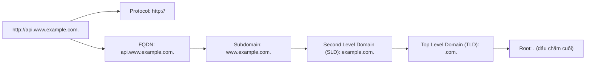
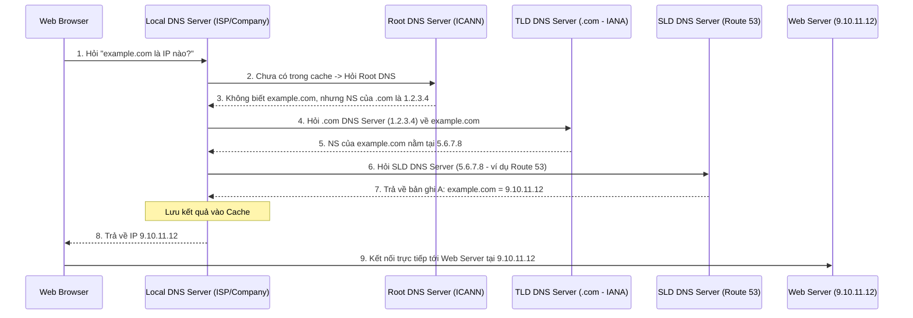

# Bài 101: What is a DNS ? (DNS là gì?)

- **Section:** Phần 10 - Route 53
- **Lecture ID:** `28384280`
- **Video:** `SAA_-_Route_53_-_What_is_DNS_v3.mp4`
- **Thời lượng:** `06:24`

---

## 1. Kiến thức trọng tâm (Exam Notes)

### 1.1. Định nghĩa DNS (Domain Name System)
- **DNS (Domain Name System)** là hệ thống phân giải tên miền — đóng vai trò là xương sống (backbone) của Internet.
- **Chức năng chính:** Dịch các tên miền thân thiện với con người (**human-friendly hostnames** như `www.google.com`) sang địa chỉ **IP** của máy chủ đích (ví dụ: `172.217.18.36`).

### 1.2. Cấu trúc phân cấp tên miền & Thuật ngữ DNS (DNS Terminology)
Xét một URL đầy đủ: `http://api.www.example.com.`

| Thuật ngữ | Giải thích | Ví dụ |
|---|---|---|
| **Domain Registrar** | Nhà đăng ký tên miền nơi bạn mua/đăng ký tên miền | Amazon Route 53, GoDaddy, Namecheap... |
| **DNS Records** | Các bản ghi định tuyến lưu trong Zone File | `A`, `AAAA`, `CNAME`, `NS`, `SOA`... |
| **Zone File** | Tệp chứa toàn bộ các DNS records giúp ánh xạ hostname sang IP/địa chỉ | Hosted Zone trong Route 53 |
| **Name Server (NS)** | Máy chủ thực hiện trả lời/phân giải các truy vấn DNS | `ns-123.awsdns-45.com` |
| **Root (`.`)** | Gốc của mọi tên miền (dấu chấm `.` ở cuối cùng), quản lý bởi **ICANN** | `.` |
| **Top Level Domain (TLD)** | Tên miền cấp cao nhất, quản lý bởi **IANA** | `.com`, `.us`, `.in`, `.gov`, `.org` |
| **Second Level Domain (SLD)** | Tên miền cấp 2 (hai từ cách nhau bởi dấu chấm) | `amazon.com`, `google.com`, `example.com` |
| **Subdomain** | Tên miền phụ mở rộng từ SLD | `www.example.com` |
| **FQDN (Fully Qualified Domain Name)** | Tên miền đầy đủ xác định chính xác vị trí nút trong cây DNS | `api.www.example.com.` |

### 1.3. Luồng hoạt động của một truy vấn DNS (How DNS Works)

---

## 2. Phụ đề chi tiết theo mốc thời gian (Full Transcript & Timestamps)

| Thời gian | Nội dung lời giảng gốc (English) | Bản dịch tiếng Việt sát nghĩa |
|---|---|---|
| `00:00:00` | Okay, so before we talk about Route 53 we have to talk about what is a DNS? | Được rồi, trước khi chúng ta nói về Route 53, chúng ta phải tìm hiểu DNS là gì? |
| `00:00:05` | So, this is a basic level lecture, but at least it will help you understand how DNS works. | Đây là một bài giảng ở mức cơ bản, nhưng ít nhất nó sẽ giúp bạn hiểu cách DNS hoạt động. |
| `00:00:10` | And this is something you've been using behind the scenes every day but you don't know about it exactly. So, let's have a look. | Và đây là thứ bạn vẫn sử dụng ngầm mỗi ngày nhưng có thể chưa biết chính xác về nó. Vậy hãy cùng xem nhé. |
| `00:00:16` | So, a DNS is a domain name system, and what it will do is that it will translate human friendly hostnames into the target server IP addresses. | DNS là hệ thống tên miền (Domain Name System), nhiệm vụ của nó là dịch các tên máy chủ (hostname) thân thiện với con người sang địa chỉ IP của máy chủ đích. |
| `00:00:25` | For example, when you type in your web browser, www.google.com, it will in the end give you back an IP address and this is IP address that your web browser will be able to access behind the scenes and get some data back from Google. | Ví dụ, khi bạn gõ vào trình duyệt web `www.google.com`, cuối cùng nó sẽ trả về cho bạn một địa chỉ IP, và đó là địa chỉ IP mà trình duyệt web của bạn truy cập ở phía hậu trường để lấy dữ liệu về từ Google. |
| `00:00:40` | So, the DNS is the backbone of the internet. It is a way for you to understand how to translate these URLs, these hostnames into IPs. | Vì vậy, DNS là xương sống của Internet. Đó là cách giúp dịch các URL, các hostname này thành các địa chỉ IP. |
| `00:00:49` | So, there is a hierarchical naming structure for DNS and the idea is that at the root of www.google.com for example, there is the .com, | Có một cấu trúc đặt tên phân cấp cho DNS; ý tưởng là ở phần gốc của `www.google.com` chẳng hạn, có `.com`, |
| `00:00:58` | but then there is example.com which is a bit more precise. Then, www.example.com or api.example.com. | sau đó có `example.com` cụ thể hơn một chút. Rồi đến `www.example.com` hoặc `api.example.com`. |
| `00:01:06` | So, all of these are going to be the hierarchy of your domain names. | Tất cả những phần đó tạo nên hệ thống phân cấp cho tên miền của bạn. |
| `00:01:11` | Next, we need to define a little bit of terminology regarding your DNS. | Tiếp theo, chúng ta cần định nghĩa một vài thuật ngữ liên quan đến DNS. |
| `00:01:15` | So, there is a domain registrar. This is where you're going to register your domain names and it could be Amazon Route 53, or it could be GoDaddy or any other domain registrar you can find online. | Đầu tiên là **Domain Registrar** (Nhà đăng ký tên miền). Đây là nơi bạn đăng ký tên miền của mình, có thể là Amazon Route 53, GoDaddy hoặc bất kỳ nhà đăng ký tên miền nào khác trên mạng. |
| `00:01:26` | Then you have DNS Records and they have different types and we'll have a look at them in detail in this section. So it could be A, AAAA, CNAME, NS, et cetera, et cetera. Don't worry, we'll see those in detail in this section. | Tiếp theo là **DNS Records** (các bản ghi DNS) với nhiều loại khác nhau mà chúng ta sẽ xem chi tiết trong phần này, như `A`, `AAAA`, `CNAME`, `NS`, v.v. Đừng lo, chúng ta sẽ tìm hiểu kỹ trong chương này. |
| `00:01:37` | A zone file which contains all the DNS records. So, this is how to match these hostnames to IPs or addresses. | **Zone file** là tệp chứa tất cả các bản ghi DNS. Đây là nơi quy định cách khớp các hostname với các địa chỉ IP. |
| `00:01:44` | Name servers is servers that will actually resolve the DNS queries. And we'll have a look at them as well in this section. | **Name servers** là các máy chủ thực sự phân giải các truy vấn DNS. Chúng ta cũng sẽ xem xét chúng trong phần này. |
| `00:01:50` | Top level domains which is .com, .us, .in, .gov, .org, et cetera, et cetera. | **Top Level Domain (TLD)** là `.com`, `.us`, `.in`, `.gov`, `.org`, v.v. |
| `00:01:55` | Second level domain which is amazon.com and google.com. So you can see there are two words in between a dot. | **Second Level Domain (SLD)** là `amazon.com` và `google.com`. Bạn có thể thấy có hai từ ngăn cách bởi một dấu chấm. |
| `00:02:01` | And so if we take a look for example at this FQDN, so fully qualified domain name, we have http://api.www.example.com. Okay? | Nếu chúng ta nhìn vào ví dụ về một **FQDN** (Fully Qualified Domain Name - Tên miền đủ điều kiện), chúng ta có `http://api.www.example.com.`. |
| `00:02:13` | So, the last dot the end is called the root and it is the root of all the domain names. | Dấu chấm cuối cùng ở tận cùng được gọi là **Root** (gốc), và nó là gốc của tất cả các tên miền. |
| `00:02:18` | Then the .com, so .com is your TLD, so that's your top level domain. | Tiếp theo, `.com` là **TLD** (Top Level Domain - tên miền cấp cao nhất) của bạn. |
| `00:02:25` | The example.com is going to be your second level domain. | `example.com` sẽ là **Second Level Domain** (tên miền cấp hai) của bạn. |
| `00:02:31` | Then we have www.example.com. That's your subdomain. | Sau đó chúng ta có `www.example.com`. Đó là **Subdomain** (tên miền phụ) của bạn. |
| `00:02:36` | api.www.example.com is your FQDN, your fully qualified domain name. | `api.www.example.com.` là **FQDN** (Fully Qualified Domain Name) của bạn. |
| `00:02:44` | HTTP is going to be your protocol and all these things together is going to be your URL. | `http` là giao thức (**Protocol**) của bạn, và tất cả những thành phần này ghép lại chính là **URL** của bạn. |
| `00:02:51` | So, now that we know a little bit of terminology, let's have a look at how DNS works. | Bây giờ khi đã nắm được một số thuật ngữ, hãy cùng xem cách DNS hoạt động. |
| `00:02:55` | So we have a web server, and let's say for example that we have an IP, it's a public IP, could be an EC2 instance, for example. And the public IP is 9.10.11.12 and we want to be able to access this using the example.com domain name. | Giả sử chúng ta có một Web Server với một địa chỉ Public IP — ví dụ như một EC2 instance — có Public IP là `9.10.11.12`, và chúng ta muốn truy cập nó bằng tên miền `example.com`. |
| `00:03:11` | So, we're going to register this example.com domain name on one of our servers for the DNS. But let's see how the computer, your web browser, can access it and can get that response. | Chúng ta sẽ đăng ký tên miền `example.com` này trên một máy chủ DNS. Hãy xem cách máy tính hay trình duyệt web của bạn có thể truy cập và nhận được phản hồi đó. |
| `00:03:22` | So, your web browser is going to want to access example.com. And to do so, it's going to ask its local DNS server. "Hey, do you know what example.com is?" | Trình duyệt web của bạn muốn truy cập `example.com`. Để làm vậy, nó sẽ hỏi máy chủ **Local DNS** của nó: "Này, bạn có biết `example.com` là gì không?" |
| `00:03:30` | Now, this local DNS server is usually assigned and managed by your company or assigned by your internet service provider dynamically. | Máy chủ Local DNS này thường được gán và quản lý bởi công ty của bạn hoặc được nhà cung cấp dịch vụ Internet (ISP) gán động. |
| `00:03:38` | And if the local DNS server has never seen this query before what it's going to do is first ask the root DNS server managed by the I-C-A-N-N, the ICANN organization and is going to say, "Hey, do you know what's example.com?" Which is the first server that's going to be asked. | Nếu máy chủ Local DNS chưa từng thấy truy vấn này trước đây, việc đầu tiên nó làm là hỏi máy chủ **Root DNS** được quản lý bởi tổ chức **ICANN**, và hỏi: "Này, bạn có biết `example.com` là gì không?". Đó là máy chủ đầu tiên được hỏi. |
| `00:03:55` | And the Root DNS Server is going to say, "I've never seen it, but I know .com." So, .com is NS, so it's an NS Record Name server and go see 1234 this public IP. | Máy chủ Root DNS sẽ trả lời: "Tôi chưa thấy nó bao giờ, nhưng tôi biết `.com`." `.com` có bản ghi NS (Name Server) tại địa chỉ Public IP `1.2.3.4`. |
| `00:04:07` | So, this is saying to local DNS, "Hey, I don't have this answer but I'm getting you a little bit closer to your answer because I know the .com domain, and the .com domain name server has this IP, 1234." | Tức là nó nói với Local DNS rằng: "Này, tôi không có câu trả lời cuối cùng nhưng tôi giúp bạn tiến gần hơn một bước vì tôi biết miền `.com`, và Name Server của miền `.com` có IP là `1.2.3.4`." |
| `00:04:19` | So the local DNS server saying, "Okay, good. Now I'm going to ask the top level domain." So the .com domain server at 1234. "I'm going to ask for the answer of my query." | Máy chủ Local DNS nói: "Được rồi, tốt lắm. Bây giờ tôi sẽ hỏi Top Level Domain (TLD)", tức là máy chủ miền `.com` tại `1.2.3.4` để tìm câu trả lời cho truy vấn. |
| `00:04:30` | So, this is another domain managed by I-A-N-A, the IANA and the example.com, okay, is going to be asked again to this DNS server. So, do you know about example.com? | Đây là một miền khác được quản lý bởi **IANA**, và câu hỏi về `example.com` lại được gửi tới máy chủ DNS này: "Bạn có biết về `example.com` không?" |
| `00:04:42` | And the DNS server is gonna say, "Hey, I do know about example.com. I don't have the answer to your query right away. I don't know which record it is, but there is a server called example.com that I know about which is at 5.6.7.8, that's a public IP that you should ask the answer to your question." | Máy chủ TLD DNS sẽ trả lời: "Này, tôi có biết về `example.com`. Tôi không có câu trả lời trực tiếp cho bản ghi của bạn ngay, nhưng tôi biết máy chủ phụ trách `example.com` nằm tại Public IP `5.6.7.8`, bạn hãy hỏi nó nhé." |
| `00:05:01` | So, local DNS server is then going go to our final server which is the second-level domain DNS server and this is a server that is going to be managed by your domain registrar. So it could be, for example, Amazon Route 53 and so on. | Khi đó, máy chủ Local DNS sẽ tìm đến máy chủ cuối cùng là máy chủ **Second-Level Domain (SLD) DNS** — được quản lý bởi nhà đăng ký/quản trị tên miền của bạn, ví dụ như Amazon Route 53. |
| `00:05:16` | So the DNS server is gonna say, "Hey, do you know about example.com?" And the DNS server will have an entry for example.com. And so it will say, "Hey, yes, of course I know example.com." | Local DNS hỏi: "Này, bạn có biết về `example.com` không?" Máy chủ SLD DNS có lưu bản ghi cho `example.com`, nên nó sẽ đáp: "Ồ có chứ, tất nhiên tôi biết `example.com`." |
| `00:05:25` | And it turns out that example.com, I know that it's an A record and that the result of it is the IP 9.10.11.12. | "Và `example.com` có một bản ghi `A` (A record) với kết quả là địa chỉ IP `9.10.11.12`." |
| `00:05:34` | So, the DNS server now knows the answer by recursively asking DNS servers and finding the most specific one. | Như vậy, máy chủ Local DNS giờ đã biết câu trả lời bằng cách hỏi đệ quy (recursively) qua các máy chủ DNS để tìm ra máy chủ cụ thể nhất. |
| `00:05:42` | And then it says, "Okay, hey, yes. I'm going to cache that answer right away because I want to be able to, if someone is asking me again for example.com I want to get it right away, give them the answer." | Sau đó nó nói: "Được rồi, tôi sẽ lưu bộ nhớ đệm (cache) câu trả lời này ngay lập tức để nếu có ai hỏi lại về `example.com`, tôi có thể trả lời họ ngay." |
| `00:05:52` | So, it's going to send back the answer into your browser and your web browser now has the answer and using this IP address then is going to be able to access your web server. | Nó gửi câu trả lời về cho trình duyệt của bạn, và trình duyệt web lúc này đã có địa chỉ IP để truy cập trực tiếp vào Web Server của bạn. |
| `00:06:03` | So, this is how DNS works. So, you've been using DNS behind the scenes all along all your life. For example, when you access www.google.com you're using DNS or any website. | Đó là cách DNS hoạt động. Bạn vẫn luôn sử dụng DNS ở phía hậu trường trong suốt cuộc sống hàng ngày mỗi khi truy cập `www.google.com` hay bất kỳ trang web nào. |
| `00:06:12` | But now we see how the DNS queries work. So, this is just some background knowledge because now we're going to go into Route 53 and learn how to manage a DNS server on our own. | Giờ chúng ta đã hiểu cách các truy vấn DNS vận hành. Đây là kiến thức nền tảng trước khi chúng ta bước vào Route 53 và học cách tự quản lý máy chủ DNS của riêng mình. |
| `00:06:21` | So I hope you liked it and I will see you in the next lecture. | Hy vọng bạn thích bài học này và hẹn gặp lại trong bài giảng tiếp theo. |
