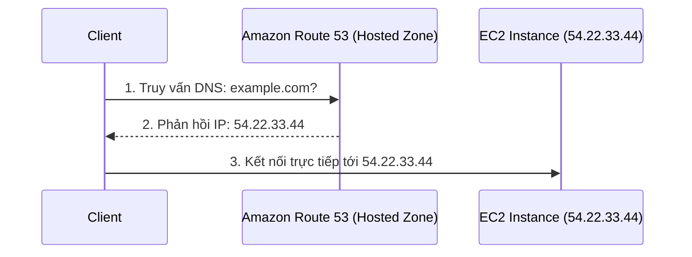
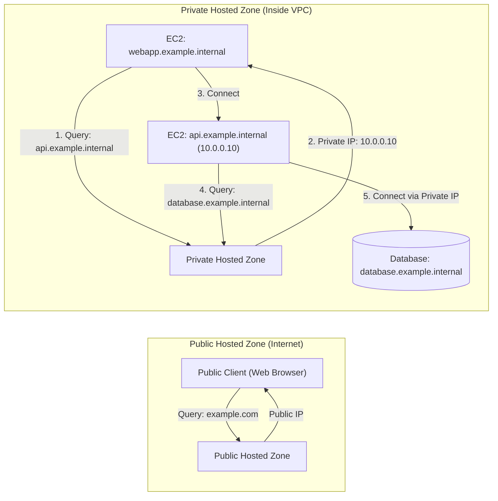

# Bài 102: Route 53 Overview

- **Phần:** Phần 10: Route 53
- **Lecture ID:** `13528180` (`Asset ID: 38084062`)
- **Video gốc:** `SAA - Route 53 - Overview v2.mp4`
- **Thời lượng:** `06:18`
- **URL bài học:** https://www.udemy.com/course/aws-certified-solutions-architect-associate-saa-c03/learn/lecture/13528180#overview
- **Cheat sheet:** [topics/aws_route53.html](../../topics/aws_route53.html)

---

## 1. Kiến thức trọng tâm (Exam Notes)

> [!TIP]
> **Tóm tắt nhanh dịch vụ Amazon Route 53 (SAA-C03 Cheat Sheet)**
> - **Là gì:** Dịch vụ hệ thống phân giải tên miền có thẩm quyền (**Authoritative DNS**), nhà đăng ký tên miền (**Domain Registrar**) và kiểm tra sức khỏe tài nguyên (**Health Checks**) được quản lý hoàn toàn với **100% Availability SLA**.
> - **Dùng khi nào (Use case điển hình trong đề):**
>   - Quản lý tên miền công khai (**Public Hosted Zone**) hoặc tên miền nội bộ trong VPC (**Private Hosted Zone**).
>   - Điều hướng lưu lượng thông minh qua 8 **Routing Policies**: `Simple` (đơn giản, không Health Check), `Weighted` (chia % lưu lượng / Canary test), `Latency` (chọn Region có độ trễ mạng thấp nhất), `Failover` (Active-Passive DR), `Geolocation` (theo Quốc gia/Châu lục/Bang Mỹ), `Geoproximity` (dịch chuyển vùng phủ bằng hệ số **`Bias`**), `IP-based` (theo CIDR của Client), và `Multi-Value Answer` (trả về tối đa **8 IP khỏe mạnh** có gắn Health Check).
> - **Khác gì dịch vụ gần giống:**
>   - **Alias Record vs. CNAME Record:** `Alias` trỏ tới tài nguyên AWS (ALB, CloudFront, S3 Website, API Gateway... **TRỪ EC2 DNS Name**), **miễn phí truy vấn** và **dùng được ở cả Root Domain / Zone Apex (`example.com`)**; `CNAME` tính phí và **chỉ dùng được cho Subdomain (`www.example.com`)**.
>   - **Route 53 vs. Global Accelerator:** `Route 53` định tuyến ở tầng DNS (chịu ảnh hưởng bởi `TTL` cache của client); `Global Accelerator` cấp **2 Anycast Static IPs** định tuyến qua mạng riêng AWS và failover tức thì không phụ thuộc DNS cache.
> - **Điểm hay bị hỏi (Giới hạn, Mặc định, Từ khóa gợi ý):**
>   - **Health Checks:** Cần **> 18%** số Health Checkers toàn cầu nhận mã `2xx`/`3xx` để báo Healthy; để giám sát **Private Resource (trong VPC / On-premises)**, phải tạo **CloudWatch Alarm** rồi cho Route 53 Health Check giám sát Alarm đó.
>   - **Hybrid DNS (Route 53 Resolver):** Dùng **`Inbound Endpoint`** cho chiều **On-premises $\rightarrow$ AWS VPC**, và dùng **`Outbound Endpoint` (+ Forwarding Rule)** cho chiều **AWS VPC $\rightarrow$ On-premises**.

### 1.1. Amazon Route 53 là gì?
- Là dịch vụ **DNS có tính sẵn sàng cao (Highly Available), có khả năng mở rộng (Scalable), được quản lý hoàn toàn (Fully Managed) và có thẩm quyền (Authoritative DNS)**.
  - **Authoritative DNS:** Khách hàng (người dùng AWS) có toàn quyền cập nhật và kiểm soát các bản ghi DNS (DNS records).
- **Cách hoạt động cơ bản:**
  - Khi các client muốn truy cập vào EC2 Instance qua tên miền `example.com` (nhưng EC2 hiện chỉ có Public IP như `54.22.33.44`), ta tạo các DNS records trong một **Hosted Zone** trên Amazon Route 53.
  - Khi client truy vấn `example.com`, Route 53 trả về IP `54.22.33.44` để client kết nối trực tiếp tới EC2 Instance.
- **Domain Registrar (Nhà đăng ký tên miền):** Route 53 cho phép đăng ký và mua tên miền trực tiếp (ví dụ: `example.com`).
- **Health Checks:** Có khả năng kiểm tra trạng thái sức khỏe của các tài nguyên.
- **SLA:** Dịch vụ **duy nhất trên AWS** cung cấp cam kết **100% Availability SLA**.
- **Nguồn gốc tên gọi:** Số **53** xuất phát từ cổng truyền thống của dịch vụ DNS (**Port 53**).

---

### 1.2. Cấu trúc của một bản ghi DNS (DNS Record)
Các bản ghi DNS định nghĩa cách bạn muốn điều hướng lưu lượng truy cập cho một tên miền cụ thể. Mỗi bản ghi bao gồm:
1. **Domain / Subdomain Name:** Tên miền hoặc tên miền phụ (ví dụ: `example.com`).
2. **Record Type:** Loại bản ghi (ví dụ: `A`, `AAAA`, `CNAME`, `NS`).
3. **Value:** Giá trị của bản ghi (ví dụ: `12.34.56.78`).
4. **Routing Policy:** Chính sách định tuyến — cách Route 53 phản hồi các truy vấn DNS.
5. **TTL (Time to Live):** Khoảng thời gian bản ghi được lưu bộ nhớ đệm (cache) tại các DNS Resolver.

---

### 1.3. Các loại DNS Record cần nhớ cho kỳ thi SAA-C03

| Loại Record | Chức năng chính | Ví dụ / Lưu ý quan trọng khi thi |
| :--- | :--- | :--- |
| **`A`** | Ánh xạ một **Hostname** sang địa chỉ **IPv4**. | `example.com` -> `1.2.3.4` |
| **`AAAA`** *(Quadruple A)* | Ánh xạ một **Hostname** sang địa chỉ **IPv6**. | `example.com` -> địa chỉ IPv6 |
| **`CNAME`** | Ánh xạ một **Hostname** sang **một Hostname khác** (đích có thể là bản ghi `A` hoặc `AAAA`). | **KHÔNG THỂ** tạo `CNAME` cho node gốc của không gian tên DNS (**Zone Apex** / Root domain như `example.com`). Chỉ tạo được cho subdomain như `www.example.com`. |
| **`NS`** *(Name Servers)* | Danh sách tên miền hoặc địa chỉ IP của các máy chủ tên miền thuộc Hosted Zone. | Có thể trả lời các truy vấn DNS cho Hosted Zone và kiểm soát cách định tuyến lưu lượng vào tên miền. |

> [!NOTE]
> Các loại bản ghi nâng cao khác được Route 53 hỗ trợ (như `CAA`, `DS`, `MX`, `NAPTR`, `PTR`, `SOA`, `TXT`, `SPF`, `SRV`) không yêu cầu đi sâu từ góc độ đề thi SAA-C03.

---

### 1.4. Hosted Zones (Public vs. Private)
**Hosted Zone** là một vùng chứa (container) các bản ghi DNS định nghĩa cách điều hướng lưu lượng tới một tên miền và các tên miền phụ (subdomains) của nó. Có 2 loại:

#### 1. Public Hosted Zones (Vùng lưu trữ công cộng)
- Dùng khi bạn mua/sở hữu một tên miền công cộng (ví dụ: `mypublicdomain.com`).
- Cho phép bất kỳ client nào từ **Internet công cộng** (như trình duyệt web) truy vấn để lấy địa chỉ IP (ví dụ: truy vấn `application1.mypublicdomainname.com`).

#### 2. Private Hosted Zones (Vùng lưu trữ riêng tư)
- Dùng cho các tên miền nội bộ không công khai ra ngoài Internet.
- Chỉ các tài nguyên bên trong **VPC (Virtual Private Cloud)** của bạn mới có thể phân giải các URL này (ví dụ: `application1.company.internal`).
- **Ví dụ thực tế trong VPC:**
  - EC2 Instance 1 (`webapp.example.internal`) cần gọi sang EC2 Instance 2 (`api.example.internal`).
  - EC2 Instance 1 hỏi Private Hosted Zone địa chỉ của `api.example.internal` -> Nhận về Private IP `10.0.0.10`.
  - EC2 Instance 2 cần kết nối tới Database -> Hỏi Private Hosted Zone địa chỉ của `database.example.internal` -> Nhận về Private IP của Database và kết nối trực tiếp.

---

### 1.5. Chi phí (Pricing)
- **Hosted Zone:** **`$0.50` / tháng** cho mỗi Hosted Zone bạn tạo trên AWS (Route 53 không miễn phí).
- **Đăng ký tên miền (Domain Registration):** Tối thiểu **`$12` / năm** khi đăng ký tên miền mới (sẽ thực hành trong bài tiếp theo).

---

## 2. Phụ đề chi tiết theo mốc thời gian (Full Transcript & Timestamps)

| Thời gian | Nội dung lời giảng gốc (English) | Bản dịch tiếng Việt sát nghĩa |
| :---: | :--- | :--- |
| `00:00` - `00:18` | So now that we know what is a DNS, let's have a look at Amazon Route 53. So this is a highly available, scalable, and fully managed and authoritative DNS. What does authoritative means? That means that the customer you can update the DNS records, so you have full control over this DNS. | Bây giờ chúng ta đã biết DNS là gì, hãy cùng tìm hiểu về Amazon Route 53. Đây là một dịch vụ DNS có tính sẵn sàng cao, có khả năng mở rộng, được quản lý hoàn toàn và có thẩm quyền (authoritative DNS). "Có thẩm quyền" nghĩa là gì? Nghĩa là khách hàng (bạn) có thể cập nhật các bản ghi DNS, tức là bạn có toàn quyền kiểm soát DNS này. |
| `00:18` - `00:47` | So the idea is that you have your clients and they want to access your EC2 Instance `@example.com` but right now your EC2 Instance only has a public IP. Therefore what's going to happen is that we're going to write some DNS records into Amazon Route 53, into a hosted zone, and when the client is asking for `example.com`, then the Route 53 service will be able to say, "Hey, you're looking for this IP `54.22.33.44`," and then the clients will be able to connect directly into our EC2 Instance. | Ý tưởng là bạn có các client muốn truy cập vào EC2 Instance của bạn tại `example.com`, nhưng hiện tại EC2 Instance chỉ có một địa chỉ IP công cộng (Public IP). Do đó, chúng ta sẽ ghi một số bản ghi DNS vào Amazon Route 53, bên trong một Hosted Zone. Khi client hỏi `example.com`, dịch vụ Route 53 sẽ trả lời: "Này, bạn đang tìm IP `54.22.33.44` này", và sau đó client có thể kết nối trực tiếp vào EC2 Instance của chúng ta. |
| `00:47` - `01:17` | So Route 53 is also a domain registrar, so it will be able to register our own domain names there such as `example.com`, and we'll be doing this in the hands-on to allow us to get started with this service. So we have the ability to check also the health of the resources within Route 53, we'll see this in the section. And this is the only service in AWS that will provide 100% availability SLA. Finally, why is it called Route 53? Well, 53 is a reference to the traditional DNS port used by DNS services, hence the name. | Route 53 cũng là một nhà đăng ký tên miền (Domain Registrar), nên ta có thể đăng ký tên miền riêng như `example.com` tại đây — chúng ta sẽ làm việc này trong bài thực hành. Chúng ta cũng có khả năng kiểm tra sức khỏe (health check) của các tài nguyên trong Route 53. Và đây là dịch vụ duy nhất trong AWS cung cấp cam kết SLA 100% availability. Cuối cùng, tại sao nó có tên là Route 53? Số 53 tham chiếu đến cổng (port) DNS truyền thống được sử dụng bởi các dịch vụ DNS. |
| `01:17` - `01:58` | So in Route 53 you're going to define a bunch of DNS records and the records define how you want to route traffic to a specific domain. So each record is going to contain a lot of information such as the domain or the subdomain names such as `example.com`. The record type, and we'll see what types of record we have available to us, for example it could be `A` or `AAAA`. Then the value, so the value of the record, for example, `12.34.56.78`. The routing policy, which is how Route 53 will respond to queries. The TTL, which is the amount of time the record is going to be cached at the DNS resolvers, also called time to live. | Trong Route 53, bạn sẽ định nghĩa các bản ghi DNS để quy định cách định tuyến lưu lượng tới một tên miền cụ thể. Mỗi bản ghi chứa nhiều thông tin như: tên miền hoặc tên miền phụ (ví dụ `example.com`); loại bản ghi (ví dụ `A` hoặc `AAAA`); giá trị của bản ghi (ví dụ `12.34.56.78`); chính sách định tuyến (Routing Policy - cách Route 53 phản hồi truy vấn); và TTL (Time to Live - khoảng thời gian bản ghi được lưu cache tại các DNS Resolver). |
| `01:58` - `02:23` | And then we have a lot of different supported DNS record types in Route 53. So we have, the ones you must know is `A`, quadruple `A` (`AAAA`), `CNAME`, and `NS`, so we'll have a look at those in the hands-on. And the advanced records that you can set, but we don't need to know from an exam perspective, are all the ones I just wrote right here. So let's learn about the important record types we need to know from an exam perspective. | Có rất nhiều loại bản ghi DNS được hỗ trợ trong Route 53. Những loại bạn bắt buộc phải biết là `A`, `AAAA`, `CNAME`, và `NS` — chúng ta sẽ xem xét chúng trong phần thực hành. Còn các bản ghi nâng cao khác thì không cần nhớ từ góc độ kỳ thi. Hãy cùng tìm hiểu các loại bản ghi quan trọng cần biết để đi thi. |
| `02:23` - `02:44` | So the `A` record is very simple, it's to map a host name into an IPv4 IP. So this is when you have, for example, `example.com` that will be directed into `1.2.3.4`. Okay, great. Then we have quadruple `A` (`AAAA`). So this is the same idea as `A`, but this time we're going to match our host name into an IPv6 address. | Bản ghi `A` rất đơn giản, dùng để ánh xạ một hostname sang địa chỉ IPv4 (ví dụ `example.com` trỏ tới `1.2.3.4`). Tiếp theo là `AAAA` (Quadruple A), ý tưởng giống hệt `A` nhưng ánh xạ hostname sang một địa chỉ IPv6. |
| `02:44` - `03:16` | Then we have a `CNAME`, which is used to map a host name into another host name. And then the target host name of course may be an `A` or a quadruple `A` record. You can not create CNAMEs in Route 53 for the top nodes of a DNS namespace or the Zone Apex, and we'll see this in a future lecture as well to understand how that works. For example, you can not create a CNAME for `example.com`, but you can create a CNAME record for `www.example.com`. So we'll see how we can deal with this in a future lecture. | Tiếp theo là `CNAME`, dùng để ánh xạ một hostname sang một hostname khác (hostname đích tất nhiên có thể là một bản ghi `A` hoặc `AAAA`). Bạn **không thể** tạo `CNAME` trong Route 53 cho node cao nhất của không gian tên DNS (gọi là **Zone Apex**). Ví dụ: bạn không thể tạo `CNAME` cho `example.com`, nhưng có thể tạo bản ghi `CNAME` cho `www.example.com`. Chúng ta sẽ xem cách xử lý trường hợp này ở bài học sau. |
| `03:16` - `03:31` | And then finally, `NS` is for name servers of the hosted zone. They are the DNS names or IP addresses of the servers that can respond to the DNS queries for your hosted zone, and this will control how traffic is routed to a domain. | Cuối cùng, `NS` là các Name Server của Hosted Zone. Chúng là tên DNS hoặc địa chỉ IP của các máy chủ có thể phản hồi truy vấn DNS cho Hosted Zone của bạn, và kiểm soát cách lưu lượng được định tuyến tới tên miền. |
| `03:31` - `04:32` | So let's have a look at what are hosted zones. So hosted zones are a container of records, and they will define how to route traffic to a domain and its subdomain. So we have two types of hosted zone, we have the public hosted zones and the private hosted zones. So whenever you buy a public domain name, for example `mypublicdomain.com`, this is a public domain name and therefore we can create a public hosted zone and these public zone can answer the query, "Hey, what is the IP, underlying IP of the domain name `application1.mypublicdomainname.com`?" But we also have private hosted zones. And these are for domain names that are not publicly available, they're private, and only you within your own virtual private cloud or VPC can resolve this URL. For example, `application1.company.internal`. You may have seen this if you're working for a private company, they sometimes have URLs that you can only access from within your corporate network, that's because this is a private URL and behind the scenes there is a private DNS record. | Hãy tìm hiểu Hosted Zone là gì. Hosted Zone là một vùng chứa các bản ghi, định nghĩa cách định tuyến lưu lượng tới một tên miền và các subdomain của nó. Có 2 loại Hosted Zone: Public Hosted Zone và Private Hosted Zone. Khi bạn mua một tên miền công cộng như `mypublicdomain.com`, bạn có thể tạo một Public Hosted Zone để trả lời truy vấn: "IP của `application1.mypublicdomainname.com` là gì?". Ngược lại, Private Hosted Zone dành cho các tên miền không công khai, chỉ bên trong VPC (Virtual Private Cloud) của bạn mới phân giải được URL này, ví dụ `application1.company.internal`. Nếu bạn làm việc trong công ty, đôi khi có những URL chỉ truy cập được khi ở trong mạng nội bộ công ty — đằng sau đó chính là bản ghi DNS riêng tư (private DNS record). |
| `04:32` - `04:51` | So for any hosted zones you're going to create in AWS you're going to pay 50 cents per month, so this is not free to use Route 53. And if you are to register a domain name, just like I will in the hands-on, this will cost you a minimum of a \$12 per year. So just so you know, this section is not free. | Với bất kỳ Hosted Zone nào tạo trên AWS, bạn sẽ trả `$0.50` mỗi tháng, vì vậy sử dụng Route 53 không miễn phí. Và nếu bạn đăng ký một tên miền giống như tôi sẽ làm trong bài thực hành, chi phí tối thiểu là `$12` mỗi năm. |
| `04:51` - `06:18` | So public versus private hosted zones, just to understand. So public hosted zone can answer queries from public clients. So when your web browser, for example, says, "Hey, give me `example.com`," and then it returns an IP. And on the other end we have the private hosted zone. So this is from within your VPC they live. And so they allow you to identify private resources with private domain names. So for example, we have one EC2 Instance that we want to identify with `webapp.example.internal`, we have another EC2 Instance that we want to identify with `api.example.internal`, and then we have a database we want to identify with `database.example.internal`. In which case we're going to register a private hosted zone, and then in case the first EC2 Instance is requesting for `api.example.internal`, then the private hosted zone has an answer for it, which is the private IP `10.0.0.10`. Then the EC2 Instance will connect to the second EC2 Instance, which may need to connect to database. So it will say, "Hey, what's `database.example.internal`?" And the private hosted zone will say, "Well, this is this private IP." And then the EC2 Instance can connect directly into the database. So the public hosted zone and the private hosted zone work the exact same way, but just the public hosted zone allows anyone from the internet to query your records, so this is for your public records, whereas a private hosted zone is only queried from within your private resources, for example your VPC. So that's it for the theory, now let's go into the next lecture to register a domain and then create some records. | So sánh Public và Private Hosted Zone để nắm rõ: Public Hosted Zone trả lời truy vấn từ các client công cộng (như trình duyệt web hỏi `example.com` và nhận về IP). Còn Private Hosted Zone nằm trong VPC của bạn, cho phép định danh các tài nguyên nội bộ bằng tên miền riêng. Ví dụ: EC2 thứ nhất là `webapp.example.internal`, EC2 thứ hai là `api.example.internal`, và một Database là `database.example.internal`. Ta đăng ký một Private Hosted Zone; khi EC2 thứ nhất hỏi `api.example.internal`, Private Hosted Zone trả về Private IP `10.0.0.10` để kết nối tới EC2 thứ hai. Khi EC2 thứ hai cần kết nối Database, nó hỏi `database.example.internal` và nhận về Private IP của Database. Cả hai loại Hosted Zone hoạt động giống hệt nhau, chỉ khác là Public Hosted Zone cho phép bất kỳ ai từ Internet truy vấn, còn Private Hosted Zone chỉ được truy vấn từ các tài nguyên nội bộ như VPC của bạn. Đó là toàn bộ phần lý thuyết, hãy sang bài tiếp theo để đăng ký tên miền và tạo bản ghi. |
