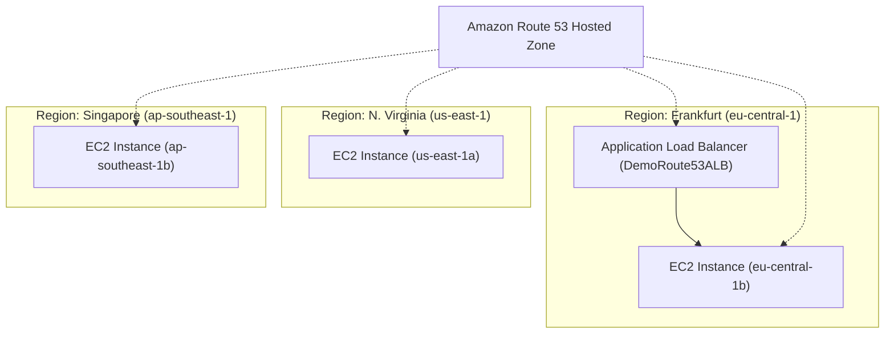

# Bài 105: Route 53 - EC2 Setup (Thiết lập hạ tầng EC2 và ALB cho thực hành Route 53)

- **Section:** Phần 10 - Route 53
- **Lecture ID:** `13528186`
- **Video:** `SAA_-_Route_53_-_EC2_Setup_v3.mp4`
- **Thời lượng:** `05:40`
- **Cheat sheet:** [topics/aws_route53.html](../../topics/aws_route53.html)

---

## 1. Kiến thức trọng tâm (Exam Notes)

### 1.1. Mô hình hạ tầng chuẩn bị cho các bài thực hành Route 53
Để kiểm thử đầy đủ các chính sách định tuyến (Routing Policies) của Route 53 trên phạm vi toàn cầu, bài thực hành khởi tạo:
1. **3 EC2 Instances (`t2.micro`, Amazon Linux 2)** đặt tại **3 AWS Regions khác nhau**:
   - **Frankfurt (`eu-central-1`)**
   - **Northern Virginia (`us-east-1`)**
   - **Singapore (`ap-southeast-1`)**
2. **Cấu hình chung cho mỗi EC2 Instance:**
   - **Key pair:** Proceed without a key pair (có thể dùng EC2 Instance Connect nếu cần).
   - **Security Group:** Mở cổng **HTTP (port 80)** và **SSH (port 22)** từ mọi nơi (`0.0.0.0/0`).
   - **User Data Script:** Cài đặt Apache (`httpd`) và xuất trang web hiển thị thông điệp:
     `Hello World from <hostname> in AZ <availability-zone>` (giúp nhận biết ngay người dùng đang được Route 53 điều hướng tới Region/AZ nào).
3. **1 Application Load Balancer (`DemoRoute53ALB`) tại Region Frankfurt (`eu-central-1`):**
   - **Scheme:** Internet-facing, IPv4.
   - **Security Group:** Cho phép HTTP (port 80).
   - **Target Group (`demo-tg-route-53`):** Đăng ký EC2 instance tại `eu-central-1`.

---

## 2. Phụ đề chi tiết theo mốc thời gian (Full Transcript & Timestamps)

| Thời gian | Nội dung lời giảng gốc (English) | Bản dịch tiếng Việt sát nghĩa |
|---|---|---|
| `00:00:00` | So let's get started. And before we use Route 53, I want to go ahead and create three EC2 instances in different regions, as well as one ALB. | Hãy bắt đầu nào. Trước khi đi sâu vào sử dụng Route 53, tôi muốn tạo 3 EC2 instances ở các Region khác nhau, cùng với 1 Application Load Balancer (ALB). |
| `00:00:08` | So in one of these regions I'm going to go into instances and then launch an instance. | Tại Region đầu tiên (Frankfurt), tôi vào mục **Instances** và nhấn **Launch an instance**. |
| `00:00:13` | And very simply, I will choose Amazon Linux 2 on this architecture, a t2.micro type of instance. | Rất đơn giản, tôi chọn **Amazon Linux 2**, loại instance `t2.micro`. |
| `00:00:20` | I don't need a key pair, because I will use, if I need to, I will use EC2 Instance Connect. | Tôi không cần Key pair vì nếu cần kết nối tôi sẽ dùng EC2 Instance Connect. |
| `00:00:25` | And then for network settings, I'm going to create a security group. I will allow SSH as well as HTTP from anywhere. | Ở phần **Network settings**, tôi tạo một Security Group cho phép cả **SSH** và **HTTP** từ mọi nơi (`Anywhere`). |
| `00:00:32` | Then I will just, in advanced details, specify a bootstrap user data script. | Sau đó trong mục **Advanced details**, tôi chỉ định một đoạn mã khởi tạo **User data script**. |
| `00:00:39` | So, to do so, just go into your Route 53 user script and you copy this entire script. And you paste it here. | Hãy mở tệp script của phần Route 53 trong tài liệu khóa học, sao chép toàn bộ đoạn script đó và dán vào đây. |
| `00:00:48` | So what it's going to do is it's going to say hello world from the instance, just as before. But now we're going to add the AZ the instance was launched in, using this environment variable called EC2_AVAILABILITY_ZONE that I created from before. | Đoạn script này vẫn sẽ in ra dòng chữ "Hello World" từ instance như trước đây, nhưng lần này chúng ta bổ sung thêm tên **Availability Zone (AZ)** mà instance được khởi chạy thông qua biến môi trường `EC2_AVAILABILITY_ZONE`. |
| `00:01:01` | So it's going to give us a little bit more info about EC2 instance. So I'm going to go ahead and launch this instance. | Nhờ đó chúng ta sẽ biết thêm thông tin chính xác về vị trí của EC2 instance. Tôi nhấn **Launch instance**. |
| `00:01:10` | So this has been launched and it is right here. Okay, that's good. | Instance đầu tiên đã được khởi chạy ở đây. Rất tốt. |
| `00:01:14` | Next I'm going to go into another region. For example, Northern Virginia, so us-east-1. And then I will launch an instance. | Tiếp theo tôi chuyển sang một Region khác, ví dụ **Northern Virginia (`us-east-1`)**, và khởi chạy một instance nữa. |
| `00:01:24` | And same settings. So again, no key pair required. So proceed without a key pair. I will allow HTTP as well. | Cấu hình hoàn toàn tương tự: không dùng Key pair (**Proceed without a key pair**), bật cho phép **HTTP**. |
| `00:01:33` | And for advanced details, I will provide the exact same EC2 user data script. Then we click on launch instance and we're good to go. | Trong phần **Advanced details**, tôi dán cùng đoạn mã EC2 User Data script đó vào. Nhấn **Launch instance** là xong. |
| `00:01:46` | And finally I'm going to go into one last region, for example Singapore. And in Singapore I'm going to launch an instance. | Cuối cùng, tôi chuyển sang Region thứ ba là **Singapore (`ap-southeast-1`)** và khởi chạy một instance tại đây. |
| `00:02:00` | And then we'll leave it as t2.micro, we will choose no key pair. We'll allow HTTP from anywhere. | Vẫn giữ nguyên loại `t2.micro`, chọn không dùng Key pair, cho phép HTTP từ mọi nơi. |
| `00:02:07` | And then, under advanced details, I'm going to paste in the user data and launch this instance. | Dưới mục **Advanced details**, tôi dán đoạn mã User Data vào và nhấn **Launch instance**. |
| `00:02:16` | Okay, so we have three instances now being started in three different regions. So we have one in Frankfurt, one in Northern Virginia, and one in Singapore. So this is good. | Vậy là chúng ta đã có 3 instances đang khởi động tại 3 Region khác nhau: 1 ở Frankfurt, 1 ở Northern Virginia và 1 ở Singapore. |
| `00:02:26` | Lastly, what I'm going to do is that I'm going to launch a load balancer in Frankfurt, for example. | Cuối cùng, tôi sẽ tạo một Load Balancer tại Region **Frankfurt**. |
| `00:02:32` | So here I'm going to create a load balancer and choose an application load balancer. Create. | Tôi vào mục Load Balancers, nhấn **Create load balancer** và chọn **Application Load Balancer**. |
| `00:02:39` | And then the unique name will be DemoRoute53ALB. This is fine, it's going to be internet facing, on IPv4. | Đặt tên là `DemoRoute53ALB`, chọn kiểu **Internet-facing** trên nền **IPv4**. |
| `00:02:49` | I will choose for mapping, one, two, and three subnets. And for security group I can choose up to five. | Ở phần Network mapping, tôi tích chọn cả 3 Subnets (3 AZ). Về Security Group, tôi chọn nhóm bảo mật `launch-wizard-2` vừa tạo lúc nãy đã mở sẵn cổng HTTP. |
| `00:03:06` | This way we're sure that HTTP is enabled. And the protocol is on 80, you're going to forward to a new target group, that we're going to have to create, based on instances. | Nhờ vậy chúng ta chắc chắn cổng HTTP (port 80) đã được mở. Ở phần Listener cổng 80, chúng ta chuyển tiếp (forward) tới một **Target Group** mới dựa trên **Instances**. |
| `00:03:17` | And I'll call it this one demo-tg-route-53. | Tôi đặt tên cho Target Group này là `demo-tg-route-53`. |
| `00:03:22` | And, what I want to do is next and register my one instance right now that I just created from before. So you do include as pending below. | Nhấn **Next**, chọn đăng ký EC2 instance tại Frankfurt mà tôi vừa tạo lúc nãy rồi nhấn **Include as pending below**. |
| `00:03:35` | Then on the review targets, you have one target. And then create the target group. | Kiểm tra lại danh sách gồm 1 target, sau đó nhấn **Create target group**. |
| `00:03:41` | So the target group is now created. So back into my load balancers. I can refresh this and select the demo-tg-route-53. | Target Group đã được tạo xong. Quay lại tab tạo Load Balancer, làm mới (refresh) danh sách và chọn `demo-tg-route-53`. |
| `00:03:51` | And everything looks good. Let's create our load balancer, and then click on view load balancer. And here we go. | Mọi thứ đã ổn. Hãy nhấn **Create load balancer**, rồi nhấn **View load balancer**. |
| `00:03:58` | So now to summarize, let's see if everything has been working properly. So, we have one EC2 instance right here. And let's take the public IP, so I'll just copy the IP itself, make sure using the IP via http. | Giờ hãy kiểm tra xem mọi thứ đã hoạt động tốt chưa. Đầu tiên là EC2 instance tại Frankfurt, tôi sao chép địa chỉ Public IPv4 của nó và mở qua giao thức `http://`. |
| `00:04:12` | And it says hello world from blah, blah, blah. So this is good, so what I'm going to do is that I'm going to, under a text file, just to have a mark of a trace of everything, I'm going to put the IP address as well as the region I'm in. So eu-central-1. | Trang web hiển thị `Hello World from ... in AZ eu-central-1b`. Tôi sẽ lưu lại địa chỉ IP này kèm tên Region `eu-central-1` vào một tệp văn bản (ghi chú) để tiện theo dõi. |
| `00:04:30` | Okay, so this instance is working. I'm just testing whether everything's working. So I'm going to also take this public IP right here, paste it in, and it says yes hello from us-east-1a. | Instance đầu tiên đã hoạt động. Tiếp theo tôi lấy Public IP của instance thứ hai, mở trên trình duyệt và thấy `Hello World ... in AZ us-east-1a`. |
| `00:04:42` | So this is perfect, so this is us-east-1. And the last instance right now it's here. | Tuyệt vời, tôi ghi chú lại IP của `us-east-1`. Và giờ là instance cuối cùng tại Singapore. |
| `00:04:52` | And then I'm going to copy this IPv4 address, paste it in, and it says hello from ap-southeast-1b. So this one's working as well. So let's go here, ap-southeast-1. | Tôi sao chép địa chỉ IPv4 này, mở trên trình duyệt và nhận được `Hello World ... in AZ ap-southeast-1b`. Tôi cũng lưu IP của `ap-southeast-1` vào tệp ghi chú. |
| `00:05:08` | And finally, if I go under my ALB and take the DNS name right here, let's see if it has been provisioned. So let's refresh this. So it is provisioned as we can tell. | Cuối cùng, tôi vào mục ALB, sao chép **DNS name** của Load Balancer. Hãy làm mới xem nó đã khởi tạo xong (`Active`) chưa. Nó đã sẵn sàng. |
| `00:05:20` | So this can take a bit of time. So for you, it may not work, for me it worked. And so because it is pointing to one EC2 instance, it's a hello world from AZ eu-central-1b. | Khi mở DNS name của ALB trên trình duyệt, vì nó trỏ tới EC2 instance tại Frankfurt nên nó cũng trả về `Hello World ... in AZ eu-central-1b`. |
| `00:05:30` | So now we have properly set up all our instances, as well as our DNS. So we're good to go. And keep this information handy, and I will see you in the next lecture. | Vậy là chúng ta đã thiết lập xong toàn bộ các EC2 instances và ALB, đồng thời lưu lại danh sách IP/DNS name để dùng cho các bài sau. Hẹn gặp lại bạn ở bài giảng tiếp theo. |
