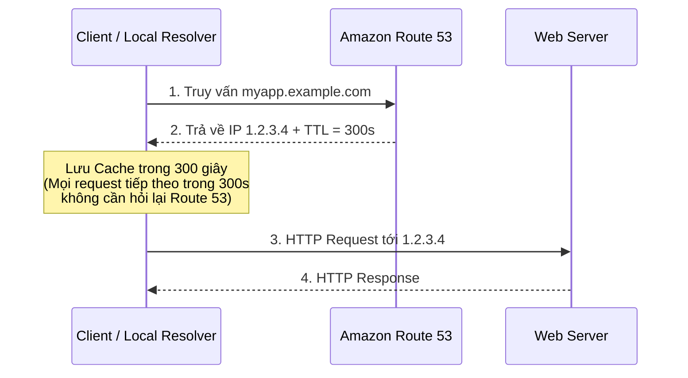

# Bài 106: Route 53 - TTL (Time To Live của bản ghi DNS)

- **Section:** Phần 10 - Route 53
- **Lecture ID:** `13528188`
- **Video:** `SAA - Route 53 - TTL v2.mp4`
- **Thời lượng:** `05:28`
- **Cheat sheet:** [topics/aws_route53.html](../../topics/aws_route53.html)

---

## 1. Kiến thức trọng tâm (Exam Notes)

### 1.1. Cơ chế hoạt động của Record TTL (Time To Live)
- **TTL (Time To Live)** chỉ định khoảng thời gian (tính bằng giây) mà **Client** và **DNS Resolver** được phép **lưu kết quả phân giải vào bộ nhớ đệm (cache)**.
- Trong suốt thời gian TTL còn hiệu lực, nếu Client truy cập lại cùng hostname đó, nó sẽ **dùng ngay IP trong cache** mà **không gửi truy vấn mới** lên Route 53.

### 1.2. So sánh High TTL vs. Low TTL (Rất hay hỏi trong đề thi SAA-C03)

| Tiêu chí | High TTL (Ví dụ: `24 giờ`) | Low TTL (Ví dụ: `60 giây`) |
|---|---|---|
| **Lượng truy vấn tới Route 53** | **Ít hơn rất nhiều** | **Nhiều hơn đáng kể** |
| **Chi phí Route 53** | **Tiết kiệm chi phí** (do Route 53 tính phí theo số lượng truy vấn) | **Tốn chi phí hơn** |
| **Thời gian cập nhật bản ghi mới** | **Chậm:** Client có thể giữ bản ghi cũ (outdated) tới 24 giờ | **Nhanh:** Bản ghi cũ chỉ tồn tại tối đa 60 giây, dễ dàng thay đổi |

### 1.3. Chiến lượcBest Practice khi chuẩn bị thay đổi bản ghi DNS
1. **Trước khi di chuyển/cập nhật hạ tầng (ví dụ: trước 24 giờ):** Giảm TTL xuống mức rất thấp (ví dụ: `60 giây`) và đợi cho TTL cũ hết hạn trên toàn bộ Client.
2. **Khi thực hiện chuyển đổi:** Cập nhật giá trị IP/bản ghi mới trên Route 53 -> Mọi Client sẽ nhận bản ghi mới chỉ trong vòng 60 giây.
3. **Sau khi ổn định:** Tăng TTL trở lại mức cao (ví dụ: `24 giờ` hoặc `3600 giây`) để tiết kiệm chi phí truy vấn DNS.

> [!IMPORTANT]
> **Lưu ý cho kỳ thi:** **TTL là bắt buộc (mandatory)** đối với mọi bản ghi DNS, **NGOẠI TRỪ Alias Record** (vì Alias Record được Route 53 tự động quản lý TTL).

---

## 2. Phụ đề chi tiết theo mốc thời gian (Full Transcript & Timestamps)

| Thời gian | Nội dung lời giảng gốc (English) | Bản dịch tiếng Việt sát nghĩa |
|---|---|---|
| `00:00:00` | Okay, so let's have a look at TTLs. So a record TTL is a Time To Live. | Được rồi, hãy cùng tìm hiểu về TTL. TTL của một bản ghi là **Time To Live** (Thời gian sống/tồn tại). |
| `00:00:05` | And let's take this example where a client is accessing our DNS Route 53 and a web server. | Hãy xét ví dụ khi một Client truy cập vào DNS Route 53 và một Web Server của chúng ta. |
| `00:00:10` | So we do a DNS request for myapp.example.com, and we get an answer from the DNS, which is saying, hey, please, this is an A record. Here is the IP, and there is a TTL, maybe a TTL of 300 seconds. | Client gửi một truy vấn DNS hỏi `myapp.example.com`, và nhận được câu trả lời từ DNS rằng: "Đây là bản ghi A, địa chỉ IP đây, kèm theo một TTL, chẳng hạn TTL là 300 giây." |
| `00:00:24` | So TTL is saying, hey clients, please cache this result for the duration of the TTL. So for 300 seconds, the client is going to cache the results. | TTL nhắn với Client rằng: "Này Client, hãy lưu kết quả này vào bộ nhớ đệm (cache) trong suốt khoảng thời gian TTL." Tức là trong 300 giây, Client sẽ lưu cache kết quả đó. |
| `00:00:34` | That means that if the client is requesting again or accessing the same host name, what's going to happen is that the client will not issue a query to the DNS system, because it already knows the answer, because the answer has been cached, and we're still within the cache period, so the cache TTL. | Điều đó có nghĩa là nếu Client yêu cầu lại hoặc truy cập lại cùng hostname đó trong khoảng thời gian này, Client sẽ **không** gửi truy vấn lên hệ thống DNS nữa vì nó đã biết câu trả lời trong bộ nhớ đệm và vẫn còn trong thời hạn TTL. |
| `00:00:53` | The idea behind this is that we don't want to query the DNS too often, because we don't expect records to change a lot, and so, therefore, using the response it has, the client can access our web server and do HTTP request and responses. | Ý tưởng đằng sau cơ chế này là chúng ta không muốn truy vấn máy chủ DNS quá thường xuyên vì các bản ghi DNS thường ít khi thay đổi; nhờ kết quả đã lưu, Client có thể kết nối thẳng tới Web Server để gửi/nhận HTTP request và response. |
| `00:01:05` | So we have, you know, two extreme cases. For example, if you set a high TTL of, say, 24 hours, then this is going to do a lot less traffic on Route 53, because less clients are doing requests, because the result are cached for 24 hours, | Chúng ta có hai trường hợp đối lập. Ví dụ, nếu bạn đặt **TTL cao**, chẳng hạn **24 giờ**, lượng truy vấn gửi tới Route 53 sẽ giảm đi rất nhiều vì kết quả được lưu cache suốt 24 giờ, |
| `00:01:21` | and, possibly, while the client will have outdated records. If somehow you want to change the record, you will need to wait 24 hours to make sure that all your clients will have the new records in their cache. | nhưng đổi lại Client có thể giữ bản ghi đã lỗi thời (outdated). Nếu bạn muốn đổi địa chỉ IP của bản ghi, bạn sẽ phải đợi tới 24 giờ để chắc chắn mọi Client đều đã cập nhật bản ghi mới vào cache. |
| `00:01:32` | If you set a low TTL, for example, 60 seconds, at the opposite, then it's going to do a lot more traffic on your DNS, so a lot more dollar you're going to spend, because you get priced per how many requests do reach Route 53. | Ngược lại, nếu bạn đặt **TTL thấp**, ví dụ **60 giây**, lưu lượng truy vấn lên DNS sẽ nhiều hơn hẳn, đồng nghĩa bạn sẽ tốn nhiều tiền hơn vì Route 53 tính phí theo số lượng truy vấn gửi tới nó. |
| `00:01:45` | But the records will be outdated for less time, so it's quicker for you to do a record change, and it's easier to change records overall. | Nhưng bù lại, bản ghi chỉ bị cũ trong thời gian rất ngắn, giúp bạn thay đổi bản ghi nhanh chóng và dễ dàng hơn nhiều. |
| `00:01:52` | So it's up to you, really, to see what a good TTL or low TTL is. If you plan on changing a record, the idea is that sometimes you will decrease the TTL for, say, 24 hours, | Tùy thuộc vào nhu cầu mà bạn chọn TTL cao hay thấp. Nếu bạn có kế hoạch thay đổi một bản ghi, chiến lược thường dùng là hạ thấp TTL trước khoảng 24 giờ, |
| `00:02:01` | and then when you know that all the clients have a new TTL that is low, then you change the record value which gets updated for everyone, and then you increase the TTL. This is a strategy. | sau đó khi biết tất cả các Client đều đã nhận TTL ngắn mới, bạn mới đổi giá trị bản ghi để mọi người cập nhật nhanh, rồi cuối cùng tăng TTL cao trở lại. |
| `00:02:10` | So the TTL is mandatory for every record except the Alias record that we'll see in the next lecture. | Lưu ý: **TTL là bắt buộc cho mọi bản ghi, ngoại trừ Alias record** mà chúng ta sẽ học ở bài tiếp theo. |
| `00:02:15` | So let's have a look how TTL works in the console. So let's create a new record, and this one is going to be called demo.stephanetheteacher.com, | Hãy xem cách TTL hoạt động trên Console. Hãy tạo một bản ghi mới tên là `demo.stephanetheteacher.com`, |
| `00:02:27` | and the value of it is going to be one of the EC2 instances we know. So let's take the one in eu-central-1. So I'm gonna take this EC2 instance and paste the value of it. | và giá trị của nó là một trong các EC2 instances chúng ta vừa tạo. Hãy lấy IP của instance tại `eu-central-1` và dán vào đây. |
| `00:02:37` | And then for the TTL, we're going to set two minutes. So to do so I'm going to click twice on this minute button. So the TTL is now 120 seconds. So let me create this record. | Về **TTL**, chúng ta sẽ đặt là 2 phút (`120` giây). Hãy nhấn tạo bản ghi này. |
| `00:02:48` | And now my record has been created. So it is an A record pointing to a specific IP at demo.stephanetheteacher.com. | Bản ghi `A` tại `demo.stephanetheteacher.com` trỏ tới IP cụ thể đã được tạo xong. |
| `00:02:56` | Now, I want to show you that the record is working, so I'm going to use Google Chrome on the right-hand side to show you this. | Để chứng minh bản ghi đang hoạt động, tôi sẽ mở trình duyệt Google Chrome ở phía bên phải. |
| `00:03:09` | So if I do demo.stephanetheteacher.com on Google Chrome, then automatically it should direct me to, yes, my eu-central-1 instance. So that means that this record, this A record, is fully functioning. | Khi tôi truy cập `demo.stephanetheteacher.com` trên Chrome, nó lập tức điều hướng tôi tới instance tại `eu-central-1`. Nghĩa là bản ghi A này đã hoạt động hoàn hảo. |
| `00:03:23` | And I can also make sure of that, for example, if I'm using CloudShell. So if I clear this and do an nslookup on demo.stephanetheteacher.com, as you can see, the address is correct. | Tôi cũng có thể kiểm tra bằng CloudShell. Khi chạy `nslookup demo.stephanetheteacher.com`, địa chỉ IP trả về hoàn toàn chính xác. |
| `00:03:34` | And if I do a dig command on this, then we get an answer. And there's a cool number that we're showing here, so the answer section, there's 115. | Và nếu chạy lệnh `dig demo.stephanetheteacher.com`, trong phần ANSWER SECTION có một con số rất thú vị là `115`. |
| `00:03:43` | So the idea here, that's because I did do a DNS query. Then the record get cached for 120 seconds. And if I retype again this dig command right here, as you can see the number got down to 98. | Lý do là khi tôi thực hiện truy vấn DNS lần đầu, bản ghi được lưu vào cache trong 120 giây. Và khi tôi gõ lại lệnh `dig` này lần nữa, con số đó đã giảm xuống còn `98`. |
| `00:03:57` | So that means that for 98 seconds, actually, I will get the same response, because, no matter what, this is what's cached on my computer. | Điều đó có nghĩa là trong 98 giây tiếp theo, tôi sẽ luôn nhận được cùng một câu trả lời đó bất kể chuyện gì xảy ra trên Route 53, vì kết quả đã được lưu cache. |
| `00:04:04` | So if I'm very quick and I go to this record right here and I edit it, so instead of this IP, I want to go to ap-southeast-1, so we'll use the first IP in my list and save this. | Bây giờ nếu tôi thao tác thật nhanh, vào chỉnh sửa bản ghi này trên Route 53: thay vì IP ở Frankfurt, tôi đổi sang IP của instance tại Singapore (`ap-southeast-1`) rồi nhấn **Save**. |
| `00:04:19` | So even though this record was being updated, okay, if I go into CloudShell and, again, do this dig command, as you can see, the answer is still the same as before. That's because for 66 more seconds this is going to be cached. | Mặc dù bản ghi trên Route 53 đã được cập nhật, khi tôi quay lại CloudShell và chạy lại lệnh `dig`, câu trả lời vẫn là IP cũ ở Frankfurt! Đó là vì nó vẫn còn được lưu cache trong 66 giây nữa. |
| `00:04:32` | And if I go to Chrome, I think I was fast enough, I go to Chrome and refresh this page, as you can see, I still have the answer from eu-central-1. And this is because, again, my record got cached for two minutes. | Tương tự, khi tôi sang trình duyệt Chrome và tải lại trang, tôi vẫn nhận được phản hồi từ `eu-central-1` vì bản ghi đã được cache trong 2 phút. |
| `00:04:43` | So when the cache is expiring, then only then my command line interface or my Chrome web browser will ask again Route 53 for the value of this record. And then, again, will I get the answer and will be redirected to this new IP. | Chỉ khi nào bộ nhớ đệm hết hạn (TTL về 0), lúc đó giao diện dòng lệnh hoặc trình duyệt Chrome của tôi mới hỏi lại Route 53 giá trị mới của bản ghi và chuyển hướng sang IP mới. |
| `00:04:59` | So the best way to check it is just to wait. So I'm going to wait maybe one more minute and then get back to you. | Cách tốt nhất để kiểm chứng là chờ đợi. Tôi sẽ đợi thêm khoảng 1 phút nữa rồi quay lại. |
| `00:05:04` | Okay, so it's been a minute and now if I refresh my web browser, as you can see now, I get a different Hello World and this time it's from ap-southeast-1b. | Được rồi, đã qua 1 phút, bây giờ khi tôi làm mới trình duyệt web, bạn có thể thấy thông điệp Hello World đã đổi sang `ap-southeast-1b`. |
| `00:05:12` | And if I go into my CloudShell and do the same dig command, then, as you can see, there's a new TTL, so 120 seconds, and there is a new IP right here which is the IP of my new server. | Và khi vào CloudShell chạy lại lệnh `dig`, bạn sẽ thấy chu kỳ TTL mới (`120` giây) cùng địa chỉ IP mới của máy chủ tại Singapore. |
| `00:05:23` | So this was a cool demo of the TTL. I hope you liked it, and I will see you in the next lecture. | Đó là một màn minh họa rất trực quan về TTL. Hy vọng bạn thích bài học này và hẹn gặp lại trong bài giảng tiếp theo. |
