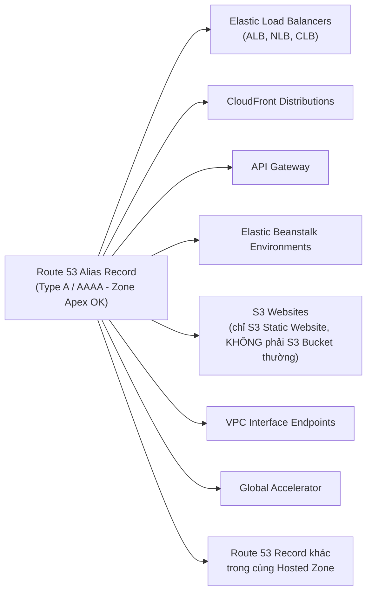

# Bài 107: Route 53 CNAME vs Alias (So sánh bản ghi CNAME và Alias)

- **Section:** Phần 10 - Route 53
- **Lecture ID:** `13528190`
- **Video:** `SAA_-_Route_53_-_CNAME_vs_Alias_v2.mp4`
- **Thời lượng:** `07:00`
- **Cheat sheet:** [topics/aws_route53.html](../../topics/aws_route53.html)

---

## 1. Kiến thức trọng tâm (Exam Notes)

### 1.1. Bảng so sánh chi tiết `CNAME` vs `Alias` (Trọng tâm thi SAA-C03)

| Tiêu chí | Bản ghi `CNAME` | Bản ghi `Alias` (Route 53 Specific) |
|---|---|---|
| **Đích trỏ tới (Target)** | Trỏ một hostname tới **bất kỳ hostname nào khác** (trong hoặc ngoài AWS, ví dụ `blabla.anything.com`) | Trỏ một hostname tới một **AWS Resource cụ thể** (`blabla.amazonaws.com`) |
| **Hỗ trợ Root Domain (Zone Apex)** | **KHÔNG** — Chỉ hoạt động cho **Non-Root Domain** (ví dụ: `app.mydomain.com`) | **CÓ** — Hoạt động cho cả **Root Domain (`mydomain.com`)** và **Non-Root Domain (`app.mydomain.com`)** |
| **Chi phí truy vấn** | **Tính phí** theo số lượng truy vấn DNS | **MIỄN PHÍ (Free of charge)** đối với các truy vấn trỏ tới tài nguyên AWS |
| **Health Check tích hợp** | Không có sẵn native health check | Có khả năng **Native Health Check** (`Evaluate target health`) |
| **Loại bản ghi hiển thị** | Kiểu `CNAME` | Luôn có kiểu **`A`** (IPv4) hoặc **`AAAA`** (IPv6) |
| **Cấu hình TTL** | Cho phép tùy chỉnh TTL | **Không thể tự đặt TTL** (Route 53 tự động thiết lập theo tài nguyên đích) |

### 1.2. Danh sách các AWS Resources hỗ trợ làm Alias Target

> [!WARNING]
> **Cái bẫy đề thi SAA-C03:**
> **KHÔNG THỂ** tạo bản ghi Alias trỏ tới **EC2 DNS Name**! Nếu muốn trỏ tới EC2 instance, bạn phải dùng bản ghi `A` (trỏ tới Elastic IP / Public IPv4) hoặc đặt EC2 phía sau một **ALB** rồi dùng Alias trỏ tới ALB.

---

## 2. Phụ đề chi tiết theo mốc thời gian (Full Transcript & Timestamps)

| Thời gian | Nội dung lời giảng gốc (English) | Bản dịch tiếng Việt sát nghĩa |
|---|---|---|
| `00:00:00` | So now let's have a look at the differences between CNAME and Aliases. | Bây giờ hãy cùng tìm hiểu sự khác biệt giữa bản ghi **CNAME** và **Alias**. |
| `00:00:04` | So when you have an AWS Resource, for example, a Load Balancer or CloudFront, it will expose a hostname. | Khi bạn có một tài nguyên AWS — ví dụ như một Load Balancer hoặc CloudFront — nó sẽ cung cấp một tên máy chủ (hostname). |
| `00:00:09` | And what you want is to maybe map that hostname to a domain you own. For example, you want to map this Load Balancer into myapp.mydomain.com. | Và điều bạn muốn làm là ánh xạ hostname đó sang một tên miền mà bạn sở hữu, ví dụ ánh xạ Load Balancer vào `myapp.mydomain.com`. |
| `00:00:17` | So we have two options. The first one is to use a CNAME record. So we've seen A records, but now let's look at CNAME records. | Chúng ta có hai lựa chọn. Lựa chọn đầu tiên là sử dụng bản ghi **CNAME**. Chúng ta đã biết bản ghi A, giờ hãy xem xét bản ghi CNAME. |
| `00:00:23` | So CNAME allows you to point a hostname to any other hostname. For example, you can say app.mydomain.com is pointing to blabla.anything.com. | **CNAME** cho phép bạn trỏ một hostname tới **bất kỳ hostname nào khác**. Ví dụ: `app.mydomain.com` trỏ tới `blabla.anything.com`. |
| `00:00:32` | And this only works if you have a non root domain name, so if you have something.mydomain.com. It does not work for just mydomain.com, as we'll see in the hands-on. | Tuy nhiên, CNAME **chỉ hoạt động đối với Non-Root Domain** (tên miền phụ có dạng `something.mydomain.com`). Nó **không hoạt động** cho tên miền gốc (`mydomain.com`), như chúng ta sẽ thấy trong phần thực hành. |
| `00:00:42` | On the other hand, you have alias records, and these are specific to Route 53, but they allow you to point a hostname to a specific AWS Resource. | Mặt khác, bạn có bản ghi **Alias** — tính năng đặc trưng của Route 53 — cho phép bạn trỏ một hostname tới một **tài nguyên AWS cụ thể**. |
| `00:00:51` | So app.mydomain.com is pointing to blabla.amazonaws.com. And these resources we'll see in a second where they are. | Ví dụ: `app.mydomain.com` trỏ tới `blabla.amazonaws.com`. Chúng ta sẽ xem danh sách các tài nguyên được hỗ trợ ngay sau đây. |
| `00:00:59` | But these alias records work for both root domains and non root domains. So you can have mydomain.com pointing to, as an alias, to an AWS resource which is very, very good. | Điểm tuyệt vời là bản ghi **Alias hoạt động cho cả Root Domain và Non-Root Domain**. Bạn có thể cho `mydomain.com` trỏ trực tiếp dưới dạng Alias tới một tài nguyên AWS. |
| `00:01:10` | So this is something that the exam may test you on, and we'll see this in the hands-on. | Đây là kiến thức mà đề thi rất hay hỏi, và chúng ta sẽ kiểm chứng ngay trong phần thực hành. |
| `00:01:14` | So on top of it, alias is very good because they're free of charge, and they have a native health check capability within them. | Hơn thế nữa, bản ghi Alias rất ưu việt vì chúng **hoàn toàn miễn phí** (free of charge) và tích hợp sẵn khả năng kiểm tra sức khỏe (**native health check**). |
| `00:01:21` | Okay, so if we look at these alias records in details, they are only mapped to resources in AWS. | Đi sâu vào chi tiết bản ghi Alias: chúng chỉ được ánh xạ tới các tài nguyên trong AWS. |
| `00:01:26` | So you would say, "Okay, here is Route 53. I want to have example.com as an alias record of type A, and the value is the DNS name of the load balancer you have." | Ví dụ trong Route 53, bạn tạo `example.com` là một bản ghi Alias kiểu `A`, và giá trị đích là DNS name của chiếc Load Balancer bạn đang có. |
| `00:01:37` | Now, this is an extension to DNS functionalities. And in case the underlying ALB have IP changes, then automatically the alias record will recognize them. | Đây là một phần mở rộng chức năng DNS của Route 53. Trong trường hợp các địa chỉ IP bên dưới của ALB thay đổi, bản ghi Alias sẽ tự động nhận diện được ngay. |
| `00:01:49` | So as I said, unlike CNAME, alias records can be used for the top node of the DNS namespace called the Zone Apex, so you can use an alias record for example.com. | Như đã nói, khác với CNAME, bản ghi Alias có thể dùng cho nút cao nhất của không gian tên DNS gọi là **Zone Apex** (ví dụ: `example.com`). |
| `00:02:00` | Now, the alias record is always of type A or AAAA which is for resources, so either IPv4 or IPv6. | Bản ghi Alias luôn mang kiểu **`A`** (cho IPv4) hoặc **`AAAA`** (cho IPv6). |
| `00:02:10` | When you have an alias record, you cannot set the TTL. It is set automatically by Route 53. | Khi sử dụng bản ghi Alias, bạn **không thể tự đặt TTL** — TTL được Route 53 thiết lập tự động. |
| `00:02:15` | So what are the targets for alias records? Well, it could be Elastic Load Balancers. It could be CloudFront Distributions. | Vậy đâu là các đích đến (Alias Targets) được hỗ trợ? Đó có thể là **Elastic Load Balancers**, **CloudFront Distributions**, |
| `00:02:29` | So ELBs, CloudFront Distributions, API Gateway, Elastic Beanstalk environments, S3 Websites, so not S3 Buckets but S3 Websites when these buckets are enabled as websites, | **API Gateway**, môi trường **Elastic Beanstalk**, **S3 Websites** (lưu ý: chỉ khi S3 Bucket được bật tính năng Static Website Hosting, chứ không phải S3 Bucket thông thường), |
| `00:02:40` | VPC Interface Endpoints, Global Accelerator accelerator, and Route 53 records in the same hosted zone. | **VPC Interface Endpoints**, **Global Accelerator**, và các **bản ghi Route 53 khác trong cùng Hosted Zone**. |
| `00:02:47` | One thing that is not there is that you cannot set an alias for an EC2 DNS name. This is something you need to remember. So EC2 DNS names are not something that can be the target of an alias record, okay? | Một điểm cực kỳ quan trọng cần nhớ là bạn **KHÔNG THỂ đặt Alias cho một EC2 DNS name**. Tên DNS của EC2 không thể làm đích của một bản ghi Alias! |
| `00:03:02` | So now let's have a look in the console to see how CNAMEs and alias records work. | Bây giờ hãy vào Console để xem cách bản ghi CNAME và Alias hoạt động. |
| `00:03:06` | So let's go ahead and create a record, and this one will be of type CNAME. So I will call this one myapp.stephanetheteacher.com. | Hãy tạo một bản ghi mới thuộc kiểu **CNAME**, đặt tên là `myapp.stephanetheteacher.com`. |
| `00:03:15` | And the record type now is not A, it's not AAAA. It's CNAME. And then the value must be a domain name. | Loại bản ghi bây giờ không phải A hay AAAA mà là **CNAME**. Giá trị (**Value**) bắt buộc phải là một tên miền. |
| `00:03:22` | And very easy, I already have a domain name available. That's my ALB. So what I'm going to do is I'm going to copy the DNS name of my ALB and paste it in here. | Rất đơn giản, tôi đã có sẵn DNS name của chiếc ALB vừa tạo. Tôi sẽ sao chép DNS name của ALB và dán vào đây. |
| `00:03:31` | The idea is that now instead of accessing my ALB through this URL, I want to access the ALB through myapp.stephanetheteacher.com. | Ý tưởng là thay vì truy cập ALB qua chuỗi URL dài ngoằng mặc định, tôi muốn truy cập ALB thông qua `myapp.stephanetheteacher.com`. |
| `00:03:38` | Okay, so I will just create this record, and now myapp.stephanetheteacher.com has been created. | Tôi nhấn **Create records**, và giờ `myapp.stephanetheteacher.com` đã được tạo. |
| `00:03:47` | And so if I go into my Chrome web browser on the right-hand side and open this URL, now you see that the answer is Hello World from my IP blah, blah, blah in AZ eu-central-1c. | Khi tôi sang trình duyệt Chrome ở bên phải và mở URL này, bạn sẽ thấy phản hồi trả về là `Hello World ... in AZ eu-central-1c`. |
| `00:04:02` | So this domain name is in fact covered by the ALB, and the ALB is directing the traffic into one EC2 instance, and so therefore I receive back this Hello World. | Tức là tên miền này đã trỏ sang ALB, và ALB điều hướng lưu lượng vào EC2 instance phía sau. |
| `00:04:13` | So this is good, but this is not AWS native, okay? This is something that will work for many domain names, but we can do something better. Because we are redirecting into an ALB, what we can do is create an alias record. | Cách dùng CNAME này hoạt động được nhưng không phải là giải pháp tối ưu chuẩn AWS (AWS-native). Vì chúng ta đang trỏ tới một ALB, chúng ta có thể làm tốt hơn bằng cách tạo một **Alias record**. |
| `00:04:24` | So I can create a record, and this time it's going to be myalias.stephanetheteacher.com, and the record type is A because my ALB is currently having only IPv4 traffic. | Tôi nhấn **Create record**, đặt tên là `myalias.stephanetheteacher.com`, chọn kiểu bản ghi là **`A`** vì ALB của tôi đang dùng IPv4. |
| `00:04:36` | And the value of it, so we have to toggle the Alias right here, and we're going to route traffic to, and then we have a list of options, okay? | Ở phần giá trị, chúng ta bật công tắc **Alias** lên, tại mục **Route traffic to** sẽ hiện ra danh sách các loại tài nguyên AWS hỗ trợ. |
| `00:04:45` | So we can see a lot of different options, but right now it's going to be an Alias to an Application and Classic Load Balancer. | Chúng ta chọn **Alias to Application and Classic Load Balancer**. |
| `00:04:51` | We need to choose a region, so it is in eu-central-1 for me. And then we need to choose the load balancer, so I will choose this load balancer right here. | Chọn Region là `eu-central-1` (Frankfurt), sau đó chọn đúng chiếc Load Balancer của chúng ta từ danh sách. |
| `00:04:59` | Then automatically we can evaluate the target health as well with a Yes because this is an alias record. So we'll click on Create this record, and now I have a new record right here called myalias.stephanetheteacher.com. | Chúng ta cũng có thể bật **Evaluate target health = Yes** vì đây là bản ghi Alias. Nhấn **Create records**, và giờ tôi đã có bản ghi `myalias.stephanetheteacher.com`. |
| `00:05:12` | And the cool thing is that this record is free to query, okay? So I'm not going to pay any money because this is an alias record. | Điểm tuyệt vời là các truy vấn vào bản ghi này **hoàn toàn miễn phí** vì nó là Alias record. |
| `00:05:18` | So if I click on myalias.stephanetheteacher.com, it's going to perform a few DNS queries, and now, again, I get the same response. Okay, nothing has changed, but it is working. | Khi mở `myalias.stephanetheteacher.com` trên trình duyệt, tôi cũng nhận được kết quả Hello World tương tự. Mọi thứ hoạt động hoàn hảo. |
| `00:05:28` | But now what if you consider the domain apex, so if you want to have just stephanetheteacher.com to redirect to this page? | Nhưng bây giờ hãy xét đến **Domain Apex (Root Domain)**: chuyện gì xảy ra nếu bạn muốn chính tên miền gốc `stephanetheteacher.com` trỏ tới trang web này? |
| `00:05:36` | So what we're going to do is create a record, and let's go ahead. So we're going to just have nothing in here, okay? And we're going to have a CNAME record pointing to the domain name of my ALB which is copied from here and pasted in here. | Hãy thử nhấn **Create record**, để trống ô subdomain (tức là dùng thẳng `stephanetheteacher.com`), chọn kiểu **CNAME** và dán DNS name của ALB vào. |
| `00:05:57` | Now, this is not going to work. Let's try it. It's saying, "Hey, bad request. The CNAME is not permitted at apex of this zone." | Cách này sẽ **không hoạt động**. Khi nhấn tạo, hệ thống báo lỗi: `Bad request. A CNAME record is not permitted at the apex of a zone.` |
| `00:06:06` | So this zone is stephanetheteacher.com, and the apex of the zone is stephanetheteacher.com, and therefore we cannot set up a CNAME at the apex. | Hosted Zone này là `stephanetheteacher.com`, đỉnh (Apex) của Zone chính là `stephanetheteacher.com`, do đó chúng ta **không được phép tạo CNAME tại Zone Apex**. |
| `00:06:14` | So the only way we can deal with this issue is instead to create an alias and the record is going to be of type A, and the alias is going to point again to an ALB or CLB in the eu-central-1 region, and the load balancer is going to be the one from before. | Cách duy nhất để giải quyết vấn đề này là tạo một **Alias record** kiểu **`A`**, bật **Alias**, trỏ tới **ALB** tại Region `eu-central-1` và chọn chiếc Load Balancer của chúng ta. |
| `00:06:31` | Now, this is going to be accepted because this is an alias record, and this is what the exam may test you on, okay? | Lần này hệ thống chấp nhận ngay vì đây là bản ghi **Alias** — và đây chính xác là tình huống đề thi sẽ hỏi bạn! |
| `00:06:36` | And so now we can see that stephanetheteacher.com is accessible. And so if I go back into my web browser in here, open a new tab and enter stephanetheteacher.com and press Enter, here I get back the Hello World from my load balancer, so everything is working great, so that's it. | Giờ nếu tôi mở một tab trình duyệt mới và gõ trực tiếp `stephanetheteacher.com`, tôi nhận được ngay trang Hello World từ Load Balancer. |
| `00:06:54` | We've shown how CNAMEs and alias records work in AWS. I hope you liked it, and I will see you in the next lecture. | Vậy là chúng ta đã nắm vững cách hoạt động của CNAME và Alias trong AWS. Hẹn gặp lại bạn ở bài giảng tiếp theo. |
