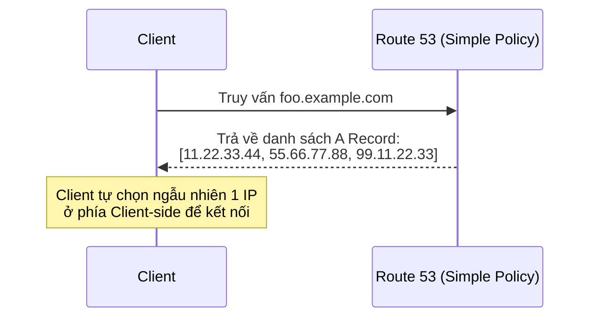

# Bài 108: Routing Policy - Simple (Chính sách định tuyến Đơn giản)

- **Section:** Phần 10 - Route 53
- **Lecture ID:** `13528192`
- **Video:** `SAA_-_Route_53_-_Routing_Simple_v2.mp4`
- **Thời lượng:** `04:05`

---

## 1. Kiến thức trọng tâm (Exam Notes)

### 1.1. Bản chất của Routing Policy trong Route 53
- **Lưu ý quan trọng:** Từ "Routing" trong Route 53 là **định tuyến ở góc độ DNS**, không phải định tuyến lưu lượng mạng như Load Balancer.
- Lưu lượng dữ liệu thực tế (HTTP/HTTPS) **không đi xuyên qua Route 53**; Route 53 chỉ trả lời các truy vấn DNS để cho Client biết cần kết nối tới địa chỉ IP/Endpoint nào.
- **Các loại Routing Policy được hỗ trợ trong Route 53:**
  1. `Simple`
  2. `Weighted`
  3. `Failover`
  4. `Latency-based`
  5. `Geolocation`
  6. `Multi-Value Answer`
  7. `Geoproximity` (qua Route 53 Traffic Flow)
  8. `IP-based`

### 1.2. Simple Routing Policy
- **Mục đích:** Thường dùng để điều hướng lưu lượng tới **một tài nguyên duy nhất** (ví dụ: 1 Web Server hoặc 1 ALB).
- **Hỗ trợ nhiều giá trị (Multiple Values):** Bạn có thể nhập **nhiều địa chỉ IP** trong cùng một bản ghi `Simple`:
  - Route 53 sẽ trả về **tất cả các địa chỉ IP** đó cho Client trong một phản hồi DNS.
  - **Client sẽ tự chọn ngẫu nhiên (client-side random choice)** một IP trong danh sách để kết nối.
- **Khi bật Alias cùng Simple Routing:** Chỉ có thể chỉ định **1 tài nguyên AWS duy nhất** làm đích.
- **Giới hạn quan trọng:** **KHÔNG THỂ gắn Health Checks** với Simple Routing Policy. (Nếu cần trả về nhiều IP có kiểm tra Health Check, phải dùng `Multi-Value Answer`).

---

## 2. Phụ đề chi tiết theo mốc thời gian (Full Transcript & Timestamps)

| Thời gian | Nội dung lời giảng gốc (English) | Bản dịch tiếng Việt sát nghĩa |
|---|---|---|
| `00:00:00` | So now let's talk about routing policies for Route 53. | Bây giờ hãy nói về các chính sách định tuyến (**Routing Policies**) trong Route 53. |
| `00:00:03` | So a routing policy is helping Route 53 respond to DNS queries, and we shouldn't be confused about the word routing. | Một Routing Policy giúp Route 53 biết cách phản hồi các truy vấn DNS, và chúng ta không nên nhầm lẫn về từ "định tuyến" (routing) ở đây. |
| `00:00:11` | This is not like when you have a load balancer and the actual load balancer will route traffic to the backend EC2 instances. No, no, no. | Nó không giống như một chiếc Load Balancer trực tiếp nhận và chuyển tiếp lưu lượng mạng tới các máy chủ EC2 phía sau. Hoàn toàn không phải. |
| `00:00:18` | This routing is from a DNS perspective. So the DNS does not route any traffic. So the traffic doesn't go through the DNS. | Việc định tuyến ở đây là dưới góc độ DNS. Hệ thống DNS không vận chuyển lưu lượng mạng, tức lưu lượng truy cập web không đi qua DNS. |
| `00:00:26` | The DNS only will respond to the DNS queries and then the clients will know to which way they should be doing these HTTP queries, for example. | DNS chỉ phản hồi các truy vấn DNS để từ đó các Client biết địa chỉ đích mà chúng cần gửi các yêu cầu HTTP tới. |
| `00:00:35` | So the DNS just helps translate host names into actual endpoints that the clients can use. | Tóm lại, DNS chỉ giúp dịch các hostname thành các endpoint thực tế để Client sử dụng. |
| `00:00:40` | So Route 53 will support the following routing policy. There's simple, weighted, failover, latency based, geolocation, multi-value answer, and geoproximity. And we're going to have a look at all of them in this section. | Route 53 hỗ trợ các chính sách định tuyến sau: **Simple**, **Weighted**, **Failover**, **Latency-based**, **Geolocation**, **Multi-Value Answer**, và **Geoproximity** (cùng **IP-based**). Chúng ta sẽ tìm hiểu tất cả trong chương này. |
| `00:00:55` | So the first one is going to be the simple routing policy. And the idea is that with this, that we've actually been using before, we're going to route traffic to a single resource typically. | Chính sách đầu tiên là **Simple Routing Policy** — cũng chính là loại chúng ta đã dùng ở các bài trước — thường dùng để hướng lưu lượng tới một tài nguyên đơn lẻ. |
| `00:01:05` | So here's an example. The clients that will say, hey, I want to go to foo.example.com, and Route 53 will say, hey, go to this IP address. And this is an A record. | Ví dụ: Client hỏi `foo.example.com`, và Route 53 trả lời bằng một địa chỉ IP thông qua bản ghi A. |
| `00:01:14` | So it is possible for us to specify multiple values in the same record. And if so, if multiple values are returned by the DNS, then a random one will be chosen by the clients on client side. | Tuy nhiên, chúng ta cũng có thể chỉ định **nhiều giá trị (multiple values)** trong cùng một bản ghi Simple. Khi DNS trả về nhiều giá trị, Client sẽ tự chọn ngẫu nhiên một giá trị ở phía Client-side. |
| `00:01:26` | So in this example, we have the client asking again for foo.example.com, and Amazon Route 53 will just reply with three IP addresses that are embedded into the A record. And then the clients will pick one of them randomly and apply it for the routing. | Trong ví dụ này, khi Client hỏi `foo.example.com`, Route 53 trả về cả 3 địa chỉ IP nằm trong bản ghi A đó, rồi trình duyệt của Client sẽ chọn ngẫu nhiên 1 trong 3 IP để kết nối. |
| `00:01:42` | So if you have enabled an alias record alongside the simple policy, then you can only specify one AWS resource as a target. | Nếu bạn bật **Alias record** kết hợp với Simple Routing Policy, bạn chỉ có thể chỉ định **duy nhất 1 tài nguyên AWS** làm đích. |
| `00:01:51` | And finally, it's called simple because it's very simple. And therefore you can not associate this with health checks and we'll see health checks later on in this section and how they work. | Cuối cùng, nó có tên là Simple vì nó rất đơn giản: bạn **không thể gắn Health Checks** với Simple Routing Policy. |
| `00:01:57` | So let's go in the console to see how a routing policy of type simple can be created. | Hãy vào Console xem cách tạo một bản ghi Simple Routing Policy với nhiều giá trị. |
| `00:02:03` | So let's create a record, and the record name is going to be simple.stephanetheteacher.com. It's an A record, and the value of which is going to be, for example, my instance in ap-southeast-1. | Tạo một bản ghi mới tên là `simple.stephanetheteacher.com`, kiểu `A`, giá trị ban đầu là IP của instance tại `ap-southeast-1`. |
| `00:02:15` | Now for TTL, we'll set something very low, like 20 seconds. And the routing policy is going to be here. | Đặt **TTL** thật thấp là `20` giây, và chọn **Routing policy** là **Simple routing**. |
| `00:02:19` | So as you can see, we have different possibilities, six of them, and then one other that is somewhere else in the UI. | Như bạn thấy, có các tùy chọn chính sách định tuyến hiện ra ở đây. |
| `00:02:26` | So we have a TTL 20 seconds and simple routing policy, and let's just create this record. So we've been doing this before. We know how this works. | Với TTL 20 giây và Simple routing policy, hãy nhấn **Create records**. |
| `00:02:34` | So now if we go to simple.stephanetheteacher.com. And go to this URL, we get Hello World from my instance in ap-southeast-1b, which is awesome. | Khi mở `simple.stephanetheteacher.com` trên trình duyệt, chúng ta nhận được `Hello World ... in AZ ap-southeast-1b`. |
| `00:02:44` | And if we do a dig command and have a look, so we need to reinstall dig. So `sudo yum install bind-utils`. So this is because I restarted my machine here. | Chuyển sang CloudShell để kiểm tra bằng lệnh `dig` (do phiên CloudShell vừa khởi động lại nên tôi cài lại `sudo yum install -y bind-utils`). |
| `00:02:56` | Okay, we're going to redo the dig command. So we do the dig command on this. As we can see, we have an A record of a TTL of 20 seconds pointing to this IP. | Khi chạy `dig simple.stephanetheteacher.com`, chúng ta thấy một bản ghi A với TTL 20 giây trỏ tới IP tại Singapore. |
| `00:03:05` | But we can change this record now. We're going to edit the record. So I will just simply click on it and edit the record. | Bây giờ hãy chỉnh sửa bản ghi này. Tôi chọn bản ghi và nhấn **Edit record**. |
| `00:03:12` | And for the value, now, I can enter multiple IPs. So I can insert my one in ap-southeast-1 and one in us-east-1, for example. | Trong ô **Value**, tôi có thể nhập nhiều địa chỉ IP trên nhiều dòng: giữ nguyên IP tại `ap-southeast-1` và thêm tiếp IP của instance tại `us-east-1` ở dòng dưới. |
| `00:03:20` | So when I do so and save this, what's going to happen is that once the TTL expires from before, we're going to get two records back. | Nhấn **Save**. Khi TTL cũ hết hạn, truy vấn DNS sẽ trả về cả 2 giá trị IP. |
| `00:03:28` | So let's use CloudShell to verify this. So I'm going to do a dig command. And as you can see, now we have in the answer section, we have two responses. We have one in this IP and one in this IP. | Kiểm tra trên CloudShell bằng lệnh `dig`: trong mục **ANSWER SECTION** hiện đã trả về **2 phản hồi** tương ứng với 2 địa chỉ IP! |
| `00:03:40` | So it's a client side choice. So that means that if I go to this website and refresh, I have one chance out of two to go into us-east-1. | Việc chọn IP nào hoàn toàn do phía Client quyết định. Nếu tôi tải lại trang web trên trình duyệt sau khi hết TTL 20 giây, tôi có xác suất 50% được chuyển sang `us-east-1`. |
| `00:03:53` | And I'm refreshing. And I get back the Hello World from us-east-1a. So this worked. This absolutely shows how simple records work. | Sau khi đợi 20 giây và nhấn Refresh, tôi đã nhận được `Hello World ... in AZ us-east-1a`. Điều này minh họa rõ ràng cách Simple Routing Policy hoạt động với nhiều giá trị. |
| `00:04:03` | I hope you liked it, and I will see you in the next lecture. | Hy vọng bạn thích bài học này và hẹn gặp lại trong bài giảng tiếp theo. |
