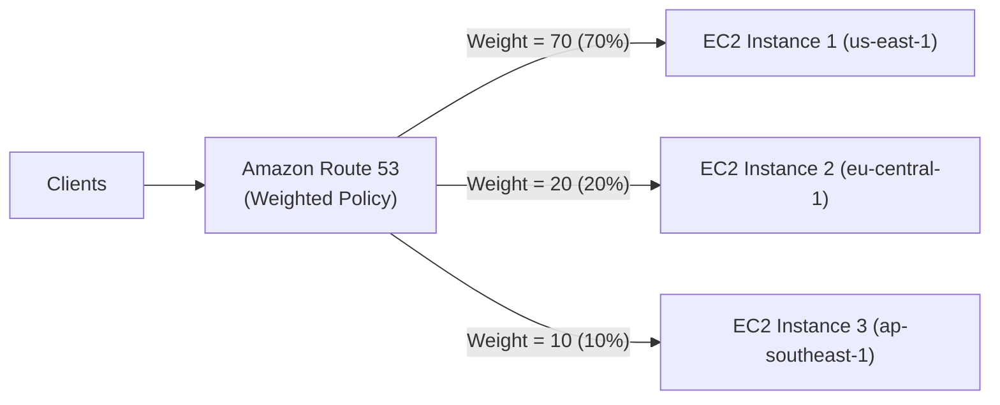

# Bài 109: Routing Policy - Weighted (Chính sách định tuyến theo Trọng số)

- **Section:** Phần 10 - Route 53
- **Lecture ID:** `13528194`
- **Video:** `SAA_-_Route_53_-_Routing_Weighted_v2.mp4`
- **Thời lượng:** `05:02`

---

## 1. Kiến thức trọng tâm (Exam Notes)

### 1.1. Cơ chế hoạt động của Weighted Routing Policy
- Kiểm soát **tỷ lệ phần trăm (%) các truy vấn DNS** được điều hướng tới từng tài nguyên cụ thể dựa trên **trọng số tương đối (`Weight`)**.
- Công thức tính tỷ lệ lưu lượng cho một bản ghi:
  $$\text{Traffic (\%)} = \frac{\text{Weight của bản ghi}}{\text{Tổng Weight của tất cả bản ghi cùng tên}}$$
- **Lưu ý:** Tổng các trọng số **không bắt buộc phải bằng 100** (tuy nhiên đặt tổng bằng 100 giúp dễ nhẩm tính phần trăm hơn).

### 1.2. Quy tắc & Trường hợp đặc biệt cần nhớ cho kỳ thi
- Các bản ghi DNS trong cùng nhóm Weighted phải có **cùng Record Name và Record Type**, phân biệt nhau bằng **Record ID**.
- **Có thể gắn kèm Health Checks** cho từng bản ghi.
- **Trọng số bằng `0` (`Weight = 0`):** Ngừng gửi lưu lượng tới tài nguyên đó.
- **Nếu TẤT CẢ các bản ghi đều có `Weight = 0`:** Lưu lượng sẽ được chia **đều nhau (equal weight)** cho tất cả các bản ghi.
- **Use Cases điển hình:**
  - Cân bằng tải giữa nhiều Region khác nhau.
  - Kiểm thử phiên bản ứng dụng mới (**Canary / Blue-Green Testing** — ví dụ: gửi 5% lưu lượng sang môi trường Elastic Beanstalk mới để theo dõi lỗi trước khi nâng dần lên 100%).

---

## 2. Phụ đề chi tiết theo mốc thời gian (Full Transcript & Timestamps)

| Thời gian | Nội dung lời giảng gốc (English) | Bản dịch tiếng Việt sát nghĩa |
|---|---|---|
| `00:00:00` | So now let's talk about the weighted routing policy. | Bây giờ hãy cùng tìm hiểu về chính sách định tuyến theo trọng số (**Weighted Routing Policy**). |
| `00:00:03` | The idea is that you can have a percentage of requests you can control to go to a specific resource thanks to weights. | Ý tưởng là bạn có thể kiểm soát tỷ lệ phần trăm các yêu cầu được gửi tới từng tài nguyên cụ thể nhờ vào các trọng số (weights). |
| `00:00:09` | So, put it simply in the diagram, we have Amazon Route 53, and then we have three EC2 instances that have been assigned different weights, so 70, 20, and 10. | Nhìn vào sơ đồ minh họa: chúng ta có Amazon Route 53 và 3 EC2 instances được gán các trọng số khác nhau là `70`, `20` và `10`. |
| `00:00:17` | In my example, these weights sum up to 100, but you don't have to in the real life, okay? | Trong ví dụ của tôi, tổng các trọng số này bằng 100, nhưng trong thực tế tổng của chúng không bắt buộc phải bằng 100. |
| `00:00:22` | But what this means that 70% of the DNS responses from Amazon Route 53 are going to be redirecting to the first EC2 instance, then 20% to the second and 10% to the third. | Điều này có nghĩa là 70% phản hồi DNS từ Route 53 sẽ điều hướng về EC2 instance thứ nhất, 20% về instance thứ hai và 10% về instance thứ ba. |
| `00:00:33` | So what we have to do in our weight is to assign each record a relative weight. And then the traffic percentage is going to be sent to each record, as just the weight of the record divided by the sum of all the weights of all the records which is like a percentage of all the weights, okay? | Chúng ta gán cho mỗi bản ghi một trọng số tương đối. Tỷ lệ lưu lượng gửi tới mỗi bản ghi bằng trọng số của bản ghi đó chia cho tổng trọng số của tất cả các bản ghi. |
| `00:00:49` | The weights don't need to sum up to 100, they're just indicative of how much we want to send to this instance, compared to all the other records in your DNS name. | Trọng số không cần cộng lại bằng 100; chúng chỉ biểu thị tỷ lệ tương quan lượng truy cập bạn muốn gửi tới instance này so với các bản ghi khác. |
| `00:00:58` | So to make this work, the DNS records must have the same name and type, and you can associate them with health checks, although we haven't seen what health checks are yet, but we'll have a look at them very, very soon. | Để cơ chế này hoạt động, các bản ghi DNS phải có **cùng tên (name) và cùng loại (type)**, và bạn **có thể liên kết chúng với Health Checks**. |
| `00:01:08` | Now the use cases for a weighted routing policy is pretty obvious, is to do for example, load balancing, maybe across different regions, or to test a new application version by sending a small amount of traffic to it, and so on. | Các trường hợp sử dụng (use cases) của Weighted Routing Policy rất rõ ràng: cân bằng tải giữa các Region khác nhau, hoặc kiểm thử một phiên bản ứng dụng mới bằng cách gửi một lượng nhỏ lưu lượng tới đó. |
| `00:01:20` | And then if you're sending a weight of zero, then you're going to stop sending traffic to a specific resource, so you can shift weight over time. | Nếu bạn đặt trọng số bằng `0` (`Weight = 0`), Route 53 sẽ ngừng gửi lưu lượng tới tài nguyên đó — giúp bạn dịch chuyển trọng số dần dần theo thời gian. |
| `00:01:26` | And if all the resource records will have a weight of zero, then all the records will be returned with equal weights. | Và nếu **tất cả các bản ghi đều có trọng số bằng `0`**, mọi bản ghi sẽ được trả về với **trọng số bằng nhau**. |
| `00:01:33` | So let's have a look in the console to see how that works. So let's create a new record, and this one is going to be called weighted.stephanetheteacher.com. | Hãy vào Console để thực hành. Tạo bản ghi mới với tên `weighted.stephanetheteacher.com`. |
| `00:01:41` | It's an A record, and the routing policy is going to be weighted. So first for the first value, let's enter the one from the ap-southeast-1, and the weight I'm going to assign to it this time is going to be 10, okay? | Chọn kiểu `A`, **Routing policy** là **Weighted**. Với bản ghi đầu tiên, tôi dán IP của `ap-southeast-1` và gán **Weight = 10**. |
| `00:01:57` | For the TTL, I'm going to set it to something really low, three seconds to just show you the impact of weighted. But obviously, this is not a TTL you would use in real life. | Về **TTL**, tôi đặt cực thấp là `3` giây để bạn thấy ngay hiệu ứng phân phối của Weighted (trong thực tế bạn sẽ không đặt thấp như vậy). |
| `00:02:05` | So as we can see, we can associate a health check with it, but for now we won't. And we have a record ID that we can set. And this is to identify this specific record within the weighted record sets. | Chúng ta có thể gắn Health check (tạm thời bỏ qua) và phải đặt một **Record ID** để định danh bản ghi này trong nhóm bản ghi Weighted — tôi đặt là `southeast`. |
| `00:02:21` | Okay, and then we can add another record. And again, we're going to use the same weighted.stephanetheteacher.com, okay? And the routing policy is going to be weighted. | Nhấn **Add another record**, nhập cùng tên `weighted.stephanetheteacher.com`, chọn **Routing policy** là **Weighted**. |
| `00:02:32` | And the value of which is going to be the one from us-east-1. So I'm going to copy this IP and paste it here. The weight is going to be on this time 70. | Giá trị lần này là IP của instance tại `us-east-1`. Trọng số (**Weight**) đặt là `70` (gửi 70% lưu lượng về `us-east-1`). |
| `00:02:44` | So we're going to send 70% of the traffic to us-east-1, and then the record ID is US East. Great, and the TTL again, three seconds. | Đặt **Record ID** là `US East` và **TTL** là `3` giây. |
| `00:02:50` | And one last record we're going to add, so again, weighted, and then the value of which is going to be eu-central-1, in here. | Thêm bản ghi thứ ba cuối cùng: tên `weighted.stephanetheteacher.com`, giá trị là IP của `eu-central-1`. |
| `00:03:01` | And I'm going to send it as a weighted record. I'm going to send 20 as weight, and the record ID is going to be EU okay. And the TTL three seconds. | Chọn chính sách **Weighted**, trọng số **Weight = 20**, **Record ID** là `EU`, và **TTL** là `3` giây. |
| `00:03:12` | So now let's go ahead and create these records. And as we can see, we now have three records in this table, okay? | Nhấn **Create records**. Như bạn thấy, trong bảng Hosted Zone hiện xuất hiện **3 bản ghi riêng biệt** cùng tên `weighted.stephanetheteacher.com`. |
| `00:03:20` | So this is why it's different from, for example, a simple record has two values, here, we have three records and each record has one value as an answer, but we have a weight of 10, 20 and 70. | Đó là điểm khác biệt so với Simple record có nhiều giá trị: ở đây chúng ta có 3 bản ghi độc lập, mỗi bản ghi trả về 1 giá trị với trọng số 10, 20 và 70. |
| `00:03:31` | So if I go to the URL now, if I go to weighted.stephanetheteacher.com and press Enter, I'm getting a first response from the us-east-1a which makes sense because, well, this is where 70% of the traffic is supposed to be going. | Khi truy cập `weighted.stephanetheteacher.com` trên trình duyệt, phản hồi đầu tiên tôi nhận được là từ `us-east-1a` — rất hợp lý vì 70% lưu lượng được hướng về đây. |
| `00:03:52` | But if I refresh and I need to refresh maybe every three seconds, at some points, I should be getting a response from another region. | Nếu tôi tải lại trang sau mỗi 3 giây, đến một lúc nào đó tôi sẽ nhận được phản hồi từ các Region còn lại dựa theo trọng số. |
| `00:04:03` | So let's do a dig command just to show you the output of what it is, so `dig weighted.stephanetheteacher.com`. And here we get a TTL of three and the answer is, I think still the one from the us-east-1. | Hãy chạy lệnh `dig weighted.stephanetheteacher.com` trên CloudShell: chúng ta nhận được 1 địa chỉ IP duy nhất kèm TTL 3 giây (lần đầu là IP của `us-east-1`). |
| `00:04:19` | But so let's try to issue one more, and see if we get any luckier. Okay, but here as we can see, we just got an answer, and this one is a different IP, 3.70.14..., which is corresponding to the weight of 20. | Thử chạy lại lệnh `dig` sau vài giây: lần này chúng ta nhận được một IP khác (`3.70.14...`), tương ứng với instance ở Frankfurt có trọng số 20! |
| `00:04:37` | So as we can see, weighted does exactly what it's supposed to do, it's redirecting most of the queries into the one that has the most weight, but from time to time, you will get other answers, okay? | Như vậy Weighted Routing hoạt động đúng như thiết kế: phần lớn truy vấn được hướng về bản ghi có trọng số cao nhất, và thỉnh thoảng sẽ trả về các bản ghi còn lại theo đúng tỷ lệ. |
| `00:04:49` | So this is something you can practice in your web browser as well as we can see, cool. I just got redirected into eu-central-1c. | Khi làm mới lại trình duyệt web, tôi cũng vừa được chuyển sang `eu-central-1c`. |
| `00:04:55` | So that's it for this lecture, and hopefully it shows you the power of weighted records. I hope you liked it, and I will see you in the next lecture. | Đó là toàn bộ nội dung bài giảng này. Hẹn gặp lại bạn ở bài học tiếp theo. |
