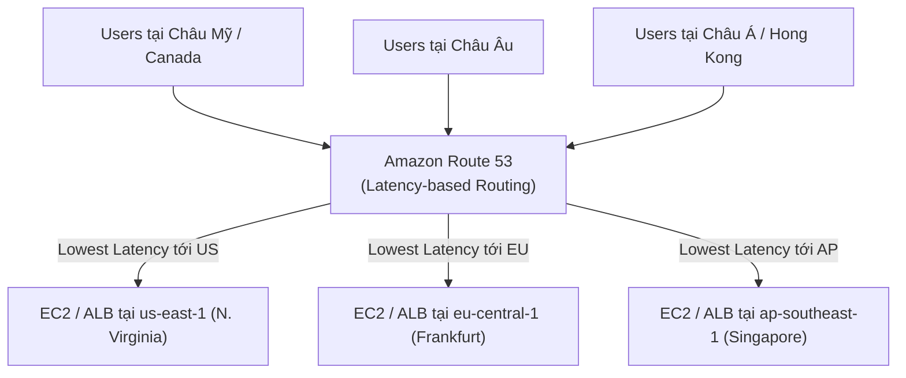

# Bài 110: Routing Policy - Latency (Chính sách định tuyến theo Độ trễ)

- **Section:** Phần 10 - Route 53
- **Lecture ID:** `13528196`
- **Video:** `SAA_-_Route_53_-_Routing_Latency_v2.mp4`
- **Thời lượng:** `04:39`
- **Cheat sheet:** [topics/aws_route53.html](../../topics/aws_route53.html)

---

## 1. Kiến thức trọng tâm (Exam Notes)

### 1.1. Cơ chế hoạt động của Latency-based Routing Policy
- Điều hướng người dùng tới tài nguyên ở **AWS Region mang lại độ trễ mạng thấp nhất (lowest latency / fastest response time)** cho người dùng đó.
- Cực kỳ hữu ích khi **độ trễ / tốc độ phản hồi (latency)** là mối quan tâm hàng đầu của ứng dụng hoặc website.
- Độ trễ được Route 53 đánh giá dựa trên thời gian kết nối từ vị trí của người dùng tới **AWS Region** được chỉ định trong bản ghi.
  - *Ví dụ:* Ngay cả khi người dùng đang ở Đức, nếu tại thời điểm đó độ trễ mạng từ họ tới Region `us-east-1` thấp hơn vùng khác được cấu hình, họ sẽ được điều hướng tới `us-east-1`.
- **Có thể kết hợp với Health Checks** (để tránh gửi người dùng tới một Region gần nhất nhưng đang bị sập).

---

## 2. Phụ đề chi tiết theo mốc thời gian (Full Transcript & Timestamps)

| Thời gian | Nội dung lời giảng gốc (English) | Bản dịch tiếng Việt sát nghĩa |
|---|---|---|
| `00:00:00` | So let's talk about a routing policy that's super easy to understand, which is the latency-based routing policy. Okay. | Hãy nói về một chính sách định tuyến cực kỳ dễ hiểu, đó là **Latency-based Routing Policy** (Định tuyến dựa trên độ trễ). |
| `00:00:06` | So now let's talk about latency-based routing policies. And the idea is that you want to redirect to the resource that is going to have the lowest latency. | Ý tưởng cốt lõi là bạn muốn điều hướng người dùng tới tài nguyên nào có **độ trễ thấp nhất (lowest latency)**. |
| `00:00:13` | So the closest to us, which is super helpful when latency is your main concern for your websites or applications. | Tức là gần chúng ta nhất về mặt tốc độ mạng — cực kỳ hữu ích khi độ trễ (latency) là mối quan tâm chính đối với website hoặc ứng dụng của bạn. |
| `00:00:18` | Now latency is going to be measured based on how quick it is for users to connect to the closest, identified AWS region for that record. | Độ trễ được đo lường dựa trên tốc độ kết nối của người dùng tới **AWS Region** được định danh cho bản ghi đó. |
| `00:00:28` | So for example, if a user is in Germany and you have the lowest latency to a resource in the US, then this is where you will be redirected. | Ví dụ, nếu người dùng ở Đức và có độ trễ thấp nhất tới tài nguyên đặt tại Mỹ (trong trường hợp không có máy chủ ở Châu Âu), họ sẽ được điều hướng tới Mỹ. |
| `00:00:35` | And this can be combined with health checks that we'll see in the very next lecture. | Chính sách này **có thể kết hợp với Health Checks** mà chúng ta sẽ học ngay ở bài giảng tiếp theo. |
| `00:00:40` | So let's have a look at the map of the world to understand it. Say we deploy our applications in two different parts of the world, one in us-east-1 and one in ap-southeast-1. | Hãy nhìn vào bản đồ thế giới để dễ hình dung. Giả sử chúng ta triển khai ứng dụng tại 2 khu vực: một ở `us-east-1` (Bờ Đông Mỹ) và một ở `ap-southeast-1` (Singapore). |
| `00:00:47` | Then the users are all around the world and the latency is going to be evaluated by Route 53. | Người dùng ở khắp nơi trên thế giới và độ trễ sẽ được Route 53 đánh giá. |
| `00:00:53` | And so the users closest and with the lowest latency to the ALB in us-east-1, will be redirected there. Whereas, the other users will be redirected to ap-southeast-1. | Những người dùng có độ trễ thấp nhất tới ALB ở `us-east-1` sẽ được điều hướng về Mỹ, trong khi những người dùng còn lại có độ trễ thấp hơn tới Singapore sẽ được điều hướng về `ap-southeast-1`. |
| `00:01:03` | Now let's put this into practice in the console. So let's create new records. And the Record name is going to be, latency.stephanetheteacher.com. | Hãy thực hành ngay trên Console. Nhấn tạo bản ghi mới với **Record name** là `latency.stephanetheteacher.com`. |
| `00:01:12` | And the first Value is going to be the one in ap-southeast-1. So I'm going to paste the value in here. And then the Routing policy is going to be Latency. | Giá trị đầu tiên là IP của instance tại `ap-southeast-1`. Chọn **Routing policy** là **Latency**. |
| `00:01:22` | So when we do this thing, because we just put an IP address in here, we need to specify the region of our record. So this one is going to be corresponding to ap-southeast-1, which is at Singapore. | Vì chúng ta chỉ nhập một địa chỉ IP thuần túy, chúng ta cần chỉ định cho Route 53 biết IP này thuộc **Region** nào. Tôi chọn `ap-southeast-1` (Asia Pacific - Singapore). |
| `00:01:36` | And the reason is that Route 53 is not smart enough, at least in this stage, to take this IP and know that it comes from an EC2 instance that I have in Singapore, because this could be any IP in the world actually. | Lý do là ở bước nhập IP tĩnh này, hệ thống coi nó có thể là bất kỳ IP nào trên thế giới nên chúng ta cần khai báo rõ IP đó tương ứng với Region Singapore. |
| `00:01:52` | And then we can associate a Health check and a Record ID. So I'll call this one, ap-southeast-1. And it's just a name that I give it. | Chúng ta có thể gắn Health check (tùy chọn) và đặt **Record ID** là `ap-southeast-1`. |
| `00:02:00` | Now we can add another record. Again, the Record name is going to be latency and the value of which this one is going to be for us-east-1. | Nhấn **Add another record**, đặt tên `latency.stephanetheteacher.com`, dán IP của instance tại `us-east-1`. |
| `00:02:08` | So I'll have the Value here, and it's going to be Latency. And then it's us-east-1. And again, I will just have it as us-east-1 for my Record ID. | Chọn **Routing policy** là **Latency**, **Region** là `us-east-1`, và **Record ID** là `us-east-1`. |
| `00:02:21` | And then one last record is going to be for eu-central-1. So I will copy this IP. And the Record name is this, the Value is here, the Routing policy is Latency and the Region is eu-central-1, so will be the Name. | Thêm bản ghi thứ ba cho `eu-central-1`: dán IP tại Frankfurt, chọn **Routing policy** là **Latency**, **Region** là `eu-central-1` và **Record ID** là `eu-central-1`. |
| `00:02:39` | So as we can see, we have three records being created, successfully created, and this is it right here. And so now let's try them out. | Cả 3 bản ghi Latency đã được tạo thành công. Bây giờ hãy thử nghiệm chúng. |
| `00:02:48` | So right now I'm in Europe. And so if I open this, I'm expecting it to go to my instance in Europe. So I go to this URL, and I get a response, Hello World, from this IP in eu-central-1c. | Hiện tại tôi đang ngồi ở Châu Âu. Khi mở `latency.stephanetheteacher.com`, đúng như kỳ vọng, tôi nhận được phản hồi `Hello World ... in AZ eu-central-1c`. |
| `00:03:01` | If I use CloudShell to try it out and we do a dig command on this. As we can see, we get an A record back of just one value. So just one value of the same IP address as this one. So this is my instance in eu-central-1c. | Khi kiểm tra trên CloudShell (cũng đang mở tại Region `eu-central-1`) bằng lệnh `dig`, kết quả trả về duy nhất 1 giá trị IP của instance tại `eu-central-1c`. |
| `00:03:15` | And if I keep on refreshing, because my latency hasn't changed to eu-central-1, I'm going to get, always the same answer. | Dù tôi có tải lại trang bao nhiêu lần, vì độ trễ từ chỗ tôi tới `eu-central-1` vẫn là thấp nhất nên tôi luôn nhận được cùng một câu trả lời đó. |
| `00:03:23` | But, so how do we test whether or not that latency record is working? Well, for this I can use a VPN. And so let's go to Canada, for example. | Vậy làm sao để kiểm tra xem các bản ghi Latency ở Region khác có hoạt động không? Tôi sẽ dùng phần mềm **VPN** và kết nối sang **Canada**. |
| `00:03:31` | And in Canada, it turns out that my latency is going to be the closest to the U.S. So if I refresh this page now, I get the Hello World from the U.S. | Từ Canada, độ trễ mạng thấp nhất sẽ là tới Bờ Đông nước Mỹ (`us-east-1`). Khi tôi làm mới lại trang web, tôi nhận được ngay `Hello World ... in AZ us-east-1a`! |
| `00:03:43` | And when I did change my location, thanks to the VPN, it cleared all the TTL that I had for my DNS cache, locally on my laptop. And so this is why automatically by refreshing it, I was able to get the newest value for us-east-1a. | Khi VPN đổi kết nối mạng, nó cũng xóa bộ nhớ đệm DNS cục bộ trên laptop của tôi, nên ngay khi làm mới trang tôi đã nhận được giá trị mới tại `us-east-1a`. |
| `00:03:56` | But again, if I use dig because this hasn't changed, okay, my CloudShell is still in Europe, okay. If I use the dig command... I'm still going to get the exact same value as before, because this CloudShell sits in eu-central-1. | Lưu ý rằng nếu tôi chạy lệnh `dig` trong cửa sổ AWS CloudShell, vì máy chủ CloudShell vẫn đặt tại Châu Âu (`eu-central-1`), nên nó vẫn nhận IP của `eu-central-1`. |
| `00:04:16` | And how do we test the one for AP Southeast? Let's go into Hong Kong. Okay. So I'm close to Singapore now. And I will refresh this. And the answer is, Hello World, from ap-southeast-1b. | Cuối cùng, để kiểm tra bản ghi tại Singapore (`ap-southeast-1`), tôi chuyển VPN sang **Hong Kong** (rất gần Singapore). Khi làm mới trình duyệt, câu trả lời là `Hello World ... in AZ ap-southeast-1b`. |
| `00:04:31` | So the latency records are working and they're really, really good and very common to use online. I hope you liked it, and I will see you in the next lecture. | Như vậy các bản ghi Latency hoạt động cực kỳ hiệu quả và rất phổ biến trong thực tế. Hẹn gặp lại bạn ở bài giảng tiếp theo. |
