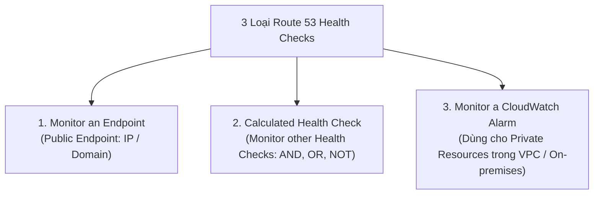
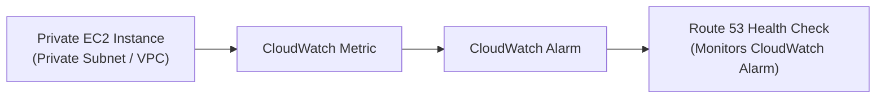

# Bài 111: Route 53 - Health Checks (Kiểm tra sức khỏe tài nguyên trong Route 53)

- **Section:** Phần 10 - Route 53
- **Lecture ID:** `13528200`
- **Video:** `SAA - Route 53 - Health Checks v3.mp4`
- **Thời lượng:** `04:54`
- **Cheat sheet:** [topics/aws_route53.html](../../topics/aws_route53.html)

---

## 1. Kiến thức trọng tâm (Exam Notes)

### 1.1. Mục đích của Route 53 Health Checks
- Kiểm tra tình trạng hoạt động (health) của các tài nguyên (chủ yếu là **Public Resources**, nhưng có cơ chế gián tiếp cho cả **Private Resources**) để phục vụ **Automated DNS Failover** (tự động chuyển đổi dự phòng ở tầng DNS khi một Region/Endpoint gặp sự cố).

### 1.2. Ba loại Route 53 Health Checks (Cực kỳ quan trọng cho kỳ thi SAA-C03)

#### Loại 1: Health Check giám sát một Public Endpoint (`Monitor an Endpoint`)
- Khoảng **15 Global Health Checkers** của AWS trên khắp thế giới sẽ gửi request kiểm tra tới Public Endpoint của bạn:
  - **Interval (Chu kỳ kiểm tra):** `30 giây` (Standard) hoặc `10 giây` (Fast — chi phí cao hơn).
  - **Giao thức hỗ trợ:** `HTTP`, `HTTPS`, `TCP`.
  - **Ngưỡng đánh giá Healthy:** Nếu **trên 18% (> 18%)** số lượng Health Checkers báo cáo Endpoint khỏe mạnh (nhận mã trạng thái **`2xx` hoặc `3xx`**), Route 53 coi tài nguyên là **Healthy**; ngược lại là **Unhealthy**.
  - **String Matching (Đối sánh chuỗi văn bản):** Có thể kiểm tra sự xuất hiện của một chuỗi văn bản cụ thể trong **5.120 bytes đầu tiên** của nội dung phản hồi (response body).
  - **Yêu cầu mạng:** Security Group / Firewall của Endpoint bắt buộc phải **cho phép lưu lượng Inbound từ dải IP của Route 53 Health Checkers**.

#### Loại 2: Calculated Health Check (`Monitor other Health Checks`)
- Kết hợp kết quả của nhiều **Child Health Checks** thành một **Parent Health Check** duy nhất.
- Kết hợp bằng các toán tử logic: **`AND`**, **`OR`**, hoặc **`NOT`**.
- Có thể giám sát tối đa **255 Child Health Checks** và chỉ định số lượng/tỷ lệ Child Health Checks cần vượt qua để Parent được tính là Healthy.
- **Use case điển hình:** Bảo trì website trên một số máy chủ mà không làm toàn bộ hệ thống kích hoạt Failover.

#### Loại 3: Giám sát Private Resources thông qua CloudWatch Alarm (`Monitor a CloudWatch Alarm`)
- **Vấn đề:** Các Route 53 Health Checkers nằm ngoài Internet công cộng nên **không thể truy cập trực tiếp** vào Private VPC hoặc mạng nội bộ On-premises.
- **Giải pháp chuẩn SAA-C03:**
  1. Tạo một **CloudWatch Metric** theo dõi tài nguyên nội bộ (ví dụ: EC2 instance trong Private Subnet).
  2. Tạo một **CloudWatch Alarm** gắn với Metric đó.
  3. Tạo một **Route 53 Health Check** giám sát trạng thái của chính **CloudWatch Alarm** đó -> Khi Alarm chuyển sang trạng thái `ALARM`, Health Check tự động chuyển thành `Unhealthy`.

---

## 2. Phụ đề chi tiết theo mốc thời gian (Full Transcript & Timestamps)

| Thời gian | Nội dung lời giảng gốc (English) | Bản dịch tiếng Việt sát nghĩa |
|---|---|---|
| `00:00:00` | So let's talk about health checks in Route 53. | Hãy cùng tìm hiểu về tính năng kiểm tra sức khỏe (**Health Checks**) trong Route 53. |
| `00:00:02` | So health checks are a way for you to check the health of mainly public resources, although there's a way for us to do it for private resources as well, as we'll see in this lecture. | Health Checks là cách giúp bạn kiểm tra tình trạng hoạt động của chủ yếu là các tài nguyên công khai (Public resources), mặc dù cũng có cách để kiểm tra các tài nguyên riêng tư (Private resources) như chúng ta sẽ thấy trong bài giảng này. |
| `00:00:11` | So the idea is that, for example, we have two load balancers in different regions and they're public load balancers, okay? And behind the scenes, we have our application running in both of them. | Ý tưởng là giả sử chúng ta có 2 Public Load Balancers đặt tại 2 Region khác nhau, và phía sau chúng là ứng dụng đang chạy ở cả 2 nơi. |
| `00:00:20` | So we're running into a multi-region setup because we want high availability and so on, at the region level. | Tức là chúng ta đang vận hành kiến trúc đa vùng (Multi-Region) để đạt tính sẵn sàng cao (High Availability) ở cấp độ Region. |
| `00:00:25` | Then, we're going to use Route 53 to create DNS records. So that's when users access our URL, for example, MyDomain.com, then they get redirected to, for example, the closest load balancer they have. So this would be the case with a latency-type of record. | Chúng ta dùng Route 53 tạo các bản ghi DNS (ví dụ chính sách Latency) để khi người dùng truy cập `mydomain.com`, họ được điều hướng tới chiếc Load Balancer gần họ nhất. |
| `00:00:41` | But we want to make sure that if one region is down, then we don't send our users to that region obviously, right? | Nhưng chúng ta muốn đảm bảo rằng nếu một Region bị sập, hệ thống sẽ không gửi người dùng tới Region bị hỏng đó nữa. |
| `00:00:47` | So to do so, we're going to create health checks from Route 53. So we'll create health checks on the one in us-east-1 and we'll create a health check on our instance in eu-west-1. | Để làm vậy, chúng ta tạo các Health Checks trong Route 53: một Health Check kiểm tra tài nguyên ở `us-east-1` và một Health Check kiểm tra tài nguyên ở `eu-west-1`. |
| `00:00:58` | Well, with these two health checks, we're going to be able to associate them with our Route 53 records. And the reason we do so is to get automated DNS failover. | Sau đó chúng ta gắn hai Health Checks này vào các bản ghi Route 53 nhằm đạt được khả năng **chuyển đổi dự phòng DNS tự động (Automated DNS Failover)**. |
| `00:01:08` | So we have three health checks that are possible. The ones I just showed you which are the health checks that monitor an endpoint, which is a public endpoint, so it could be an application, a server, or another AWS resource. | Có **3 loại Health Checks** trong Route 53: Loại thứ nhất là Health Check **giám sát một Endpoint công khai** (ứng dụng, máy chủ, hoặc tài nguyên AWS khác). |
| `00:01:18` | It could be a health check that monitors other health checks, also called a calculated health check. | Loại thứ hai là Health Check **giám sát các Health Checks khác**, còn gọi là **Calculated Health Check**. |
| `00:01:22` | Or it could be a health check that monitors a CloudWatch alarm, which gives you more control and is helpful for private resources, as we'll see in this lecture. | Loại thứ ba là Health Check **giám sát một CloudWatch Alarm**, mang lại khả năng kiểm soát sâu hơn và đặc biệt hữu ích cho các **tài nguyên riêng tư (Private resources)**. |
| `00:01:30` | Finally, these health checks have their own metric and you can view them in CloudWatch metrics as well. | Ngoài ra, bản thân các Health Checks này cũng phát sinh các chỉ số (metrics) riêng và bạn có thể xem chúng trong CloudWatch Metrics. |
| `00:01:35` | So let's look at how health checks work with a specific endpoint. So if we have a health check for eu-west-1 for an ALB, then the health checkers of AWS are coming from all around the world. | Hãy xem cách Health Check hoạt động với một Endpoint cụ thể. Khi bạn tạo Health Check cho một ALB tại `eu-west-1`, các bộ kiểm tra sức khỏe (Health Checkers) của AWS từ khắp nơi trên thế giới sẽ tham gia kiểm tra. |
| `00:01:46` | So it's not just one health checker, it's about 15 health checkers from all around the world. And they're all going to send requests into our public endpoint to whatever route we set. | Không chỉ có một bộ kiểm tra, mà có khoảng **15 Global Health Checkers** trên toàn cầu cùng gửi request tới Public Endpoint theo đường dẫn (path) bạn cấu hình. |
| `00:01:55` | And then, if it gets 200 OK code back, or the code we defined, then the resource is deemed healthy. | Nếu nhận về mã phản hồi `200 OK`, tài nguyên đó được coi là khỏe mạnh (Healthy). |
| `00:02:01` | So about 15 global health checkers will check the endpoint health, and then you can set a threshold for healthy or unhealthy. | Khoảng 15 Health Checkers toàn cầu sẽ kiểm tra sức khỏe của Endpoint, và bạn có thể đặt ngưỡng (threshold) cho trạng thái Healthy/Unhealthy. |
| `00:02:07` | You can set an interval, so we have two options. It could be either 30 seconds for regular health checks or every 10 seconds, which is a higher cost, which is what's called a fast health check. | Về chu kỳ kiểm tra (**Interval**), có 2 lựa chọn: mỗi **30 giây** (tiêu chuẩn) hoặc mỗi **10 giây** (Fast health check — chi phí cao hơn). |
| `00:02:16` | It supports many protocols, so HTTP, HTTPS, and TCP. And the rule is that if over 18% of the health checkers say that the endpoint is healthy, then Route 53 will consider it healthy, otherwise it's deemed unhealthy. | Nó hỗ trợ các giao thức **HTTP, HTTPS và TCP**. Quy tắc là nếu **trên 18%** số Health Checkers báo cáo Endpoint khỏe mạnh, Route 53 sẽ coi nó là **Healthy**; ngược lại sẽ bị coi là **Unhealthy**. |
| `00:02:30` | And you have the ability to choose which locations you want to use for the health checks. | Bạn cũng có quyền chọn những khu vực (locations) nào được dùng để thực hiện Health Check. |
| `00:02:34` | Now, the health checks will only pass if you have the status 2xx or 3xx status code back from the load balancer and the health check has a cool capability. | Health Check chỉ vượt qua (pass) khi nhận được mã trạng thái **`2xx` hoặc `3xx`** từ Endpoint. Ngoài ra, nó còn có một tính năng rất hay: |
| `00:02:42` | So if it is a text-based response, then the health checkers can check the first 5,120 bytes of the response to look for some specific text in the response itself. | Nếu phản hồi ở dạng văn bản (text-based), các Health Checkers có thể đọc **5.120 bytes đầu tiên** của nội dung phản hồi để tìm kiếm một chuỗi văn bản cụ thể. |
| `00:02:53` | Finally, very important from a network perspective, if you want for it to work, obviously, the health checkers must be able to access your application load balancer or whatever endpoint you have. And so, therefore, you must allow incoming requests coming from the Route 53 health checkers IP address range. | Cuối cùng, cực kỳ quan trọng dưới góc độ mạng: để Health Check hoạt động được, bạn **bắt buộc phải cho phép lưu lượng Inbound từ dải địa chỉ IP của Route 53 Health Checkers** đi vào Security Group/Router của Endpoint. |
| `00:03:14` | Now, the second type of health checks we have are calculated health checks. And so, this is to combine the results of multiple health checks into a single health check. | Loại Health Check thứ hai là **Calculated Health Checks** — dùng để gộp kết quả của nhiều Health Checks con thành một Health Check cha duy nhất. |
| `00:03:22` | And so, if we look at Route 53, with three EC2 instances, we can create three health checks. They're all going to be child health checks and they can all monitor each EC2 instance one by one. And then, we can define a parent health check, which is going to be defined on all these child health checks. | Ví dụ với 3 EC2 instances, chúng ta tạo 3 **Child Health Checks** giám sát từng instance, rồi định nghĩa 1 **Parent Health Check** tổng hợp từ các Child Health Checks đó. |
| `00:03:38` | And so, the conditions to combine all these health checks could be an OR, an AND, or a NOT. You can monitor up to 255 child health checks and you can specify how many of the health checks need to pass to make the parent pass. | Điều kiện kết hợp có thể là **`OR`**, **`AND`**, hoặc **`NOT`**. Bạn có thể giám sát tối đa **255 Child Health Checks** và chỉ định cần bao nhiêu Child Health Checks khỏe mạnh để Parent được tính là khỏe mạnh. |
| `00:03:51` | So the use case for this, for example, if you want to have a parent health check to perform maintenance on your website without causing all the health checks to fail. | Trường hợp sử dụng điển hình là khi bạn muốn bảo trì một phần website của mình mà không làm toàn bộ hệ thống Health Check bị đánh dấu lỗi. |
| `00:04:00` | And so, how do we monitor the health of a private resource? So in case you want to monitor something private, it's going to be difficult because, well, all the Route 53 health checkers live on the public web and they're outside of your VPC. | Vậy làm thế nào để giám sát sức khỏe của một **tài nguyên riêng tư (Private resource)**? Việc này không thể làm trực tiếp được vì tất cả các Route 53 Health Checkers đều nằm ngoài Internet công cộng, bên ngoài VPC của bạn. |
| `00:04:12` | So they cannot access private endpoints, so if it's a private VPC or an on-premises resource. And so, the way we can do it, though, is to create a CloudWatch metric and assign a CloudWatch alarm on it. And then, you can assign the CloudWatch alarm into the health checker. | Chúng không thể truy cập vào các Private Endpoints trong VPC hay On-premises. Cách giải quyết là: bạn tạo một **CloudWatch Metric** theo dõi tài nguyên nội bộ, gắn một **CloudWatch Alarm** vào Metric đó, rồi cấu hình Route 53 Health Check giám sát **CloudWatch Alarm** này. |
| `00:04:27` | So the idea is that we're going to monitor the health of our EC2 instance in a private subnet with a CloudWatch metric, and then, if the metric is breached, we're going to create a CloudWatch alarm on it. | Tức là chúng ta giám sát EC2 instance trong Private Subnet bằng CloudWatch Metric; nếu chỉ số vượt ngưỡng, CloudWatch Alarm sẽ kích hoạt. |
| `00:04:37` | And when the alarm goes into the alarm state, then the health checker is going to be automatically unhealthy, and therefore, we'll have created exactly what we want, which is a health check on a private resource, which is the most common use case on how to do it. | Khi Alarm chuyển sang trạng thái báo động (`ALARM`), Route 53 Health Check sẽ tự động chuyển sang trạng thái `Unhealthy`. Đó là cách phổ biến nhất để kiểm tra sức khỏe cho tài nguyên nội bộ. |
| `00:04:50` | So that's it for this lecture, I hope you liked it. And I will see you in the next lecture. | Đó là toàn bộ nội dung bài giảng này. Hẹn gặp lại bạn ở bài học tiếp theo. |
