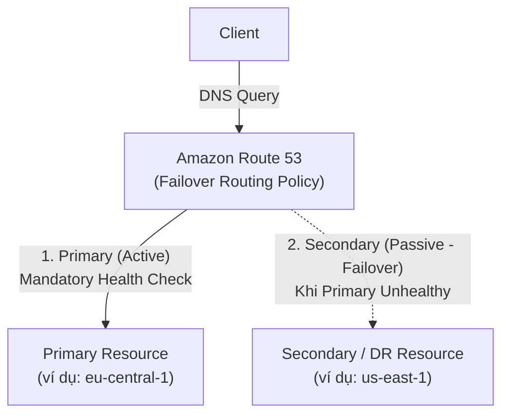

# Bài 113: Routing Policy - Failover (Chính sách định tuyến Chuyển đổi dự phòng Active-Passive)

- **Section:** Phần 10 - Route 53
- **Lecture ID:** `13528204`
- **Video:** `SAA_-_Route_53_-_Routing_Failover_v2.mp4`
- **Thời lượng:** `04:12`

---

## 1. Kiến thức trọng tâm (Exam Notes)

### 1.1. Cơ chế hoạt động của Failover Routing Policy (Active-Passive)
- Sử dụng khi bạn muốn thiết lập mô hình **Active-Passive Failover**: có **1 tài nguyên chính (`Primary`)** và **1 tài nguyên dự phòng thảm họa (`Secondary / Disaster Recovery`)**.
- **Quy tắc bắt buộc:**
  - Chỉ có thể có **1 Primary** và **1 Secondary** cho mỗi nhóm Failover.
  - Bản ghi **Primary BẮT BUỘC (Mandatory)** phải được gắn với một **Health Check**.
  - Bản ghi **Secondary** có thể gắn Health Check hoặc không (Optional).
- **Luồng hoạt động:**
  - Bình thường khi **Primary = Healthy**, Route 53 luôn trả về địa chỉ của **Primary**.
  - Ngay khi Health Check của Primary chuyển sang **Unhealthy**, Route 53 tự động chuyển đổi dự phòng (**Failover**) và trả về địa chỉ của **Secondary** cho các truy vấn DNS của Client.

---

## 2. Phụ đề chi tiết theo mốc thời gian (Full Transcript & Timestamps)

| Thời gian | Nội dung lời giảng gốc (English) | Bản dịch tiếng Việt sát nghĩa |
|---|---|---|
| `00:00:00` | Okay, so now let's talk about routing policies and this one is going to be for the failover. | Được rồi, bây giờ hãy nói về chính sách định tuyến tiếp theo: **Failover Routing Policy** (Chuyển đổi dự phòng). |
| `00:00:04` | So the idea is that we have Route 53 in the middle and we have EC2 instances, one is going to be our primary EC2 instance, and the second one is going to be a secondary, or disaster recovery, EC2 instance. | Ý tưởng là chúng ta có Route 53 ở giữa và 2 EC2 instances: một là **Primary EC2 instance** (máy chủ chính), và cái thứ hai là **Secondary / Disaster Recovery EC2 instance** (máy chủ dự phòng thảm họa). |
| `00:00:15` | In this case, what's going to happen is that we're going to associate our primary record with a health check, and this is mandatory. | Trong mô hình này, chúng ta sẽ liên kết bản ghi **Primary** với một **Health Check** — và việc này là **bắt buộc (mandatory)**. |
| `00:00:21` | And if the health check becomes unhealthy, then Route 53 is going to automatically failover to the second EC2 instance, and start sending that result back instead. | Nếu Health Check của bản ghi chính chuyển sang trạng thái **Unhealthy**, Route 53 sẽ tự động chuyển đổi dự phòng (**failover**) sang EC2 instance thứ hai và trả về kết quả của máy chủ dự phòng đó. |
| `00:00:32` | And of course the secondary EC2 can also be associated with a health check as well, if we want it to. But there can only be one primary and one secondary. | Tất nhiên bản ghi Secondary cũng có thể gắn kèm Health Check nếu muốn. Lưu ý là chỉ có thể có **1 Primary** và **1 Secondary**. |
| `00:00:40` | Now the client, when it makes DNS requests, will automatically get the resource that is deemed healthy. So if our primary is healthy, then Route 53 will answer with a primary record. | Khi Client thực hiện truy vấn DNS, nếu Primary đang khỏe mạnh, Route 53 sẽ luôn trả lời bằng bản ghi Primary. |
| `00:00:50` | But if the health check is unhealthy, automatically, we will get the response of the second record, which really helps us do a failover. | Nhưng nếu Health Check của Primary báo Unhealthy, Client sẽ tự động nhận được phản hồi là bản ghi Secondary — giúp thực hiện chuyển đổi dự phòng tự động. |
| `00:00:57` | So that's it, let's go in the hands-on to see how we can practice this. | Hãy vào phần thực hành để trực tiếp cấu hình và kiểm chứng cơ chế này. |
| `00:01:00` | Okay, so now let's leverage these health checks and create a failover record. So in my hosted zone, I'm going to create a record, and this one's going to be called failover.stephanetheteacher.com, | Trong Hosted Zone của mình, tôi nhấn **Create record** và đặt tên là `failover.stephanetheteacher.com`. |
| `00:01:13` | and it's an A record, and the first value is going to be for my eu-central-1 instance, so the one close to me, and the routing policy is going to be a failover. | Chọn kiểu `A`, giá trị đầu tiên là IP của instance tại `eu-central-1`, và chọn **Routing policy** là **Failover**. |
| `00:01:22` | So the TTL we'll set it something really low, like 60 seconds. And the failover record type has two options. It could be either primary or secondary, just these two. | Đặt **TTL** thấp là `60` giây. Mục **Failover record type** chỉ có 2 lựa chọn: **Primary** hoặc **Secondary**. |
| `00:01:30` | So this is my primary record, and I will associate it with a health check, I have to. So I will associate with my health check named eu-central-1, and the record ID is going to be EU. | Đây là bản ghi **Primary** của tôi, nên tôi bắt buộc phải gắn Health Check cho nó — tôi chọn Health Check `eu-central-1` và đặt **Record ID** là `EU`. |
| `00:01:40` | So what this is saying is that this record should be my primary one, but this is going to be associated with a health check, which means that you can failover to a second record. | Cấu hình này chỉ định đây là bản ghi chính, có gắn Health Check để sẵn sàng failover sang bản ghi thứ hai khi gặp sự cố. |
| `00:01:48` | So let's add a new record, and I will keep the record name as failover.stephanetheteacher.com, and the value of which is going to be my instance in us-east-1. | Nhấn **Add another record**, giữ nguyên tên `failover.stephanetheteacher.com`, và dán địa chỉ IP của instance tại `us-east-1`. |
| `00:01:58` | Okay, we're still going to have to do a failover, the TTL is 60 seconds, and the failover record type is going to be secondary. | Chọn **Routing policy** là **Failover**, **TTL** là `60` giây, và **Failover record type** là **Secondary**. |
| `00:02:05` | Now we can optionally associate a health check with it, okay, of us-east-1, but you don't have to. And the record ID is going to be US. Now let's create this record, and notice it was successfully created. | Chúng ta có thể tùy chọn gắn Health Check `us-east-1` cho nó, và đặt **Record ID** là `US`. Nhấn **Create records**. |
| `00:02:17` | And so let's go back into our health checks. And currently these two health checks I've associated with my records are healthy. | Quay lại kiểm tra mục **Health checks**: hiện tại cả hai Health Checks (`eu-central-1` và `us-east-1`) đều đang ở trạng thái **Healthy**. |
| `00:02:23` | So if I go into the URL, so if I go to failover.stephanetheteacher.com, right now, I get an answer from eu-central-1c. That's perfect. | Khi tôi truy cập `failover.stephanetheteacher.com` trên trình duyệt, tôi nhận được câu trả lời từ bản ghi Primary tại `eu-central-1c`. |
| `00:02:36` | But what I'm going to do is trigger a failure. So let's go into the eu-central-1 region, and I'm going to find my instance, here, and I'm going to find the security group, and I'm going to, again, stop some security group rules. | Bây giờ tôi sẽ giả lập một sự cố cho máy chủ chính. Tôi vào Region `eu-central-1`, mở Security Group của EC2 instance tại đây và chỉnh sửa Inbound rules. |
| `00:02:54` | And for the inbound rule, I'm going to edit it, and I will remove the rule on port 80. So that will make my instance completely unreachable from the health checkers. | Tôi xóa rule cho phép cổng **80 (HTTP)** đi. Việc này sẽ làm cho instance tại Frankfurt hoàn toàn không thể truy cập được từ các Health Checkers. |
| `00:03:04` | So what I have to do now is to wait for this health check to become unhealthy, and then we'll be able to test the failover. | Bây giờ hãy đợi một lát để Health Check `eu-central-1` chuyển sang trạng thái **Unhealthy**, sau đó chúng ta sẽ kiểm tra quá trình Failover. |
| `00:03:10` | So let's refresh, and as we can see now, my eu-central-1 health check is deemed unhealthy, and we can look into the monitoring tab and see really when it got unhealthy, so this is quite cool. | Làm mới trang Health Checks: như bạn thấy, Health Check `eu-central-1` đã chuyển sang **Unhealthy**. Trong tab **Monitoring**, biểu đồ phần trăm Health Checkers báo Healthy đã tụt từ 100% xuống 0%. |
| `00:03:28` | So what this means, is that now that this health check is unhealthy because of the way we set up the failover that was linked to this health check, then next time I refresh this, I should not be in eu-central-1c, I should be in us-east-1. | Điều này có nghĩa là vì bản ghi Primary tại `eu-central-1` đã Unhealthy, lần tới khi tôi tải lại trang web `failover.stephanetheteacher.com`, tôi sẽ được chuyển sang `us-east-1`. |
| `00:03:43` | So let's refresh this page, and yes, the answer is that we are in us-east-1. And so the failover did work seamlessly behind the scenes. | Hãy nhấn Refresh trang web: và đúng như vậy, trang web hiện trả về `Hello World ... in AZ us-east-1a`! Quá trình Failover đã diễn ra hoàn toàn tự động và mượt mà ở phía hậu trường. |
| `00:03:51` | And well to fix it, you just go back into your security group, you would edit the inbound rule, and then you would add back the HTTP rule, and then automatically the health check is going to pass again, and therefore we are going to failover back to our primary location, okay. | Để khôi phục lại, tôi chỉ cần quay lại Security Group ở Frankfurt, thêm lại Inbound rule cho cổng HTTP (port 80) từ mọi nơi. Khi đó Health Check sẽ xanh trở lại và lưu lượng tự động quay về vị trí Primary ban đầu. |
| `00:04:09` | So that's it for this lecture, I hope you liked it, and I will see you in the next lecture. | Đó là toàn bộ nội dung bài giảng này. Hẹn gặp lại bạn ở bài học tiếp theo. |
