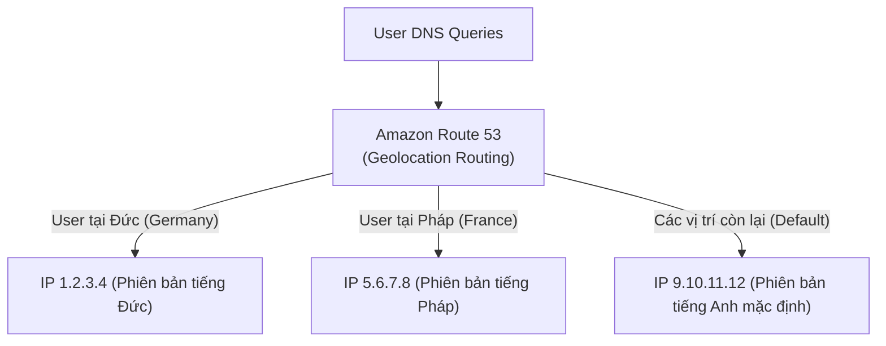

# Bài 114: Routing Policy - Geolocation (Chính sách định tuyến theo Vị trí địa lý)

- **Section:** Phần 10 - Route 53
- **Lecture ID:** `13528206`
- **Video:** `SAA_-_Route_53_-_Routing_Geolocation_-_v2.mp4`
- **Thời lượng:** `04:15`
- **Cheat sheet:** [topics/aws_route53.html](../../topics/aws_route53.html)

---

## 1. Kiến thức trọng tâm (Exam Notes)

### 1.1. Cơ chế hoạt động của Geolocation Routing Policy
- **Khác hoàn toàn với Latency-based:** Geolocation định tuyến dựa trên **vị trí địa lý thực tế của người dùng (User Location)** chứ không phải độ trễ mạng.
- Bạn có thể chỉ định vị trí theo 3 cấp độ:
  1. **Châu lục (Continent):** Ví dụ: `Asia`, `Europe`...
  2. **Quốc gia (Country):** Ví dụ: `France`, `Germany`, `United States`...
  3. **Tiểu bang của Hoa Kỳ (US State):** Ví dụ: `California`, `Texas`...
- **Quy tắc khớp lệnh (Matching Rule):** Nếu có nhiều bản ghi chồng lấn (ví dụ vừa có bản ghi cho Châu Âu, vừa có bản ghi cho Pháp), Route 53 sẽ chọn **vị trí cụ thể/chi tiết nhất (most precise location)** trước.
- **Bản ghi Mặc định (`Default` Record):** **Nên luôn tạo một bản ghi `Default`** để xử lý tất cả các truy vấn từ những khu vực không khớp với bất kỳ vị trí nào đã khai báo (nếu không có `Default`, những khu vực không khớp sẽ nhận phản hồi `No Answer`).

### 1.2. Use Cases điển hình trong đề thi SAA-C03
- **Website Localization (Bản địa hóa nội dung):** Hiển thị ngôn ngữ, tiền tệ hoặc nội dung riêng cho từng quốc gia.
- **Content Distribution Restriction (Giới hạn bản quyền/pháp lý theo quốc gia):** Chỉ cho phép người dùng ở một số quốc gia truy cập website, hoặc chặn các quốc gia khác (bằng cách chỉ định IP hợp lệ cho quốc gia được phép và không tạo/chặn ở các vùng khác).
- **Có thể gắn kèm Health Checks.**

---

## 2. Phụ đề chi tiết theo mốc thời gian (Full Transcript & Timestamps)

| Thời gian | Nội dung lời giảng gốc (English) | Bản dịch tiếng Việt sát nghĩa |
|---|---|---|
| `00:00:00` | So now let's talk about the Routing Policy - Geolocation, which is very different from Latency-based. | Bây giờ hãy tìm hiểu về chính sách định tuyến **Geolocation**, một chính sách rất khác so với Latency-based. |
| `00:00:04` | So, this is based on where the user is actually located. So, for example, you can say, if a user comes from a specific continent, or a country, or even more precise, on the U.S. states, and, the most precise location is going to be selected at first, then routed to this IP. | Chính sách này dựa trên **vị trí địa lý thực tế của người dùng**. Bạn có thể cấu hình theo **Châu lục (Continent)**, **Quốc gia (Country)**, hoặc chi tiết hơn nữa là **Tiểu bang tại Mỹ (US State)**. Vị trí cụ thể/chi tiết nhất sẽ được ưu tiên chọn trước để điều hướng tới IP tương ứng. |
| `00:00:20` | So, you should create a default record, in case there's going to be no match on location, and the use case for this is going to be for website localization, to restrict content distribution, do load balancing, and so on. | Bạn **nên tạo một bản ghi mặc định (`Default`)** phòng trường hợp vị trí của người dùng không khớp với bất kỳ khu vực nào đã khai báo. Các trường hợp sử dụng chính là: **bản địa hóa website (website localization)**, **hạn chế phân phối nội dung theo lãnh thổ (restrict content distribution)**, cân bằng tải, v.v. |
| `00:00:30` | And these type of records can be associated with health checks. | Các bản ghi Geolocation cũng **có thể được liên kết với Health Checks**. |
| `00:00:33` | So the idea is that, if we have a map of Europe, with multiple countries, we can define a geolocation record for Germany, to say the German users should go to this IP, which contains my German version of my app. | Ví dụ trên bản đồ Châu Âu: chúng ta có thể tạo một bản ghi Geolocation cho nước Đức để người dùng tại Đức được đưa tới IP chứa phiên bản ứng dụng tiếng Đức; |
| `00:00:43` | And if I go to France, then go to this IP, which contains a French version of my app. But for anywhere else, go to the default IP here, which contains maybe the English version of my app. | nếu người dùng ở Pháp thì đưa tới IP chứa phiên bản tiếng Pháp; còn tất cả những nơi khác trên thế giới sẽ đi vào IP **Default** chứa phiên bản tiếng Anh mặc định. |
| `00:00:53` | So, this is how you would use a geolocation. Now, let's go practice in the console. | Đó là cách sử dụng Geolocation. Hãy vào Console để thực hành. |
| `00:00:57` | Okay, so, let's go ahead, and create our first geo record. So, I'm going to create a record, and I'm gonna name it geo, and, the record type would be A, the value of it is, let's link it first to the ap-southeast-1. | Nhấn **Create record**, đặt tên là `geo.stephanetheteacher.com`, kiểu `A`, giá trị đầu tiên là IP của instance tại `ap-southeast-1`. |
| `00:01:12` | And, what we're going to do here is going to say, the routing policy is going to be geolocation. And we're saying, okay, all of Asia, so, any user located in Asia, should go to my ap-southeast-1 EC2 instance. | Chọn **Routing policy** là **Geolocation**. Tại mục **Location**, tôi chọn cả châu lục **Asia** (Châu Á) — tức bất kỳ người dùng nào ở Châu Á sẽ được điều hướng về instance tại `ap-southeast-1`. |
| `00:01:25` | We could associate a health check with it if we wanted to, we need to give a record ID, so, here we go. | Đặt **Record ID** là `Asia`. |
| `00:01:30` | Now, let's add another two records. So what I'm going to do is that, I'm going to say that, for us-east-1, I want to send any user from, and, we can say geolocation yet again. And let's say, for example, just a country, so we can say, United States. | Nhấn **Add another record** cho `us-east-1`: chọn **Geolocation**, và lần này ở mục Location tôi chọn một quốc gia cụ thể là **United States** (Hoa Kỳ), đặt **Record ID** là `US`. |
| `00:01:54` | And so, as you can see here, I specified a country, and here I specified a whole continent, it doesn't matter. | Như bạn thấy, bạn có thể kết hợp linh hoạt giữa cấp độ Quốc gia và cấp độ Châu lục. |
| `00:01:59` | And then lastly, we'll add one more record, here's the record name, and the value of which, is going to be eu-central-1. And, this one is going to be my default, | Thêm bản ghi thứ ba với giá trị là IP của `eu-central-1`, chọn **Geolocation**, và tại mục Location chọn **Default**. |
| `00:02:13` | that means that anything that doesn't match Asia or United States, is going to go to my default location, and this one is going to be called, Default EU. Now, let's create these records, and they've been successfully created. | Nghĩa là bất kỳ truy vấn nào không đến từ Châu Á hoặc Hoa Kỳ sẽ đi về vị trí mặc định tại `eu-central-1`. Đặt **Record ID** là `Default EU` và nhấn **Create records**. |
| `00:02:27` | So, what I can do now is that I can test it, right? So, currently, I am not in the U.S., and I'm not in Asia. So, if I open this URL, I will get the eu-central-1 region, so, this is good, that means that this is the default record that is working properly. | Hiện tại tôi đang ở Châu Âu (không phải Mỹ, không phải Châu Á). Khi mở `geo.stephanetheteacher.com`, tôi nhận được phản hồi từ `eu-central-1` — chứng tỏ bản ghi **Default** đã hoạt động chính xác. |
| `00:02:43` | So now, let's change geographic location, and to do so, I'm going to use my VPN, and now let's go to a country in Asia, so let's go to India. So, I'm now connected into India. | Bây giờ tôi bật VPN và chuyển vị trí sang một quốc gia ở Châu Á là **Ấn Độ (India)**. |
| `00:02:54` | And, when I refresh this page now, what I expect is to get a Hello World, from my ap-southeast-1 instance. Oh, as you can see, there's a long load, so, I know what's happening, so, this is a timeout, | Khi làm mới trang web, tôi kỳ vọng nhận được phản hồi từ `ap-southeast-1`. Tuy nhiên trang web đang xoay vòng tải rất lâu — đó là hiện tượng **Timeout**! |
| `00:03:06` | and so, whenever you see a timeout in AWS, usually you have to think about security groups. So, if I go to my security group, yes, I'm in the right region, so in the Singapore region, and look at the Inbound rules, and edit them. | Mỗi khi gặp lỗi Timeout trong AWS, hãy nghĩ ngay tới **Security Group**! Nếu bạn còn nhớ ở bài thực hành Health Check trước, chúng ta đã xóa rule HTTP trên Security Group của instance tại Singapore. |
| `00:03:20` | If you remember, I had removed the HTTP rule to make the health check fail, so, we need to add back that HTTP rule, so, let's add it back... So, the HTTP rule has been added back, | Vì vậy tôi vào Security Group tại Region Singapore và thêm lại rule **HTTP (port 80)** từ mọi nơi (`0.0.0.0/0`). |
| `00:03:30` | and so now, if I go back into this page, as we can see, now, we get the Hello World from ap-southeast-1b, so, the Asia thing is working. | Ngay sau khi lưu Security Group, quay lại trình duyệt đang kết nối VPN ở Ấn Độ, trang web lập tức hiển thị `Hello World ... in AZ ap-southeast-1b`! Quy tắc cho Châu Á đã hoạt động. |
| `00:03:38` | Now, if I go to a country in the U.S., if I go to the United States, overall, and, I'm in the U.S., and refresh, I'm going to get Hello World from us-east-1a, so, this is perfect. | Tiếp theo, tôi chuyển VPN sang **Hoa Kỳ (United States)** và làm mới trang web: kết quả trả về là `Hello World ... in AZ us-east-1a`. Hoàn hảo! |
| `00:03:50` | And, if I go to something right next to the U.S., but not in the U.S., for example, if I go to Mexico. And refresh, as you can see, I get my eu-central-1c, because this is my default record, and Mexico was not specified as a rule in the geolocation Route 53 record. | Cuối cùng, hãy thử chuyển VPN sang một quốc gia nằm sát cạnh Mỹ nhưng không phải Mỹ — ví dụ **Mexico** (mặc dù về độ trễ mạng Mexico rất gần Mỹ, nhưng về địa lý Mexico không khớp với rule United States hay Asia). Khi tải lại trang, tôi nhận được `eu-central-1c` vì Mexico rơi vào bản ghi **Default**! |
| `00:04:09` | Okay, so this is it, this is working perfectly. I hope you like this lecture, and I will see you in the next lecture. | Điều này chứng minh sự khác biệt rõ rệt giữa Geolocation và Latency. Hẹn gặp lại bạn ở bài giảng tiếp theo. |
