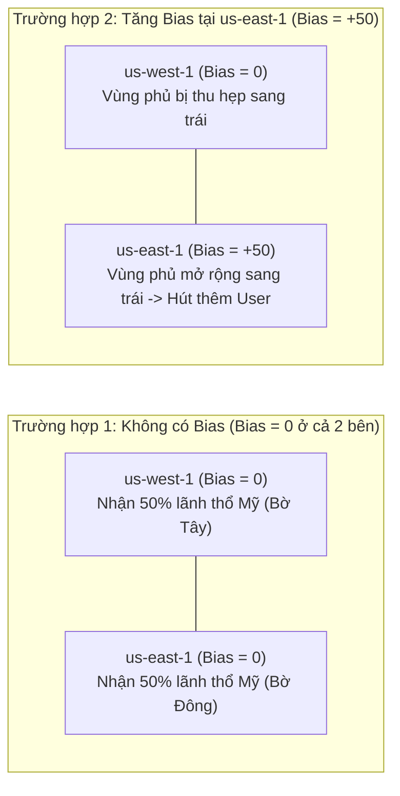

# Bài 115: Routing Policy - Geoproximity (Chính sách định tuyến theo Khoảng cách địa lý & Bias)

- **Section:** Phần 10 - Route 53
- **Lecture ID:** `26099214`
- **Video:** `SAA_-_Route_53_-_GeoProximity_Routing_v1.mp4`
- **Thời lượng:** `03:21`
- **Cheat sheet:** [topics/aws_route53.html](../../topics/aws_route53.html)

---

## 1. Kiến thức trọng tâm (Exam Notes)

### 1.1. Cơ chế hoạt động của Geoproximity Routing Policy
- Điều hướng lưu lượng tới tài nguyên dựa trên vị trí địa lý của **cả người dùng (Users) lẫn tài nguyên (Resources)**.
- Điểm đặc trưng cốt lõi (từ khóa thi SAA-C03): Cho phép **dịch chuyển lưu lượng (shift traffic)** từ khu vực này sang khu vực khác bằng cách điều chỉnh hệ số **`Bias`**:
  - **Tăng Bias (`Bias > 0`, từ `1` đến `99`):** Mở rộng (Expand) vùng ảnh hưởng địa lý để **thu hút thêm nhiều lưu lượng (more traffic)** về tài nguyên đó.
  - **Giảm Bias (`Bias < 0`, từ `-1` đến `-99`):** Thu hẹp (Shrink) vùng ảnh hưởng địa lý để **giảm bớt lưu lượng (less traffic)** tới tài nguyên đó.
- **Loại tài nguyên hỗ trợ:**
  - **AWS Resources:** Chỉ cần chọn **AWS Region** nơi đặt tài nguyên.
  - **Non-AWS Resources (ví dụ: On-premises Data Center):** Chỉ định tọa độ **Vĩ độ (`Latitude`) và Kinh độ (`Longitude`)**.
- **Yêu cầu công cụ:** Để dùng tính năng Geoproximity, bạn phải sử dụng **Route 53 Traffic Flow** (tính năng nâng cao có trả phí).

---

## 2. Phụ đề chi tiết theo mốc thời gian (Full Transcript & Timestamps)

| Thời gian | Nội dung lời giảng gốc (English) | Bản dịch tiếng Việt sát nghĩa |
|---|---|---|
| `00:00:00` | So now, let's talk about another feature which is called Geoproximity Routing. And it can be a little bit confusing but I will try to explain with diagrams in the very next slide to make it clear. | Bây giờ hãy nói về một tính năng khác có tên là **Geoproximity Routing**. Khái niệm này có thể hơi dễ gây nhầm lẫn nên tôi sẽ giải thích kèm sơ đồ trực quan ngay ở slide tiếp theo. |
| `00:00:09` | So this allows you to route traffic to your resources based on the geographic location of your users and resources. | Chính sách này cho phép bạn định tuyến lưu lượng tới tài nguyên dựa trên vị trí địa lý của **cả người dùng (users) và tài nguyên (resources)**. |
| `00:00:16` | So the idea is that with this policy, you're able using a number called the bias to shift more traffic to resources based on specific locations. | Ý tưởng cốt lõi là với chính sách này, bạn có thể dùng một con số gọi là hệ số độ lệch (**Bias**) để dịch chuyển thêm lưu lượng về các tài nguyên dựa trên vị trí. |
| `00:00:28` | So the idea is that to change the size of a geographic location, you need to specify a bias value. If you want more traffic to go to a specific resource, you expand the bias value by increasing it. | Để thay đổi kích thước vùng phủ địa lý của một tài nguyên, bạn chỉ định giá trị **Bias**: nếu muốn **tăng lưu lượng** tới một tài nguyên, bạn mở rộng vùng phủ bằng cách **tăng giá trị Bias (số dương)**. |
| `00:00:40` | And if you want less traffic to go to your resource, you shrink it, you decrease the bias values to a negative number. | Ngược lại, nếu muốn **giảm lưu lượng** tới tài nguyên đó, bạn thu hẹp vùng phủ bằng cách **giảm giá trị Bias xuống số âm**. |
| `00:00:47` | So the resources can be resources from AWS, in which case you specify the region they're in and automatically AWS will compute the correct routing. | Các tài nguyên đích có thể là **tài nguyên AWS** — khi đó bạn chỉ cần chỉ định **AWS Region** chứa tài nguyên và AWS sẽ tự động tính toán định tuyến. |
| `00:00:56` | Or if they are non-AWS resources such as your on-premises data center. Then, you will just need to specify the latitude and longitude, so that AWS knows where they are right now. | Hoặc nếu đó là **tài nguyên ngoài AWS (Non-AWS resources)** như trung tâm dữ liệu tại chỗ (On-premises Data Center), bạn chỉ cần khai báo tọa độ **Vĩ độ (`Latitude`) và Kinh độ (`Longitude`)** để AWS biết vị trí của chúng. |
| `00:01:07` | And to use this feature, you need to use the advanced Route 53 Traffic Flow to be able to leverage the bias. | Để sử dụng được tính năng Geoproximity này, bạn bắt buộc phải dùng công cụ nâng cao **Route 53 Traffic Flow**. |
| `00:01:14` | So the diagram should make everything more simple. And to me, this is what you should remember. | Hãy nhìn vào sơ đồ này — đây là phần giúp bạn nhớ dễ nhất cho kỳ thi. |
| `00:01:18` | So let's take an example of a resource in us-west-1, and one resource in us-east-1. And the bias is set to zero in both regions. | Giả sử chúng ta có một tài nguyên ở `us-west-1` (Bờ Tây nước Mỹ) và một tài nguyên ở `us-east-1` (Bờ Đông nước Mỹ), với hệ số **Bias = 0** ở cả hai Region. |
| `00:01:31` | So that means that if you have users all around the US trying to access these resources, there's going to be a line dividing the US into two, and users left of that line will go to us-west-1, and users right of that line will go to us-east-1. | Khi có người dùng trên khắp nước Mỹ truy cập, sẽ có một đường ranh giới chia đôi nước Mỹ ở chính giữa: người dùng ở bên trái vạch chia sẽ đi về `us-west-1`, còn người dùng ở bên phải vạch chia sẽ đi về `us-east-1`. |
| `00:01:48` | Now, this is simple, this is when there is no bias, okay? And this looks like going to the closest resource region based on the user location. | Đó là khi không có Bias (`Bias = 0`), người dùng đơn thuần đi tới Region gần vị trí địa lý của họ nhất. |
| `00:01:56` | But thanks to the bias, we can have the same setup but a different way to have the users routed to different regions. So let's take an example. We have us-west-1 and us-east-1, and the bias is set to zero in us-west-1, but we're going to have a positive bias of 50 in us-east-1. | Nhưng nhờ có **Bias**, vẫn với hai Region đó, nếu chúng ta giữ `Bias = 0` tại `us-west-1` và đặt **Bias dương `+50`** tại `us-east-1`: |
| `00:02:16` | And we've seen that the bias makes more users and more traffic go to that resource. Why? Well, because of the bias now the dividing line between the two resources is going to be a little bit more to the left because of the higher bias of us-east-1. | Lúc này đường ranh giới phân chia giữa hai Region sẽ bị **đẩy dịch sang bên trái (về phía Tây)** do `us-east-1` có Bias cao hơn! |
| `00:02:32` | And so what that means is that the users left of that line can go to us-west-1, but the users right of that line will go to us-east-1. | Kết quả là vùng phủ của `us-east-1` phình to ra, thu hút thêm nhiều người dùng ở khu vực miền Trung nước Mỹ về `us-east-1`, trong khi chỉ những người ở sát Bờ Tây mới đi vào `us-west-1`. |
| `00:02:41` | So why do we do this? Well, for example, you would set your resources all around the world and say you needed to shift more traffic to a specific region. What you would do is that you will use a Geoproximity Routing Policy to increase the bias in that specific region. | Vậy khi nào chúng ta dùng tính năng này? Đó là khi bạn có các tài nguyên đặt ở nhiều Region và muốn **dịch chuyển lưu lượng (shift traffic)** từ Region này sang Region khác bằng cách tăng hệ số **Bias** ở Region muốn nhận thêm tải. |
| `00:03:02` | So what you need to remember going into an exam is that the Geoproximity Routing is really helpful when you need to shift traffic from one region to another, by increasing the bias. Okay? | Hãy nhớ kỹ từ khóa cho kỳ thi: **Geoproximity Routing** là đáp án khi đề bài yêu cầu **dịch chuyển lưu lượng giữa các khu vực địa lý bằng cách thay đổi hệ số Bias**. |
| `00:03:13` | So hopefully the diagrams helped you make more sense of the Geoproximity Routing Policy. I hope you liked this lecture, and I will see you in the next lecture. | Hy vọng sơ đồ trên đã giúp bạn hiểu rõ về Geoproximity Routing Policy. Hẹn gặp lại trong bài giảng tiếp theo. |
