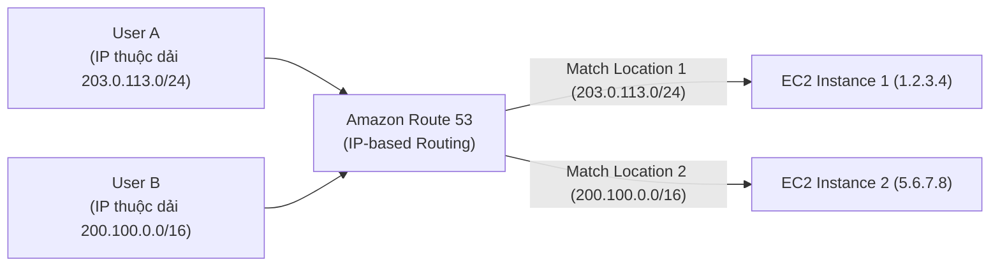

# Bài 116: Routing Policy - IP-based (Chính sách định tuyến dựa trên Địa chỉ IP của Client)

- **Section:** Phần 10 - Route 53
- **Lecture ID:** `37045728`
- **Video:** `SAA_-_Route_53_-_Routing_IP_Based_v1.mp4`
- **Thời lượng:** `01:45`
- **Cheat sheet:** [topics/aws_route53.html](../../topics/aws_route53.html)

---

## 1. Kiến thức trọng tâm (Exam Notes)

### 1.1. Cơ chế hoạt động của IP-based Routing Policy
- Định tuyến lưu lượng dựa trên **địa chỉ IP của phía Client (Client IP addresses)** thông qua danh sách các dải **CIDR blocks** do bạn định nghĩa trong Route 53.
- Bạn tạo các bộ sưu tập dải mạng (**CIDR Locations**), sau đó ánh xạ từng CIDR block tới Endpoint/IP đích tương ứng trong bản ghi DNS.
- **Use Cases điển hình:**
  - **Tối ưu hóa hiệu năng (Optimize performance)** và **giảm chi phí mạng (Reduce network costs)** khi bạn đã biết trước các dải IP của khách hàng hoặc của các nhà cung cấp dịch vụ Internet (ISP) cụ thể và muốn điều hướng thẳng họ tới máy chủ tối ưu nhất cho mạng ISP đó.

---

## 2. Phụ đề chi tiết theo mốc thời gian (Full Transcript & Timestamps)

| Thời gian | Nội dung lời giảng gốc (English) | Bản dịch tiếng Việt sát nghĩa |
|---|---|---|
| `00:00:00` | So now let's talk about another routing policy called the IP-based Routing which is very intuitive to think about because you're going to define the routing based on the client IP addresses. | Bây giờ hãy nói về một chính sách định tuyến khác có tên là **IP-based Routing** (Định tuyến dựa trên IP) — một cơ chế rất trực quan vì bạn định nghĩa luồng định tuyến dựa trên **địa chỉ IP của Client**. |
| `00:00:10` | In Route 53, you're going to define a list of CIDRs, they are IP ranges for your clients, and you're going to say, based on the CIDR which location the traffic should be sent to. | Trong Route 53, bạn định nghĩa một danh sách các dải **CIDRs** (các dải địa chỉ IP của khách hàng/client), và quy định rõ với mỗi dải CIDR thì lưu lượng sẽ được gửi tới Endpoint nào. |
| `00:00:21` | So the use cases will be to optimize performance because you know the IP ahead of time or to reduce network costs because you know where the IPs are coming from. | Các trường hợp sử dụng chính là để **tối ưu hóa hiệu năng** (do bạn biết trước các dải IP của người dùng) hoặc để **giảm chi phí mạng** vì bạn biết chính xác lưu lượng từ các dải IP đó xuất phát từ đâu. |
| `00:00:29` | So an example is that if you know that you have a specific internet provider and they are using a specific CIDR of IP addresses you can route them to a specific endpoint thanks to this strategy. | Ví dụ: nếu bạn biết một nhà cung cấp dịch vụ Internet (ISP) cụ thể đang sử dụng một dải CIDR nhất định, bạn có thể điều hướng toàn bộ người dùng thuộc ISP đó tới một Endpoint chuyên biệt nhờ chiến lược này. |
| `00:00:41` | So let's go for an example. In Route 53, I'm going to define two locations with two different CIDR blocks. As you can see, one starts with 203 and the other one starts with 200 and the defined IP ranges. | Hãy xem ví dụ minh họa: trong Route 53, tôi định nghĩa 2 vị trí (`Location_1` và `Location_2`) tương ứng với 2 dải CIDR blocks khác nhau (một dải bắt đầu bằng `203...` và một dải bắt đầu bằng `200...`). |
| `00:00:54` | Now we are going to link these locations to a specific record. So for example.com we're going to have location one, so the first CIDR block to send to the value 1.2.3.4, and the second location, the CIDR block number two, to send it to 5.6.7.8. | Sau đó chúng ta liên kết các Locations này vào bản ghi của `example.com`: `Location_1` (dải CIDR thứ nhất) sẽ trả về giá trị IP `1.2.3.4`, còn `Location_2` (dải CIDR thứ hai) sẽ trả về giá trị IP `5.6.7.8`. |
| `00:01:10` | And these represent the public IP of two EC2 instances. Now, as you would expect, if a user comes in with a specific IP that is part of the location one CIDR block, they will be directed to the first EC2 instance of IP 1.2.3.4, | Hai giá trị đó là Public IP của 2 EC2 instances. Khi User A truy cập từ một địa chỉ IP nằm trong dải CIDR của `Location_1`, họ sẽ được điều hướng tới EC2 instance thứ nhất có IP `1.2.3.4`; |
| `00:01:26` | and the user B, with a second IP address that belongs to the location two, will be redirected and will have a DNS query response to the EC2 instance of IP 5.6.7.8. | còn User B có địa chỉ IP thuộc dải CIDR của `Location_2` sẽ nhận được phản hồi DNS trỏ tới EC2 instance thứ hai có IP `5.6.7.8`. |
| `00:01:39` | And that's it for IP based routing. It's very simple and I hope you liked it. I will see you in the next lecture. | Đó là toàn bộ về IP-based Routing. Rất đơn giản và dễ hiểu, hẹn gặp lại bạn trong bài giảng tiếp theo. |
