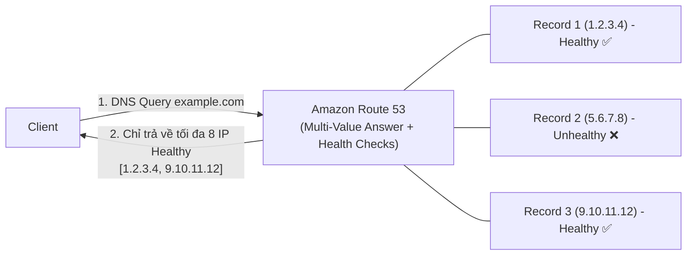

# Bài 117: Routing Policy - Multi Value (Chính sách định tuyến Đa giá trị có kiểm tra sức khỏe)

- **Section:** Phần 10 - Route 53
- **Lecture ID:** `13528210`
- **Video:** `SAA_-_Route_53_-_Routing_Multivalue_v2.mp4`
- **Thời lượng:** `03:42`
- **Cheat sheet:** [topics/aws_route53.html](../../topics/aws_route53.html)

---

## 1. Kiến thức trọng tâm (Exam Notes)

### 1.1. Cơ chế hoạt động của Multi-Value Answer Routing Policy
- Sử dụng khi bạn muốn định tuyến lưu lượng tới **nhiều tài nguyên (multiple resources)** và muốn Route 53 trả về **nhiều giá trị IP khỏe mạnh (healthy resources)**.
- **Điểm khác biệt cốt lõi so với Simple Routing (Multiple Values):**
  - **Simple Routing** với nhiều giá trị **KHÔNG hỗ trợ Health Checks** -> nếu 1 máy chủ bị sập, IP của nó vẫn bị trả về cho Client.
  - **Multi-Value Answer** **HỖ TRỢ gắn Health Checks** cho từng bản ghi độc lập -> Route 53 chỉ trả về các bản ghi đang ở trạng thái **Healthy**!
- **Giới hạn trả về:** Trả về tối đa **8 bản ghi khỏe mạnh (up to 8 healthy records)** cho mỗi truy vấn Multi-Value.
- **Lưu ý quan trọng:** Multi-Value Answer thực chất là cân bằng tải phía máy khách (**client-side load balancing**), **KHÔNG phải là giải pháp thay thế cho Elastic Load Balancer (ELB)**.

---

## 2. Phụ đề chi tiết theo mốc thời gian (Full Transcript & Timestamps)

| Thời gian | Nội dung lời giảng gốc (English) | Bản dịch tiếng Việt sát nghĩa |
|---|---|---|
| `00:00:00` | Let's talk about the last routing policy, which is Multi-Value, which is going to be used when you want to route traffic to multiple resources. And Route 53 will therefore return multiple values or resources. | Hãy nói về chính sách định tuyến tiếp theo là **Multi-Value**, được sử dụng khi bạn muốn định tuyến lưu lượng tới nhiều tài nguyên và để Route 53 trả về nhiều giá trị/tài nguyên cùng lúc. |
| `00:00:10` | Now, you can associate them with Health Checks, and so therefore the only resources returned via the Multi-Value policy are going to be the ones that are associated with a healthy Health Check. | Bạn **có thể liên kết chúng với các Health Checks**, nhờ đó những tài nguyên duy nhất được trả về qua chính sách Multi-Value sẽ chỉ là những tài nguyên đang có Health Check khỏe mạnh (**Healthy**). |
| `00:00:20` | So up to eight healthy records are going to be returned for each Multi-Value query. | Tối đa **8 bản ghi khỏe mạnh (up to 8 healthy records)** sẽ được trả về cho mỗi truy vấn Multi-Value. |
| `00:00:25` | And although it looks like an ELB, it's not a substitute for having an ELB. The idea is that it's a client-side load balancing. | Mặc dù nhìn có vẻ giống ELB, nhưng nó **không phải là sự thay thế cho một chiếc ELB**. Bản chất của nó là cân bằng tải ở phía máy khách (**client-side load balancing**). |
| `00:00:31` | So let's look at an example. We are going to set up multiple A Records for our example.com, and we associate them with Health Checks. | Hãy xem một ví dụ: chúng ta thiết lập nhiều bản ghi A cho `example.com` và gắn từng bản ghi với một Health Check. |
| `00:00:38` | So when a Multi-Value query is done by our clients, it's going to receive up to eight records back, and then the clients will choose one of them. | Khi Client thực hiện truy vấn Multi-Value, nó sẽ nhận về tối đa 8 bản ghi, rồi trình duyệt của Client sẽ tự chọn ngẫu nhiên 1 bản ghi trong số đó. |
| `00:00:45` | But at least by combining this with Health Checks, we know that one of the eight records being returned, or up to eight, are going to be healthy. And therefore the client can have very safe queries into them. | Nhưng nhờ kết hợp với Health Checks, chúng ta đảm bảo được rằng tất cả các bản ghi được trả về (tối đa 8 cái) đều đang khỏe mạnh, giúp Client kết nối an toàn. |
| `00:00:59` | This is going to be different, for example, when you have a simple routing with multiple values in it, because as you know, the simple routing policy does not allow for Health Checks, and therefore it's possible that one of the resources returned in the query of a simple routing policy will be unhealthy. | Điều này hoàn toàn khác với việc dùng Simple Routing chứa nhiều giá trị, bởi vì như bạn đã biết, Simple Routing **không cho phép gắn Health Checks**, nên rất có thể một trong các địa chỉ IP trả về cho Client lại là một máy chủ đã bị sập (unhealthy). |
| `00:01:15` | This is why Multi-Value are a little bit more powerful as types of records. So let's have a look in the UI at how we can test them. | Đó là lý do vì sao bản ghi Multi-Value mạnh mẽ hơn. Hãy vào giao diện Console để kiểm thử. |
| `00:01:22` | So let's practice the Multi-Value record. So let's go and create a multi-record, so `multi.stephanetheteacher.com`. And then the value of it is going to be linked to us-east-1. | Tạo bản ghi mới với tên `multi.stephanetheteacher.com`, giá trị đầu tiên là IP của instance tại `us-east-1`. |
| `00:01:36` | So I will add this value here, and then the Routing policy is going to be Multivalue answer. The Health check is going to be us-east-1. And the Record ID is going to be US. And TTL is going to be 60 seconds. | Chọn **Routing policy** là **Multivalue answer**, gắn **Health check** `us-east-1`, đặt **Record ID** là `US` và **TTL** là `60` giây. |
| `00:01:46` | Let's add another Record. So, multi, and again, we're going to route to a different region, so this one is ap-southeast-1. So the answer is Multivalue answer. The Health check is ap-southeast-1. And the Record ID is going to be Asia. And then the record TTL is one minute. | Nhấn **Add another record** với tên `multi.stephanetheteacher.com`, giá trị là IP của `ap-southeast-1`, chính sách **Multivalue answer**, gắn Health check `ap-southeast-1`, **Record ID** là `Asia`, **TTL** là 1 phút. |
| `00:02:05` | And then finally, the last one, so again, one more Record name. The Value is going to be linked to eu-central-1 right here. The TTL is one minute. And the Routing policy is Multivalue answer. And for the Health checks, we're going to use the one from eu-central-1. And the Record ID is EU. | Và bản ghi thứ ba cho `eu-central-1`: dán IP tại Frankfurt, TTL 1 phút, chính sách **Multivalue answer**, gắn Health check `eu-central-1` và **Record ID** là `EU`. |
| `00:02:26` | Okay, so let's create these records. And the records are successfully created. Now let's test it out. | Nhấn **Create records**. Cả 3 bản ghi đã được tạo thành công. Giờ hãy kiểm tra trên CloudShell. |
| `00:02:33` | So for this, we're going to use our CloudShell in here... And so if I test a dig on this, then I get three answers. So the three IPs are returned, and the reason is, well, the three health checks are fully working. | Khi chạy lệnh `dig multi.stephanetheteacher.com` trên CloudShell, tôi nhận được **3 câu trả lời (3 địa chỉ IP)** trong mục ANSWER SECTION, bởi vì cả 3 Health Checks hiện đều đang ở trạng thái **Healthy**. |
| `00:02:57` | So as you can see, they're all healthy. But if I take one of them, for example, I take the eu-central-1, so I'm gonna make this one unhealthy, and I'm just going to trick it by editing and do an Invert health check status. | Bây giờ tôi sẽ làm cho một Health Check — ví dụ `eu-central-1` — chuyển sang trạng thái **Unhealthy** bằng mẹo nhanh là bấm **Edit** Health Check đó và tích chọn **Invert health check status** (đảo ngược trạng thái). |
| `00:03:08` | So this is going to make the healthy unhealthy, and vice versa. It's just a quick way for me to create an unhealthy health check. So let me pause right now. | Tùy chọn này biến trạng thái Healthy thành Unhealthy ngay lập tức mà không cần sửa Security Group. |
| `00:03:16` | Okay, so now my eu-central-1 health check is Unhealthy. And so if I reissue a dig command right here, I should expect to see only two values, yes, as a result. | Hiện tại Health Check `eu-central-1` đã báo **Unhealthy**. Khi tôi quay lại CloudShell và chạy lại lệnh `dig multi.stephanetheteacher.com`, kết quả chỉ còn trả về **2 địa chỉ IP** (của `us-east-1` và `ap-southeast-1`)! |
| `00:03:29` | So the Multivalue answer has worked, and it worked really well. So just to revert this, edit this health check, and let's untick this Invert health check status, and we're good to go. | Như vậy Multivalue Answer đã tự động loại bỏ IP bị lỗi ra khỏi phản hồi DNS. Cuối cùng tôi bỏ tích **Invert health check status** để khôi phục lại như cũ. |
| `00:03:37` | Okay, so that's it for this lecture. I hope you liked it. And I will see you in the next lecture. | Đó là toàn bộ bài học này. Hẹn gặp lại bạn ở bài giảng tiếp theo. |
