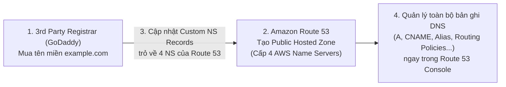

# Bài 118: 3rd Party Domains & Route 53 (Sử dụng tên miền bên thứ 3 với Route 53)

- **Section:** Phần 10 - Route 53
- **Lecture ID:** `13528212`
- **Video:** `SAA_-_Route_53_-_3rd_party_registar_v2.mp4`
- **Thời lượng:** `02:24`

---

## 1. Kiến thức trọng tâm (Exam Notes)

### 1.1. Phân biệt Domain Registrar và DNS Service Provider
- **Domain Registrar (Nhà đăng ký tên miền):** Nơi bạn mua và trả phí duy trì tên miền hàng năm (ví dụ: GoDaddy, Namecheap, Google Domains, Amazon Registrar...).
- **DNS Service Provider (Nhà cung cấp dịch vụ DNS):** Hệ thống quản lý các bản ghi DNS (Hosted Zone) và phản hồi truy vấn phân giải tên miền (ví dụ: Amazon Route 53, Cloudflare DNS...).
- Mặc dù hầu hết các Domain Registrar đều đi kèm sẵn dịch vụ DNS, bạn **hoàn toàn có thể tách rời hai vai trò này**:
  - Mua tên miền trên nhà đăng ký bên thứ 3 (như **GoDaddy**), nhưng dùng **Amazon Route 53** làm DNS Service Provider.
  - Hoặc ngược lại: mua tên miền trên Amazon Registrar nhưng dùng DNS của bên thứ 3.

### 1.2. Các bước sử dụng tên miền mua ở Bên thứ 3 (GoDaddy) với Route 53 (Rất hay hỏi trong đề thi SAA-C03)
1. Mua/đăng ký tên miền (ví dụ `example.com`) trên nhà đăng ký bên thứ 3 (GoDaddy).
2. Vào **Amazon Route 53** -> Tạo một **Public Hosted Zone** cho tên miền `example.com`.
3. Lấy danh sách **4 Name Servers (`NS` records)** mà Route 53 cấp cho Public Hosted Zone đó.
4. Quay lại trang quản trị của **nhà đăng ký bên thứ 3 (GoDaddy)** -> Cập nhật mục **Custom Name Servers (`NS` records)** trỏ về **4 Name Servers của Route 53**.

---

## 2. Phụ đề chi tiết theo mốc thời gian (Full Transcript & Timestamps)

| Thời gian | Nội dung lời giảng gốc (English) | Bản dịch tiếng Việt sát nghĩa |
|---|---|---|
| `00:00:00` | So we need to make the distinction between a domain registrar and a DNS service. | Chúng ta cần phân biệt rõ sự khác nhau giữa **Domain Registrar** (Nhà đăng ký tên miền) và **DNS Service** (Dịch vụ DNS). |
| `00:00:05` | So actually you can buy your domain name with any kind of domain registrar you want, and you're going to pay annual charges. | Bạn có thể mua tên miền từ bất kỳ nhà đăng ký tên miền (Domain Registrar) nào bạn muốn và trả phí duy trì hàng năm. |
| `00:00:11` | So the way we did it so far in this course was to use the Amazon Registrar, through the Route 53 console, but it's possible for you to use any domain name registrar. So for example, you can use GoDaddy, you can use Google Domains, and so on. | Từ đầu chương đến giờ chúng ta đã dùng Amazon Registrar thông qua giao diện Route 53 Console, nhưng trong thực tế bạn có thể dùng bất kỳ nhà đăng ký nào như **GoDaddy**, **Google Domains**, v.v. |
| `00:00:24` | And usually whenever you register a domain with a domain registrar, they will provide you as well with a DNS service to manage your DNS records. | Thông thường, mỗi khi bạn đăng ký tên miền tại một Domain Registrar, họ cũng cung cấp kèm một dịch vụ DNS để quản lý các bản ghi DNS của bạn. |
| `00:00:32` | So when we registered a DNS name with Amazon, we had a Route 53 hosted zone to manage our DNS records. | Khi chúng ta đăng ký tên miền với Amazon, chúng ta có sẵn một Route 53 Hosted Zone để quản lý các bản ghi DNS. |
| `00:00:43` | But it's possible for you to choose not to use, for example, AWS Route 53 as your DNS records, when you have registered your domain with Amazon Registrar. | Tuy nhiên, bạn hoàn toàn có thể chọn không dùng Route 53 làm dịch vụ DNS ngay cả khi đã mua tên miền qua Amazon Registrar. |
| `00:00:52` | Or vice versa, you can, for example, register your domain with GoDaddy. So you're going to purchase example.com, yet you're going to use Amazon Route 53 to manage your DNS records. It's a perfectly acceptable combination. | Hoặc ngược lại — và đây là trường hợp rất phổ biến: bạn mua tên miền `example.com` trên **GoDaddy**, nhưng lại sử dụng **Amazon Route 53** để quản lý toàn bộ các bản ghi DNS của mình. |
| `00:01:05` | So how do we do this? Well, on GoDaddy you're going to register your domain, and then you're going to have the name servers option, and you can specify custom name servers. | Vậy làm thế nào để thiết lập mô hình đó? Trên GoDaddy sau khi mua tên miền, bạn sẽ thấy tùy chọn cấu hình **Name Servers** cho phép chỉ định **Custom Name Servers** (Máy chủ tên miền tùy chỉnh). |
| `00:01:14` | So what do we put in there? Well, first we're going to go to Amazon Route 53, and we're going to create a public hosted zone, for any domain we want. | Chúng ta sẽ điền gì vào đó? Đầu tiên, bạn vào **Amazon Route 53** và tạo một **Public Hosted Zone** trùng với tên miền bạn đã mua. |
| `00:01:22` | And then in the hosted zone details, we're going to find name servers on the right-hand side. So these four name servers are the ones we're going to have to change on the GoDaddy websites. | Trong phần chi tiết của Public Hosted Zone vừa tạo, bạn sẽ thấy **4 Name Servers (`NS`)** của AWS. Bạn lấy 4 địa chỉ Name Servers này và cập nhật vào mục Custom Name Servers trên trang web GoDaddy. |
| `00:01:31` | So that when GoDaddy answers a query, "Hey, which name server should I use?" the name servers are going to be pointing to Amazon Route 53 name servers, and therefore we can use Amazon Route 53 to manage all the DNS records from that console. | Khi đó, bất cứ khi nào có truy vấn hỏi tên miền trên GoDaddy dùng Name Server nào, nó sẽ trỏ về các Name Servers của Amazon Route 53, và từ đó bạn có thể dùng Route 53 Console để quản lý mọi bản ghi DNS. |
| `00:01:47` | So to summarize, if you buy your domain on a third-party registrar, you can still use Route 53 as your DNS service provider. | **Tóm lại (cần nhớ cho kỳ thi):** Nếu bạn mua tên miền tại một nhà đăng ký bên thứ ba (3rd-party registrar), bạn vẫn có thể dùng Route 53 làm nhà cung cấp dịch vụ DNS (DNS Service Provider): |
| `00:01:55` | For this, you will create a public hosted zone in Route 53, and then you will update the NS, or name server's records, on the third-party website, where you bought your domain. And then you're going to point them to the Route 53 name servers. | 1) Tạo một **Public Hosted Zone** trong Route 53. 2) Cập nhật bản ghi **NS (Name Servers)** trên trang web của **nhà đăng ký bên thứ ba** để trỏ về các Name Servers của Route 53. |
| `00:02:08` | So, just so you know, a domain registrar looks like, but is different from a DNS service, even though every domain registrar usually comes with some DNS features. | Hãy luôn nhớ rằng Domain Registrar và DNS Service là hai khái niệm khác nhau, dù các nhà đăng ký tên miền thường tích hợp sẵn cả tính năng DNS. |
| `00:02:20` | So that's it for this lecture. I hope you liked it. And I will see you in the next lecture. | Đó là toàn bộ nội dung bài giảng này. Hẹn gặp lại bạn trong bài học tiếp theo. |
