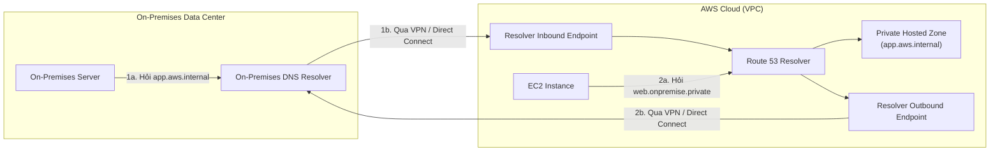

# Bài 119: Route 53 Resolvers & Hybrid DNS (Bộ phân giải Route 53 & DNS Lai giữa Cloud và On-Premises)

- **Section:** Phần 10 - Route 53
- **Lecture ID:** `51771513`
- **Video:** `SAA - Route 53 - Private Resolver v1.mp4`
- **Thời lượng:** `02:56`
- **Cheat sheet:** [topics/aws_route53.html](../../topics/aws_route53.html)

---

## 1. Kiến thức trọng tâm (Exam Notes)

> [!TIP]
> **Tóm tắt nhanh dịch vụ — Route 53 Resolver (Hybrid DNS) (SAA-C03 Cheat Sheet)**
> - **Là gì (1 câu):** Dịch vụ phân giải DNS hai chiều giữa môi trường **AWS VPC** (Private Hosted Zones) và mạng **On-Premises Data Center** thông qua kết nối VPN hoặc AWS Direct Connect.
> - **Dùng khi nào:** Kiến trúc Hybrid Cloud cần máy chủ trong mạng On-Premises phân giải được tên miền nội bộ trong AWS Private Hosted Zone và ngược lại máy chủ EC2 trong VPC phân giải được tên miền nội bộ của On-Premises DNS Server.
> - **Khác gì dịch vụ gần giống:**
>   - **Inbound Endpoint vs Outbound Endpoint:**
>     - **Inbound Resolver Endpoint:** Cho phép DNS query đi **TỪ On-Premises VÀO AWS VPC** (On-Premises DNS forwarder trỏ tới IP của Inbound Endpoint).
>     - **Outbound Resolver Endpoint + Forwarding Rules:** Cho phép DNS query đi **TỪ AWS VPC RA On-Premises** (VPC Resolver chuyển tiếp truy vấn tên miền công ty về IP của On-Premises DNS Server).
> - **Điểm hay bị hỏi:**
>   - **Giới hạn & Mặc định:** Yêu cầu phải có sẵn kết nối mạng riêng giữa On-Premises và VPC (**Site-to-Site VPN** hoặc **Direct Connect**). Để đảm bảo High Availability (HA), cần triển khai Resolver Endpoints (ENI) trên tối thiểu **2 Subnets thuộc 2 Availability Zones (AZs)** khác nhau.
>   - **Từ khóa gợi ý:** `"hybrid DNS resolution between VPC and on-premises"`, `"resolve Route 53 Private Hosted Zone from on-prem"` (Inbound Endpoint), `"resolve on-premises domain names from EC2 in VPC"` (Outbound Endpoint + Resolver Rule).

### 1.1. Route 53 Resolver mặc định trong VPC
- Mặc định trong mỗi VPC, **Route 53 Resolver** tự động trả lời các truy vấn DNS cho:
  1. Tên miền nội bộ của các EC2 instances (`ec2-...compute.internal`).
  2. Các bản ghi trong **Private Hosted Zones** gắn với VPC.
  3. Các bản ghi trên **Public Name Servers** (Internet công cộng).

### 1.2. Kiến trúc Hybrid DNS (Kết nối DNS hai chiều giữa AWS VPC và On-Premises)
Khi doanh nghiệp đã kết nối mạng giữa **On-premises Data Center** và **AWS VPC** (bằng **AWS Site-to-Site VPN** hoặc **AWS Direct Connect**) và muốn phân giải tên miền nội bộ xuyên suốt cả hai phía:

| Thành phần | Chiều phân giải DNS | Mô tả hoạt động |
|---|---|---|
| **Resolver Inbound Endpoint** | **On-Premises $\rightarrow$ AWS VPC** | Cho phép các máy chủ/DNS Resolver tại **On-premises** phân giải các tên miền nằm trong **AWS Private Hosted Zones** (ví dụ: `app.company.aws`). |
| **Resolver Outbound Endpoint** | **AWS VPC $\rightarrow$ On-Premises** | Cho phép **Route 53 Resolver trong VPC** chuyển tiếp (forward) các truy vấn DNS từ EC2 về **On-premises DNS Resolver** để phân giải tên miền nội bộ dưới mặt đất (ví dụ: `web.onpremise.private`). |

---

## 2. Phụ đề chi tiết theo mốc thời gian (Full Transcript & Timestamps)

| Thời gian | Nội dung lời giảng gốc (English) | Bản dịch tiếng Việt sát nghĩa |
|---|---|---|
| `00:00:00` | Okay, so let's have a little talk about the Route 53 Resolver. | Được rồi, hãy cùng thảo luận ngắn gọn về **Route 53 Resolver**. |
| `00:00:04` | So the idea is that by default, when you have a Route 53 Resolver, which is the basic thing you create in Route 53 when you start using it, it will answer DNS queries for the local domain names for your EC2 instances, for the records in your private hosted zones, as well as for the records in your public name server. | Mặc định, **Route 53 Resolver** trong tài khoản/VPC của bạn sẽ tự động trả lời các truy vấn DNS cho: các tên miền cục bộ của EC2 instances, các bản ghi trong **Private Hosted Zones**, cũng như các bản ghi trên **Public Name Servers** ngoài Internet. |
| `00:00:23` | So everything you create under Route 53 is going to be answered within your account. | Tức là mọi thứ bạn tạo trong Route 53 đều được giải quyết sẵn bên trong tài khoản AWS của bạn. |
| `00:00:29` | But you may want to have a situation where you want a hybrid DNS. That means that you want this resolver to resolve as well the DNS of your own network and vice versa. | Tuy nhiên, trong thực tế bạn có thể gặp tình huống cần một kiến trúc **Hybrid DNS** (DNS lai) — nghĩa là bạn muốn bộ phân giải trên AWS có thể phân giải cả các tên miền trong mạng nội bộ dưới mặt đất của công ty bạn và ngược lại. |
| `00:00:40` | So you want to establish connectivity between your AWS Cloud DNS and the DNS of your on-premises network. | Tức là bạn muốn thiết lập khả năng phân giải thông suốt giữa **AWS Cloud DNS** và **On-premises DNS**. |
| `00:00:49` | And so how do we do this? For this, we're going to use what's called a Resolver endpoint. | Làm thế nào để thực hiện điều này? Chúng ta sẽ sử dụng tính năng gọi là **Route 53 Resolver Endpoints**. |
| `00:00:52` | So this is just a simplified version, but the idea is that we're going to create an inbound endpoint that will allow the DNS resolvers of on-premises resources to resolve domain names of AWS resources. | Ở mức khái quát cho kỳ thi: đầu tiên chúng ta tạo một **Inbound Endpoint** (Điểm cuối chiều vào) cho phép các DNS Resolvers tại **On-premises** phân giải được các tên miền của tài nguyên trên **AWS**. |
| `00:01:05` | So how does that work? Say we have established our own Route 53 Resolver in our cloud and we have an EC2 instance, a private hosted zone, and we have our on-premises data center. | Cơ chế hoạt động như sau: giả sử trên AWS Cloud chúng ta có Route 53 Resolver, EC2 instance và một Private Hosted Zone; còn ở dưới mặt đất là On-premises Data Center. |
| `00:01:16` | First of all, we need to establish of course, connectivity between our data center and AWS using a VPN or a Direct Connect connection. | Trước tiên, tất nhiên chúng ta phải thiết lập kết nối mạng riêng giữa Data Center và AWS bằng **VPN** hoặc **Direct Connect**. |
| `00:01:26` | And then this server is going to do a DNS query, for example, to look for a domain name that belongs to our private hosted zone, is going to be passed to the closest DNS resolver, so the on-premises resolver, | Khi một máy chủ ở On-premises thực hiện truy vấn DNS để tìm một tên miền thuộc **Private Hosted Zone** trên AWS, truy vấn đó sẽ được gửi tới **On-premises DNS Resolver** gần nó nhất. |
| `00:01:39` | and these resolvers are going to be set up to talk to a resolver inbound endpoint, and to pass on this DNS query into our AWS Cloud. And this resolver knows how to talk to the Route 53 Resolver. | Bộ phân giải On-premises DNS Resolver này được cấu hình để nói chuyện với **Resolver Inbound Endpoint** trên AWS, chuyển tiếp truy vấn DNS vào AWS Cloud để **Route 53 Resolver** trả lời từ Private Hosted Zone. |
| `00:01:52` | So this is how you have the full chain of lookups from your on-premises data center to your cloud using an inbound endpoint. | Đó là toàn bộ chuỗi tra cứu từ trung tâm dữ liệu On-premises lên AWS Cloud thông qua **Inbound Endpoint**. |
| `00:02:01` | And of course you can do it the other way with an outbound endpoint in which your Route 53 Resolver will forward DNS queries to your resolver on-premises. | Và tất nhiên bạn có thể làm theo chiều ngược lại bằng **Outbound Endpoint** (Điểm cuối chiều ra), nơi **Route 53 Resolver** trên AWS sẽ chuyển tiếp (forward) các truy vấn DNS về cho **On-premises DNS Resolver**. |
| `00:02:10` | So again, if we have a look, we have the two infrastructures that are connected, and then we're going to have a resolver outbound endpoint. | Nhìn vào sơ đồ thứ hai: hai hạ tầng đã được kết nối mạng với nhau, và chúng ta tạo một **Resolver Outbound Endpoint** trên AWS. |
| `00:02:18` | And this time whenever your EC2 instance queries for a DNS query that is resolved on-premises, for example, web.onpremise.private, it is going to be passed through the resolver outbound endpoint to the DNS resolvers of the on-premises data center, and we'll be good to go. | Lần này, bất cứ khi nào một **EC2 instance** trên AWS truy vấn một tên miền nội bộ nằm ở On-premises (ví dụ: `web.onpremise.private`), truy vấn sẽ đi qua **Resolver Outbound Endpoint** về tới **On-premises DNS Resolver** tại trung tâm dữ liệu để lấy câu trả lời. |
| `00:02:35` | So that's it. The idea behind this, I think, a bit complicated lecture is that if you want to connect your on-premises data center and AWS and make sure the DNS queries are resolved both ways, you must use the resolver inbound and outbound endpoint. | Tóm lại, ý chính duy nhất bạn cần nhớ từ bài học này cho kỳ thi là: nếu muốn kết nối On-premises Data Center với AWS và phân giải các truy vấn DNS theo cả hai chiều, bạn phải sử dụng **Route 53 Resolver Inbound Endpoint** (On-prem -> AWS) và **Outbound Endpoint** (AWS -> On-prem). |
| `00:02:49` | And that's about it. All you should know. All right, that's it for this lecture. I hope you liked it, and I will see you in the next lecture. | Đó là tất cả những gì bạn cần nắm vững. Hẹn gặp lại bạn ở bài giảng tiếp theo. |
